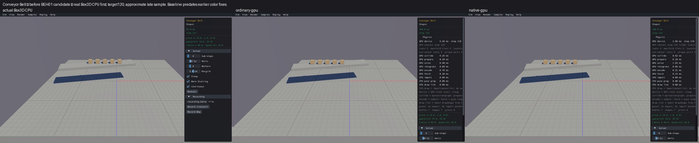
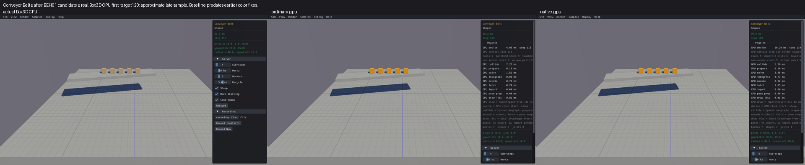

# Published evidence: BEH01

**Verified repair.** Final milestone:21 fixed,1 resolved without repair,0 open;165 native samples reviewed,0 left. PR04 physical failures remain open.

This is a portable extract of the original report, SHA256 `9dda5e3ae1d0729549279eca20007b5aea644476f94da1bd1a281acf2cdd2757`. Original milestone-time counts and scope statements below are historical; current PR09 acceptance/routing is in the [publication overview](../README.md). Selected original screenshots are byte-identical. Additional per-scene clips, full raw outputs, protocols and failure inputs remain in the local capture/audit archive; their links are explicitly labeled rather than published as broken paths.

# BEH01 — Conveyor Belt surface velocity

Status: VERIFIED/CLOSED. Both affected scenes and selected physical/calculation/lifecycle gates pass. Overall10 fixed,0 resolved,12 open; original165 samples reviewed,0 left. Final scene comparisons2 done,0 left. BEH01 is checked; PR09 and the overall repair goal remain unfinished. Box3D/WASM/defaults/geometry/public identities unchanged; no new commit/push authorization.

The actual Box3D belt sample supplies local surface velocity `[2,0,0]` on a platform yawed0.2. Native CPU first contacts at step31 have world velocity `[1.95911252,0,-0.40234074]`; ordinary/native GPU fresh convex contacts instead retained the zero from `empty_contact`. The friction solver already subtracts `contact.tangent_velocity`. The defect was a missing contact material write.

The candidate writes world-space A material velocity minus B, using the actual body quaternions already loaded in contact finalization. Geometry-axis capsule rotations must not rotate body-local material vectors. The first artifact used collider rotations: actual Y/Z capsule checks failed8/28. Corrected body rotations pass all28 checks at the unchanged absolute1e-5 limit. Mesh triangle averaging remains unchanged.

The smallest demonstrated capsule input uses native body quaternions `[0,.101103246,0,.994875908]` and `[0,.234432638,0,.972132385]`, and local materials `[1.3,.4,-.2]`/`[-.7,.3,.9]`. Native output is `[1.44602764,.099999994,-1.5775665]`; the rejected Y-capsule collider frame produced `[1.0899947,1.0999999,-1.3952469]`. The corrected actual shader output agrees with native. Raw CPU read-only solver observations and production GPU contact trace streams are retained, without zero-time contact seeding.

| Check | Evidence/status |
| --- | --- |
| Exact native setup/contact boundary | Native CPU/current GPU baseline (local capture/audit archive): identical material/default/5 initial body records;20 GPU zero vectors, native first contact31 |
| Material coordinate frames | Final28 checks (local capture/audit archive): sphere,capsuleX/Y/Z,box,general hull × two endpoint orders; two zero-material guards/backend PASS1e-5 |
| Native-default belt transport | Focused acceptance (local capture/audit archive): all10 GPU final boxes supported5.75±.01m, awake, velocity within.01m/s of native surface velocity;advance>2m; IDs/generations preserved |
| Zero-material friction | Existing240step test PASS bothbackends; stopping distance.39576817m, frictionless position error.000006198883m; original assertions unchanged |
| Support and energy | Existing600step test PASS bothbackends; peak overlap.0009977221m, energy gain0J/kg, tail speed0; original assertions unchanged |
| Material setters/cache/lifecycle | Twelve actual GPU contact observations match native CPU. Set/get succeeds; cached vectors stay unchanged until contact refresh on both engines. Retired handles invalid, active handles valid. Native reuses shape slots/generations; GPU appends fresh shape IDs, correctly mapped by logical role. No guessed cross-engine allocator equality |
| Affected native scenes | Source inventory has only135Conveyor Belt and136Conveyor Mesh tangent-velocity registrations.135 and136 PASS CPU/ordinary/native/combined120steps; ten selected completed display cells. Other163 native scenes are explicitly UNREVIEWED_ON_FINAL_BEH01_CANDIDATE; their original full survey remains complete. |

Actual sampled screenshots: CPU first, ordinary GPU, native GPU. Targets120, approximate late clip sample; exact pixels/trajectory matching is outside this repair. Original baseline predates the already-closed rendering/color repairs; this report judges belt motion.

Before:

After candidate:

CPU-first before/after clip grid (local capture/audit archive). Mesh guard screenshots, same realCPU/ordinary/native order, targets120 and approximate late samples:

Mesh guard individual review (local capture/audit archive). Both combined routes are included in the five-column Belt review (local capture/audit archive), before sheet (local capture/audit archive) and after sheet (local capture/audit archive).

Candidate WGSL SHA256 `4786c0cab0d0017413cac1046b7e07c1381e76f83b3e617cb6618d750d2aa690`; ordinary archive `6a2bb51dcc9ce2c1c5723db7efb217f9f50b23400ab97b59ebde673bb27f66fc`, native archive `f220997064e80aa19ae8b40ba7cbdc6a9c9e161184b1abfbf5f67a9462e5f940`. The exact verified candidate is now retained in the production shader after the pre-retention audit; its previous source remains preserved. Exact build/fixture/link pins are in each protocol and receipt.

Original failed CPU header/observer compile, missing optional export link, recorder output-path/incomplete aggregate, offline helper/path/identity assertions, shader alias prelaunch, copied test permissions, combined renderer archive substitution and pre-engine count API errors are retained. Corrected checks use actual original outputs; no completed engine check was repeated. The rejected capsule-frame candidate remains archived.

The first136 capture budget produced three90second GPU startup timeouts and a host resource-unavailable media probe; no physics start was observed. The actual screen reports `collide_pairs` shader compilation. A separate exact native constructor/prepare-loading diagnostic uses22 bodies and0 physics steps: ordinary129.555s and native127.539s collision compilation complete. Original failed clips remain retained. Four distinct warmcache confirmations complete all previously incomplete/unlaunched GPU views in19–25s; successfulCPU136/Belt135 captures are reused. LatestVIS0230step baseline clips were excluded because belt first contact is31; original reviewed120step media is used instead.

Limits: single focused checks and short120step scene views; no five-run full-state repeatability, long conveyor circulation, arbitrary mesh/capsule material combinations, controls, dragging physics, cold-start/FPS/performance or full release qualification. All separate physics/runtime/performance findings remain open. PR09 stays unchecked; the22-item goal remains ACTIVE.

Final pre-retention evidence audit (local capture/audit archive) PASS11.746s:43 successful producer operations,1252 source/output pins,21 compiler dependencies,163 unchanged linked inputs,196 media pins and73 absent original producer PIDs. Ten selected120step display cells complete with clear recorded health. Verified retention receipt (local capture/audit archive) maps the exact tested WGSL to the retained source. Failed parent campaigns remain failed; the successful corrected checks are linked separately.
