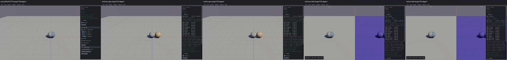
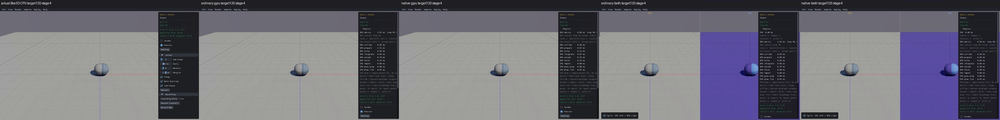

# Published evidence: BEH02

**Verified repair.** Final milestone:21 fixed,1 resolved without repair,0 open;165 native samples reviewed,0 left. PR04 physical failures remain open.

This is a portable extract of the original report, SHA256 `25cfcf23b4f08251ec8b74c742d22c8e0b458a55a4fd3a91fa1669104204b836`. Original milestone-time counts and scope statements below are historical; current PR09 acceptance/routing is in the [publication overview](../README.md). Selected original screenshots are byte-identical. Additional per-scene clips, full raw outputs, protocols and failure inputs remain in the local capture/audit archive; their links are explicitly labeled rather than published as broken paths.

# BEH02 — Passive static contact creation repaired

**11 fixed,0 resolved,11 open;165 original native samples reviewed,0 left. BEH02 verified and retained locally.** The goal remains active and PR09 unchecked. No new commit/push.

In default Passive mode, native Shapes/Static Invoke143 inserts a static sphere after step20 with `invokeContactCreation=false`. Real Box3D leaves the overlapping dynamic sphere atX=.25. Before repair, standalone GPU created a separating contact: the first frozen boundary movedX to.300000012, and the default120-step replay ended atX=.99999547. Actual CPU/GPU reproduction and inputs (local capture/audit archive), baseline records (local capture/audit archive).

The smallest fixture holds identical centers `[.25,.5,0]` and `[0,.5,0]`, radius.5, initial velocity0, timestep1/60 and four substeps. Only this diagnostic stationary fixture sets gravityScale0; actual native sample replays and viewers preserve gravity, material, geometry and defaults. The CPU trace reports **zero moved proxies** at passive insertion and0 contacts. GPU candidate enumeration accepted the overlap anyway and created1 contact. Both the standalone C bridge and the combined `configure_gpu_shape` path dropped the creation flag, and ordinary hash/static plus native flat-matrix pair generation lacked moved-proxy eligibility. This is a creation-policy defect, not a floor geometry or solver tuning repair.

The fix forwards `invokeContactCreation` with native defaulttrue, records moved/forced state in the existing eight-word fat-bound record, and gates only fresh pairs involving passive static geometry on relevant public-proxy movement. A passive shape remains visible, queryable and collidable when a dynamic proxy later moves or escapes its fat bounds. Retained contact processing stays intact. Geometry replacement/remapping preserves the correct public identities and fat history. Explicit filter invocation retires affected contacts and queues a generation-checked proxy move after topology upload. Compound creation retains the native exception: creation alone does not force pairs even when invocation is requested. No buffer layout growth, fake bodies, scene/default changes or Box3D/WASM edits.

The independent startup repair is preserved. A clean three-way merge of the retained startup tree with the BEH02 candidate exactly matches the nine previously compiled startup-topology files; the combined forwarding addition is the previously verified C source. Final closure reused those pinned libraries/test binaries, relinked four API fixtures and two combined viewers, and ran eight backend checks. No extra Rust build was needed. Source merge proof (local capture/audit archive), final producer receipts (local capture/audit archive).

| Boundary or check | Verified result on ordinary and native GPU |
|---|---|
| Late passive insertion, same stationary inputs |0 new contacts;X=.25, matches real CPU |
| Explicit invocation / dynamic created after passive static |1 contact, matches real CPU |
| Within-fat movement, fat escape, static movement, deletion/recreation |Native creation sequences; old IDs invalid after deletion |
| Changed filter with explicit invocation |1 contact; original candidate0 failure repaired |
| Late compound creation / later movement |Creation0, later movement1; matches native compound exception |
| Six primitive/lifecycle cases, static/filter/compound/sensor cases |60 steps in10 worlds; finite states and creation/contact gates pass |
| Query and identity controls |16 valid targeted ray controls and12 stale body/shape invalidations perbackend |
| Native default Passive sample120 |X=.25,Y≈.49993,zero speed,one synchronized ground contact |
| Native explicit Invoke sample120 |X=.99999547,two synchronized contacts |
| Existing physical regressions |240-step analytical friction and600-step support/energy checks pass bothbackends; original limits unchanged |

Final boundary assessment (local capture/audit archive) covers307 API steps in15 worlds perbackend, with actual CPU references. A separate broad capsule response screen remains **FAILED at1e-5**: case1/step8 CPUY=.55 versusGPUY=.5, identical to the preceding candidate. That discrepancy was not repaired or relabeled as a pass; general hull response is also not qualified by these creation gates. The sensor fixture is only a negative/no-event guard, not positive sensor-discovery qualification. Original lifetime/setup/compile/link/identity-audit failures and cold compile timeouts remain preserved.

Before — real Box3D CPU first, then ordinary/native GPU and both combined views. The standalone GPU spheres separate despite Passive mode:

After — same column order; allfour GPU views keep the overlap likeCPU, while floor support and IDs remain intact:

| Final scene | CPU reference | Four GPU routes and review |
|---|---|---|
|143 Shapes/Static Invoke — directly affected |Actual unchanged120-step reference reused |Four fresh120-step captures, clearhealth;X=.25/Y≈.49993/speed0; body2/gen1 stable;3 instances |
|039 Collision/Long Ray Cast — query/geometry guard |Actual unchanged120-step reference reused |Four fresh120-step captures, clearhealth; five sphere/capsule/hull/mesh/heightfield shapes and green rays, displayed0% failures |
|049 Compound/Simple — compound/support guard |Fresh actual Box3D CPU120 first |Four fresh120-step captures, clearhealth; transformed slab and sphere visible; body2/gen1Y≈-.75/speed0,2 bodies/instances |

All three comparisons were actually inspected one by one and logged before continuing: **3 done,0 left**, thirteen fresh cells and two unchanged CPU cells reused. Before039 guard media targets180 steps; after120, explicitly labeled percolumn. Screenshots sample approximate elapsed stages, not identical physics ticks. Combined ordinary-state blue coloring is intentional. The sphere partly overlaps axes in049's default camera; numeric support was checked separately. GPU headline `contact_count` is explicitly marked unknown by the health contract; synchronized API contacts establish the contact counts above. All CPU-first clips and older GPU evidence (local capture/audit archive), simple review log (local capture/audit archive).

Guard before/after sheets:

Source scope reconciles all165 registrations across22 native sample source files. Only143 explicitly requests passive creation in native sample code. Shared compound/filter/proxy behavior is covered by the focused controls and the two viewer guards; **other162 scenes are explicitly unreviewed on this final candidate**, not claimed equivalent. The original full165 review remains complete. Picking UI, manual Invoke/Create/Destroy/launch-speed/ray controls, full-state repeats, long windows, generic solver response, performance and release qualification remain open. Existing query/picking code is unchanged; targeted identity/ray controls pass. Necessary first mesh-contact compilation and unused-constant cache invalidation remain open under the separate startup report.

Final audit (local capture/audit archive) passed in4.890s:1011 source/receipt pins,163 unchanged linked inputs,144 media records and59 recorded producer PIDs absent. The interruption recovery check passed3.464s/722 pins and confirmed the audit process also absent, with no build/capture repetitions. Recovery check (local capture/audit archive), verified retention (local capture/audit archive). Bounded fetch completed withHEAD/origin feat/gpu0ahead0behind; baselinec076092a remains the commit. Local documentation and all other work are preserved.

| Retained source relative to GPU experiment | SHA256 |
|---|---|
| src/types.rs | `ed9c7d9e95695aa002c32ecfe85e86f34a517db3fbe524d9fec035baeee614dc` |
| src/api/types_api.rs | `57ed6b9fa7aaee402dd8fdbdaf16e9b0558bb0bb51aa9660502e3cf5ee172dfb` |
| src/api/world.rs | `376955727fde6a8c28e87e9b87614e7fa4a9f42768eb34b4d6c040b4a0df79b8` |
| src/c_abi.rs | `9ba0dffbbede17f37edaa115e53f63bb00e66af39404486677d42e9de1ad4186` |
| c_abi/shim.c | `6e22c583b12d884dbdb643786c3518159d95b68c249915924baf671321d48548` |
| shaders/physics/types.wgsl | `0a863429ddc697fe0789a39e9023ce9fa201503c5e6d87afd2dcacb65fcb15c6` |
| shaders/physics/broadphase.wgsl | `dec4f93e6e66c69f17983b73c95facdd0a9963466de68ebe0c81f1b2ffb9a722` |
| src/sim.rs | `15dfcd0f6f28e033efc27f46174ffe9c77541d208c1bd7b7066aa0c7307afffa` |
| src/api/world/state_trace.rs | `42350783c82172dcd7b7be18c2907492d758db81a95c36a8141e2b750b281e33` |
| c_abi/both_dual.c | `809f8a54fb18ff79bb8a31d8cb03d54eb6a02dabd1c32265210a2de619502524` |

| Frozen viewer | SHA256 |
|---|---|
| cpu | `32587ea9cf2f8fd067303bf3ce25bc1d43eee92c988ad751b5ea990940d0e99e` |
| ordinary-gpu | `857ead4d3b86e112399649408554b2b914f598c5d00611cfd6189d467fe9785e` |
| native-gpu | `de9e5ad87d4dcac2da17fc74252403147158380a3e015e75afd74fe0f4951614` |
| ordinary-both | `c29a288a31625389cb0651ef905e08ab33517c8cfa7f6fd4d4e8c2a1f19c183a` |
| native-both | `9398b1c21e485dd896523fe8a5d98566fa3a4693b7f3cd3e033aae4f1742ed04` |
