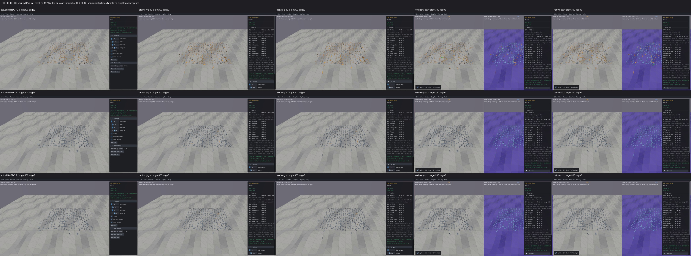
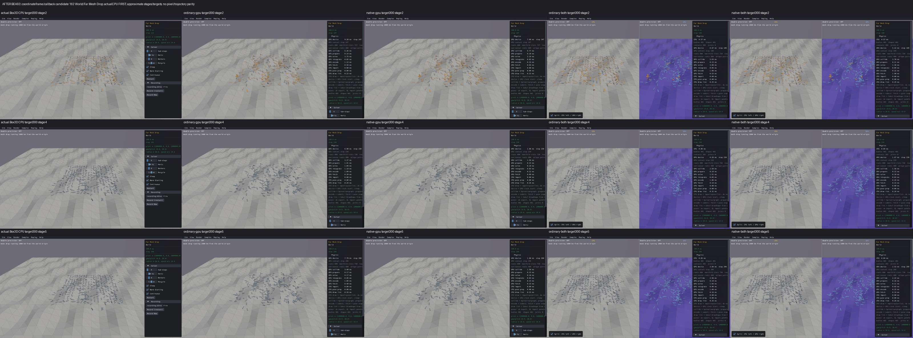

# Published evidence: BEH03

**Verified repair.** Final milestone:21 fixed,1 resolved without repair,0 open;165 native samples reviewed,0 left. PR04 physical failures remain open.

This is a portable extract of the original report, SHA256 `347fd1c2eab072efc75e9ae622209c2afd64c59e9402aa3e9d92cb37496a7639`. Original milestone-time counts and scope statements below are historical; current PR09 acceptance/routing is in the [publication overview](../README.md). Selected original screenshots are byte-identical. Additional per-scene clips, full raw outputs, protocols and failure inputs remain in the local capture/audit archive; their links are explicitly labeled rather than published as broken paths.

# BEH03 — Far Mesh Drop fall-through repair

**BEH03 verified and retained: 12 fixed, 0 resolved, 10 open. Original 165-sample review complete; all 10 repair comparison rows reviewed, 0 left.** Exact source retention (local capture/audit archive) follows the full acceptance audit. PR09 remains unchecked.

The floor was visible. At one million metres, ordinary and native GPU lost small lateral movement during float32 world-position integration, and mesh clipping rounded contact anchors onto a 62.5 mm grid. Before the repair, six of the 400 thin boxes fell through the interior of the uneven floor. The repaired ordinary/native standalone and combined viewers have **zero interior fall-throughs throughout 300 steps**, with all 400 bodies asleep and zero linear/angular velocity at step 300. The unchanged real Box3D CPU reference still has eight fall-throughs and nine awake bodies; that failure is preserved.

Before, with real Box3D CPU first:

After, with the same CPU reference first:

These are three approximate stages of real captures. Thin boxes below the floor cannot all be counted from this camera; the full physical records establish the losses. All ten CPU-first comparison rows and clips (local capture/audit archive) include every affected default scene, two near-origin guards, and all four native Far Stack presets.

## Cause and repair

The smallest failing calculations were `world_position += small_delta` and adding then subtracting a large mesh/body origin around contact clipping. An initially collision-free box at 1e6 lost approximately 9 mm of X/Z travel per step. At the first traced contact, anchor error reached 28 mm. A mesh-only clipping prototype reduced six falls to one and was rejected; its failed evidence remains.

A fixed per-axis local physics frame is selected at the first body when world-coordinate float32 spacing exceeds the existing 5 mm linear slop. Integration, contact caches, CCD, topology, mass properties and host mirrors stay in that frame. Global API points, queries, events and drawing convert at their boundaries. A separate GPU pose publication buffer preserves all 28 words, flags, IDs and slots, translating only the world position lanes. Zero-frame worlds bypass translation. Recreated worlds choose a fresh frame; deleting/reusing bodies does not rebase a live world. The original mesh shader, Box3D, WASM, scene geometry, creation order, densities, gravity and solver settings remain unchanged.

Boundary checks exposed two related defects that were also repaired: a host CCD pre-solve callback returned a local hit point, and moving far bodies produced inconsistent public point/centre-force and GPU-versus-host picking results. Public point operations now agree with the representable global origin/COM returned by getters; the GPU ray shader uses the same representable shape pose. GPU picking remains an actual GPU operation. Its extra frame parameters occupy reserved words in the existing ray ABI. Physical local motion retains its precision.

## Checks and scene scope

**74 actual checks passed across both NVIDIA/Vulkan backends**, at the original tolerances: five frame/API/publication/lifecycle tests per backend, the original CCD landing test, 240-step analytical friction, 600-step support/energy, and 29 numerical checks per backend. They cover far points, centre force/impulse, ray fraction/normal agreement after movement, stepping after queries, callbacks, exported pose words, host edits, capacity growth, generation-safe reuse and world recreation. Initial 800 near/far body inputs were checked against actual Box3D CPU; the original small calculation traces and rejected prototype are retained.

The full source inventory covers **all 165 native C registrations**, including helper-built samples. Defaults 162/163/164 activate the frame; Far Stack 165 activates it at 100/1000/10000 km. Its 0/10 km cases and near Mesh Drop 063 / Falling Hulls 057 are guards. All six default comparisons and all four actual native-control presets were individually reviewed with CPU first. Other **159 samples are explicitly unreviewed on this final candidate**; their completed original 165-sample survey is preserved.

| Scene / control | CPU-first before | CPU-first after | Evidence / limits |
| --- | --- | --- | --- |
| World/Far Mesh Drop / default | [Before](../media/d8175848319741003a231d12.jpg) | [After](../media/cf5b4ee3b80136da2200b91a.jpg) | Individual review (local capture/audit archive) |
| World/Far Pyramid / default | [Before](../media/6aa601083c60c2003b8f615e.jpg) | [After](../media/32ccab40e04a40b1ce1925b9.jpg) | Individual review (local capture/audit archive) |
| World/Far Ragdolls / default | Before (local capture/audit archive) | After (local capture/audit archive) | Individual review (local capture/audit archive) |
| World/Far Stack / default | Before (local capture/audit archive) | After (local capture/audit archive) | Individual review (local capture/audit archive) |
| Determinism/Mesh Drop / default | Before (local capture/audit archive) | After (local capture/audit archive) | Individual review (local capture/audit archive) |
| Continuous/Mesh Drop / default | Before (local capture/audit archive) | After (local capture/audit archive) | Individual review (local capture/audit archive) |
| World/Far Stack / 10 km | Before (local capture/audit archive) | After (local capture/audit archive) | Individual review (local capture/audit archive) |
| World/Far Stack / 100 km | Before (local capture/audit archive) | After (local capture/audit archive) | Individual review (local capture/audit archive) |
| World/Far Stack / 1000 km | Before (local capture/audit archive) | After (local capture/audit archive) | Individual review (local capture/audit archive) |
| World/Far Stack / 10000 km | Before (local capture/audit archive) | After (local capture/audit archive) | Individual review (local capture/audit archive) |

Far Pyramid 163 retains its independent open physical interpretation; a different pyramid response is not claimed fixed. Far Ragdolls 164 retains unqualified joint residual/long-settling behavior. Falling Hulls 057 remains partly awake at its short endpoint. Mesh Drop 063 has zero interior falls/all 400 asleep at 300 and exactly unchanged raw body records between each corresponding before/after GPU backend. Far Stack presets retain six stable bodies and floor support with the unchanged 5 mm slop; every timed position verifies the actual selected offset. Initial world-space float32 geometry quantization is preserved.

The related 10,000 km native Far Stack case has a different short-window response: the prior GPU stack topples into a lower pile, while the after stack stays upright. Both retain all six bodies above the floor. This is a related precision guard, not another claimed floor defect or a resting-pose parity gate.

## Evidence, budgets and recovery

Final acceptance audit (local capture/audit archive) checks 90 primary CPU/GPU cells in ten rows, all finite body records, identity/population/support gates, actual selected offsets, 74 test counts, source/build identities and closed producers. Frozen final budget (local capture/audit archive), candidate/test protocol (local capture/audit archive), artifact viewer build protocol (local capture/audit archive), source inventory (local capture/audit archive), and simple recovery log (local capture/audit archive) record the finite campaigns. No exhausted solver, Rain or scheduling experiments were resumed.

The original CPU observer searched only ±100,000 m and silently omitted far bodies. Its empty records are unsupported, not a CPU pass. The observer-only correction includes ±100 million m, using unchanged native CPU geometry/physics/libraries. The original failure and corrected 400-body CPU capture remain. Native preset capture initially failed because X11 lacked a window PID property, then because benchmarks intentionally ignored mouse input, then because a window was photographed before its first rendered frame. All incomplete attempts and receipts remain. Capture-only copied mains allow explicitly opted-in native UI input; a bounded readiness wait, observed button/caption and every timed body position establish the selected offset. This does not change ordinary benchmark input isolation or production viewer code.

Exact pixels, chaotic scene trajectories, arbitrary worlds spanning enormous coordinates, bodies far from a near first body, full manual dragging, long-window joint qualification, complete-state determinism and desktop FPS remain unqualified. Diagnostic graphics used Mesa/Xvfb; computation used the RTX 4070 SUPER Vulkan backend. Box3D/WASM remain unchanged. All prior local work is preserved. This repair goal has no additional commit/push authorization; the retained milestone remains local.
