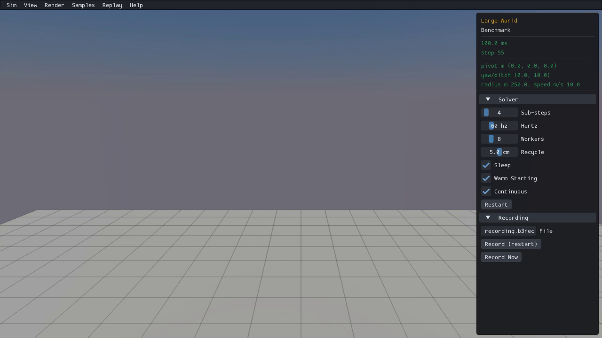
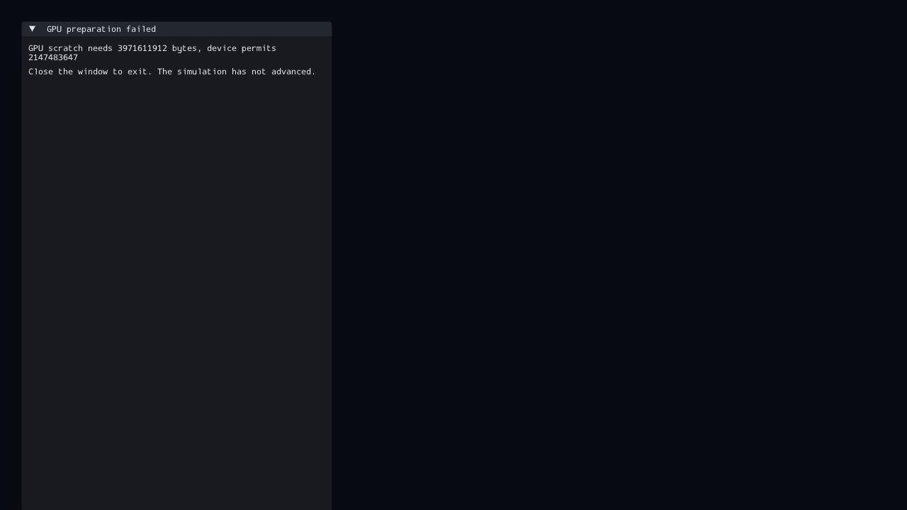
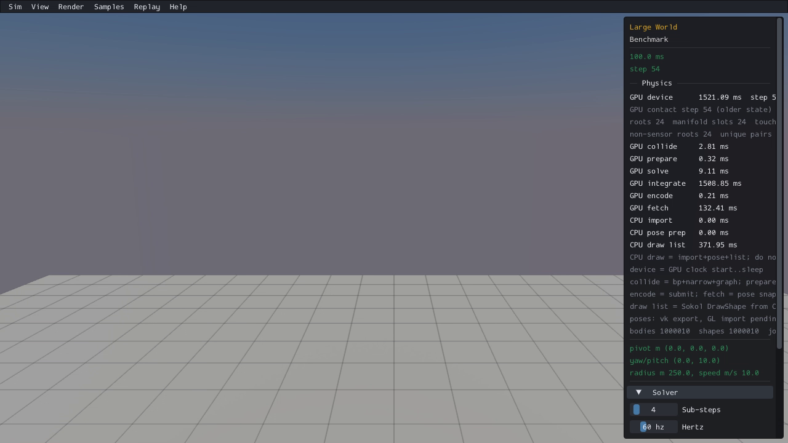

# Published evidence: CAP01

**Verified repair.** Final milestone:21 fixed,1 resolved without repair,0 open;165 native samples reviewed,0 left. PR04 physical failures remain open.

This is a portable extract of the original report, SHA256 `771625662c1cb6d011115483b1cf1d07b2522f33491797ce1bdb6cf6a558fe96`. Original milestone-time counts and scope statements below are historical; current PR09 acceptance/routing is in the [publication overview](../README.md). Selected original screenshots are byte-identical. Additional per-scene clips, full raw outputs, protocols and failure inputs remain in the local capture/audit archive; their links are explicitly labeled rather than published as broken paths.

# CAP01 — Large World allocation and default progression repaired

**13 fixed, 0 resolved, 9 open. Original survey: 165 reviewed, 0 left. Final affected matrix: 3 reviewed, 0 left. CAP01 verified; PR09 remains unchecked.**

The unchanged million-tile Large World now prepares and progresses on ordinary/native GPU and both combined routes. The original four GPU routes rejected scratch allocation before any simulation advancement. Real Box3D CPU, ordinary GPU and native GPU each complete the original 100 sphere schedule through 540 steps, with valid geometry/body/shape/owner identities, supported finite spheres and correct first/middle/last closest-ray picks.

The earlier 90 second failures showed an explicit preparation-rejected panel. They did not measure 90 seconds of shader compilation. The first allocation-only candidate later timed out at 180 seconds and sampled step 38; that failure remains archived. The completed repair traces and removes specific preparation/step costs without changing scene geometry or physics defaults. Native viewing is still slow; this report does not qualify performance.

## Before and after, actual CPU first

Default camera, 60 steps at 60 Hz/4 substeps, no interactions. Images are the 90% clip sample: CPU approximately step 55, GPUs approximately step 54. Original before images show no advancement. The default camera establishes visible floor availability; it does not establish rendering or support of spheres spawned far from the camera. The separate original C full-population check supplies physical/support/identity/picking evidence.

|Route|Real Box3D CPU|Original GPU before|Repaired GPU after|
|---|---|---|---|
|ordinary-gpu||||
|native-gpu||||
|ordinary-both||||
|native-both||||

All CPU-first clips and five sampled stages per route (local capture/audit archive), individual visual log (local capture/audit archive). Combined CPU is left, GPU right; the ordinary-state blue material is intentional. CPU's first sampled stage is black during initialization; later stages show the floor. No exact pixel or trajectory claim.

## Smallest causes and repairs

1. **Allocation arithmetic:** 16 slots per all reserved bodies yielded 16,777,216 contacts. Scratch requested 3,971,611,912 bytes against 2,147,483,647, while hot/persistent contact buffers also exceeded the binding limit. Checked actual Rust structure sizes now precede buffer allocation and physics pipeline preparation. Original supported layouts retain their exact reservations. Only an already rejected layout uses a fallback covering every allocated shape, 16 slots per nonstatic reserve including spare body/type-change headroom, native contact hint and previous contact capacity. Large World uses 1,048,576 contacts/pairs and 1,266,040,072 scratch bytes. The full million-entry wide-static list and 16,777,216 insertion slots remain intact. Growth uses the existing history-copy/relocation path; excess demand still reports explicit rejection or sticky capacity loss. This is a finite reserve, not maximum density support.
2. **Static pair emission:** one visitor invocation serially scanned a million static shapes. Existing insertion workspace now temporarily gathers visitors and the existing shape-sized dispatch traverses statics when they outnumber visitors. The same pair predicate, canonical keys, complete list and public-parent handling remain. Workspace/count ownership returns before hash insertion. Native first-sphere stage 1125.763232→0.378688 ms; stage 16 1196.254880→0.397120 ms in targeted diagnostic timestamps.
3. **Inertia upload:** the full packed scene was followed by 3,000,003 redundant tiny queue writes at the first sphere, directly measured 4340.162 ms. Suppression applies only when all nine original patch values match packed bytes bit-for-bit; signed zero, asymmetric triangles or one-ULP differences retain the original upload. First-spawn encode 5779.511→1134.077 ms in incidental diagnostic clocks.
4. **CCD box rejection:** every distant tile constructed eight corners/planes and COM-shifted geometry before its existing bounding-sphere rejection. The early box radius uses exactly the same rounded extreme corner calculation and bounds predicate. Retained targets execute original CCD. Nonfinite/overflow inputs fall back; enabled custom-filter callbacks bypass the shortcut, preserving 1087 old/new visits and IDs exactly per backend.

These are traced operation timings, not additive costs, desktop FPS or a speedup benchmark. Ordinary tiles are real colliders; SHAPE_PUBLIC_PROXY denotes compound parents and does not exclude these floor tiles.

## Checks and affected scenes

|Gate|Evidence/result|
|---|---|
|All 165 registrations/660 GPU routes allocation census|Only 013 has the original 4 scratch rejections; census (local capture/audit archive). Other findings retained.|
|Checked allocation|8 CPU cases PASS: original/fallback typed sizes, supported layouts, full static reserve, nonstatic/spare types, native/old floors, monotonic demand, overflow and dense rejection. Original 7 pass/1 fixture failure preserved; explicit nonstatic fixture flags fix the remaining selector without changing its expected 255.|
|Static traversal|21 actual CPU/ordinary/native API guard cases PASS: both orientations, late static, filters, dynamic/kinematic sensors, kinematic-solid exclusion, contact/owner IDs, ray floor picking and destroyed IDs. Assessment (local capture/audit archive).|
|Packed inertia|6 actual packed-byte vectors PASS; focused guards and first 11 sphere support/IDs pass. Assessment (local capture/audit archive).|
|Box CCD|6 bit-exact radius cases plus 2 nonfinite fallback cases;10 CPU/GPU before/after support cells, unchanged 1087 callback outputs/backend. Both 60-step million-tile prefixes preserve all 330 previous sphere records exactly/backend. Assessment (local capture/audit archive).|
|Full original schedule|Actual CPU/ordinary/native 540 steps PASS: 1,000,000 tiles + 100 spheres, every-step spawning/finite states, final Y [0.735, 0.77], speed ≤0.1, XZ drift ≤0.01, radius 0.5/center 0 geometry, valid body/shape/owner IDs, 3 correct closest picks/backend. Fixture and raw assessment (local capture/audit archive). No tolerance change.|
|Final visual/health matrix|013 Large World, 019 Body Type, 052 Village × actual CPU/ordinary/native/combined =15 completed 60-step cells, clear health, no capacity loss/nonfinite state. All 75 sampled frames individually reviewed. Log (local capture/audit archive).|

|Final scene|CPU reference|Ordinary after|Native after|Combined after|
|---|---|---|---|---|
|019 Bodies/Body Type|||||
|052 Compound/Village|||||

Body Type retains ground/table/blocks/sphere/capsule, 8 bodies/3 joints. Village retains its visible floor/buildings and compound metadata; its full 120 step performance issue PERF06 remains open. Guard stages differ approximately; conditional controls and long-window mechanisms are unexercised. Other 162 final-candidate scenes are explicitly UNREVIEWED; all 165 original survey dispositions remain saved.

## Reproducibility and limits

All phases froze finite budgets before execution. Original failures/timeouts, observer compile/link errors and preparation corrections remain saved. No closed campaign or unchanged engine run was retried. Final full-population budget: 0 Rust builds, 1 C compile/3 links 25 s each, actual CPU 120 s and two GPU 600 s watchdogs; all pass. Final visual budget: 0 builds/candidates,15 captures,60 steps,180 s each,0 retries. Four final viewers link unchanged C/C++ scene/render/picking objects to the exact checked ordinary/native archives. Artifact-only read-only observer exports are disclosed; production sim/world files were restored after compilation.

Final audit PASS in 2.888 s: 320 source/link/reference pins, 119 real CPU source/object pairs (118 current plus exact original health-hook witness), 38 CPU link inputs, 15 captures/90 raw media files and 36 absent original process IDs. Audit (local capture/audit archive), seven-file CAP01 delta (local capture/audit archive), frozen audit protocol (local capture/audit archive). The source-only WASM package/demo/patch protection covers 593 tracked files; the ignored WASM binary was absent before work and was not built. Box3D remains clean.

|CAP01 file|Verified current SHA256|
|---|---|
|src/lib.rs|`2ad0945eeb58dc2c7f39ec3cd4e0f92041ecbf311c7b4a55d2ec296a0c60acdc`|
|src/sim.rs|`583824380d734c0af47481c9d4a090ec829b92423d6477f35b67290ce6949f24`|
|src/api/world.rs|`d4ef787ce16c73cd30579ba180db460154b59527279a4b70a764b2201b658d1c`|
|src/gpu_invariants.rs|`0aee046fc451d35968e94ffe298d7885454a3f62e3dadc125e3192080c32981a`|
|src/manifold_chain_tests.rs|`1089821af52610fed2f08a598a0c91bf821e56eeb80614d9e88a2d6198667b57`|
|src/allocation.rs|`9db4324ba633626f48343dab6fd9ef6f5e39194eb770eff71251665f27b08e6d`|
|shaders/physics/broadphase.wgsl|`f49df7557960f55ce5b64ac518b57e09249bf33aa2ac91b27fbc4d3ad533d747`|

|Final viewer|SHA256|
|---|---|
|cpu|`5b9e441d684c1cdfedac56d45e55a6f14f1e1e1c43ac4132d122b38faba588eb`|
|ordinary-gpu|`37770dc14daef19fa3d6f450169c8b75e8bc2344eccb4cd21f97626850d7c1b5`|
|native-gpu|`c7238a13d57bdb9da6f3e75a25dd87ea072e47e46f1343b74deeb786e4db91e5`|
|ordinary-both|`9e96db392e354ecd8ec0c644e17dee2a06ebdb774d3acf20859c58471ea3d506`|
|native-both|`94628443c471e9ee9c64cb95de469fe4b92ed4f9edb093f4bf2a178dfe32b499`|

No maximum density/contact-growth release qualification, full manual dragging/UI, repeated-state determinism, arbitrary spanning-world, desktop FPS or performance claim. Native viewer GPU stages remain slow. CPU/GPU trajectories and exact pixels remain deferred. Village PERF06, Candy 001/Sensor 016/Stall 060 runtime findings and all other nine issue groups stay open. No Box3D/WASM/default/geometry/ID/picking changes and no new commit/push.

Original allocation-only failed report (local capture/audit archive), complete recovery (local capture/audit archive), full initial survey (local capture/audit archive).
