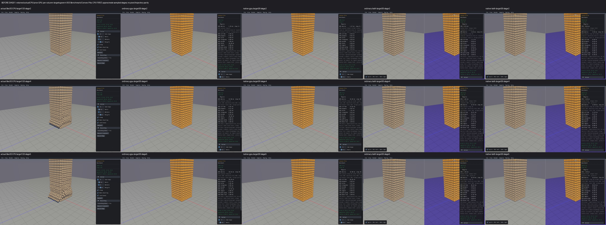
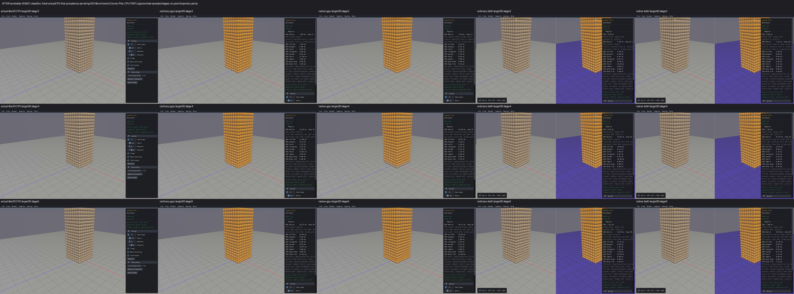

# Published evidence: DIAG01

**Verified repair.** Final milestone:21 fixed,1 resolved without repair,0 open;165 native samples reviewed,0 left. PR04 physical failures remain open.

This is a portable extract of the original report, SHA256 `0fd15d2714fcbf29448a24bd9d0cad109678697638aa8ed87a18772c0876986b`. Original milestone-time counts and scope statements below are historical; current PR09 acceptance/routing is in the [publication overview](../README.md). Selected original screenshots are byte-identical. Additional per-scene clips, full raw outputs, protocols and failure inputs remain in the local capture/audit archive; their links are explicitly labeled rather than published as broken paths.

# DIAG01 — repair false scene health warnings

The recorder incorrectly called six native setups exploded: a tall initial pile, high sensor spawns, a translated mesh and intentional fast projectiles. The repair classifies those inputs using audited scene coordinates and launch limits, preserves every historical raw flag, and retains nonfinite, excessive-speed/height, capacity and progress failures. All nine selected comparisons were inspected individually with actual Box3D CPU first. This is a diagnostic classification repair; the separate physics/runtime findings remain open.

CPU-first clips (local capture/audit archive), individual review log (local capture/audit archive), affected-scene matrix (local capture/audit archive), final audit (local capture/audit archive).

The first failing calculation was `nan_count > 0 || max_speed > 120 || max_y > 200` (Bounce House already used180). The public GPU scan's coarse `exploded` flag was not used by the recorder; its caller and the Python validator each independently reapplied the global heuristic. Actual original CPU records also failed it. The source-driven input trace finds:

| Sample | Native input responsible | Contextual diagnostic contract |
|---|---|---|
|003 Convex Pile|80 layers atY=2+4*layer; top318|referenceY318, retain200m excursion screen|
|016 Sensor|CreateRow10+40*5, staggered±1; maximum211|referenceY211, retain200m excursion screen|
|125 Voxel|ground origin(5000,3500,-7000), bodyY3506.2275|referenceY3500, retain200m excursion screen|
|061 Thin Wall|launch180m/s atY10, gravity−10|speed sqrt(180²+2*10*10)+0.05; rise at most180²/20 for broad screen|
|071 Sensor Hits|intentional200–300m/s launch atY6|speed sqrt(300²+2*10*6)+0.05; rise at most300²/20 for broad screen|
|060 Stall|requested600m/s, actual native world maximum400|query actual world cap; speed cap+0.05, rise cap²/20; real capacity failure retained|

These bounds come from unchanged native setup, not observed output maxima. They are broad outlier screens, not energy/support/contact/CCD certification. The0.05m/s arithmetic allowance already exists in the Bounce House validator; no analytical physical test tolerance was changed. Existing Bounce House energy/enclosure checks remain. All165 native names were checked against the actual C++ policy: only these six profiles change; the other159 retain their previous generic/Bounce bounds.

The smallest repair is the shared audited `native-samples/scene_health_contracts.inc` plus `scene_health.h`, used by `sokol_bench_hooks.cpp`. It records `raw_exploded`, policy identity, referenceY, speed/height bounds and actual world speed cap alongside contextual `exploded`. The cap getter and classification run only under `health_scan` and inside separately measured `health_ns`. `scripts/scene_health.py` independently recomputes float32 limits; `native_scene_validate.py` rejects missing/unknown/inflated bounds and retains strict legacy handling. Old recordings are never silently reclassified. The public Rust `WorldHealthScan.exploded` ABI/heuristic remains unchanged.

Actual CPU appears first in both screenshot sheets. BeforeCPU120 and freshCPU/GPU30 (SensorCPU40; Stall6; before039CPU/GPU180) have different progression. Sampled stages are approximate; valid scene stages were inspected, while loading and black shutdown tails remain preserved.

Checks were bounded and frozen before execution. The original825 capture receipts yield exactly six affected scene names,24 available health records and six unavailable records. Replaying2880 archived frame inputs plus four controls through the source-extracted old C++ predicate reproduces2884 classifications. The candidate actual C++ header and independent Python check agree on2880 archived inputs plus45 boundary/negative cases; seven malformed/inflated metadata cases are rejected, legacy records stay failed, and the real Stall capacity record remains failed. Actual native CPU/ordinary/native APIs plus the unchanged production recorder agree on24 created-body cases (six source input witnesses and two failure guards per backend) at zero physics steps. The root remains incomplete after the negative guards. This fixture tests the classification boundary, not the full complex source scenes or device computation.

Five health-hook C++ compiles and five links reuse verified unchanged engine/Rust archives and existing objects. No Rust, Box3D or WASM rebuild. The real CPU archive SHA is b35f71d07515e333fa19f3e6297bbfc2040984a49f366c94afc5f974acef2c0c. Exact viewer/source/dependency/link receipts (local capture/audit archive), candidate checks (local capture/audit archive), actual body boundary (local capture/audit archive), all-name scope (local capture/audit archive). The only post-operator adjustment moved the getter/limits behind the health-scan guard and inside its timer; the checked policy/header/validator bytes stayed unchanged. The final evidence audit verifies current source, compiled dependencies, linked inputs, five viewer binaries, all45 capture records/media and absent original job processes.

All45 fresh display captures complete:41 have clear health; four Stall GPU routes retain explicit contact capacity loss and root incomplete at physicsstep4 (six requested displays). The intentional launch is no longer a contextual explosion, but RUNTIME03 is not fixed. SensorCPU40 exercises the high spawn row; GPU30 does not exercise its step32 freeze, which remains RUNTIME02. The zero-step body fixture separately tests the GPU high-spawn classification without resuming that closed failing campaign. Actual scene compute uses NVIDIA GeForce RTX4070SUPER/Vulkan; diagnostic visuals use software OpenGL. Collector elapsed times are not FPS/release performance measurements.

The original actual-boundary preparation failed because a hash helper received a string instead of a Path; a dependent preparation invocation then lacked its protocol. Both are retained, with zero compiler/API/engine processes launched. A distinct frozen path-correction campaign passed. All budgets stay closed and there are no unchanged engine retries.

The original165-sample survey remains complete. Final DIAG01 views cover the six affected scenes and three guards, with156 other scenes explicitly unreviewed on this final viewer; the exhaustive source-name audit proves unchanged profile mapping, not their dynamic behavior. Exact pixels/chaotic trajectories, full energy/support/CCD/contact/constraints, custom controls, sensor event semantics, sustained dragging, runtime and performance remain unqualified. Box3D/WASM/defaults/geometry/body identities and all other local work are preserved. No new commit/push is authorized by this repair goal. PR09 and the overall goal remain unfinished.

| Scene | Role | Raw flags CPU/ordinary/native/ordinary-both/native-both | Contextual flags | Before | After | Findings and explicit limits |
|---|---|---|---|---|---|---|
|003 Benchmark/Convex Pile|affected|30/30/30/30/30|0/0/0/0/0|[CPU-first](../media/9e1a8db84a46ed4f122c2550.jpg)|[CPU-first](../media/7c74f65143082516cd16d057.jpg)|Reviewed (local capture/audit archive); Convex Pile floor/grid and descending column geometry preserved in all five before/after routes. All five new30-display cells complete with clear health; all30 old/raw height flags retained percell,0contextual failures. The 318m initial column is classified using its audited reference instead of absoluteY200. CPUbefore120 and new30 show different collapse/contact stages; upper column offcamera. Fullenergy/contact/support/latepile behavior and performance unqualified; collector times are diagnostic only.|
|016 Benchmark/Sensor|affected|8/0/0/0/0|0/0/0/0/0|CPU-first (local capture/audit archive)|CPU-first (local capture/audit archive)|Reviewed (local capture/audit archive); Sensor default empty/camera-culled view and shared event labels retained across valid CPU-first before/after stages. CPU40 creates40 dynamic spheres aboveY200:8raw flags retained,0contextual failures; clear CPUhealth. Four GPU30 cells clear with0dynamic bodies and0raw/context flags. GPU30 does not exercise newrow/spawn at32 or resolve RUNTIME02; actual zero-step Y211 body/recorder fixture separately verifies the GPU classification path. CPU120before/40after andGPU30 have different creation/event stages; actual event filtering/collisions/lifecycle unqualified. No solidfloor expected; preparation/shutdown black tails retained.|
|060 Continuous/Stall|affected|6/2/2/2/2|0/0/0/0/0|CPU-first (local capture/audit archive)|CPU-first (local capture/audit archive)|Reviewed (local capture/audit archive); Stall floor, high-resolution torus and visible rock preserved in valid CPU-first before/after stages. CPU6 retains6raw speed flags and0contextual failures; four GPU6 cells retain2raw flags and0contextual failures. All four still show INVALID/GPU FAILED and explicit contact capacity loss at completed physicsstep4; root remains incomplete. No solver/CCD/capacity/runtime repair claimed. GPU6 meansdisplaycount, not6physicssteps; RUNTIME03 remainsOPEN. CPUbefore120 vsnew6 show different rock positions/visibility, with preparation/shutdown tails; fullenergy/support/longwindow unqualified.|
|061 Continuous/Thin Wall|affected|7/7/7/7/7|0/0/0/0/0|CPU-first (local capture/audit archive)|CPU-first (local capture/audit archive)|Reviewed (local capture/audit archive); Thin Wall wall slab, three projectiles and grid/axes preserved in valid CPU-first before/after views. All five routes complete30 with clearhealth, retain7raw intentional-launch speed flags and record0contextual failures. Native180m/s launch and gravity-drop bound are recorded/independently checked. CPUbefore120 vsnew30 shows different projectile height/contact stages; small primitives and some preparation/shutdown tails limit pixels. No numericCCD/support/collision/energy or longwindow equivalence claim; custom controls unexercised.|
|071 Events/Sensor Hits|affected|8/8/8/8/8|0/0/0/0/0|CPU-first (local capture/audit archive)|CPU-first (local capture/audit archive)|Reviewed (local capture/audit archive); Sensor Hits ground/grid, wall, sensor planes and small projectile preserved in valid CPU-first before/after stages. All five routes complete30 with clear health, retain8raw intentional launch flags and record0contextual failures. The actual291m/s launch is below the audited300m/s source maximum with gravity allowance. CPUbefore120 vsnew30 shows different projectile/contact stages; projectile is small and sometimes offplatform. Loading and black shutdown stages retained. Default bullet only; launch controls, sensor event counters, CCD/contact/energy behavior and longwindow remain unqualified.|
|125 Mesh/Voxel|affected|30/30/30/30/30|0/0/0/0/0|CPU-first (local capture/audit archive)|CPU-first (local capture/audit archive)|Reviewed (local capture/audit archive); Voxel translated mesh floor and small body preserved in valid stage4 on actualCPU, ordinary/native GPU and combined routes. Allfive complete30 with clearhealth;30raw absolute-height flags retained percell and0contextual failures. Actual bodyY3506.21 and speedbelow0.35 are classified relative to unchanged source originY3500. New standaloneGPU stage2 still loading and every stage5 black after shutdown; validstage4 inspected. CPUbefore120 vsnew30 and tiny body limit visual progression/pixels. This verifies false-height classification only, not far-coordinate mesh contact/support/energy/CCD or controls.|
|053 Continuous/Bounce House|negative/shared-path guard|0/0/0/0/0|0/0/0/0/0|CPU-first (local capture/audit archive)|CPU-first (local capture/audit archive)|Reviewed (local capture/audit archive); Bounce House enclosure, floor/grid and bouncing body preserved in valid CPU-first before/after views. Allfive complete30 with clearhealth,0raw/context flags. Existing BounceHouse180m/s andY200 generic limits remain unchanged; validstage4 shows enclosure and body in allroutes. RetainedCPU120 vsnew30 has different ball/sleep stages; standalone stage2 loading and allnew stage5 black. This is a negative diagnostic-profile guard; fullenergy/enclosure/contact/CCD/longwindow and customcontrols unqualified.|
|039 Collision/Long Ray Cast|negative/shared-path guard|0/0/0/0/0|0/0/0/0/0|CPU-first (local capture/audit archive)|CPU-first (local capture/audit archive)|Reviewed (local capture/audit archive); Long Ray Cast five source geometry types and ray/normal lines preserved in valid stage4 across CPU-first before/after routes. Allfive complete30 clearhealth with0raw/context flags. Prior acceptedQRY01 binary/query arithmetic is unchanged; latest health-only viewers retain default displayed failure percentages atzero in the legible saved stage. Before actualCPU and GPU180 vsnew30 gives approximate progression only. NewGPU stage2loading and allstage5black; stage4 and prioraccepted180 evidence retained. Finequerypixels/conditional raycontrols/sustained dragging and completephysics remain unqualified; no new180 repeat.|
|158 Stacking/Single Box|negative/shared-path guard|0/0/0/0/0|0/0/0/0/0|CPU-first (local capture/audit archive)|CPU-first (local capture/audit archive)|Reviewed (local capture/audit archive); Single Box box, floor/grid and axes preserved in valid stage4 across actualCPU, ordinary/native GPU and combined views. Allfive complete30 clearhealth with0raw/context flags. Generic120m/s andY200 limits unchanged. FreshCPU and standaloneGPU show same active colour atthisshortstage; intentional combined blue retained. Retainedbefore standaloneGPU remains in original preparation/timeouts and is not a geometry pass; combinedbefore and newstage4 visible. CPUbefore120 asleep vsnew30 active is different progress, not a colour regression. Stage2GPUloading and some stage5black retained; fullsupport/energy/sleep/longwindow/controls/performance unqualified.|
