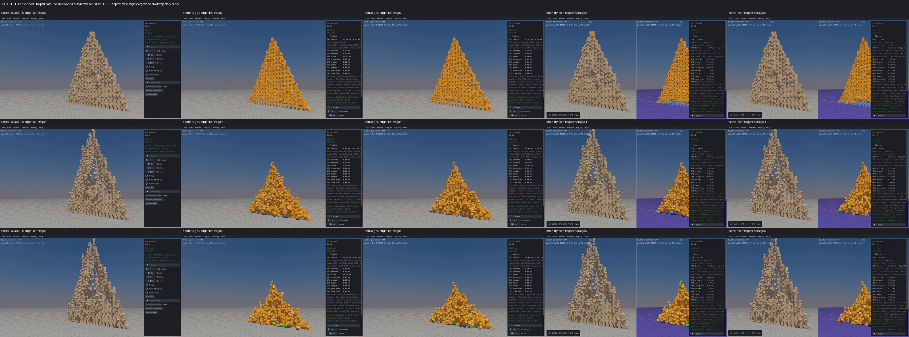
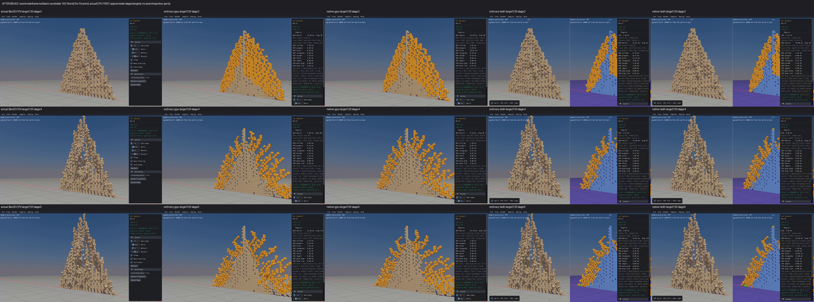

# Published evidence: FarPyramid

**Separate setup triage; evolved collapse unconfirmed.** Final milestone:21 fixed,1 resolved without repair,0 open;165 native samples reviewed,0 left. PR04 physical failures remain open.

This is a portable extract of the original report, SHA256 `178d47ffa30baa4f67e02574d55662c4ce99791476d616e50864708e76624180`. Original milestone-time counts and scope statements below are historical; current PR09 acceptance/routing is in the [publication overview](../README.md). Selected original screenshots are byte-identical. Additional per-scene clips, full raw outputs, protocols and failure inputs remain in the local capture/audit archive; their links are explicitly labeled rather than published as broken paths.

# Far Pyramid setup triage

**20 fixed,1 resolved,1 open. Original survey165 done,0 left; targeted candidate verification21 covered,0 left.** This is the separately requested watch triage, not another repair.

The exact upstream FarPyramid constructor loop creates820 distinct cube body inputs at10,000km along X. In the single-precision configuration used by the CPU, ordinary GPU, native GPU and combined sample compile recipes, native `b3OffsetPos` produces only620 distinct positions. There are200 coincident pairs of cube inputs; X rounding reaches0.5m, while cube full width is1m. Same-row neighboring center distances are0m in200 pairs,2m in200 pairs and1m in380 pairs. This happens before the call which chooses CPU or GPU body creation.

The first cause of this setup quantization is the native world-position addition at10,000,000m with1m float32 spacing. Local half-meter placements round to integer global coordinates. Both routes inherit this setup; it is not evidence of a GPU-only missing floor or lost body. The ideal separated-pyramid assumption is invalid for these inputs. The different evolved collapse remains unconfirmed as a GPU defect: this calculation does not qualify subsequent contacts, penetration, energy or solver behavior. Do not mark it fixed or change upstream geometry/defaults in response to this triage.

One native input observer executes the byte-exact upstream dynamic loop, actual native default definitions, native box hull construction and inline position arithmetic. Body/shape creation calls are observation stubs: they record original arguments and do not create or step a world. Native configuration reports sizeof(b3Pos)=12 and double precision OFF. Four current sample compile recipes independently lack BOX3D_DOUBLE_PRECISION; historical linked-binary behavior is not requalified by those current recipe files alone.

All820 recorded inputs (local capture/audit archive), coincident identities and example rounding (local capture/audit archive), unaltered upstream loop (local capture/audit archive), protocol (local capture/audit archive), audit (local capture/audit archive).

The previously inspected CPU-first before/after sheets remain archival context; no new scene, capture or visual inspection occurred here:

Prior scene review and physical limitations (local capture/audit archive).

Frozen original budget:one10s compile/link,one5s native run,one5s comparison,one10s audit,0GPU runs/steps/captures/retries. The observer parameter incorrectly used b3Hull rather than the actual public b3HullData type; original compile failed in0.365s before any native run. Its source, error and unused execution allowances are retained/closed. A distinct observer-type correction budget was frozen with the same finite limits and unchanged upstream math; compile0.365s/native0.004s passed, comparison0.025s. Audit verifies24 pins and absent producer PIDs. All budgets closed; no production edits, Box3D/WASM changes, commit or push. Rain/PERF04/PR09 remain open.
