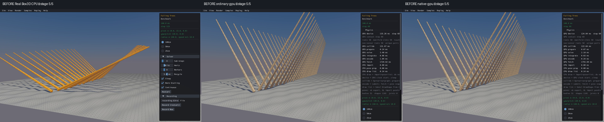
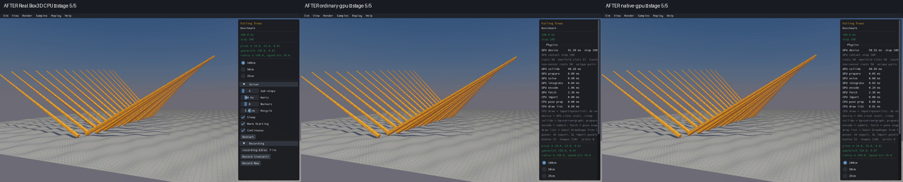
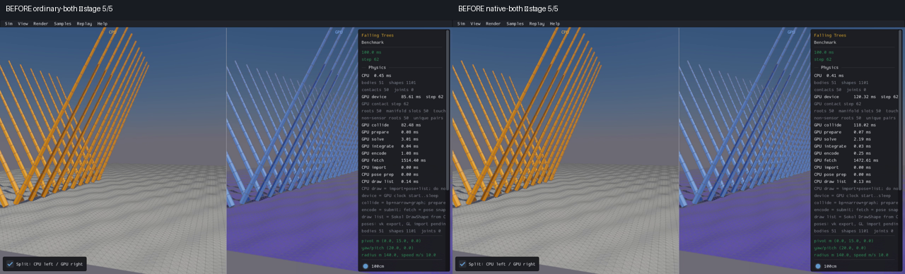
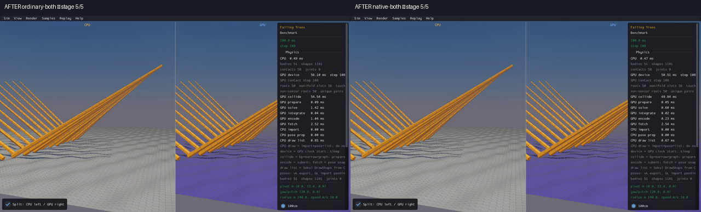

# Published evidence: PERF01

**Verified repair.** Final milestone:21 fixed,1 resolved without repair,0 open;165 native samples reviewed,0 left. PR04 physical failures remain open.

This is a portable extract of the original report, SHA256 `5571428ad74eda65a619c6a5c7716998fdf9db088f775702f6a07bf73368d0a3`. Original milestone-time counts and scope statements below are historical; current PR09 acceptance/routing is in the [publication overview](../README.md). Selected original screenshots are byte-identical. Additional per-scene clips, full raw outputs, protocols and failure inputs remain in the local capture/audit archive; their links are explicitly labeled rather than published as broken paths.

# PERF01 — Falling Trees timeout

Status: VERIFIED / RETAINED with the limitations below. **16 fixed, 1 resolved without repair, 5 open.** One direct sample reviewed: **007 Benchmark/Falling Trees**. PR09 remains unchecked; five other original runtime/performance groups remain open after closure of this item.

Falling Trees now completes the original120-step factory in **4.22s ordinary /4.02s native**, versus both180s watchdogs before repair (102/103 completed steps). The full original600-step scene completes in **14.54/13.59s**, with unchanged geometry, physics defaults, body/shape identities and public floor selection. This is bounded diagnosis, not native FPS or PR08/PR12 qualification.

CPU-first clips / all full-resolution stages (local capture/audit archive) · 50-stage visual review (local capture/audit archive) · 120-step exact before/after state checks (local capture/audit archive) · 600-step physical checks (local capture/audit archive) · closure audit (local capture/audit archive) · recovery log (local capture/audit archive)

## Before and after

Real Box3D CPU first, ordinary GPU second, native GPU third. Screenshots are stage5/5 of each clip; the stages have different completed steps and are not pixel/trajectory matches. Independent receipts establish120 completed after steps. Before photographs precede separately verified material/decoration fixes, so those incidental differences are not attributed to this performance repair. The original same-source state records isolate this change.

Combined routes, actual CPU left and GPU right inside each image. The GPU floor tint is intentional.

All25 before and25 after stages were inspected. Full uneven floor and50 compound trees are visible throughout; upper tips and the side panel remain camera/inspection limitations. Before GPU stages advance only to~68 and combined~62 during the90s collector window. This was severe slow progression, not a deadlock or a newly missing floor. All five after viewers complete120 steps with clear health. Each route's24000 p/q/v/w channel records are byte-exact to its corresponding factory records,120000 records total.

## Smallest expensive calculation and repair

The original factory creates one30351-vertex/60000-triangle wave floor,50 dynamic bodies and22 cylinder hulls per tree:51 bodies /1101 shapes. Each small hull is far from its owner's COM. The host mesh CCD query used a sphere enclosing that part about the whole body's COM, admitting thousands of distant triangles. Every admitted triangle then ran the native-style centroid-plane/TOI/GJK work, even when it could not touch the part.

Read-only cost trace (local capture/audit archive) captured actual mesh geometry and4400 CCD boundary input/output rows. Early two steps selected5,975,050 triangles, all rejected by the centroid-plane check. A distinct new fixture seeded from preserved late public poses selected7,067,078 candidates and ran6,033,658 TOI calls:4.003s TOI +1.255s extra distance work,7.708s operation time. Its file-writing overhead is recorded separately. The seeded fixture is a new initial-value problem, not a replay of original step103.

The repair encloses each part's COM-linear/quaternion-nlerp sweep from its actual start geometry, with a conservative rotation envelope and float-rounding allowance. It includes the unchanged TOI target/tolerance shell and centroid retry sphere. Unsupported/invalid bound inputs retain the old path. The same BVH traversal preserves relative leaf order; TOI arithmetic, callbacks, geometry and defaults are unchanged.

Actual frozen-input proof (local capture/audit archive) reduces those candidate counts to0 early /7862 seeded, with all4400 actual TOI results unchanged. 3,432,000 sampled actual nlerp/rotate points remain enclosed;90 antipodal/near-pi/norm-rounding/large-COM controls and a positive real-BVH hit pass. Four existing mesh CCD controls and the actual GPU kinematic/filter/joint-exclusion and metadata/host-CCD controls pass. These focused calculations are supplemented by the original scene checks, not substituted for them.

A related exact optimization memoizes a static/kinematic target's sweep bound only inside one CCD call. The old floor bound rescanned30351 vertices1100 times per step (33,386,100 points/~32ms), yielding the same[-125,125] bound. Dynamic targets still recompute after corrections; callback ordering and later-step edits remain unchanged. This alone did not repair the timeout: both failed180s confirmations are preserved. The rotation-aware mesh query removes the dominant remaining cost. All5253 ordinary /5304 native initial+completed state rows through those original102/103-step failures are **EXACT after repair**.

## Cold-start diagnosis

Earlier diagnostic scripts supplied DISPLAY=:87 when no Xvfb server was alive. NVIDIA chose eglcore/UUID2df201c9 rather than the live-display glcore/UUID4ce2c594 and discarded the incompatible26MB cache, producing long driver compiler waits. Changing only DISPLAY (local capture/audit archive) isolated this cause; actual wgpu accepted the full cache byte-exact with a live display. This explains the diagnostic cold starts, not the original collector's CCD cost.

Pipeline cache files now distinguish the actual Vulkan pipeline-cache UUID, validate the compatible driver header before import, preserve compatible legacy fallback and other-provider data, and explicitly report rejection/cold starts. The header/unit and three actual API import/export cases per backend pass. Submitted compatible bytes are not claimed to prove a pipeline hit. The final recording display passed raw and actual-helper26,532,353-byte import preflights before any scene launch; no missing-display compiler wait was repeated.

## Physical and functional checks

Original CPU-first600-step factory checks pass all finite state,51 body/1101 shape owners, quaternion norm≤1e−5, unchanged default speed cap,45 public floor picks and destruction invalidation per backend. Full150×200m floor and all22 hull geometries match CPU **exactly** as geometric multisets; CPU body-shape enumeration is reversed. Physics gravity−10,60Hz/four substeps, sleep/continuous/warm-start, recycle.05, density1/friction.9/rolling-resistance.05 and original velocities remain unchanged.

Independent float64 faceted convex-hull/triangle SAT checks the native public hull points/planes/edges against the full floor at completed steps0/120/300/450/600. All face and edge-cross axes are included, with four primitive controls. Both GPU modes have maximum penetration **.003611721m**, below existing.005 linear slop (10668 pairs each). Mechanical energy at every one of600 steps stays below the initial398788.894 bound; final13382.906. Both modes have49 asleep/1 awake at600. The gross whole-body floor-AABB screen is reported separately and is not used as a local penetration proof.

Stock CPU transient SAT penetration **.093727081m** atstep120/body23 is retained as a baseline screen failure. Its energy screen passes. No GPU tolerance was raised and Box3D was not patched. The first offline analyzer's incorrect same-order geometry assertion is also preserved; the corrected analyzer reuses the identical engine data and matches exact hull multisets.

## Scope, source identity and limitations

Retained production deltas for this item are pipeline_cache.rs (UUID validation/namespace), world.rs (exact per-call static-bound memo), query.rs/query_mesh_sweep.rs (conservative mesh query bound plus regression), and query_toi.rs (internal visibility of the existing nlerp for actual primitive testing; arithmetic unchanged). Exact final sources and hashes (local capture/audit archive), checked normal ABI archives, four linked viewer routes and all media are audited in closure.json. Branch feat/gpu, baseline c076092a; prior local work/docs retained, Box3D clean and WASM unchanged. No additional commit/push requested or performed for this repair goal.

Only default Falling Trees007 is the demonstrated repaired scene. The shared host operation can apply to other convex-vs-mesh scenes; the other164 final-candidate native scenes are explicitly **UNREVIEWED** for this item's revision. The original exhaustive165-scene survey is complete. No independent closure is claimed for Height Field, Joint Grid, Rain, Washer or Village. 50cm/25cm presets, manual widgets/dragging, body-body SAT, every swept substep, beyond600-step support, repeatability and native performance/release qualification remain open. CPU/GPU exact scene trajectory/pixel matching is deferred. The13 browser/native counterpart gaps remain outside the22-group repair goal.

All phase budgets were frozen before execution and are now closed: finite builds, process timeouts and five120-step/120s captures, no unchanged engine retries. Preserve every failed compile/assertion/watchdog and earlier rejected cache hypothesis. Observer sources were restored; artifact-only archives are not release builds. The corrected C fixture and geometric-multiset analyzer are changed-input/check phases, with original failures retained.
