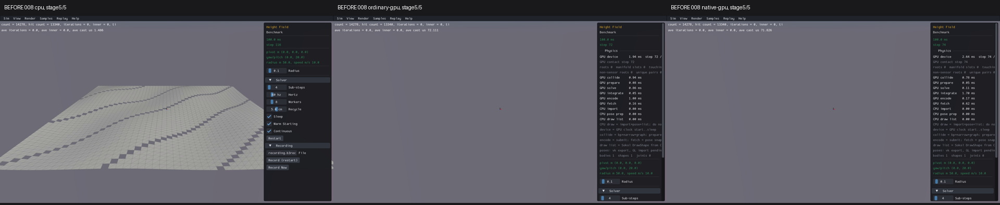
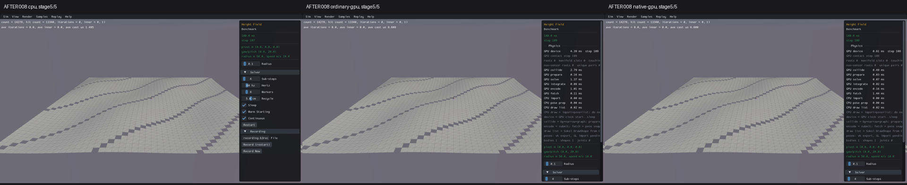
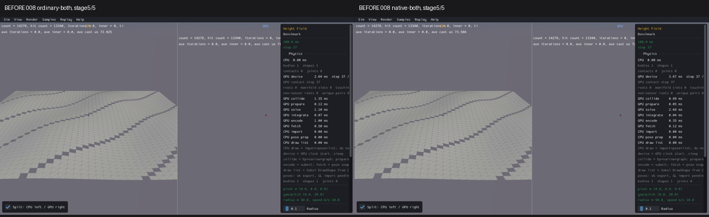
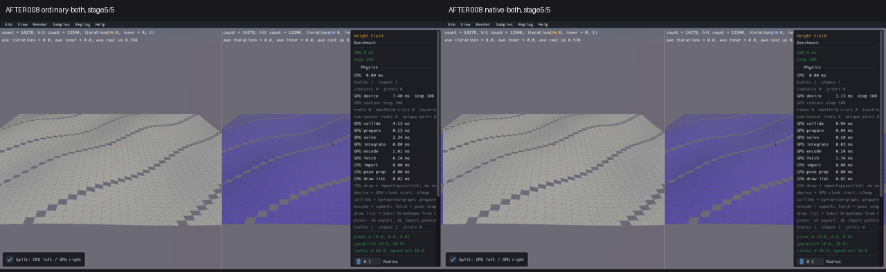

# Published evidence: PERF02

**Verified repair.** Final milestone:21 fixed,1 resolved without repair,0 open;165 native samples reviewed,0 left. PR04 physical failures remain open.

This is a portable extract of the original report, SHA256 `08da947bf3cdeb06e589421be301b626e6da0b78406777c7bbe1c022d6db3409`. Original milestone-time counts and scope statements below are historical; current PR09 acceptance/routing is in the [publication overview](../README.md). Selected original screenshots are byte-identical. Additional per-scene clips, full raw outputs, protocols and failure inputs remain in the local capture/audit archive; their links are explicitly labeled rather than published as broken paths.

# PERF02 — Height Field query slowdown

Status: VERIFIED / RETAINED with the explicit limits below. **17 fixed, 1 resolved without repair, 4 open.**

Benchmark/Height Field (008) now completes the original 120-step workload on ordinary and native GPU and both combined routes. This closes the demonstrated severe query slowdown; it does not close the remaining release roadmap or Village PERF06. Original survey coverage is165 reviewed/0 left. Final affected/default guards:10 reviewed/0 left.

The actual native registered factory creates one static 50×50 wave heightfield with holes, body origin(-25,0,-25), scale(1,1,1). Its unchanged Render runs14,278 radius0.1 sphere casts/frame using translation(80000,-80000,8). Original90-second GPU captures made only about72 standalone/37 combined steps. The cause was unrelated to floor drawing: one diagonal swept AABB admitted about900–1045 triangle candidates per first sampled cast, although the first terrain hit was around1.4–1.8 metres away. The actual frozen mesh has2500 vertices,4502 non-hole triangles and1835 BVH nodes. Boundary inputs and mesh (local capture/audit archive), first16 intermediate costs (local capture/audit archive), all14,278 inputs/results (local capture/audit archive) preserve the diagnosis.

The repair conservatively intersects a translating proxy box with each mesh BVH node in world space, with inclusive float64 slab intervals, explicit zero-direction handling and outward float32 transform/motion padding. A coarse root interval limits the rounding guard needed near the mesh. The old broad AABB remains a necessary filter; the new predicate removes irrelevant nodes while preserving surviving leaf order. Unsupported/nonfinite inputs retain the legacy selection. Triangle narrowphase, query output arithmetic, geometry, defaults, transforms and identities are unchanged. This is a shared host mesh-query operation used by both GPU backends, not a shader or Box3D change.

The retained delta is query_mesh_cast.rs (local capture/audit archive), traversal/narrowphase delegation in query.rs (local capture/audit archive), and the saved-input regression mesh_casts.rs (local capture/audit archive). Exact source hashes (local capture/audit archive), normal build protocol (local capture/audit archive), operation receipts (local capture/audit archive), numerical/runtime result (local capture/audit archive), final audit (local capture/audit archive).

## Checks and bounded progression

- 14,278 frozen actual C-boundary casts/13,340 hits: old/new hit, fraction, point, normal, triangle and material are exact. Candidates fall from6,549,202 to196,362 (97.0% fewer).81 transformed controls cover body rotation, mirrored/nonuniform instance scale, multipoint proxies, zero components, radii0/0.1/1 and clipped fractions0/0.1/1. These numerical controls use can_encroach=false; the mover's true mode is a short visual guard, not an independently qualified numerical matrix.
- Three normal builds pass: unit41.704s, ordinary ABI24.562s, native ABI26.867s. Convex overlap/cast, five mesh CCD regressions and plane clipping guard selectors pass. No physics/default/solver changes were made for this item.
- Actual registered factory with120 Sample::Step and120 actual Render calls passes CPU first, ordinary and native:1,713,360 casts/1,600,800 hits/backend, all13,340 first-frame callback records exact against that backend's before output. Every frame's full query digest stays invariant. Geometry/defaults/one live body and shape/owned heightfield lifetime/9 public floor ray picks/owner IDs/destruction invalidation pass. This static scene has no falling dynamic bodies; do not infer a landing/support solver repair.
- All50 final capture cells complete with clear finite health.008 completes120 physics steps in every route. Related defaults have30 display records;020/040 override Step, and empty036 GPU skips solver stepping, so their records are not30 simulated physics steps. Body counts remain unchanged within every run and match CPU for these defaults.

| Actual120 Step+Render process | CPU | Ordinary GPU | Native GPU |
|---|---:|---:|---:|
| Wall seconds |2.969|17.850|13.890|
| Median actual Render seconds |0.022413|0.131169|0.098009|

These are bounded single-process triage measurements, not a repeated performance/FPS release claim. The original before observer logged every cast; subsequent120-frame logging is suppressed after frame1 while full numeric digests remain. The query timing comparison has observer overhead; candidate counts and exact output checks establish the cause separately.

## Before/after evidence

Real Box3D CPU is the first column and the left combined pane. Ordinary and native GPU follow. Each row retains all five sampled stages, complete clips and health/launch receipts in the CPU-first comparison grid (local capture/audit archive). Sequential visual review log (local capture/audit archive), hashed review record (local capture/audit archive), affected source inventory (local capture/audit archive), capture/physics-step summary (local capture/audit archive).

Below,008 uses clip stage5/5; related rows use stage3/5, except038/040 stage4/5 where stage3 still contained preparation. Stages sample10/30/50/70/90% of each wall-clock clip including preparation and shutdown. Before120 versus after30 related prefixes differ; screenshots are not synchronized simulation-time or pixel/trajectory tests. Raw preparation/black frames remain preserved and reviewed.

008 before — CPU, ordinary GPU, native GPU:

008 after — CPU, ordinary GPU, native GPU:

008 before — ordinary combined, native combined (CPU left in each):

008 after — ordinary combined, native combined (CPU left in each):

The original before GPU floor is absent because those media predate the already verified VIS03 terrain renderer repair. That visible floor improvement is not attributed to this query change. Intentional purple combined GPU floor tint remains.008 UI shows roughly71–74µs/cast before versus7–9µs after; independent full120 numeric progress verifies completion.

| Scene | Default guard reviewed on all five routes | Scope/visible-stage limits |
|---|---|---|
|008 Benchmark/Height Field|Reviewed|25/25 before and after visible; original120 progression verified separately.|
|020 Bodies/Cast|Reviewed|14/25 after visible;11 preparation/shutdown. Default convex guard; mesh UI unqualified.|
|032 Character/Mover|Reviewed|15/25 after visible;10 preparation. Ground/block/ramps/capsule retained; manual movement unqualified.|
|034 Character/Rigid Body|Reviewed|15/25 after visible;10 preparation. Capsule/block/wall/ground retained; manual walk/jump unqualified.|
|036 Collision/Cast World|Reviewed|14/25 after visible;11 preparation/shutdown. Empty default/ray guard; mesh UI unqualified.|
|038 Collision/Initial Overlap|Reviewed|13/25 after visible;12 preparation/shutdown. Mesh/capsule retained; zero-length default cast guard.|
|040 Collision/Mesh Scale|Reviewed|14/25 after visible;11 preparation. Only small cast markers visible in CPU baseline too; scaled mesh offcamera/unqualified.|
|043 Collision/Shape Cast|Reviewed|15/25 after visible;10 preparation. Rings and cast targets/markers retained; manual start/toggle unqualified.|
|052 Compound/Village|Reviewed|20/25 after visible;5 preparation. Facade/roof/paving/capsule retained; landing/navigation/long progression unqualified;PERF06 OPEN.|
|121 Mesh/Height Field|Reviewed|20/25 after visible;5 preparation.400×400 default wave surface/cast marker retained; resolution/amplitude/UI unqualified.|

### 020 Bodies/Cast

Defaultcompound spheres/capsules/hull casttarget andaxes/grid visible/coherent inallfive modes afterstartup. ActualCPUleftcombined. No newdefaultgeometry/querymarkerloss. Defaultconvex guard doesnotexercisechangedmesh branch; UIvariants remainunqualified. All30healthsteps independentlyclear.

Before — CPU/ordinary/native:

After — CPU/ordinary/native:

Before combined — CPU left in each:

After combined — CPU left in each:

### 032 Character/Mover

Full visible level ground/block/ramps and blue capsule retained across all five routes, actual CPU left in combined. After 15 scene stages and 10 black/loading stages; no gross fall-through or new missing geometry in default30 prefix. Manual movement/third-person camera/body support trajectory and long-window remain unqualified; finite clear-health30 independently verified.

Before — CPU/ordinary/native:

After — CPU/ordinary/native:

Before combined — CPU left in each:

After combined — CPU left in each:

### 034 Character/Rigid Body

Visible standing capsule/lower block, level floor and wall retained across all five routes; CPU left in combined. After15 scene-visible stages/10 black-loading stages. Blue/green change belongs prior material repair. Character descends toward ground in default30 prefix; no gross fall-through/new geometry loss observed. Manual walk/stairs/jump/camera and long-window remain unqualified; all30 health clear.

Before — CPU/ordinary/native:

After — CPU/ordinary/native:

Before combined — CPU left in each:

After combined — CPU left in each:

### 036 Collision/Cast World

Default empty Cast World retains grid/axes, instructions and controls across all five routes, CPU left combined. Before25 visible; after14 visible/11 black-loading or shutdown including CPUstage5. Default is a negative/ray guard, with zero bodies; no mesh is exercised without UI interaction. Shape creation, mesh/heightfield presets and manual casts remain unqualified; captured30 display frames have clear health.

Before — CPU/ordinary/native:

After — CPU/ordinary/native:

Before combined — CPU left in each:

After combined — CPU left in each:

### 038 Collision/Initial Overlap

Mesh rectangle and green initial-overlap capsule/axes retained across all five modes. Before25 visible; after13 visible/12 black or preparation stages, native stage3 still loading and CPUstage5 shutdown. No new missing shape or query marker in available scene stages. Zero-length/default initial-overlap guard; manual movement/toggle and numerical overlap semantics not qualified by screenshots. CPUleft combined;30 display records clear health. Report uses stage4 for all modes to retain visible scene.

Before — CPU/ordinary/native:

After — CPU/ordinary/native:

Before combined — CPU left in each:

After combined — CPU left in each:

### 040 Collision/Mesh Scale

Default camera exposes only small cast line and colored endpoint markers, same CPU/ordinary/native/combined; large mesh/floor not visible in CPU baseline either, so screenshots do not verify scaled mesh geometry. Before23 visible/2 preparation-shutdown; after14 visible/11 preparation stages including native stage3. CPUleft split. No new marker disappearance in scene-visible stages;30 display records clear health; sample overrides stepping and this is not30 physics steps. Scale/cast UI, offcamera geometry and full numeric semantics unqualified; report stage4.

Before — CPU/ordinary/native:

After — CPU/ordinary/native:

Before combined — CPU left in each:

After combined — CPU left in each:

### 043 Collision/Shape Cast

Three mesh rings and sphere/capsule/box cast targets, red/green endpoint and wire markers, grid remain visible across all five routes. Before25 visible; after15 visible/10 black or preparation. CPUleft combined. Added right-pane direct cast markers vs original are priorVIS07 repair, not PERF02. No new visible query-marker/mesh loss; clear30 display health. Numerical cast accuracy, dragging start point and initial-overlap toggle remain unqualified by this guard.

Before — CPU/ordinary/native:

After — CPU/ordinary/native:

Before combined — CPU left in each:

After combined — CPU left in each:

### 052 Compound/Village

Default compound building facade/windows/roof rail and visible ground paving retained, blue capsule descends in all five modes; CPUleft combined purple GPU tint intentional. Before25 visible; after20 visible/5 loading. No new missing geometry or gross explosion in30-frame prefix. Full capsule landing/support, navigation, mesh UI and long progression not covered. This is a query-path visual guard; Village PERF06 remains OPEN despite short captures completing.

Before — CPU/ordinary/native:

After — CPU/ordinary/native:

Before combined — CPU left in each:

After combined — CPU left in each:

### 121 Mesh/Height Field

Full visible wave terrain tessellation and yellow default cast marker retained across CPU/ordinary/native/combined, CPUleft and intentional purple GPU floor tint. Before23 scene stages/2 loading; after20 scene stages/5 loading. Original missing GPUterrain already repaired byVIS03, not attributed toPERF02. No new missing terrain/marker indefault30 prefix; health clear.400x400 default terrain visual guard only; height/amplitude/resolution/cast controls and longwindow numerical semantics unqualified.

Before — CPU/ordinary/native:

After — CPU/ordinary/native:

Before combined — CPU left in each:

After combined — CPU left in each:

## Limits and retained failures

Actual NVIDIA Vulkan compute was used with software llvmpipe/Xvfb graphics. Live display preflight imported the same compatible26,532,353 driver-cache bytes before each row. This gives no native desktop FPS, cold-start or five-process repeatability claim. Main final capture wall times CPU19.711/ordinary33.316/native29.555/ordinarycombined54.584/nativecombined46.899s include graphics/collector overhead. Actual500 before/after sampled stages were inspected one scene at a time; capture completion never substituted for review.

The same frozen CPU/GPU boundary inputs expose117 adjacent triangle/normal differences and maximum point difference0.014739m. This independent PR11 query watch remains OPEN; the performance repair preserves the GPU's prior results and does not claim exact CPU query equivalence. CPU/GPU digest differences are retained. Default manualT camera/mover paths in other mesh-containing scenes, all presets/controls/dragging, long-window physical support/energy, other155 defaults on the final candidate and final release qualification remain unreviewed/unqualified. Prior blue/green material and combined primitive changes are VIS02/VIS07, not this item. Village PERF06 and Joint Grid/Rain/Washer remain separate open items.

Original90-second survey cutoffs and three failed diagnostic/proof phases remain unchanged: inherited nonexistent CPU geometry-file expectation after a successful CPU render; serde_json dev-only compile rejection; prototype MeshNode/type/literal compile rejection. Corrected phases changed those harness inputs and launched only their previously unexecuted operations, with separate finite budgets. The first final audit also failed a blanket exit0 assumption for the deliberately terminating exit86 cache probe; that error and output remain in final-audit-result.json. Its corrected CPU-only audit reads the preflight expected_exit from the frozen capture protocol and compares actual raw/helper cache bytes. The next CPU audit found a sheet-path assumption: original008 before sheets remain at review-images/ rather than the regenerated008 subdirectory; their original hashes were all found intact. The final changed path audit uses the original before sheets and the recorded008 after sheets. Both failed audits remain retained. No engine or capture was repeated. No closed budget was restarted. Frozen protocols and chronological recovery (local capture/audit archive) retain every failure and termination. All builds/processes/captures are bounded; final audit is separately frozen with0 builds/GPU launches/captures/retries.

Box3D, WASM, geometry, physics defaults and existing local work remain unchanged. Branch feat/gpu remains at c076092a; this work is uncommitted and no additional commit/push was requested. PR09 and the22-item goal remain incomplete. After verified closure the next issue is PERF03; exhausted historical Rain/scheduling experiments stay closed.
