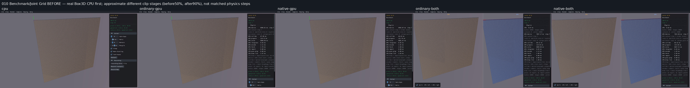
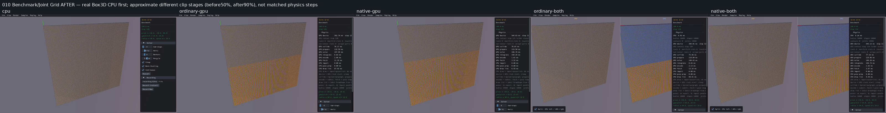

# Published evidence: PERF03

**Verified repair.** Final milestone:21 fixed,1 resolved without repair,0 open;165 native samples reviewed,0 left. PR04 physical failures remain open.

This is a portable extract of the original report, SHA256 `85e9b8ceb748ebbb1c7aedf44a544bb3940029960ba53e7ffea56326b3268bdb`. Original milestone-time counts and scope statements below are historical; current PR09 acceptance/routing is in the [publication overview](../README.md). Selected original screenshots are byte-identical. Additional per-scene clips, full raw outputs, protocols and failure inputs remain in the local capture/audit archive; their links are explicitly labeled rather than published as broken paths.

# PERF03 — Joint Grid progress and lossless health export

Verified repair; 18 fixed, 1 resolved, 3 open. PR09 remains unchecked.

Joint Grid's CPU viewer originally displayed step 120 but hit its 90-second watchdog while exporting a 1 GB health file. All four GPU views timed out without final health files. The actual native factory creates 10,000 spheres, 19,800 spherical joints and 100 static anchors. It has **no floor**. Geometry, physical defaults, joint equations, identities and picking are preserved.

Three independently demonstrated costs explain the incomplete runs:

| Calculation / actual input | Before | Repair and evidence |
|---|---|---|
| CPU duplicate-joint collection | 387,099,416 earlier-record comparisons per frame; about 0.48 s of health collection | A bitmap cleared per world scan preserves first encounter order and every exported field: 39,302 checks and about 8 ms. 88,803 complete body/joint records match exactly over three steps. The full 120-step, 1.083 GB export completes in 11.134 s. Output audit (local capture/audit archive). |
| GPU joint color wave | One writable component with 19,701 joints. The component walk makes 5,673,888 serial list visits per step; steady device solve about 5.9 s | Valid non-overflow colors have exclusive writable endpoints, permitting one lane per joint. Overflow, invalid-list, serial and small single-group waves preserve their original walk and barriers. Device solve about 0.198 s. Actual packed inputs and colors (local capture/audit archive). |
| Ordinary host CCD at the first fast body | From step 8, movement exceeds the unchanged 0.02 m fast threshold. Joint exclusion searches run before masks reject candidates; fetch takes 41–42 s per step | Evaluate the same pure group/mask predicate first. At actual step 70: 6,600 fast bodies, 660,000 masked pairs, zero joint lookups. Thresholds, callbacks, sensors, exclusions and TOI math stay unchanged. Combined candidate audit (local capture/audit archive). |

The combined registered-factory probes complete 120 steps in 52.116 s ordinary / 64.790 s native. Each checks 2,376,000 public joint-anchor observations. The per-frame maximum errors exactly equal CPU, peaking at 0.0246697664 m. No tolerance increased. Ordinary's first two complete packed body/joint states also exactly match the pre-repair ordinary GPU words. Native has no packed pre-repair baseline; its evidence is the public physical/prefix guards and identical-input shader controls.

Five focused selectors pass once on each backend: eight joint kinds with overflow and retired/filter holes through six color/bias cases, with exact body/joint bytes against the old shader walk; invalid-list single-writer warm start; preserved contact/joint colors; 36 mask/group/exclusion cases; and the existing actual convex CCD filter, kinematic and joint controls. Raw protocol and receipts (local capture/audit archive).

CPU collector controls cover **all 35 default scenes with joints**: Joint Grid plus 34 other registered factories. The latter compare 23,181 complete body/joint records exactly over three steps each; all 71 compile/link/process receipts pass. Result (local capture/audit archive), full 165-row inventory (local capture/audit archive). These controls establish collector equivalence, not long-window physics qualification.

The first normal-viewer build was rejected because preserved source timestamps caused Cargo to reuse diagnostic archives. Corrected builds force fresh timestamps and confirm `perf03_joint_wave_dump` is absent from both GPU archives. Four GPU/combined viewers link using their established recipes. Twelve public picking rays, CPU first then ordinary/native, preserve static/dynamic hit shape/body identity, generation and fraction 0.449999988 before and after three steps. Producer receipts (local capture/audit archive). The unchanged verified CPU viewer/hook/picks are reused. Restored source contents receive fresh timestamps so a later Cargo build cannot silently reuse candidate outputs against baseline source.

The playable comparison grid (local capture/audit archive) puts real Box3D CPU first. Combined views keep CPU on the left. These clips use software Mesa graphics with actual NVIDIA RTX 4070 SUPER Vulkan physics; wall times include loading, rendering and lossless export and are not release FPS measurements.

Before clips preserve their original 120-step targets and all failures. After guards use 30 steps except Joint Grid's 120. Screenshot stages are approximate **different** clip-relative windows, not matched physics steps. Initial shader compilation occupied most early Chains screenshots; those frames remain saved. Later 90–98% extracts expose geometry and may include export/shutdown. Black loading/shutdown frames are disclosed. Historical screenshots may also include differences repaired by preceding items; attribution here rests on the demonstrated PERF03 boundary calculations.

| Scene | Final window | Review |
|---|---|---|
| 002 Benchmark/Chains | 30 steps | Reviewed with limits below |
| 010 Benchmark/Joint Grid | 120 steps | Reviewed with limits below |
| 015 Benchmark/Rain | 30 steps | Reviewed with limits below |
| 123 Mesh/Reflection | 30 steps | Reviewed with limits below |
| 129 Ragdoll/Pile | 30 steps | Reviewed with limits below |
| 164 World/Far Ragdolls | 30 steps | Reviewed with limits below |

## 002 Benchmark/Chains

Mesh floor and full chain array retained in CPU/ordinary/native/both visible late stages; CPU left and intentional GPU split tint preserved. All five30-step captures completed with2501bodies/1875joints/clear health. Originalbefore120 versusafter30 and late90–98percent frames do not match physics steps. First four original GPU stages show loading; final CPU late stage is black after completion, preserved as capture limitation. No gross broken chains/floor omission at visible stages; interactive/long-window behavior unreviewed.

All before stages (local capture/audit archive), all late after stages, including shutdown (local capture/audit archive).

Before (original 120-step target, including retained failures):

After (30-step target; approximate late clip stages):

## 010 Benchmark/Joint Grid

Coherent sphere lattice retained in all five routes; native old final blacktimeoutstage preserved, all new120-step captures complete with10000bodies/19800joints and clear health. All per-frame maxanchors exactlyCPU, peak0.0246697664m. No floor exists in nativeCPUfactory. Actualcamera/frustum culling yields9600standalone/8730combined visible instances, panel hides parts; individual10000silhouettes not claimed. GPU lower lattice Orange/Glossy FAST band follows existing diagnostic precedence; lastbody p/q/v/w exactlyCPU at120 and frame30 FASTmetadata retained incolor-observation.json. CPU/GPU CCDclassification policy differs, unchanged; no palette/threshold repair here. Screenshotlate90–98percent windows differ frombefore stages; long/manualinteractions and fullrelease/FPS remainunqualified.

All before stages (local capture/audit archive), all late after stages, including shutdown (local capture/audit archive).

Before (original 120-step target, including retained failures):

After (120-step target; approximate late clip stages):

## 015 Benchmark/Rain

Mesh floor, full arch array and spawning/falling ragdolls remain visible in all five routes; four late stages show scene, finalstage black after successfulshutdown in all five retained as evidence limitation. All30-step captures complete/clear health and matchingdefault population progression; CPUfirst/CPUleft and FASTorange/splitblue diagnostic colors retained. BeforeCPU120/GPUpartial90timeout versusafter30 are different windows. No grossfragmentation/missingfloor in visible shortwindow; individualtiny ragdoll limbs occluded. PERF04 residualfailuresfrom107/recycling/old600campaign remainOPEN; thisguardcannotcloseRainphysical/performancequalification.

All before stages (local capture/audit archive), all late after stages, including shutdown (local capture/audit archive).

Before (original 120-step target, including retained failures):

After (30-step target; approximate late clip stages):

## 123 Mesh/Reflection

Mesh floor, two building meshes including reflectedXspecimen,20ragdolls andthree fallingprimitives retained in allfive visible afterroutes. Allfive30steps complete286bodies280joints/clearhealth. CPUleft, FASTorange diagnostics and combinedblue preserved; rightbuilding/limbs partiallypanelhidden. Several lastCPU/native/combined lateframes blackaftershutdown, preserved; original30guard fullclipframes remain. Before120late roof/groundlanding vsafter30earlyfall are distinctwindows; no landing, individualpart, axisreflectioncontrol, normalsnumeric orlongphysicalqualification inferred. No grossfragmentation ormissingfloor/buildings atvisiblestages.

All before stages (local capture/audit archive), all late after stages, including shutdown (local capture/audit archive).

Before (original 120-step target, including retained failures):

After (30-step target; approximate late clip stages):

## 129 Ragdoll/Pile

Triangulatedfloor and20ragdoll cluster retained in allfive visibleafterroutes;all30stepscomplete281bodies280joints/clearhealth. CPUfirst/CPUleft andstateOrangeGlossy/splitblue palette retained. Overlappinglimbs andrightpanelocclusion preventindividual14part/all20silhouetteclaims. Several lateblackframesaftershutdownpreserved;originalafter fullclipstages available. Before120supportedpile vsafter30fallingcluster are differentwindows; groundY-1 unchanged. No grossfragmentation/missingfloor at visible stages; no landing/longsettling/penetration/constraintorUIpicking qualification inferred.

All before stages (local capture/audit archive), all late after stages, including shutdown (local capture/audit archive).

Before (original 120-step target, including retained failures):

After (30-step target; approximate late clip stages):

## 164 World/Far Ragdolls

Floor and20far human row retained in allfive visibleafterroutes;all30stepscomplete281bodies280joints/clearhealth. CPUfirst/CPUleft andFASTOrangeGlossy/splitpalette preserved. SourceX1000000/doubleprecisionOFF unchanged. CPU/GPU textnowvisible frompriorVIS07repair, notPERF03. Occludedrightlimbs/tinyhumans preventindividualpartclaims; lateblackshutdownframesretained. Before120fall/landing vsafter30earlyfall differ. No missingfloor/grossfragmentation atvisiblestages;farcoordinateconstraint/penetration/longsupport/precisiontoggle/pickingunqualified.

All before stages (local capture/audit archive), all late after stages, including shutdown (local capture/audit archive).

Before (original 120-step target, including retained failures):

After (30-step target; approximate late clip stages):

## Limits and retained failures

Six default populations enter the changed general joint-color wave: Chains, Joint Grid, Rain, Mesh/Reflection, Ragdoll/Pile and Far Ragdolls. Presets, manual interactions and later spawning that cross the 256-body small-wave boundary remain unreviewed. Ordinary CCD predicate order applies more broadly; its pure decisions are preserved and focused controls pass, but this is not a new all-165-scene CCD qualification. CPU collection changes no physics/render state.

Rain's 30-step guard cannot close PERF04, independently recorded residual failures from step 107, recycling or exhausted 600-step experiments. Far-coordinate ragdoll residuals/support, occluded individual limbs in dense piles and manual picking remain outside these short guards. Twelve focused public rays qualify Grid picking identity, not every UI interaction. Exact cross-engine pixels/trajectories, full state repeatability and release certification remain separate. Shader compilation/startup and software capture costs remain limitations.

Original partial files, hypotheses and failures stay intact: the partial CPU export; probe output-directory setup failure; fresh native test-target 180 s timeout; parallel-only candidate 120 s timeout from host CCD at step 8; CPU producer's post-result missing-key failure followed by the independent passing output audit; audit step-regex failure; and rejected stale diagnostic normal-build archives. Corrections used distinct finite protocols. Recovery log (local capture/audit archive), stale-build rejection (local capture/audit archive), original sweep (local capture/audit archive).

Box3D/WASM are unchanged. No additional commit/push. The four compiled candidate source files are retained byte-for-byte after the passing closure audit (local capture/audit archive); retention hashes (local capture/audit archive) and closure/build identities (local capture/audit archive) establish the source and binary identity. PERF03 is checked; PR09 and the remaining three original issue groups remain open.
