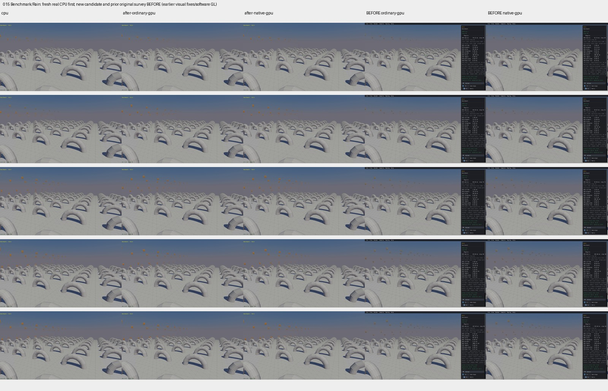
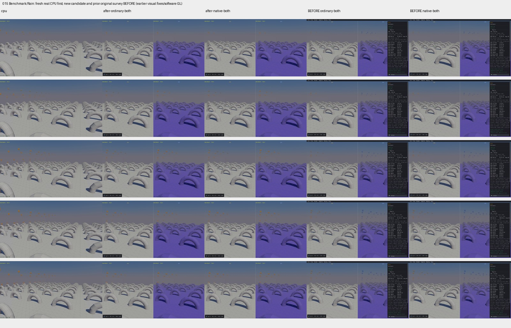

# Published evidence: PERF04

**Verified repair.** Final milestone:21 fixed,1 resolved without repair,0 open;165 native samples reviewed,0 left. PR04 physical failures remain open.

This is a portable extract of the original report, SHA256 `f07a2325d449d9c0f694a090ddcd0ea89cfdd0d1c5f3289d0858915781733460`. Original milestone-time counts and scope statements below are historical; current PR09 acceptance/routing is in the [publication overview](../README.md). Selected original screenshots are byte-identical. Additional per-scene clips, full raw outputs, protocols and failure inputs remain in the local capture/audit archive; their links are explicitly labeled rather than published as broken paths.

# PERF04 Rain timeout — verified milestone

**PERF04 [x]. The22-item sample repair goal is finished:21 fixed,1 resolved without repair,0 open. All165 native samples reviewed,0 left.** On2026-10-15 the user selected option1: close the verified timeout item and retain Rain's pre-existing joint-physics failures under openPR04. This closes the performance repair, with its documented limits; PR09 and production readiness remain unchecked.

Rain's host CCD searched the whole joint list for every eligible moving-shape/static-target pair. At step82,252,000 lookups traversed423,360,000 joint records. The repair builds an unordered blocked-body-pair lookup once per CCD call, using the original joint-kind/flag/endpoint predicate. It expires before later mutation, retirement or world recreation. Geometry, defaults, filtering, TOI arithmetic, body/shape identities and picking calculations are preserved.

The retained source also contains the independently checked loading/compiler prerequisites: lazy joint pipelines, protected native atomic-selection handling, single-call general mesh dispatch with exact Meshzero feature IDs, and parameter updates separated from scene loading. The six exact current sources and ordinary/native static archives are recorded in completion audit (local capture/audit archive) and the source/build report (local capture/audit archive). No rejected solver, ordering, coupled-body or CCD-policy experiment is retained.

Matched normal-ABI headless120-step before/after checks take98.206→9.933s ordinary and102.214→10.184s native. All134,400 body and134,400 joint observations per backend remain exactly unchanged, including first impact. These are bounded diagnostic timings, not releaseFPS or cold-start claims. Current realCPU/ordinary/native/ordinary-combined/native-combined120-step captures complete3.246/9.724/9.408/9.628/9.440s, with matching spawn populations and clear finite health. Actual CPU is first in the comparison grid; original90s timeout media and differing resolution/UI/progress contexts remain labeled.

[CPU-first clips and captions](../compare/index.html), actual inspection/state/cleanup report (local capture/audit archive). The45unique stages and4additional fullPNG inspections are existing verified evidence, not new captures or matched simulation ticks.

Current326-step CPU-first lifetime/static-picking check (local capture/audit archive) verifies798,000 body and798,000 joint membership observations per route. At321,420 old body/shape/joint handles retire and remain invalid; replacement owners and fresh body generations are correct. All6static floor picks and world destruction invalidation pass. Source applicability (local capture/audit archive) ties these results to the exact current static archives.

The affected review is exhaustive within its declared default windows: full165-row applicability/current review ledger (local capture/audit archive), initial39reviews+1unavailable affected union (local capture/audit archive). The later source set has23fresh individual reviews, justified prior applicability and all21held defaults covered/0remaining. The142notfreshlyrecaptured entries are explicitly marked as such; they are not142new defects. Manual controls, presets, dynamic picking, longer windows, complete-state repeatability and nativeFPS remain separately unqualified. All13browser/native gaps remain explicit and outside this22-group goal.

Rain's existing physical failures remain **18anchor/27angular/249cone/0lower-twist/0upper-twist**, at their original bounds. Before/after/current records (local capture/audit archive) prove they predate the timeout repair. They remain release blockers underPR04. Contact geometry, selected cache transfer and preparation match native at the examined boundaries; this is diagnosis, not a physical repair. Selected native transition report (local capture/audit archive). Far Pyramid's [separate setup triage](FarPyramid.md) identifies shared float32 input overlaps; evolved collapse remains unconfirmed and is not counted as another fix.

Finalization uses only existing evidence:0builds/GPU runs/scenes/captures/retries, with30/15s offline audit limits and128KiB retained closing diagnostics. Budget (local capture/audit archive), completion evidence (local capture/audit archive), final preservation/cleanup receipt linked from the roadmap. Required media and minimal unresolved PR04 inputs remain. No engine, Box3D or WASM edits were made during closure; local work is preserved. No new commit/push is authorized or performed. Stop at this milestone; do not automatically startPR04 or the rest of the roadmap.

Final preservation/cleanup receipt (local capture/audit archive) passed in0.690s:53other local files preserved, exact current source/static archives retained, consumed88,600,826-byte restoration backup removed after its finalization consumer ended. Required media and minimal unresolved PR04inputs remain. App goal completion confirmation (local capture/audit archive): COMPLETE on2026-10-15; no further roadmap work started.
