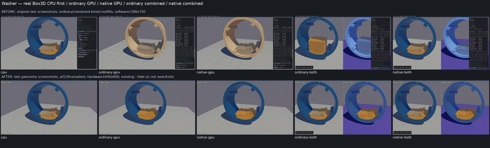
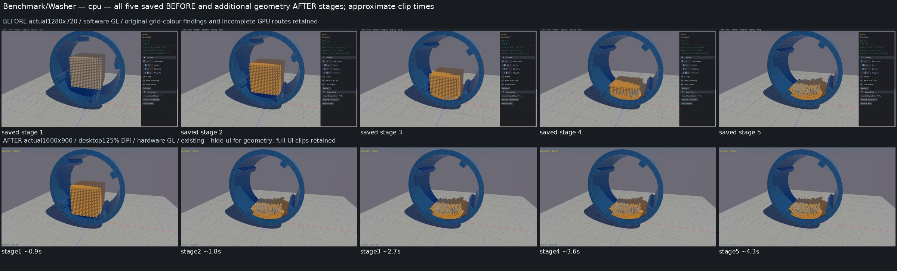

# Published evidence: PERF05

**Verified repair.** Final milestone:21 fixed,1 resolved without repair,0 open;165 native samples reviewed,0 left. PR04 physical failures remain open.

This is a portable extract of the original report, SHA256 `62af95c93dbb3d4ba232089d690a6ea5c4c6dbe405e577e3ea137c23aa4f10c0`. Original milestone-time counts and scope statements below are historical; current PR09 acceptance/routing is in the [publication overview](../README.md). Selected original screenshots are byte-identical. Additional per-scene clips, full raw outputs, protocols and failure inputs remain in the local capture/audit archive; their links are explicitly labeled rather than published as broken paths.

# PERF05 — Washer conservative CCD target bounds

Status: **VERIFIED / RETAINED**,2026-10-07. **19 fixed, 1 resolved, 2 open.**
Original full survey: **165 reviewed, 0 left**. This candidate's visual confirmation:
**Washer 1 reviewed, 164 other defaults unreviewed**. PR09 remains unchecked.

Ordinary GPU Washer spent most of its completed-step fetch time doing host CCD
against targets that could not touch the falling cubes. The additional conservative
target bound removes those misses without changing geometry, defaults, TOI equations,
body/shape identity or surviving target order. All five actual registered CPU/GPU
routes now complete the bounded 120-step check. Native already completed standalone;
its combined timeout also included expensive software graphics. These are two
separately diagnosed costs, not evidence of a 90-second cold start.

CPU-first clips (local capture/audit archive) include real Box3D CPU first, the latest
ordinary/native standalone and combined routes, then preserved original clips.
Each screenshot below is an approximate clip stage, not an exact matched tick.
Original clips use actual 1280×720 Mesa/llvmpipe graphics. The desktop uses NVIDIA
graphics and actual 1600×900 pixels: Sokol scales the logical 1280×720 request by
`Xft.dpi=120 / 96 = 1.25`. Both use the same aspect and upstream camera. The extra
after geometry clips use the existing `--hide-ui` option; full UI clips are retained.
Earlier VIS01 grid and VIS02 material/state repairs explain the palette/decoration
differences. They are not changes made by this CCD repair.

All five saved before and five unobscured after stages were inspected individually
for each route. Floor, drum walls/paddles and tumbling cube contents remain visible.
Combined CPU stays on the left, with the intentional blue GPU pane on the right.
No missing floor or gross escape was observed. Late CPU/native after images repeat
the terminal 120-step pose while the health export finishes; they do not show longer
mixing. Full UI captures (local capture/audit archive) retain the
new-user Controls panel occlusion and the numerical completion proof.

The smallest demonstrated operation was step31, public fast body3/shape42. Its
cube moves from `[-8,11.7395830154,-8]` to `[-8,11.6545133591,-8]`. The ground is
unchanged: half-extents `[60,1,60]`, body origin `[0,-1,0]`, top `y=0`. An
origin-centered bounding sphere has radius about84.86, so the old coarse bound
admits this cube despite its height. Similar spheres around offset drum parts
admit irrelevant cubes. In that actual step, 8000 fast bodies visit41 targets:
**328000 bound overlaps, 328000 TOI calls, zero hits**. The recorded80-step fetch
observer attributes26.066s to host CCD out of26.176s fetch. The first fast body's
41 actual target inputs, raw float32 words and miss outputs are preserved in
the fetch receipt (local capture/audit archive).

The existing mesh CCD helper already computes a padded conservative enclosure of
the interpolated convex proxy, including rotation and invalid-input fallback. An
internal query wrapper exposes that calculation to the world module. After the
old filters/custom callback, COM adjustment and original coarse check, static or
kinematic nonmesh targets receive this additional bound. A per-call map memoizes
it by the actual target slot; it expires before any later edit or motion. A missing
valid bound retains the old path. Fast bounds, mesh and dynamic-bullet paths, TOI
arithmetic and surviving visit order are unchanged.

| Check | Result and evidence |
|---|---|
| Actual old bound/helper/TOI regression |41 recorded misses pruned;90 norm/angle/sign/far controls;269336 actual interpolated proxy points enclosed;5 positive TOIs kept;2 invalid fallbacks. Candidate receipt (local capture/audit archive). |
| Ordinary/native normal archives |Both static builds and focused unit pass. Exact tested four source files/archives are recorded in the retention receipt (local capture/audit archive) and final closure audit (local capture/audit archive). No readonly observers in the engine archives. |
| Same software context, first80 steps |Ordinary fetch25.672→8.366s, about67% less. All640000 dynamic records per backend exactly preserve its normal before run. Native fetch.135→.141s; no native speedup claim. |
| Actual full UI, five hardware routes |CPU5.155s, ordinary22.131s, native8.268s, ordinary combined22.216s, native combined8.634s; all120 completed/rendered,8002 bodies/0 joints, no NaNs/explosion. Full UI receipt (local capture/audit archive). |
| Original factory/defaults/geometry |Real registered C++ Washer,8002 bodies/8041 shapes:60Hz/4 substeps/default gravity/sleep/warm/continuous/recycle, initial poses and hull coordinates matchCPU. Every static/drum public pose through120 is CPU-exact. Factory receipt (local capture/audit archive). |
| Picking and lifetime |Each backend:12 factory floor-owner picks+4 controls; all body/shape owners remain valid, teardown invalidates IDs; floor transform, shape recreation and world recreation preserve positive CCD guards.16 control steps/two worlds per backend. |
| Physical screens |All120 finite/quaternion/native velocity-cap/identity/whole-body screens pass;zero analytical cube-ground vertex violations at unchanged.005 limit. Cubes remain inside the drum above world ground: minimum bottoms CPU4.961/GPU5.008/5.021; this is not settled ground-support or drumSAT proof. Control centerY-minus.2 is a positive CCD guard, not full rotated-vertex/substep/energy qualification. |
| Final geometry captures |All five120-step clips/recorders pass;4.8million dynamic records exactly match the respective full UI controls. Geometry numeric receipt (local capture/audit archive), individual review (local capture/audit archive). |

The complete165-row exposure inventory (local capture/audit archive) and
source audit (local capture/audit archive) reconcile every original native
registration, including the two Mixed Stacks template aliases. Only017 was tagged
PERF05 in the full original survey. No shorter benchmark subset defines coverage.
The generic bound can execute in other scenes: all164 other candidate defaults and
presets/interactions remain explicitly unreviewed, not silently called equivalent.
Focused rotational/far/invalid/positive/edit/reuse guards cover the shared calculation;
the original165-scene review remains complete. Browser native-counterpart gaps retain
their separate availability disposition.

Final audit PASS3.481s:602 unique pins,75 absent producerPIDs,32 prior trackedlocal changes preserved and49 WASM/public/patchfiles unchanged. The releaseWASM binary is absent in this checkout; it was not rebuilt. Four exactcheckedcandidate files are retained, and all jobs/budgets are closed.

Every phase had a finite frozen budget before execution; the log (local capture/audit archive) links
protocols, exact PIDs and terminal results. Preserved failures include the original
software90s cutoffs, missing renderer counter, test imports/private reexport,
fixture `material` versus `baseMaterial`, offline array-order/world-domain assumptions,
and capture guards. CPU `b3Body_GetShapes` enumerates the drum in reverse creation
order; GPU enumerates forward. Actual owner/lifetime IDs are checked within each
backend; CPU/GPU world-generation domains need not have equal numbers. No geometry
or tolerances were changed to pass the comparison.

Sokol here does not publish `_NET_WM_PID`. The final readonly observer obtains its
own `sapp_x11_get_window()`/PID/dimensions once; recording targets that exact drawable,
never the desktop root. Initial failed discovery and the incorrect crop/ignored-env
hypothesis are retained and superseded by actual framebuffer banners/Xft scaling.
An Escape-command exit0 did not close the Controls panel; those clips remain limited.
The documented existing `--hide-ui` geometry run closes the obstruction without
altering any of its120 physics records. Hardware-versus-software comparisons also
change physical resolution/UI context; do not present them as isolated GL timing
experiments or release FPS.

No long mixing, full body/drum SAT, manual dragging, full-state repeatability,
presets, all165 final-candidate qualification or release performance is claimed.
Rain's combined physical gate and Village's timeout remain open. Box3D and WASM
are unchanged; prior local work and raw evidence are preserved. No new commit/push
is authorized for this repair goal. HEAD/origin `feat/gpu` are both `c076092`,
fresh fetch2026-10-07 reports0 ahead/0 behind.
