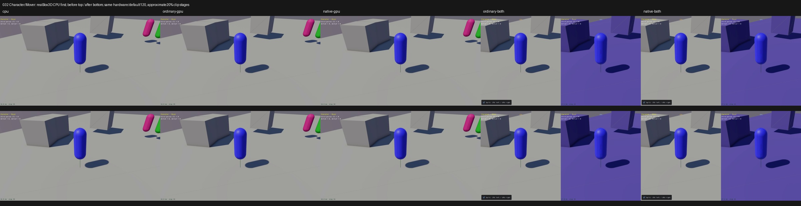
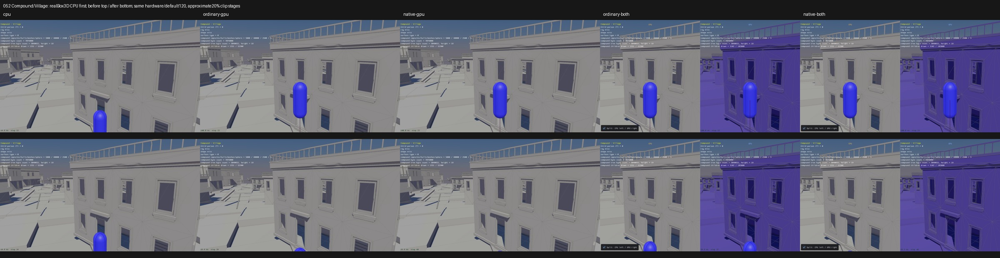

# Published evidence: PERF06

**Verified repair.** Final milestone:21 fixed,1 resolved without repair,0 open;165 native samples reviewed,0 left. PR04 physical failures remain open.

This is a portable extract of the original report, SHA256 `4c99c46353c4aaf1babe455364c63ec0e0f1f638e1ae6eb8b1795d0f54b54c07`. Original milestone-time counts and scope statements below are historical; current PR09 acceptance/routing is in the [publication overview](../README.md). Selected original screenshots are byte-identical. Additional per-scene clips, full raw outputs, protocols and failure inputs remain in the local capture/audit archive; their links are explicitly labeled rather than published as broken paths.

# PERF06 Village timeout — verified and retained

20 fixed,1 resolved,1 open (RainPERF04). Original full survey165 reviewed,0 left. Final affected defaults032 Character/Mover and052 Compound/Village:2 reviewed,0 left; other163 defaults on this candidate explicitly **UNREVIEWED**.

Village now completes its original120-step workload in about7.8s on ordinary/native GPU and both combined routes under matched NVIDIA graphics, down from about29s. The original software-graphics survey had four90-second GPU timeouts; realCPU also took83s. These are two distinct causes: earlier hardware-rendering setup closes the software rendering cost, while this repair removes unnecessary mover-query work. No claim that an idle lock screen or a90s watchdog is itself a shader cold-start defect.

The GPU mover cast copied the entire52500-child village, recomputed the compound's full bounds, then attempted every child narrowphase cast. Native Box3D uses the compound childBVH. The smallest captured input is origin[0,10,0], capsule centers[0,-0.5,0]/[0,0.5,0], radius0.300000012, translation[0,-0.00416660309,0], category1/mask4294967293. RealCPU and bothGPU return fraction1. The first eightsteps contain14 actual movercasts; every input and result isCPUexact. Their CastMover time was0.000017s CPU versus1.619012s ordinary and1.539022s native. Frozen actual boundary records (local capture/audit archive).

The repair caches the original per-public-shape bounds in the existing query index and updates them on refit. It retains the same broad-phase public filter groups/order/IDs, including a callback when the parent overlaps but no child is nearby. It owns only conservative sweptBVH childcandidates before releasing the world lock and entering callbacks. Childorder, clipped-fraction progression, mesh/convex cast formulas, filters, capsule geometry, physics defaults, rendering and body/shape identities are unchanged. [Query code](../../../../src/api/query.rs), [world adapter](../../../../src/api/world.rs), [meaningful regression](../../../../src/fixtures/perf06_mover_snapshot.rs).

Normal candidate source SHA256: query7fabd4e86dcfe686a64cbfdc4f559cf856defbc9cd4a1f6fd8d88b6cfc7eab03; worlda4c62a2908bcd534159dc24c6098b8c9615f5ea2aa20e78877fc94ed00452503; regressionfb47e5abd6f1b90c4b49fb6af3013a3761a62bc8640f5760344b56afaa2bb8d6. Ordinary archivef4a61bab1ed0ac4936d591a3ec957d64d328d1ecd17a47fc8ea8fc07fe7180a1; native1c949ef533e1d6799dfc0f9d1bf738d7cf0e5201199db7d76785d3b47ee38542. Baseline is the previously retained Washer revision, heldnormal archives3f9df6cc/c90ac650; engine observers were never retained. Exact link inputs and tool/source/asset identities are pinned in every finite protocol.

| Route | Village before (s) | Village after (s) | Mover before / after (s) |
|---|---:|---:|---:|
| cpu | 2.461 | 2.374 | 2.382 / 2.347 |
| ordinary-gpu | 28.995 | 7.839 | 3.396 / 3.412 |
| native-gpu | 29.180 | 7.739 | 3.396 / 3.371 |
| ordinary-both | 29.067 | 7.924 | 3.306 / 3.322 |
| native-both | 28.444 | 7.772 | 3.363 / 3.379 |

Matched allfive routes use actual NVIDIA4070SUPER OpenGL/Vulkan,1600x900 framebuffer, default camera/geometry/physics,120 completed/rendered steps, same compatible pipeline cache inputs and existing --hide-ui geometry view. RealBox3D CPU runs first each scene/phase. Single runs include startup, presentation pacing, readonly clocks and capture overhead; these are bounded diagnosis/confirmation timings, not release FPS or statistically repeated performance qualification. CPU approximately2.4s and BasicMover approximately3.3s remain unchanged. Village GPU wall time falls roughly73%; its first-eight-step mover cast time falls to0.000241/0.000242s with all14 results unchanged.

CPU-first clip comparison grid (local capture/audit archive). Top row before, bottom after; columns realCPU, ordinaryGPU, nativeGPU, ordinarycombined, nativecombined. Captured at approximate20% clip progress, **not matched physics ticks**. This is a performance repair: visible geometry remains intact.

All100 individually inspected stages and limits (local capture/audit archive), all10 route sheets and raw frames/clips (local capture/audit archive), numeric confirmation (local capture/audit archive).

All2400 recorded frames across20 cells are finite, fresh and clear of health/capacity failures. Default counters stay10bodies/1joint forBasicMover and1staticbody/0joints forVillage. Every120-step body/joint record and every131(Mover)/176(Village) moverinput/fraction record is unchanged before/after perroute:1535 mover record pairs,1200 dynamicbody pairs and600joint pairs. BasicMover also passes the existing CPU-relative support/joint screen (extra0.05m anchor/0.05rad angular and2m support envelope, from native_scene_validate.py); actual maximum anchor error0.000225187m and GPU angular error0rad. This is a screening envelope, not complete meshSAT qualification. Village capsule ends at y3.07954550CPU/3.07954574GPU (minimum3.05781221allroutes), then sits below the close camera; disappearing below that view is not unbounded fall or missing geometry. All default movercasts aremisses; positive operation correctness is checked separately.

Actual public function controls run on realCPU then bothnormalGPU archives:16casts,8positivefloor results,4filtervetoes,2empty-child compound parent callbacks,6public owner-checked floorpicks and two freshworld lifetimes each. Transform edits, shape destroy/recreate, staleIDs and world destruction all pass. Positive capsule endpoints remain above the analytic floor within0.005m, and fractions matchCPU at the unchanged1e-5 limit. IDs/world/generations are checked within eachbackend, rather than forcing independent allocation domains equal. These are query/support-bound controls with0physicssteps, not a solver change. Controls and raw receipts (local capture/audit archive).

The focused1536-child/3-public-group regression covers positive, miss, touching/encroaching, zero-translation, reverse and long sweeps, childorder, original public filtergroups including emptychildren, refits and owned lifetime. Unit and bothnormal static builds pass. Candidate proof (local capture/audit archive). All165 registered sources were reconciled using163class locations and two explicitly verified templatealiases; only032 and052 invoke the shared CharacterMover.Step/CastMover path. Complete affected inventory (local capture/audit archive). Generic API/preset exposure remains unqualified rather than inferred absent from lexical calls.

Every phase froze its finite build/check/capture budget beforeexecution. Hardware baseline5cells90s; query boundary1CPP/3links/3eight-step cells30s; candidate1unit/2normal builds90s and2eight-step cells30s; controls1CPP/3links/3cells30s; finalconfirmation10links/20cells45s/100stages. All ended with0process retries. The initial offline check incorrectly assumed16casts; the actual14-call correction passed without rerunning an engine, and its failure remains preserved (local capture/audit archive). Older exhausted solver/scheduling/cold-start campaigns were not resumed.

Only nearby default camera geometry was visually inspected, not every village child, distant terrain/stairs/torus/door or camera preset. FullUI/manualmovement/jump/T/dragging, reflected-mesh preset matrices, radius variations, complete geometrySAT, substeps, energy, longwindows, repeats/fullstate/releaseFPS remainunqualified. Earlier floor, material, bounds and overlay repairs are separate preserved work. Box3D/WASM and priorlocalwork remain protected; no newcommit/push. Freshfetch86799terminal0:feat/gpu c076092,0ahead/0behind. PR09 remainsunchecked and RainPERF04 remainsopen with its physicalgate intact. Recovery log (local capture/audit archive), retention/audit records (local capture/audit archive).

Finalretention audit PASS14.931s,421uniqueinputpins/86absentproducerPIDs,32priorlocaltrackedchanges/49WASMpublicpackagepatchfiles andtwoWasherfixtures preserved. Exact3testedfiles retained. Finalauditexec39312terminal0collected; gitdiffcheck0. No newbuild/engine/capture/retry/commit/push. See closure (local capture/audit archive).
