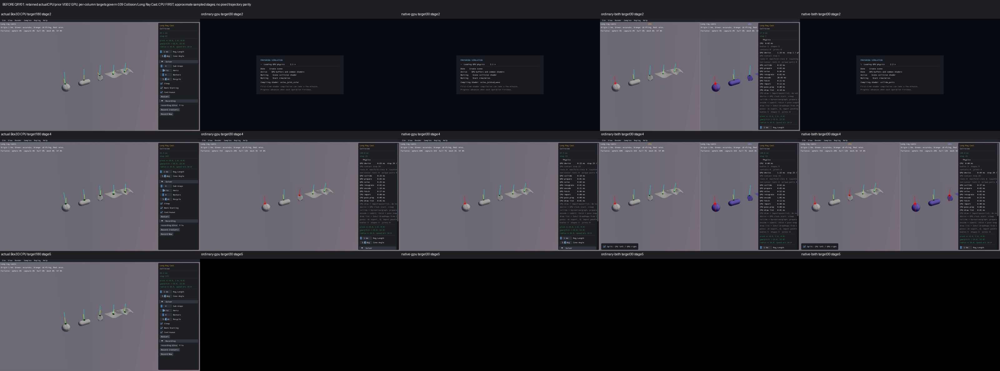
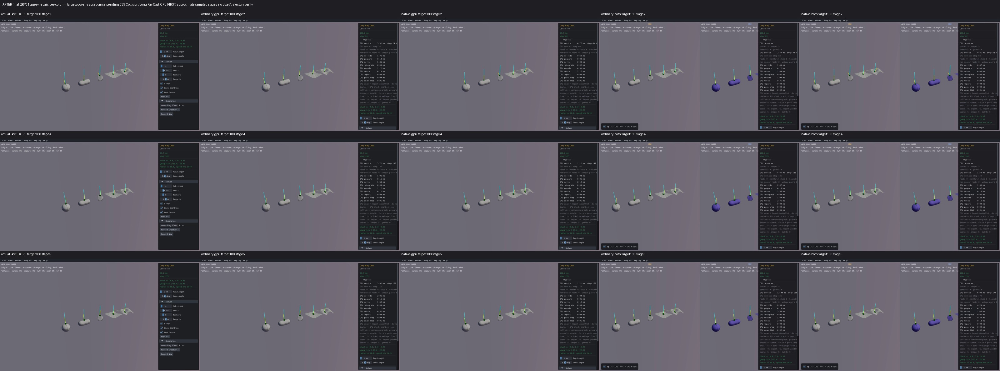

# Published evidence: QRY01

**Verified repair.** Final milestone:21 fixed,1 resolved without repair,0 open;165 native samples reviewed,0 left. PR04 physical failures remain open.

This is a portable extract of the original report, SHA256 `62dd9fdabb9a9ccdcfad1641d516b7d565b957a4ee3c9436f1b20d7ed39e1286`. Original milestone-time counts and scope statements below are historical; current PR09 acceptance/routing is in the [publication overview](../README.md). Selected original screenshots are byte-identical. Additional per-scene clips, full raw outputs, protocols and failure inputs remain in the local capture/audit archive; their links are explicitly labeled rather than published as broken paths.

# QRY01 Long Ray Cast repair

QRY01 verified: independent numerical queries and actual picking pass on both GPU backends. Final affected comparisons17 done,0left;68/68 GPU captures completed with clear health. Original inventory165 reviewed/dispositioned,0left. Closing this item brings the repair checklist to8fixed,0resolved,14open. PR09 and the overall goal remain unfinished.

CPU-first before/after clip grid (local capture/audit archive), final source/media/process audit (local capture/audit archive).

Long Ray Cast039 reported misses on visible sphere/capsule surfaces for long rays; the independent actual Box3D CPU hit those same surfaces. The combined viewer's left-pane query annotations use the GPU provider, so a green combined pane alone was insufficient evidence. The repair uses the actual native CPU as an independent reference.

The first failing operation was the generic ray iteration: the positive residual remained above its unchanged hit tolerance, but adding the computed tiny fraction increment rounded back to the same fraction. Actual input/iteration traces reproduce that stagnation. Shape-specific sphere/capsule/hull/triangle ray calculations avoid that failure without changing geometry, physical defaults or hit tolerances. Follow-up primitive traces isolated further rounding differences in shader division, hull dot products, distance-versus-fraction point reconstruction and the ray-relative world output transform. The implementation preserves surface points computed from the native distance parameter before normalizing the fraction, uses the existing accurate arithmetic helpers, and reconstructs world points in native CPU order. Parent/child/triangle/material/filter identity and initial-overlap semantics remain covered by the actual public-API fixtures.

Final actual picking added a box guard with origin `[0.3,2.3,1000]` and translation `[0,0,-2000]`. The box slab path multiplied its numerator by a rounded reciprocal. At numerator `-999` and denominator `-2000`, native CPU division returned fraction bits1056947831, while reciprocal multiplication returned1056947832. The hit point and grab anchor changed fromZ1 to0.999938965, exceeding1e-5. An actual native C calculation and isolated unchanged production WGSL `ray_obb` reproduced those exact bits. Replacing only the two slab reciprocal multiplications with the existing `gyro_divide` restored native fraction/point bits. No global solver arithmetic changed.

Original identical-input diagnosis (local capture/audit archive), iteration trace (local capture/audit archive), triangle division trace (local capture/audit archive), hull operator differential (local capture/audit archive), host world-point trace (local capture/audit archive), box primitive/f32 evidence (local capture/audit archive), final numerical and actual picking acceptance (local capture/audit archive).

The final candidate passes1800 callback plus1800device-closest native CPU/GPU pairs per backend at50m/1000m over the five original sample shape types, with exact point/fraction/normal and metadata. The768 boundary pairs per backend cover six geometry types, rotated poses, callback/direct/body/closest queries, masks, overlap/zero inputs and lifecycle transitions: hit/point/fraction agree exactly. At shared edges/vertices,91 different adjacent face choices remain; independently checking the actual chosen cooked triangle verifies valid normals at the unchanged1e-5 tolerance. Requiring identical face choices would incorrectly reject these ties. Ordinary/native raw outputs agree.

The unchanged production `both_pointer_down/state/up` path also passes independent CPU/GPU selected IDs, hit fraction/point, local anchors, mouse body and motor joint creation/release, one-sided misses and world destruction for sphere/capsule/box guards on both backends, at1e-5 and zero physics steps. This qualifies query-to-picking setup and cleanup; sustained dragging physics is still a separate gate.

Actual CPU appears first in these saved screenshots. Before GPU30 and retained CPU180/finalGPU180 sampled stages are approximate. Loading and shutdown tails remain visible in the originals.

Final affected confirmation set:039/020/032/034/035/036/040/042/052/057/064/095/121/130/008/019/158;15 direct/helper query consumers plus two lifecycle/box guards. Individual final log (local capture/audit archive). The earlier full165 CPU-first before/after gallery and audit belong to the earlier candidate and remain available; they are not relabeled as final-binary captures. Conditional ray modes, custom interaction controls, loaded Replay states, fine/offcamera/occluded pixels, complete physics, runtime and performance remain unqualified. Village052 and HeightField008 performance findings remain open. No exact pixel or chaotic scene-trajectory matching is claimed.

The build/check/capture envelopes were frozen before execution, with bounded timeouts and no unchanged retries. Final source identity: query shader0427f7846d0f9284232ba83fc8a63b5fba497bfa53838b321d58dbf9b132d5e1, host query88b72af7d248a2e570d2cf349a358febab7170e7950aa284ce836e51de415c0e; archive identities (local capture/audit archive) and four viewer link receipts (local capture/audit archive). Real compute is NVIDIA GeForce RTX4070SUPER/Vulkan; software OpenGL is used for diagnostic capture. This is not a desktop FPS claim.

Retained failures matter: the first picking link omitted real GL dependencies and a drawing-only observer clock; the corrected uncached harness timed out during pipeline initialization before picking; the cached run exposed the actual box failure. An isolated hull observer changed compiler context and failed its reproduction gate; an output-only differential established the arithmetic cause instead. A box trace's original offline assertion compared shortest decimal float32 text as float64; a separately frozen offline bit-domain check corrected validation using the same saved outputs, with no engine rerun. Some earlier cloned protocols retained stale library path metadata; their exact original records and actual-output identity addenda remain intact. The fresh final candidate protocol uses correct archive paths. The partial previous final-viewer campaign closed after8reviews/32cells, with9 unlaunched scenes, when the box picking guard failed; it was not silently resumed after changing the shader.

Box3D, WASM, geometry, defaults, body/shape identities and other local work are preserved. No new commit/push authorized by the repair goal. PR09 and the overall goal remain unfinished. Geometry/defaults/identity were retained; the report does not claim full physics or sustained dragging qualification.

All affected final scenes were inspected individually before proceeding to the next. Each row below links its findings, limits and four capture receipts. The actual CPU column is first in both screenshot sheets and the nine-column clip grid. GPU039 uses180 displays; all other final GPU scenes30. Retained CPU039 uses180 and the other CPU references120; sampled times are approximate.

| Sample | Final review | Before | After | Retained limitation |
|---|---|---|---|---|
| 039 Collision/Long Ray Cast | Reviewed,4completed/clear (local capture/audit archive) | [CPU-first](../media/d6321b09a22f2d1048e0df68.jpg) | [CPU-first](../media/81cc4c7f9923cecc4f104c62.jpg) | BeforeGPU30/CPU180 versus finalGPU180 approximates stages; loading/blacktails preserved. Combined annotations use GPU provider; true independent CPU supplied by retained CPU and numeric fixtures. No full dragging physics claim. |
| 020 Bodies/Cast | Reviewed,4completed/clear (local capture/audit archive) | CPU-first (local capture/audit archive) | CPU-first (local capture/audit archive) | Shared C tool; controls unexercised; preparation and black tails retained. |
| 032 Character/Mover | Reviewed,4completed/clear (local capture/audit archive) | CPU-first (local capture/audit archive) | CPU-first (local capture/audit archive) | Idle defaults; movement/jump/conditional queries unexercised; preparation, black tails, panel occlusion retained. |
| 034 Character/Rigid Body | Reviewed,4completed/clear (local capture/audit archive) | CPU-first (local capture/audit archive) | CPU-first (local capture/audit archive) | Idle defaults; jump/push/boom controls unexercised; preparation and black tails retained. |
| 035 Collision/Capsule Cast Ray | Reviewed,4completed/clear (local capture/audit archive) | CPU-first (local capture/audit archive) | CPU-first (local capture/audit archive) | Idle ray translation control zero/unexercised, shared tool; loading/black tails and palette differences retained. |
| 036 Collision/Cast World | Reviewed,4completed/clear (local capture/audit archive) | CPU-first (local capture/audit archive) | CPU-first (local capture/audit archive) | Empty initial setup; spawning and alternate ray/sweep modes unexercised, black tails retained; no loaded/control behavior pass. |
| 040 Collision/Mesh Scale | Reviewed,4completed/clear (local capture/audit archive) | CPU-first (local capture/audit archive) | CPU-first (local capture/audit archive) | Default SphereCast true, conditional ray mode unexercised; tiny geometry/panel limits, preparation/black tails retained. |
| 042 Collision/Ray Curtain | Reviewed,4completed/clear (local capture/audit archive) | CPU-first (local capture/audit archive) | CPU-first (local capture/audit archive) | Fine per-ray pixels and alternate controls unqualified; sampled progression, preparation/black tails retained. |
| 052 Compound/Village | Reviewed,4completed/clear (local capture/audit archive) | CPU-first (local capture/audit archive) | CPU-first (local capture/audit archive) | CPU120 versusGPU30 character position/offcamera difference retained; no exact trajectory claim. Default view only, near/far fine parts/control interactions unqualified. PERF06 long-window issue remains open; capture elapsed30-42s is diagnostic, no FPS claim. |
| 057 Continuous/Mesh Drop | Reviewed,4completed/clear (local capture/audit archive) | CPU-first (local capture/audit archive) | CPU-first (local capture/audit archive) | CPU120 boxes progress to floor whileGPU30 mostlydescending; actual column targets govern. Short window does not qualify collision/CCD/support/energy or every box/facet pixel; black tails retained. |
| 064 Determinism/Query Spawn | Reviewed,4completed/clear (local capture/audit archive) | CPU-first (local capture/audit archive) | CPU-first (local capture/audit archive) | CPU120 has12spawns versusGPU30about3; dynamic script/query/trajectory stages are approximate, not pairedinputs. Full50spawn hash/lifecycle and controls unqualified; offcamera/partial bounds and black tails retained. |
| 095 Joints/Door | Reviewed,4completed/clear (local capture/audit archive) | CPU-first (local capture/audit archive) | CPU-first (local capture/audit archive) | Idle default only; custom Door click/push controls unexercised. CPU120/GPU30 body sleep/progress differs; black tails/preparation retained. |
| 121 Mesh/Height Field | Reviewed,4completed/clear (local capture/audit archive) | CPU-first (local capture/audit archive) | CPU-first (local capture/audit archive) | Default .2sphere shapeCast withrays0, conditional ray control unexercised; fine triangles/querypixels and terrain support/CCD unqualified. Intentional combined blue palette retained. |
| 130 Replay/Viewer | Reviewed,4completed/clear (local capture/audit archive) | CPU-first (local capture/audit archive) | CPU-first (local capture/audit archive) | No loaded recording orqueryinspection data; native recording/player unsupported and loaded interactions unqualified. Preparation/black tails retained; default empty setup only. |
| 008 Benchmark/Height Field | Reviewed,4completed/clear (local capture/audit archive) | CPU-first (local capture/audit archive) | CPU-first (local capture/audit archive) | Default .1sphere casts/rays0; conditional ray benchmark and terrain fine pixels unqualified. RetainPERF02 long-run timeout asOPEN; 38-72s diagnostic collector times are notFPS/release performance qualification. |
| 019 Bodies/Body Type | Reviewed,4completed/clear (local capture/audit archive) | CPU-first (local capture/audit archive) | CPU-first (local capture/audit archive) | Idle default only: body-type, collision and motion controls unexercised; CPU120/GPU30 sleep and trajectory stages differ. Preparation and black tails retained; no full interaction or physics pass. |
| 158 Stacking/Single Box | Reviewed,4completed/clear (local capture/audit archive) | CPU-first (local capture/audit archive) | CPU-first (local capture/audit archive) | Previous standalone before captures remained in preparation through their120s watchdogs; retain these original timeouts, not a prior geometry pass. Combined before geometry visible; current short30 default confirmation is not long-run physics, interaction or performance qualification. CPU120/GPU30 sleep colours/progress and black tails differ. |
