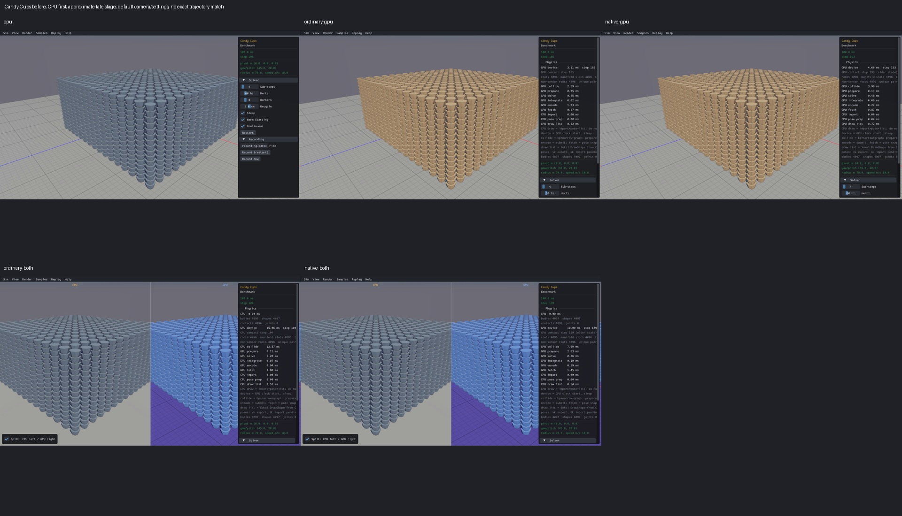
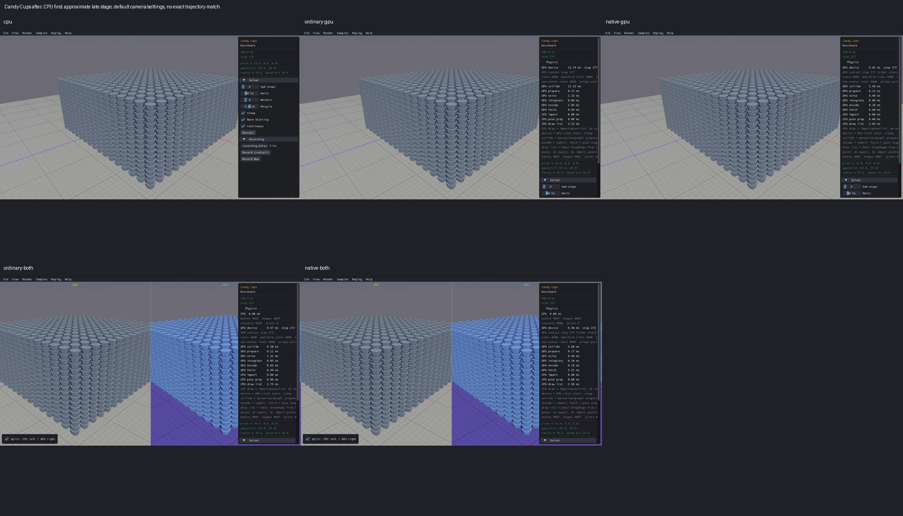

# Published evidence: RUNTIME01

**Resolved without code repair.** Final milestone:21 fixed,1 resolved without repair,0 open;165 native samples reviewed,0 left. PR04 physical failures remain open.

This is a portable extract of the original report, SHA256 `8e5cff8a9340101cc19a3c391dc035be21d80ebdf71eddfa95fe241cd35cf3b7`. Original milestone-time counts and scope statements below are historical; current PR09 acceptance/routing is in the [publication overview](../README.md). Selected original screenshots are byte-identical. Additional per-scene clips, full raw outputs, protocols and failure inputs remain in the local capture/audit archive; their links are explicitly labeled rather than published as broken paths.

# RUNTIME01 — Candy Cups bounded progression review

Status: **RESOLVED WITHOUT CODE CHANGE**. RUNTIME01 [x]. Counts: **13 fixed, 1 resolved, 8 open**. Original survey: 165 reviewed, 0 left. Final scene: 1 reviewed, 0 left.

The original `Benchmark/Candy Cups` recordings requested 300 completed steps with a 90-second wall-time watchdog. Actual Box3D CPU also exceeded that limit. The retained GPU initialization banners reached preparation/first drawing in roughly 2–3 seconds; calling the 90-second timeout a shader cold start was incorrect. This investigation separates the original physics operation from the viewer's graphics and collection costs.

All five actual viewers completed the intended 300 steps with clear health. The failure boundary was the collector watchdog: software rendering made the full viewer take 138–265 seconds, including CPU. There is no demonstrated Candy Cups runtime freeze in this contract. This closes the original missing-completion finding, without claiming a new engine repair or native desktop performance qualification.

The current original C++ factory completed 300 physics steps on CPU, ordinary GPU and native GPU. It creates 4,096 dynamic cups and the original floor, with unchanged geometry, defaults, creation order and identity. Each step checks finite state, original population, every original hull vertex's floor support and bounds. All cups sleep at the end. Three closest-ray picks per backend identify the original top-column shapes; destroying the original scene invalidates the recorded IDs. This diagnostic omits graphics callback attachment and the window loop only, so actual viewer runs are independently required.

The final actual viewer contract is five CPU-first captures, 300 steps each, a 360-second watchdog, zero builds, candidates or retries. Graphics uses Mesa software rendering; physics uses NVIDIA Vulkan. Its longer watchdog is established before launch, supported by measured rendering costs and independent full physics progression. Original failed clips and the interrupted native-split orphan recording remain unchanged.

| Actual viewer | Completion (s) | Physics median (ms) | Render median (ms) | Result |
|---|---:|---:|---:|---|
| cpu | 138.195 | 0.9289 | 436.3123 | 300 completed / clear health / 4,096 asleep |
| ordinary-gpu | 144.640 | 20.9777 | 431.9822 | 300 completed / clear health / 4,096 asleep |
| native-gpu | 139.794 | 6.7009 | 428.1350 | 300 completed / clear health / 4,096 asleep |
| ordinary-both | 264.977 | 21.6647 | 821.8135 | 300 completed / clear health / 4,096 asleep |
| native-both | 245.902 | 6.7791 | 782.9870 | 300 completed / clear health / 4,096 asleep |

These are diagnostic callback clocks from software-rendered health captures, not release performance measurements. `RenderFrame` is measured separately from the physics operation and health scan. Medians are not additive.

Offline audit passed in 77.854 seconds under its 180-second budget: 350 viewer/reference pins, 359 physical pins, all 1,500 captured frame records, stable body identity sets, finite pose/velocity, no capacity/NaN/explosion flags, all 4,096 cups asleep at completion and 12 absent original process IDs. All 25 after frames and the 25 original before stages were actually visually reviewed: intact cup array and solid floor, early active tan to sleeping gray, CPU grid restored in combined view, intentional blue GPU comparison half, no gross collapse or geometry omission. The default panel still crops the right silhouette. Audit (local capture/audit archive).

Screenshots show default scene/camera and approximately late clip stages, not matching simulation ticks. The combined GPU half retains its intentional blue comparison palette. Earlier verified material/grid repairs are present in current viewers; those repairs have their own reports. Screenshots alone cannot prove runtime progression.

CPU-first before/after clips (local capture/audit archive), all before stages (local capture/audit archive), all after stages (local capture/audit archive), physical assessment (local capture/audit archive), viewer receipts (local capture/audit archive), frozen visual protocol (local capture/audit archive), offline audit protocol (local capture/audit archive).

The first diagnostic fixture compile failed because it used incorrect public quaternion/hull accessor fields. The failure is retained. A separate finite corrected phase changed only fixture accessors, then passed one compile, three links and three physics processes. Production Box3D, WASM and GPU sources were unchanged during this investigation.

Source identity: `feat/gpu` baseline `c076092a86636ff33e4ff6a11b85a8695f78b08a`, with previously verified local repairs retained. The actual CPU viewer is the real Box3D build, SHA-256 `5b9e441d684c1cdfedac56d45e55a6f14f1e1e1c43ac4132d122b38faba588eb`; its original health-hook source witness is recorded in CAP01. GPU viewers use the checked CAP01 archives and unchanged seven-file source snapshots. Frozen protocols pin 359 physical inputs and 350 viewer/source/reference inputs; final audit records each actual binary and media hash.

Limits: one default Candy Cups scene, 300 steps. Manual dragging, scene switching, long-window dynamics, repeatability and native desktop performance remain unqualified. The other 164 scenes have no final review under this item's protocol; their original survey dispositions remain available. Exact pixels and CPU/GPU trajectories are outside scope. The default query-mask watch and other runtime/performance groups remain open. PR09 and the full release roadmap remain unchecked. No new commit or push.

The independent physical diagnostic retained native hull support bounds of −0.015 m. Its worst observed world vertex heights were −0.00119533041 m CPU and −0.00080751098 m GPU, with peak speeds 0.381463557 and 0.358658612 m/s. All original IDs/owners, 16 hull points per cup, three closest picks and post-destruction invalidation checks passed on each backend. No trajectory matching or tolerance adjustment was used.
