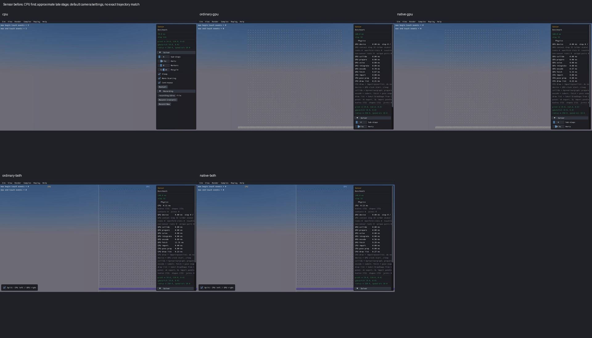
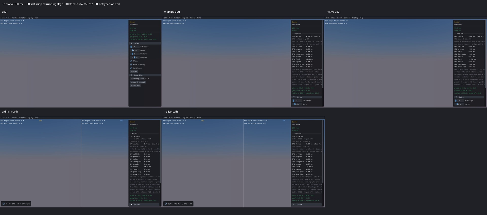

# Published evidence: RUNTIME02

**Verified repair.** Final milestone:21 fixed,1 resolved without repair,0 open;165 native samples reviewed,0 left. PR04 physical failures remain open.

This is a portable extract of the original report, SHA256 `119299c040cd78cf60b004b9471b96b9d106f81ac4c3e51f3b1e0fc382afe90c`. Original milestone-time counts and scope statements below are historical; current PR09 acceptance/routing is in the [publication overview](../README.md). Selected original screenshots are byte-identical. Additional per-scene clips, full raw outputs, protocols and failure inputs remain in the local capture/audit archive; their links are explicitly labeled rather than published as broken paths.

# RUNTIME02: Sensor callback deadlock repaired

Verified 2026-10-05 on `feat/gpu`, retained uncommitted on baseline `c076092a86636ff33e4ff6a11b85a8695f78b08a`. **14 fixed, 1 resolved without repair, 7 open. Original sample review: 165 reviewed, 0 left. Final Sensor review: 1 reviewed, 0 left.** This closes the demonstrated Sensor freeze and related metadata reads in filter/pre-solve/CCD callouts; PR09 and the full release contract remain unchecked. No new commit or push authorization.

The real upstream `Benchmark/Sensor` creates forty falling spheres after step32. Both GPU backends previously hung on the next physics step. The first stopped operation was the original custom filter's `b3Shape_IsSensor`, which attempted to acquire the world registry mutex already held by GPU stepping. A safe, owned shape-metadata snapshot now lets those getters complete without acquiring that lock again. Physics calculations, callback decisions, scene geometry/defaults and public IDs are preserved.

## Actual before and after

Real Box3D CPU is first in each composite and the clip comparison grid (local capture/audit archive). The original four GPU clips expired at90s and stayed at displayed step32. The after composite uses the sampled running stage3: CPU53, ordinary57, native58, ordinary split57, native split58. Stages are approximate clip times, not synchronized physics ticks. Full120-step completion is verified independently in each health record.

Before, late sampled stage (original CPU/GPU/combined recordings):



After, running sampled stage3 (same default scene/camera, actual retained recordings):



The original sensor grid was incorrectly drawn despite default bounds; that separate visibility defect was already fixed by VIS05/VIS06. RUNTIME02 makes no additional rendering change. The correctly empty CPU/GPU default view cannot demonstrate visible falling geometry or sensor material changes. All25 before stages (local capture/audit archive), all25 after stages (local capture/audit archive) and individual review (local capture/audit archive) retain this limitation. Some first/late after samples show black/preparation panels; these are not final scene poses or physics failures. No recapture was used to hide them.

## First failing boundary and repair

The diagnosis (local capture/audit archive) uses the actual registered C++ factory and original filter, wrapping only entry/exit observations. CPU120 completed in0.064s. Ordinary/native each reached `STEP_ENTER33`, then:

```
CALLBACK_ENTER a=882:1:1 b=1682:1:1
SENSOR_GET_ENTER id=882:1:1
(no getter return; 60s watchdog)
```

Shape882 is the row20 custom-filter sensor atY110; shape1682 is a newly spawned sphere nearY210. GPU invokes this filter earlier/more broadly than CPU. The callback must still run and reject row20; skipping it is not the repair. On the repaired original120-step runs, all268800 GPU callback invocations returned the original denied decision per backend. CPU callback count is different; no callback-count or performance parity is claimed.

Exactly two production files comprise this candidate, with exact retained snapshots (local capture/audit archive): `src/api/world.rs` and new `src/api/world/callback_shape_reads.rs`. Existing local work in world.rs was retained as the candidate baseline.

An immutable owned snapshot copies live shape generations, event flags and opaque user-data values from every live registry world while the registry lock is held and before borrowing mutable world/simulation state. A thread-local RAII scope restores the previous snapshot on normal exit, nesting and unwind; its guard cannot move to another thread. There are no raw references into the actively borrowed world and no unlocked world mutation. Shape validity, sensor/event-flag and user-data getters use this scope, including generation validation; outside a scope they use their normal path. Normal custom-filter/pre-solve stepping and pending host-CCD/mirror completion establish the scope before callouts.

This qualifies only those read-only shape metadata operations. Arbitrary body/query/material API reentry, mutation from callbacks, callback-created threads that wait under the registry lock, broad concurrency and all release APIs remain unqualified.

## Checks and affected scene

| Scene/mode | Actual120-step capture | Health | Review |
|---|---:|---|---|
|016 Sensor / real Box3D CPU|11.408s|PASS,1801 bodies/120 dynamic|Reviewed with capture limits|
|016 / ordinary GPU|15.982s|PASS,1801 bodies/120 dynamic|Reviewed with capture limits|
|016 / native GPU|15.883s|PASS,1801 bodies/120 dynamic|Reviewed with capture limits|
|016 / ordinary combined|19.062s|PASS,1801 bodies/120 dynamic|Reviewed with capture limits|
|016 / native combined|18.939s|PASS,1801 bodies/120 dynamic|Reviewed with capture limits|

All5 cells have120 measured/completed/rendered records, finite poses/velocities, stable120 dynamic identities, no capacity loss/sticky GPU failure and final speed below5.001m/s. Health is captured inside base `Sample::Step`, before the derived post-step spawn: the exact expected population is1681+40×floor((completedStep−1)/32). Source-defined row creation remains after32/64/96. This observer boundary is explicitly recorded, not a spawn timing change.

The original-factory and physical controls assessment (local capture/audit archive) passes on actualCPU, ordinary and native implementations. It checks all1681 static poses/sensor flags, all120 source-defined sphere spawns, owners/generations/counts, finite position/rotation/linear/angular state, original X/Z/rotation and velocity at the existing1e−5 numerical criterion. All three finish with1801 bodies,75 begin events and40 end events; no excluded row20 events. The exact successful CPU factory receipt is reused with unchanged factory-function/source/link hashes.

| Related actual C API control, each backend | Result |
|---|---|
|Sensor allow / reject|Allow1begin+1end; reject0+0; original−5m/s motion|
|Active sensor deletion|1begin+1end; visitor body/shape become invalid|
|Pre-solve allow / reject|Allow supports atY1; reject passes through|
|CCD custom-filter allow / reject|Allow finalY0.285910994; reject passes through|
|CCD pre-solve allow / reject|Allow finalY0.285910994; reject passes through|

All nine controls exercise actual `IsValid`, `IsSensor` and `GetUserData` inside callbacks, retaining opaque context, flags, filtering decisions, owner identity and destruction invalidation. Solid/CCD support bounds derive from unchanged geometry and the declared three native slops; isolated motion bounds stay0.015m. The default factory contains intentional birth overlaps from its random Y offsets: pair separation is checked against source birth gap or1m, minus0.015m, rather than cross-engine trajectory equality. Minimum recorded gap0.843261719m, recorded Y drift0.0759429932m. The small CCD control retains native transient penetration0.024443346m at step3; final support is checked, not a long-window or maximum-transient CCD certificate.

Two Rust regression guards pass: owned metadata validates stale/zero/missing/foreign-world IDs and thread isolation; nested scopes/unwind restore prior metadata. Ordinary/native release ABI builds pass. Four final viewer links reuse pinned original C++/C/graphics/sample objects and replace only the Rust archive. The realCPU viewer is the corrected DIAG01 Box3D viewer, not a GPU engine CPU mode. Source/binary hashes and command/environment pins are in candidate protocol (local capture/audit archive), link protocol (local capture/audit archive), capture protocol (local capture/audit archive), postcapture result (local capture/audit archive) and closure (local capture/audit archive).

## Finite budgets, retained failures and limitations

Budgets were frozen before each phase; all are CLOSED. One two-file production candidate; one Rust unit build and two ABI builds180s each; two unit checks15s; diagnosis/candidate C++ compiles and links25s; original diagnosis processes60s, candidate/physical processes120s; four final viewer links25s; exactly five final120-step captures90s. No unchanged GPU retry, new solver campaign or additional capture after review.

Three failed CPU-only fixture phases remain intact, with no GPU launched in any:

- Uniform Y travel wrongly ignored native sphere contact from the original0.8434m birth gap. Raw source/body data established that contact correction is expected.
- Bit-exact−5 velocity wrongly rejected native contact rounding of4.8e−7; the existing1e−5 numerical criterion was applied, with geometry/defaults unchanged.
- A coded0.29m CCD support boundary was two slops although the frozen protocol specified three. A separate4-step CPU trace retained all inputs/intermediates; the boundary now computes radius+wall half-height−0.015=0.285m. Native transient behavior remains recorded.

Offline audit failures are also retained: an initial copied folder name (`full-visual` vs `final-visual`), then the incorrect post-spawn population assumption at32/64/96. The final distinct snapshot-boundary audit passed5.321s under90s:435 visual pins,371 physical pins,600 health records, all media hashes, two exact production sources and12 absent original process IDs. These corrections changed only the collector checks; no source physics/tolerance change or scene rerun.

The final provenance audit also retained a failed comparison against the later BEH03 observer source. That earlier change only expanded the CPU health scan AABB from1e5 to1e8. Reversing that one archived observer change reconstructed the exact original DIAG01 hook source hash0ba3b2;119 original CPU source/object pairs,38 linked inputs, the actual hook object and unchanged CPU binary are verified. Sensor geometry is inside either bound. The exact compiled CPU hook witness (local capture/audit archive) is evidence only; no production source was restored or rebuilt. The corrected closure audit passed3.561s, verifying362 candidate and364 link pins.

Graphics used Mesa software rendering with actual NVIDIA Vulkan compute. Timings are collector observations, not desktop FPS/performance qualification. Sensor016 is the only final scene reviewed for this item; the other164 native samples are explicitly UNREVIEWED on this candidate, although the original165-sample sweep is complete. Manual picking/dragging, long-window sensor-base arrival, repeated-run determinism, all callback APIs, full CCD/contact/solver and release qualification remain open. Picking code and body identity mapping were not changed; this is not a new manual-picking pass. Box3D and WASM were not changed/rebuilt; previous local edits/evidence were preserved.

Next open item: RUNTIME03 Stall060, followed by PERF01–06. The FarPyramid/FarRagdoll/default-query-mask watches remain open. This report closes one item; it does not resume the full release roadmap or exhausted historical experiments.
