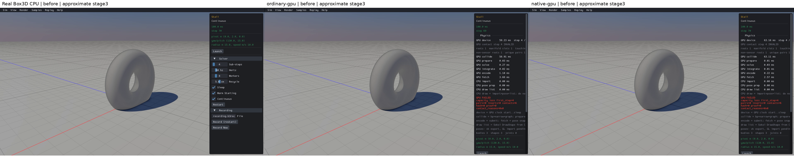
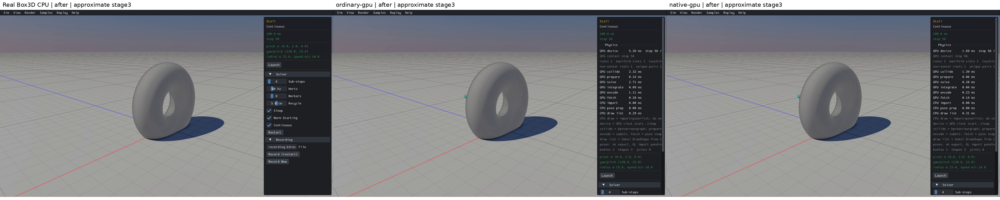
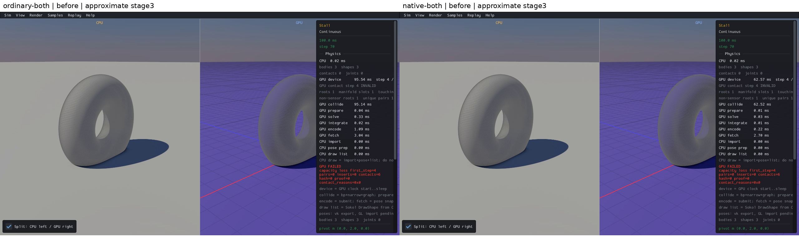
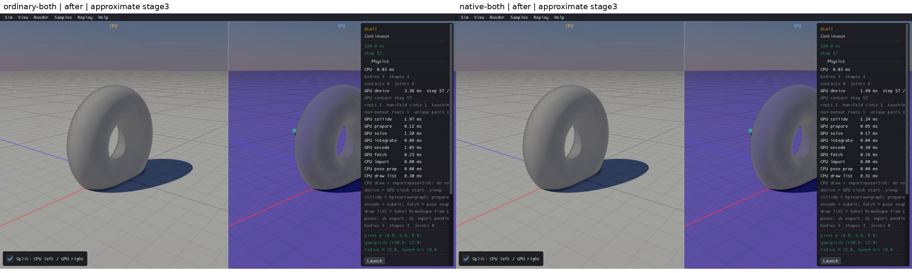

# Published evidence: RUNTIME03

**Verified repair.** Final milestone:21 fixed,1 resolved without repair,0 open;165 native samples reviewed,0 left. PR04 physical failures remain open.

This is a portable extract of the original report, SHA256 `bda3c07c88b0884fad7a15cb2dc850d8816943d9a17e17b1125968798c40225e`. Original milestone-time counts and scope statements below are historical; current PR09 acceptance/routing is in the [publication overview](../README.md). Selected original screenshots are byte-identical. Additional per-scene clips, full raw outputs, protocols and failure inputs remain in the local capture/audit archive; their links are explicitly labeled rather than published as broken paths.

# RUNTIME03 — Continuous/Stall step-4 freeze

Status: VERIFIED / RETAINED with the limitations below.
Counts: **15 fixed, 1 resolved without a repair, 6 open.** Original **165 reviewed / 0 left**; final Stall **1 reviewed / 0 left**.

Stall now completes120 physics steps on ordinary/native standalone and both combined routes. Its GPU mesh collision traversal previously stopped after2048 BVH visits, leaving six nodes pending and correctly recording contact-capacity loss atstep4. The repair bounds traversal by the actual shape's BVH node count. It preserves collision arithmetic, visit order, geometry/defaults, the64-node stack and truthful invalid-state detection.

CPU-first clips and full-resolution screenshots (local capture/audit archive) · physical checks (local capture/audit archive) · source/media closure (local capture/audit archive) · recovery log (local capture/audit archive) · individual visual review (local capture/audit archive)

## Before and after

Real Box3D CPU is first. Original default Continuous/Stall,60Hz/four substeps/eight workers/sleep/warmstart/continuous, original600m/s bullet with unchanged400m/s default clamp. These are approximate middle screenshot stages, not corresponding trajectories or exact pixel comparisons. Before GPU physicalstep4 is INVALID despite its advancing displayframe counter; after overlays advance beyond4 and independent receipts show120 completed physics steps. CPU's rock leaves the default camera; small-body/panel occlusion is retained.

Before: real CPU / ordinary GPU / native GPU. Original full-survey media is copied byte-for-byte under before/. All original failure evidence remains.

After: real CPU / ordinary GPU / native GPU.

Before: ordinary/native combined, actual CPU on the left in each image. Historical missing CPU grid decoration is the separately closed VIS01; it is not attributed to this shader repair.

After: ordinary/native combined. Intentional GPU comparison tint remains.

All25 before and25 after stages were inspected. The per-mode five-stage sheets (local capture/audit archive) preserve every sampled frame, including early stages.

## Smallest failing operation

The original registered C++ factory creates the full200×200 torus (40000 vertices/80000 triangles), ground half-extents500/1/500 atY−1, and native10-point rock of radius.25. CPU builds48231 BVH nodes; the GPU API deliberately rebuilds a32767-node tree, so native tree inputs cannot substitute for GPU data. Actual zero-step GPU metadata was captured with GpuSimNone asserted.

Frozen original GPU completed3 pose, actualCOM/half and cooked BVH feed extracted production overlap/push/quaternion helpers and DFS into an actual NVIDIA/Vulkan kernel. Computed local center is[.291509389877,.770638942719,.250994980335], radius.799913287163. The old limit visits2048 nodes/957 leaves/4685 triangles, leaving nodes28672/26625/26114/25987/25980/25973 pending. The actualnode bound completes3036 visits/1437 leaves/7023 triangles with0pending; maximum stack12, no overflow. Independent float32 CPU traversal matches every count, pending ID and all32767 visited bitmap entries exactly. Diagnosis (local capture/audit archive).

The exact one-line candidate (local capture/audit archive) replaces `visit < 2048u` with `visit < max(mesh_shape.topology_counts, 1u)`. A valid cooked tree visits eachnode atmostonce; the bound is finite and sufficient. max1 preserves empty-tree pop/skip behavior. The unchanged stack-overflow reason12 and remaining-stack sticky-drop fallback remain active. Triangle contact/manifold work was omitted only from the isolated traversal probe, never from production. Both repaired full-scene backends reproduce the archived before completed3 p/q/v/w exactly, then actually complete120.

## Checks and scope

| Actual capture | Completed physics steps | Wall time | Review/health |
|---|---:|---:|---|
| cpu |120|46.399 s|clear; reviewed|
| ordinary-gpu |120|49.418 s|clear; reviewed|
| native-gpu |120|49.714 s|clear; reviewed|
| ordinary-both |120|87.780 s|clear; reviewed|
| native-both |120|88.089 s|clear; reviewed|

The frozen build/factory protocol (local capture/audit archive) passes ordinary/native/unit release builds26.717/28.824/44.504s, existing forcedsticky-capacity31.677s and contradictory-proof1.266s regressions, one CPP compile/three links, originalCPU120.164s/ordinary120133.937s/native120132.732s. Contact first appears atstep3; no failure clears or defaults/tolerance changes were used. Forcedcapacity firstfailure remains2, loss remainssticky, and subsequent stepping is rejected. Results (local capture/audit archive).

Six actual kernel controls (local capture/audit archive) pass: original32767 output exactly equals the prior whole-tree result; empty, overlapping/disjoint one-node, balancedseven-node trees retain expected visits; a valid65-deep skewtree still records64-entry stackoverflow. Their build takes33.381s, individual processes.214–.314s. The actual GPU empty/small controls qualify traversal behavior; they do not pretend to be full contact scenes.

Original body/shape owners and all360 finite state records per engine are stable through120; allfive final capture state channels match the corresponding factory records exactly. Native mass33.1882973, COM, inertia and all10 hullpoints match real CPU before/after original Launch. Original virtual DrawControls is called with only its button result adapted; oldbody/shape IDs invalidate, replacement body generation changes1→2, count remains3bodies/3shapes/0joints, and a public ray selects the correct replacement rock owner. Geometry/lifecycle records (local capture/audit archive). This is API selection, not a manual dragging-physics pass.

Independent120-step ground support checks every native hull vertex: GPU minimumY=.000483392126; no ground fall-through. Maximum GPU mechanicalenergy2655504.395356 stays below the unchanged400clamped initial bound2655504.867288. Speed≤400+1e−5 and quaternion norm error≤1e−5; no numerical tolerances increased. GPU completed-step hullvertex penetration into the analytic torus is atmost.000376919357, below existing.005 linear slop. This is a vertex-only analytic screen, not full faceted-mesh SAT or swept-substep penetration qualification. Stock CPU maximum.030665957468 transient analytic vertex penetration is retained; CPU/GPU trajectory equality is deferred.

## Related mesh inventory

The global reservednode total is not a shape's traversal bound. Actual original zero-step per-shape metadata reconciles the seven large allocation watch cases:

| Scene | Largest individual cooked tree | Disposition |
|---|---:|---|
|002 Benchmark/Chains|4095|Potential bound applicability; original120 five-route sweep had no capacity freeze. Finalcandidate scene unreviewed; no independent repair claimed.|
|007 Benchmark/Falling Trees|16383|Potential applicability; original90s timeout remains PERF01, not proved this visit cutoff. Finalcandidate scene unreviewed.|
|015 Benchmark/Rain|127|100 original static bodies/200 meshes;31/127-node trees sum15800. This cutoff cannot truncate a valid individualtree. PERF04/old solver budgets remainopen/closed respectively.|
|034 Character/Rigid Body|not extracted|Headless observer failed twice (first missing assets, then segfault with assets). Original fullviewer review retained; no new viewer defect or third attempt claimed. Finalcandidate scene unreviewed.|
|060 Continuous/Stall|32767|Only confirmed visit-cutoff defect; repaired/verified on allfourGPU routes with CPUfirst.|
|121 Mesh/Height Field|131071|Original default has1static body/shape, no dynamic contact pairs; no launch/collision repair claimed. Rendering VIS03 already closed. Finalcandidate scene unreviewed.|
|123 Mesh/Reflection|1571|Three trees255/1571/1571 sum3397; per-shape trees fit oldlimit. Finalcandidate scene unreviewed.|

Evidence: first extraction (local capture/audit archive), asset-cwd failure (local capture/audit archive), two unlaunched cells (local capture/audit archive), original Stall metadata (local capture/audit archive). No additional scene with this capacity-cutoff cause was demonstrated. Other164 finalcandidate scenes remain explicitly unreviewed for this milestone; original165 survey is complete.

## Identity, budgets and retained limitations

Production delta from this item's retained baseline: exactlyone WGSL line in collide.wgsl. Before/candidate files (local capture/audit archive), retained final source (local capture/audit archive). Before SHA2564786c0cab0d0017413cac1046b7e07c1381e76f83b3e617cb6618d750d2aa690; candidate SHA256f43aa4c67628c8b786da4dd70a7a4ff5f26cbd6443a2e4a2767b0bacfdc0cadf. Archive/viewer/source/media identities are recorded in closure.json. RealCPU viewer stays32587ea9cf2f8fd067303bf3ce25bc1d43eee92c988ad751b5ea990940d0e99e with original Box3D/sample object proofs. Priorlocal work, Box3D/WASM and all otherlocal documentation are preserved. No new commit/push.

Every phase has a distinct protocol frozen before execution. Builds/watchdogs are finite; finalfive captures use180s each, zero retries. Earlier observer quaternion compile failure and120.264s fullobserver preparation timeout are closed and retained; no unchanged engine retry or extension. Two Character headless extraction failures and one host STEP_EXIT parser failure are retained; corrected parser reuses existing engine evidence without rerunning physics. Before clips precede several separately verified rendering repairs, so incidental decoration/material differences are not isolatedone-line evidence. Exact current baseline shader and identical completed3 proof establish applicability of the traversal defect.

Cold first-use preparation remains a limitation: factory checks take~133s, later captures~49s standalone/~88s split with warmed pipeline cache and software graphics. These are not desktopFPS/PR08/PR12 claims; the cold-start cause/performance repair is not closed here. Vertex-only torus screen, post-Launch physics, manual dragging, long-window support/friction/CCD, whole-state repeats and final release qualification remainopen. PR09 staysunchecked; next original issuegroup is PERF01 FallingTrees. Do not resume historical Rain/scheduling experiments.
