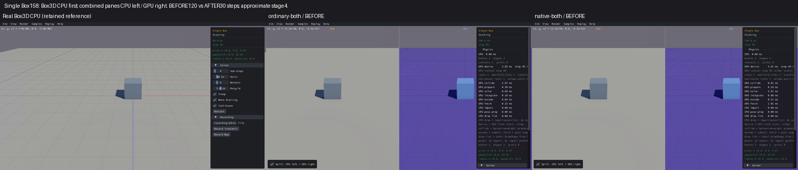
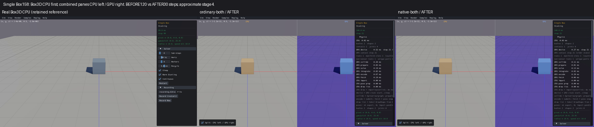

# Published evidence: VIS01

**Verified repair.** Final milestone:21 fixed,1 resolved without repair,0 open;165 native samples reviewed,0 left. PR04 physical failures remain open.

This is a portable extract of the original report, SHA256 `c44f3b010ae3b0d9505921d8e22d10a0ae98b0ae83afd0e292a742659cca6c92`. Original milestone-time counts and scope statements below are historical; current PR09 acceptance/routing is in the [publication overview](../README.md). Selected original screenshots are byte-identical. Additional per-scene clips, full raw outputs, protocols and failure inputs remain in the local capture/audit archive; their links are explicitly labeled rather than published as broken paths.

# VIS01 — Combined CPU ground decoration

**Verified [x].** Overall repair goal:2 fixed,0 resolved,20 open. VIS01:97 scenes reviewed,0 left; all194 corrected-display after application captures retained. Offline audit (local capture/audit archive), acceptance/scene coverage (local capture/audit archive), closed budget (local capture/audit archive), portable evidence manifest (local capture/audit archive) and offline verifier (local capture/audit archive), and CPU-first comparison grid (local capture/audit archive). Read log.md (local capture/audit archive) first on continuation, then the original full-sweep log, AGENTS.md and the GPU roadmap. Exact current scene/PID lives in active-job.json (local capture/audit archive), which must be checked against the OS.

The combined viewer's CPU ground loses its grid and colored origin axes, while real standalone Box3D CPU retains them. The solid slab and its physical shape remain present. The smallest confirmed cause is a name lookup during lazy CPU debug-shape creation, not missing collision geometry.

Real CPU `b3World_Draw` passes raw CPU shape ID `[index1=1,world0=0,generation=1]` to the shared adapter. `PopulateCommonFields` queries `b3Shape_GetName` and compares it with `"ground"`. The dual getter previously searched GPU metadata first and then attempted a GPU-to-CPU mapping. A raw CPU ID with world0=0 is not a public GPU ID, so both lookups fail: CPU name `ground` becomes an empty string. The adapter caches `isGround=false`, then submits `MESH_MATERIAL_MODE_SOLID`, cell0; the ground shader never draws its grid/axes.

The repair scopes CPU-name lookup around the actual CPU world draw in both split and offset routes. During that call, `b3Shape_GetName` sends the unchanged raw ID directly to `cpu_b3Shape_GetName`. Afterward it restores the previous scope. The adapter receives `ground`, selects its existing ground-grid mode/cell1 and renders the original geometry. GPU name lookup, world mappings, hulls, transforms, physics, defaults and picking remain unchanged. Other getters and material/overlay findings are separate open items.

Actual CPU draw/name checks (local capture/audit archive) reproduce the empty name and solid decision; after checks (local capture/audit archive) preserve exact ground, ordinary and empty names across12 split/offset cases, cached repeated draws and GPU scope restoration. The fixture includes the actual dual-world implementation and a real prefixed Box3D CPU archive. GPU renderer endpoints are isolated stubs in this focused check; the combined scene captures exercise the actual ordinary/native GPU viewers. The material decision is the adapter's exact source predicate; screenshots verify actual renderer output. Compiled source evidence (local capture/audit archive) records this boundary, adapter and CPU implementation.

The complete matrix (local capture/audit archive) retains all165 native identities. The earlier85-tag count was wrong:90 notes mention VIS01, ten explicitly exclude it, leaving80 positive findings. All90 mentions plus seven heightfield guards are selected for97 individual CPU-first inspections. Source applicability (local capture/audit archive) audits all165 registration classes, including template registrations; all source classes that call AddGround*/SetGroundShape are inside this set. This corrects a count without dropping observations.

Original protocol (local capture/audit archive) freezes one candidate, two focused builds/processes, two C-only viewer builds/links and194 after capture cells at30steps/90s, zero Rust/performance/before scene launches/retries. Two harness errors are retained: a nonexistent debug-draw field prevented compilation; a handwritten prefixed hull prototype had the wrong return ABI and crashed before the callback. The compile correction (local capture/audit archive) and distinct compiler-derived ABI fixture protocol (local capture/audit archive) record their finite work; the latter passed both12-case processes and both viewer builds. No failed result was removed.

The first two capture apps targeted copied DISPLAY:85 while the Xvfb server was:86. Sokol panicked before rendering/physics startup. Raw failures (local capture/audit archive) remain. The display correction (local capture/audit archive) changes only DISPLAY to:86, preserving binaries/settings: two display-corrected158 cells plus192 never-launched cells. No unchanged engine experiment was retried. CPU/Rust/render/scene linked inputs are hash-checked against VIS03 receipts in ordinary (local capture/audit archive) and native (local capture/audit archive) build records. Only both_dual.c was recompiled for each viewer.

Each scene (local capture/audit archive) keeps both clips, five sampled images, raw health/stdout/stderr, binary/config receipts and a manual review. The comparison contact sheet pins real Box3D CPU first, followed by ordinary before/after and native before/after combined views. Original before media are retained; the seven heightfield before columns use the already verified VIS03 candidate rather than resurrecting missing terrain. Standalone CPU is the same unchanged executable. Static grid comparisons do not require matching trajectories; old120/300-step recordings and new30-step samples have approximate, differing clip times. Early loading/occlusion and health flags remain limits, not passes. This does not close any long-window solver, runtime, picking or performance item.

The audit verifies356 compiled-source hashes,356 object hashes and82 unchanged linked inputs across both viewers, actual focused CPU archive identity,194 after cells and291 reference/before cells. Ordinary binary (local capture/audit archive): `4491106ca998627e65ade2bb5eeaf6e8d628cec2fa29123cad7961fc96b28acd`; native binary (local capture/audit archive): `a6c987836ddc0161914c114b120dbdf622584c6d0b4f33c9b358f8770c97d4c0`. Candidate `both_dual.c`: `dbcf40d524f862b5817c6750d468dd2d0bf4d5f3fe3721150700bbf3d2c59fa4`. Exact delta from the prior verified VIS03 source (local capture/audit archive) changes only the CPU draw/name scope. VIS03 applicability (local capture/audit archive) preserves its earlier terrain/control evidence through unchanged sources/providers; no exhausted terrain campaign was repeated.

All97 scenes were inspected individually with actual CPU-first images and logged notes. This closes the common name/material defect in all80 positively tagged scenes. It does **not** claim97 unobstructed pixel passes: Many Pyramids014 has minified/occluded ground pixels; Long Ray039's current terrain is panel-hidden, with prior VIS03 camera evidence applicable to unchanged terrain. Ten explicit negative cases and seven additional heightfield guards are retained, including off-camera terrain in032. Source coverage and actual smallest-operation checks support shared-path applicability in these limits. No scene was removed to improve the result.

Eight after cells retain health warnings: ordinary/native Convex Pile003, Stall060, Thin Wall061 and Sensor Hits071. Stall's last completed step remains4 with contact-capacity loss despite a completed30-frame capture application. These are existing DIAG01/RUNTIME03 findings, stillopen; a completed clip is not a healthy physics pass. Colors, overlays, CPU body omissions, queries and all other20 groups remainopen. Early loading/black shutdown stages, camera/panel occlusion and before120/300 versus after30 progress are recorded individually. Interactive picking, concurrent/multiworld draw and long-window physics remainunqualified.

Smallest-scene evidence: Single Box158; real Box3D CPU first, ordinary combined second, native combined third. In each combined column CPU is left and GPU right. Approximate clip stage4, before120 versus after30steps; block state/color differs with progress (VIS02 staysopen). Before the CPU combined slab is flat; afterward its grid/redblue axes return, while the GPU floor retains its grid.

Current scene counts and findings are authoritative in log.md (local capture/audit archive). No commit or push is requested for this repair goal; all changes are local. PR09/full production readiness remainunchecked.
