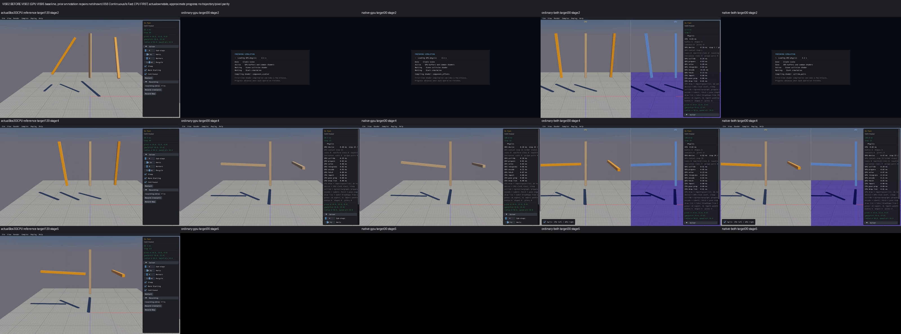
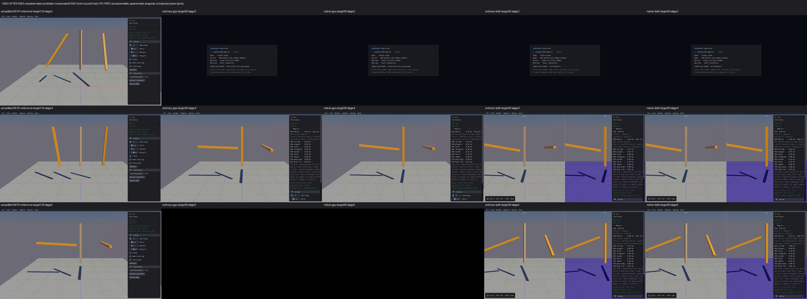
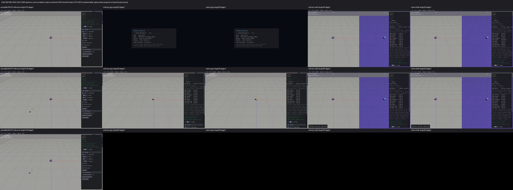
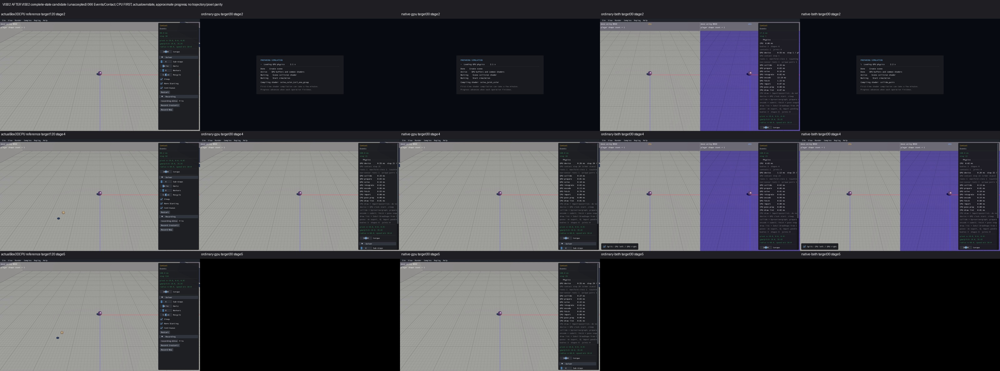

# Published evidence: VIS02

**Verified repair.** Final milestone:21 fixed,1 resolved without repair,0 open;165 native samples reviewed,0 left. PR04 physical failures remain open.

This is a portable extract of the original report, SHA256 `353906aea4da487a7dad26da109ff827007532ca2c064babf23e5d7c1f91f40e`. Original milestone-time counts and scope statements below are historical; current PR09 acceptance/routing is in the [publication overview](../README.md). Selected original screenshots are byte-identical. Additional per-scene clips, full raw outputs, protocols and failure inputs remain in the local capture/audit archive; their links are explicitly labeled rather than published as broken paths.

# VIS02 material/state repair — verified with retained limits

165 samples checked individually,0 left. **VIS02 [x];7 fixed,0 resolved,15 open.** Final acceptance (local capture/audit archive) and portable verification (local capture/audit archive) PASS:29245 saved files/11095964792 bytes,725 compiled-source records; no ignored build outputs needed. Audit28.27s,index36.59s,portable35.48s; all180s envelopes CLOSED. No live job. This header is current; the detailed chronological entries below retain their original pending labels and closed next actions.

The GPU renderer used generic Tan/Soft (or combined blue/Soft), discarding custom material, body type and sleep state. Its diagnostic inputs also omitted actual speed-cap and accepted-CCD state. The shared selector now uses those actual inputs with CPU precedence; cap metadata is written inside the unchanged clamp operation, and HadTOI is written only at an accepted CCD correction. An internal accumulator preserves cap observations across substeps. Idle/sleep states retain the last awake diagnostics. Explicit custom colours remain byte-for-byte unchanged; ordinary combined colours retain intentional blue RGB with the correct material. Geometry, physics defaults, bodies/shapes and picking operations are unchanged; Box3D/WASM are unchanged.

**Acceptance evidence:** offline audit (local capture/audit archive), source/object reconstruction (local capture/audit archive), all165 CPU-first comparison rows (local capture/audit archive), individual visual log (local capture/audit archive), affected-source inventory (local capture/audit archive). The audit checks725 actual compiled sources/objects,721 unchanged units,192 linked inputs, exact production-plus-observer reconstruction, all825 CPU/before reference captures, all660 after cells and550884 actual colour records (2360 custom passthrough). Original96 colour mentions are included in the full165 review. Focused ordinary/native clamp/CCD/lifetime tests and74 actualCPU/2304 precedence selector inputs passed as detailed below. Original fixture/audit preparation failures remain saved; three offline assertion corrections addressed helper context, viewer-persisted settings and the five older review schemas without production changes or new engines.

**Limits:**646 after cells completed,12 timed out,2 capacity failures;34 cells retain runtime/health flags. SingleBox158 standalone and ConveyorMesh136 remain unavailable. JointGrid010 has post-draw limits; LargeWorld013 has no material draws. Full per-body pixels behind panels/crops, unexercised transitions and approximate CPU120/GPU30 progress remain explicit in each review. These are no physics, runtime, query, picking or performance passes. PR04 FAST-threshold differences and every independently logged issue remain open. No build/check/capture budget is reopened. No new commit/push.

The following selected screenshots show actualCPU first; every sample's before/after sheets and route-specific limits are displayed in the detailed report below. GPU baseline precedes separately verified VIS07/08 annotation repairs; stages/progress are approximate.

Before, Is Fast056:

After, Is Fast056 (actual FAST Orange/Glossy):

Before, Contact066:

After, Contact066 (custom Plum/Metallic preserved):

## Preserved detailed investigation and all165 individual comparisons

### Earlier focused-check report

Status: focused checks passed; whole VIS02 remains unchecked. Overall6 fixed/0 resolved/16 open. Original full review165 done/0 left; earlier prototype14 comparisons preserved,151 not reviewed on that prototype. All four final metadata viewers built successfully (14 commands,46.2s). Final verification165/165 reviewed/dispositioned,0left; fullsample acceptance remains open.

The shared GPU draw selector discarded custom/type/sleep state in the original baseline. The first candidate restored these inputs and FAST Orange/Glossy. Source tracing then found two additional missing inputs: actual clamp branches did not publish speed-cap state, and accepted host/device CCD corrections did not publish HadTOI. A cleared NO_HIT proxy bit also occurs on teleport and cannot stand in for an accepted hit.

The metadata extension retains the existing clamp predicate/arithmetic, records an internal pending cap flag at the actual branch, accumulates across TGS substeps, then publishes at the existing apply pass. Sleeping/confirmed-idle bodies retain last-awake diagnostics, matching CPU body-flag lifetime without changing scheduling. Accepted host/device CCD adds a separate HadTOI bit. Custom colors, invalid mass, disabled and sensors retain their CPU precedence; HadTOI Lime/Default precedes awake bullet Turquoise, speed-cap Yellow/Default, FAST Orange/Glossy and type/awake materials. Ordinary combined states retain blue RGB, with diagnostic/custom hues taking precedence.

| Check | Ordinary | Native | Evidence |
|---|---|---|---|
| Recorded clamp | PASS15 actualCPU vectors, bit-exact outputs;6 strict boundary controls | PASS same | First/corrected raw test logs below |
| Cap lifetime and identity | PASS early-substep linear cap, angular cap, allow-fast exception, locked velocity, next-step clear, shape/body ownership and deleted-slot generation | PASS same | Raw metadata flags/positions/velocities |
| Host CCD | PASS accepted solid vs miss/filter/veto/sensor; sensor hit recorded without solid HadTOI | PASS same | Frozen start/end traces, existing correction operation |
| Device CCD | PASS accepted solid vs miss/filter, no host correction, unchanged velocity and next-awake miss clear | PASS same | Executed device path asserted |
| Sleep/idle/callback | First helper failed to exercise idle; corrected helper PASS16 sleep/idle steps and callback cap/clear | PASS | Failure retained, no repeated passing ordinary tests |
| CPU color selector | ASAN/UBSAN PASS74 saved actualCPU inputs+2304 diagnostic precedence combinations, ordinary/cool/custom | Shared C selector | C-check.stdout.txt |

First check: one ordinary test build26.3s and five-test process108.2s,4PASS/1fixtureFAIL. The helper used gpu_wait_with_mirror, which calls with_world_mut and invalidates the idle proof on every step. The source correction changed only that helper to gpu_wait plus read-only getters. One extra ordinary build21.5s/failed-test-only0.9s and originally unused native build26.5s/five-test109.3s all passed. No production correction, unchanged engine retry or repeated passing ordinary tests. Both budgets CLOSED, driver processes absent.

Raw evidence: first state (local capture/audit archive), ordinary results (local capture/audit archive), ordinary trace/failure (local capture/audit archive), corrected state (local capture/audit archive), corrected idle trace (local capture/audit archive), native results (local capture/audit archive), native trace (local capture/audit archive), C selector (local capture/audit archive), production delta (local capture/audit archive), source audit (local capture/audit archive), original finite budget (local capture/audit archive), helper correction budget (local capture/audit archive). First failed source/binary identities are retained.

This does not qualify full sample rendering, physics/CCD correctness, queries, picking, runtime/performance, exact pixels or scene trajectories. The CPU/GPU FAST cutoff difference remains PR04. Before/after images for the earlier partial material prototype remain in the prototype report (local capture/audit archive); final metadata images must be captured/reviewed under a distinct protocol. Box3D/WASM/defaults/geometry/picking operations unchanged. No commit/push.

## First final comparison — Single Box158

ActualCPU first; BEFORE GPUVIS05 bounds/floors-fixed30, prior Step/text annotation repairs absent. AFTER metadata candidate120. Approximate stage/progress, own actual state; no pixel/trajectory comparison.

Both combined modes complete120, no health flags, and actualGPU flags select Dead material at30/120 with intentional blue RGB. Floors/grid/box/annotations retained. Each standalone times out90 during scene collision shader initialization; native/ordinary final original-resolution screens state `Compiling shader: collide_pairs` at85.8/85.9s. No health/color rows or simulated/rendered standalone result. This is an availability limit, not proof of a solver stall or a repaired startup cost. Loading clips and raw receipts remain preserved. Individual review (local capture/audit archive).

No failed engine cell is repeated. The remaining unlaunched cells stay under the frozen660-cell capture protocol; inspect/log each scene before continuing. Full source/object/media audit, portable index and final report are still pending.

## Further final comparisons — Is Fast056 and Contact066

All four routes completed30 steps for each scene with no health flags. These screenshots pin actualBox3DCPU first and use approximate independent progress; baseline GPU clips precede the Step/text annotation repairs.

Is Fast: baseline tan/Soft or blue/Soft becomes Orange/Glossy from actualGPU FAST flags0x18008. CPU middle-bar FAST classification differs under the existing thresholds; that physics difference remains PR04. These sampled rows do not exercise speed-cap/HadTOI. Individual review (local capture/audit archive).

Contact: the actual custom0x05dda0dd Plum/Metallic remains unchanged through body3/shape6 generation1 awake8 to sleeping12, including both cool-palette routes. Before GPU discarded the custom material. CPU120-step later spawned spheres versus GPU30-step initial sphere reflects independent sampled progress. Loading/shutdown black tails and panel occlusion are retained; no event-interaction or long-window claim. Individual review (local capture/audit archive).

The current recovery header is regenerated from verification-matrix.json. A host-only checkpoint regex correction now refreshes both previously-used “reviewed” and “dispositioned” header wording; no pinned producer, viewer, capture protocol or engine result changed. Contact driver1536270 is absent; session70525 is no longer retained by the execution service, and all four capture receipts record exit0.

The current all165-row CPU-first comparison grid (local capture/audit archive) shows saved individual final reviews and explicitly marks every remaining sample UNREVIEWED. Generation uses a frozen host-only grid budget (local capture/audit archive), at most165 distinct review counts/15s each, with zero engine/build/capture/retry operations; raw generation identities remain in grid-receipts/. This display does not close the still-unused final audit/portable acceptance.

## Conveyor Mesh136 — final comparison unavailable

All four final routes reached the90s watchdog, with no health file or color rows. Original-resolution loading frames explicitly show create scene/common shaders done, scene collision shader active and simulation waiting at `Compiling shader: collide_pairs` (85.8s). This is an initialization boundary, not an inferred solver stall or successful custom-Green repair. Before GPU discarded custom Green; CPU baseline remains first. Individual review (local capture/audit archive).

All four136 GPU routes are UNVERIFIED. Current158/136 six initialization timeouts are preserved, with zero unchanged engine retries. After the scheduled028 kinematic comparison, isolate frontend/driver compilation at the actual collision-pipeline boundary under a separately frozen finite diagnostic budget before launching further mesh-heavy scenes. No closed solver campaign resumes. Metadata660-cell protocol remains unchanged; its unlaunched cells are pending, not silently retried or granted a larger watchdog.

## Offset Kinematic028 — final material comparison

All four routes completed30 steps with two bodies/two draws and no health flags. Actual type1/flags24 selects SteelBlue/Metallic0x054682b4 standalone and coolBlue/Metallic0x056495ed combined, replacing the baseline Soft material. Static object/grid remain visible; loading/black-tail/panel limits and independent CPU120/GPU30 sampled poses remain explicit. No cap/TOI/custom state or physics/control/picking qualification from these images. Individual review (local capture/audit archive).

Isolated collision-frontend report (local capture/audit archive): actual before/current parse/validate/override/emission completed all four variants in0.215s; added3OpName/1OpConstant are a binary difference, not proven semantic or driver-cache attribution. One hostbuild/process budgetCLOSED, no GPU/viewer retry or production change. Next freeze the actual device/pipeline/cache-boundary diagnosis before further mesh captures.

Actual driver-creation report (local capture/audit archive) retains the failed two-process diagnostic: before-metadata mesh pipeline136.221s exceeds90s startup budget; candidate call incomplete under shared150s process limit (only roughly14s remaining). No production/solver/cache-write change or shader-semantic/cache-miss attribution. A forward-only remaining capture envelope (local capture/audit archive) is frozen for the640 originally unlaunched cells: initialization180s plus post-first-actual-draw90s, maximum270s per app; preserve loading/failure media and sample actual draw window. No repeated six failedcells or new builds. Driver/prepared protocol still required before launch.

Remaining driver/protocol prepared before first001launch: frozen execution protocol (local capture/audit archive), driver (local capture/audit archive), original20-cell closure (local capture/audit archive). Live completeGPU-provider JSON rows start the post-draw deadline; candidate images sample first/last observed callback window with120ms display margin, capped before app exit, and preserve original whole-clip/loading samples. Timing is approximate host observation, not GPU/frame-step equality. Missing markers remain explicit; no-body tools/culling need individual source/visual disposition. Exact same producer/binaries/settings/steps as the five original comparisons.

## Candy Cups001 — completed final material window

All four routes completed30 steps, no health flags,4097 bodies/draws stable.8194 sampledGPU color rows per route select Tan/Soft or intentional combined coolBlue/Soft from actual awake flags8. CPU300-step reference is gray/asleep; that independent progress/state difference is not a material-state mismatch. Complete cup array, floor/grid visible in actual-draw-window samples; full loading clips/whole-clip frames remain retained. No custom/cap/TOI exercised here. RUNTIME01 full300-step progression, physics/picking/query/performance stayOPEN. Individual review (local capture/audit archive).

Chains002: all four complete30, stable2501 bodies/draws and1875 joints, no reported health flags. Actual dynamic Tan/Soft and static Matte states match the packed selector; combined blue retains those materials. Standalone initialization143–145s is retained, with actual drawing sampled separately. Independent CPU120 versusGPU30 progress; cap/CCD/custom/sleep transitions and long settling remain unexercised. Raw review (local capture/audit archive).

Before, real Box3D CPU first:

After, real Box3D CPU first:

Convex Pile003: Convex Pile: both CPU-first before/after sheets actually inspected. Solid floor/grid and descending hull column remain visible in all four routes; upper column is clipped by the default camera in CPU and GPU. Candidate visibly restores FAST Orange/Glossy where baseline was Tan/Soft or combined coolBlue/Soft; actual frame30 dynamic flags98312 yields04ffa500 in every recorded visible body, overriding combined tint. Frame1 awake8 is Tan/Soft or coolBlue/Soft, staticfloor9 remainsMatte. All four complete30, stable5121 totalbodies,3713 standalone/2817 combined renderedshapes, zero NaNs. Original DIAG01 remains: initialmaxY317.9983 is already above recorder200 cutoff; maxY decreases316.7397 at30, raw exploded/incomplete flags preserved, not a material failure or physical pass. Standalone17.8/17.3s, combined26.9/26.3s;7426 standalone/5634 combined actualcolorrows. CPU120 versusGPU30 independent own state; CPU/GPU FASTthreshold difference staysPR04, not repaired here. No cap/HadTOI/custom/sleep transitions exercised; no fullpile landing, picking or performance qualification. Raw review (local capture/audit archive).

Before, real Box3D CPU first:

After, real Box3D CPU first:

Destruction004: Destruction: both CPU-first before/after sheets actually inspected. Solid mesh floor/grid, fragment pile, shadows and explosion gizmo remain visible; candidate restores orange moving fragments where baseline standalone was Tan/Soft and combined GPUblue. All four complete30 with4027 bodies/draws and zero joints, no reported health flags or NaNs. Actual8054 colorrows per mode exercise cap and acceptedCCD: frame1 has1718 flags229384 Yellow/Default,861 FAST98312 Orange/Glossy,1447 awake8 Tan/Soft or coolBlue/Soft. Frame30 has2751 FASTOrange,1222 ordinaryawake,15 capYellow,37 acceptedCCD294920 Lime plus1 cap-and-CCD425992 Lime, verifying HadTOI precedence; staticfloor9 staysMatte. All recorded inputs match selector, no pendingbit. Transient frame1 Yellow is raw draw evidence, not claimed present in all sampled screenshots. Standalone15.4s each, combined22.9s each; approximate CPU120 versusGPU30 independent progress. Fragment trajectories/default settling differ and are not matched here. Custom/sleep/disabled states, explosion controls, long recycling, picking and physicalCCD/performance qualification unexercised; existing PR04 FASTthreshold difference remains. Raw review (local capture/audit archive).

Before, real Box3D CPU first:

After, real Box3D CPU first:

Explosion005: Explosion: actually inspected both CPU-first sheets. Complete body array, enclosing compound walls and solid floor visible across ordinary/native GPU and bothcombined. Candidate dynamic bodies remain Tan/Soft or coolBlue/Soft because actual frame1/30 flags8 are awake; CPU120 reference is gray/asleep, different independent own state, not selector mismatch. Five static draws flags9 remainMatte;2188 actualcolorrows/mode match selector, no pendingbit. Allfour complete30 without health flags/NaNs,1090 bodies/1094 draws, zerojoints, lastmaxspeed0/minY0.0049/maxY0.005. Baseline ordinaryGPU last sampled panel is retained black shutdown tail; earlier baseline panels show geometry, candidate actualdraw stages allshowgeometry. Standalone12.9/13.4s andcombined16.9s each. Cap/HadTOI/custom/sleep/disabled transitions and explosionbutton not exercised; no longsleep/physical/picking/performance or trajectory parity qualification. Raw review (local capture/audit archive).

Before, real Box3D CPU first:

After, real Box3D CPU first:

Falling Boxes006: Falling Boxes: both CPU-first before/after sheets actually inspected. Falling layers and solid floor/grid remain visible across allfour routes; high layers exceed defaultcamera in CPU and GPU. Candidate restores FAST Orange/Glossy in movingGPUlayers where baseline was Tan/Soft orcoolBlue/Soft. Actual6402 colorrows/mode show3200 awakeflags8 ordinarySoft at1 and3200 FAST98312 Orange/Glossy at30; staticfloor9 staysMatte, allrows matchselector and no pendingbit. Allfour complete30 withouthealthflags/NaNs,3201 bodies/draws andzerojoints; lastminY1.2396/maxY99.2396/maxspeed5.0. Baseline nativeGPU/nativeboth final panels are retainedblackshutdown tails; earlierpanels havegeometry, candidateactualdraw samples showgeometry. Standalone9.6/9.1s, combined12.1/12.6s; CPU120 versusGPU30 independentprogress. Full100mcolumn landing, sleep/cap/CCD/custom/disabledtransitions, picking, physicalandperformance qualification unexercised. Existing PR04 FASTthreshold difference retained. Raw review (local capture/audit archive).

Before, real Box3D CPU first:

After, real Box3D CPU first:

Falling Trees007: Falling Trees: both CPU-first before/after sheets actually inspected. Uneven heightfieldterrain and falling compoundbranches remain visible in allfourroutes; candidate restores FAST Orange/Glossy where baseline was Tan/Soft orcoolBlue/Soft, including combined GPUbranches. Actual1278 standalone/926combined colorrows show dynamicflags98312 Orange/Glossy at1/30 and staticfloor9 Matte; no cap/HadTOI/custom/sleep transitions exercised. Allfour complete30 withouthealthflags/NaNs,51 totalbodies/zerojoints,639 standalone/463combined visible drawshapes under differentviewports; lastminY-0.1192/maxY0.291/maxspeed10.2589 are bodyorigins, not independent floorpenetration test. Standalone27.8s each, combined34.8/34.3s; this instrumented shortwindow doesnot close PERF01 original120-step timeouts. CPU120 reference has progressedfurther in falling; no trajectory or complete landing parity claimed. Tallbranches extendcamera, and interaction/picking/longlanding/physicalanddesktopperformance qualification remainopen. Existing PR04 FASTthreshold difference retained. Raw review (local capture/audit archive).

Before, real Box3D CPU first:

After, real Box3D CPU first:

Height Field008: Height Field: both CPU-first before/after sheets actually inspected. Wave surface, intendedhole strips and grid remain visible in allfourGPUroutes; earlier VIS03 heightfieldrepair is preserved. Static floorflags9 yields DarkGray/Matte standalone and intentional coolDarkSlateBlue/Matte combined, actualtwo colorrows/mode at1/30 matchselector withnopendingbit. Allfour complete30 withouthealthflags/NaNs, onebody/onedraw/zerojoints. Standalone38.3s each, combined69.7/70.7s; these instrumented shortcaptures do not close PERF02 original120-step queryperformance finding or qualify numericraycast parity. CPU120 versusGPU30 independentprogress; no dynamic/cap/CCD/custom/sleep/disabled transitions exercised, no UIinteraction/picking/physical/desktopFPS or exactpixel parity qualification. Raw review (local capture/audit archive).

Before, real Box3D CPU first:

After, real Box3D CPU first:

Hull009: Hull: actually inspected both CPU-first before/after sheets. Green/yellow wireframe specimens remain visible in early/middle stages ofallfour modes. Defaultpanel obscures right specimen and splitdivider clips/straddles specimens inbefore/after; originalVIS04/layout limitation preserved. Baseline finalnativeGPU/both panels andcandidate finalnativeGPU panel retainblackshutdown tails, not missingbody material. Actualsource box3d/samples/sample_benchmark.cpp BenchmarkHull constructor creates hulls without bodies and Render directly callsDrawHull explicitGreen/Yellow; nofloor expected. Allfour complete30 measured displayframes withouthealthflags, zero bodies/drawshapes/joints and completed/renderedGPUstep0. No GPUprovidercolorrows or livedrawmarkers bydesign: sharedgeometrydraw guard only, no bodymaterial/independentGPUhullalgorithm or30GPUphysicssteps qualification. Standalone5.7s each, combined6.7s each; CPU120 independentdisplayprogress. Cap/CCD/custombody/type/sleep states, interaction/picking/fullspecimenlayout andperformance unexercised. Raw review (local capture/audit archive).

Before, real Box3D CPU first:

After, real Box3D CPU first:

Joint Grid010: Joint Grid: both CPU-first sheets plus allfour existing mode/frame-3.png actually inspected. Allfour timeout afterfirstactualGPUdraw90s at100.7-101.3s total, nohealthfile/no30-stepcompletion; PERF03/runtime remainsopen. Actualfirstframe9700 standalone/8827combined rows show100/97 staticanchors flags1 Matte and9600/8730 dynamicflags0 awakeSoft (Tan orcoolBlue), allmatchselector withnopendingbit. No frame30 stateinputs. First/last observedmarker isonlyframe1, yieldingzero-width marker sampling; standalonedraw-frame sheets stillshowloading, while combined earlylattice isvisible. Existing wholeclipframe-3 shows coherentlattice inallfour, ordinarydisplaystep7 andnativedisplaystep10; nativebottombodies visiblyorange, butexactlaterFASTinputs were nottraced. UIreports10000 bodies/shapes and19800joints; nofinalhealth/count/physicalacceptance inferred. CPUreferencehasnofloor, noflooromissionclaimed. Cap/CCD/custom/sleep states, constraintaccuracy, fullduration, pickingandperformance qualification remainunverified; timingisincidentaldiagnostic. Loading/partialclipsandoriginalCPUexportlimitation retained, noengine retry/media regeneration. Raw review (local capture/audit archive).

Before, real Box3D CPU first:

After marker sheet (standalone loading; see existing later whole-clip frames below), real Box3D CPU first:

Existing whole-clip stage4 frames actually inspected; approximate independent progress, no final health result. No extra capture or extraction.

| Actual Box3D CPU reference | Ordinary GPU | Native GPU | Ordinary combined | Native combined |
|---|---|---|---|---|
|  |  |  |  |  |

Junkyard011: Junkyard: both CPU-first before/after sheets actually inspected. Floor/container, hullcolumn and kinematiccylinder remainvisible inallfourroutes. Candidate cylinder is SteelBlue/Metallic standalone (type1 flags24 packed054682b4) andcoolBlue/Metallic combined056495ed; baseline standalonecylinder wasTan/Soft. Movinghulls visiblyrestore FASTOrange/Glossy inallfour instead ofTan/Soft orcombinedblue. Actual21176 standalone/13880combined rows matchselector withnopendingbit: static3draws flags9Matte; at1 ordinarydynamic10580/6932 plus4FAST; at30 dynamic10584/6936 allFAST98312; onekinematic perframe. Allfour complete30 withouthealthflags/NaNs,10586 bodies/zerojoints,10588 standalone/6940combined drawshapes underdifferentviewports. Originalfullsweep10590vsCPU10588 accountingnote ispreserved/untraced, notclaimedfixedbycolors. Standalone18.8/17.6s,combined24.5/22.5s; CPU120versusGPU30 independentprogress, highcolumn clippedbycamera. Cap/CCD/custom/sleep/disabledtransitions, fullsettling, picking, physicalandperformance qualification remainopen. ExistingPR04 FASTthreshold difference retained. Raw review (local capture/audit archive).

Before, real Box3D CPU first:

After, real Box3D CPU first:

Large Pyramid012: Large Pyramid: actually inspected both CPU-first before/after sheets. Tallpyramid andsolidfloor/grid remainvisible inallfourroutes, no grosscollapse seen in sampledwindow. Defaultcamera/panel clipsapex/rightedge especiallysplit, limitingfullsilhouette. Allfour complete30 withouthealthflags/NaNs,5051bodies/draws andzerojoints; lastminY0.4937/maxY98.741/maxspeed1.0634. Actual10102 colorrows/mode at1/30 show5050 awakeflags8 Tan/Soft orcoolBlue/Soft plusstaticfloor9 Matte, allmatchselector/no pendingbit. Candidate middleframes showtransientorange upperlayers inallfour; middleFAST inputs are notlogged atendpoint-only1/30, so no exactintermediate state parity claimed. Endpoints have no cap/HadTOI/custom/sleep/disabled flags. Standalone13.1/14.1s,combined19.1/19.2s; CPU120 andGPU30 independentprogress. Fullsettling/stability, picking, physics/performance and exacttrajectory matching remainunqualified; PR04 FASTthreshold differencesretained. Raw review (local capture/audit archive).

Before, real Box3D CPU first:

After, real Box3D CPU first:

## Large World013 — capacity failure retained

Actual Box3D CPU first. The default CPU camera shows floor grid/sky; its original healthy million-body run does not qualify the unrendered GPU scene. Every GPU route still fails preparation: `GPU scratch needs 3971611912 bytes, device permits 2147483647`. Standalone runs retain181.4s timeouts. Both combined runs stop after over5s presentation of this explicit fatal error, with status CAPACITY_FAILURE and11.28s elapsed. No health, GPU draw markers or material inputs; CAP01 remains open. The native combined final black shutdown stage is retained.

The collector failed starting ffprobe with EAGAIN. Recovery processed saved native media and launched only the two combined cells that had never started; original receipts/videos remain intact. No engine repeats, source edits, builds or checks. Individual review (local capture/audit archive), bounded collector recovery (local capture/audit archive), CPU-first grid (local capture/audit archive). Current18checked/147left;6fixed/0resolved/16open. This is a documented failure disposition, not material/physics acceptance.

## Many Pyramids014

All four routes complete30steps without health issues;10781 bodies,0joints. Static Gray/Matte and awake Tan/Soft (intentional blue/Soft in combined) match actual endpoint inputs. Standalone6931/combined5391draws; prior full-survey10781 GPU draw count belongs to the preVIS05 bounds repair. Array/floor remain visible/coherent, with camera/panel cropping. Custom/sleep/FAST/cap/acceptedCCD and long-window physical/picking behavior unexercised. CPU120 independently progressed; no pixel/trajectory parity. Individual review (local capture/audit archive).

Current19checked146left;6fixed0resolved16open. Bounded fetch succeeded, HEAD/origin feat/gpu0/0; no merge or local-work changes needed. Next015 Rain after reading its log; no historical solver campaign resumed.

## Rain015

All four30-step runs complete without health issues; bodies520→940/joints420→840. Actual awake/static/FAST inputs match selected materials; by30 all840standalone/672combined dynamic draws select Orange/Glossy, overriding combined blue. Before tan/blue falling specimens become orange; tiny high specimens and panel/divider limits restrict visual detail. Mesh floor/arches retained. CPU120 has later spawning/progress; no trajectory/population parity. Full landing/recycling/constraints, sleep/custom/cap/acceptedCCD, picking and performance remain unqualified; PERF04 stays open and no historical solver campaign resumed. Individual review (local capture/audit archive).

Current20checked145left;6fixed0resolved16open. Session10582 terminal0/driver1720807 absent; next016 Sensor after log read.

## Sensor016 — no body materials exercised

All four30-step runs complete6.27–6.75s/no health issues,1681bodies/0joints/0draws. Sensor-only default visibility matches the prior VIS06 repair. No color rows/live GPU draw markers, so no material/sensor-color qualification. Sheets show preparation at the first sample, sky/UI at the middle and black shutdown tails at the last in all four after clips; preserved explicitly. CPU120 has later spawning/events. The historical step32 freeze and later false health classification remain RUNTIME02/DIAG01 open; this30-step check does not reach them. No engine retry, event/physics/picking or fullVIS02 acceptance. Individual review (local capture/audit archive).

Current21checked144left;6fixed0resolved16open. Session89809 terminal0/driver1724458 absent; next017 Washer after log read.

## Washer017

All four30-step runs complete without health issues,8002bodies/0joints/8041draws. Each mode has16082actual color-input rows:40kinematic drum parts select Metallic,8000awake contents become FAST Orange/Glossy by30, floor remains Matte. Standalone drum changes tan→SteelBlue/Metallic; combined blue/Metallic remains intentional and FAST Orange overrides blue contents. Floor/grid/compound parts intact, right-panel/split cropping limits full silhouette. CPU120 later tumbling vsGPU30 ordered block is independent progress, not a trajectory defect. No custom/sleep/cap/acceptedCCD inputs; longer mixing/physical/picking/performance remains unqualified and PERF05 open. Individual review (local capture/audit archive).

Current22checked143left;6fixed0resolved16open. Session10603 terminal0/driver1726649 absent; next018 Wide Pyramid after log read.

## Wide Pyramid018

All four30-step runs complete/no health issues,1241bodies/0joints/1241draws. At1 all1240dynamics awake Soft; at30 689FAST Orange/Glossy+551awake Soft, static floor Matte. All2482input rows/mode match selector. After images show orange upper/falling layers and tan lower layers, or blue lower layers in combined. CPU120 later settled state differs; independent progress and existing FAST cutoff differences remain explicit. Floor/grid/stack intact; split panel occludes right GPU extent and original baseline ordinary final black tail remains. No custom/sleep/cap/acceptedCCD, full settling/physical/picking/performance or wholeVIS02 qualification. Individual review (local capture/audit archive).

Current23checked142left;6fixed0resolved16open. Session53628 terminal0/driver1731564 absent; next019 Body Type after log read.

## Body Type019 — endpoint sleep inputs, sampled appearance limited

All four30-step runs complete/no health issues,8bodies/3joints/8draws. All16rows/mode match selector: static Matte, awake Soft, FAST Orange/Glossy; last rows contain four asleep flags12 selecting Dead material (LightSlateGray standalone, blue combined). The sampled structure still appears tan/blue before endpoint completion, so these images do not prove visible sleep-color presentation. Upper boxes visibly become FAST orange. Native after final black shutdown tail and baseline loading/black tails retained. Floor/grid/table/boxes/sphere remain visible. CPU120 gray structure is later ownstate. The default type radio does not exercise kinematic or transitions; separate Washer/Junkyard/OffsetKinematic guards remain applicable. No custom/cap/acceptedCCD, UI changes/picking/constraint/full settling or wholeVIS02 acceptance. Individual review (local capture/audit archive).

Current24checked141left;6fixed0resolved16open. Session55454 terminal0/driver1734638 absent; next020 Cast after log read. This continuation saved six individual reviews014–019 with original scenes/binaries unchanged, no build/test/engine retry; bounded fetch HEAD/origin0/0.

## Final comparison 020 — Bodies/Cast

Actually inspected CPU-first before/after sheets: retained colored query fixtures/cylinder/capsules/lines and grid/axes standalone; orange origin collisionplane outline now replayed in both GPUhalves, consistent with priorVIS07 fix. Split mainfixtures remain behind panel/offcamera, no fullvisibility claim. Allfour complete30 DISPLAYframes5.77to6.75s/no reportedhealthissues;completedphysicsstep0 expected becauseStep omitsSample::Step. Recorderbody_count0/instances3 is toolmetadata, not actualonekinematicbody inventory. Zero GPU color rows/drawmarkers; shared directRender/Stepprimitives guardonly, noGPUbodymaterial/kinematic color or30physics qualification. Firstsampleloading/finalallfourblackshutdown preserved; middleactualfixture visible. No querynumeric/drag/picking/physical or wholeVIS02 acceptance.

Individual review (local capture/audit archive). CPU first; independent progress, no exact pixel/trajectory match.

Current25checked140left;6fixed0resolved16open. Driver1737444 absent, capture terminal. Next021-Class-Ring after log read; wholeVIS02 remains unchecked.

## Final comparison 021 — Bodies/Class Ring

Actually inspected CPU-first before/after sheets: compound ring/band/gem and floor/grid intact; baseline tan/blue ring becomes FAST OrangeGlossy allfourroutes, overridingcombinedblue. Allfour complete30displayframes7.26to8.77s/nohealthissues,2bodies/0joints/26draws;52rows/mode,25dynamicparts flags114760FAST OrangeGlossy at1/30 plusstatic9Matte (purpleRGBcombined). Allpackedmaterials match selector; no cap/HadTOI/custom/sleep cases. Source sixteen960Hz steps perdisplay/8substeps retained: finalcompletedphysics480 for30displayframes is intentional, not extraelapsedtime; CPUreference120display independently later. Shape/body mapping still compound one ringbody25parts, nofakebody change. Before native loading/blacktail retained; afterthree sampled stages showring in allfour. No inversionduration/energy/contactnumeric/picking/performance or wholeVIS02acceptance.

Individual review (local capture/audit archive). CPU first; independent progress, no exact pixel/trajectory match.

Current26checked139left;6fixed0resolved16open. Driver1739621 absent, capture terminal. Next022-Disable after log read; wholeVIS02 remains unchecked.

## Final comparison 022 — Bodies/Disable

Actually inspected CPU-first before/after sheets: floor/grid and verticaljointedlinks retained; standalone linktip now SteelBlueMetallic and fallingball FASTOrangeGlossy. SplitGPUball behindpanel/offcamera, so no visiblecombinedball claim. Allfour complete30/nohealthissues6.27to7.75s;6bodies/3joints/6draws,12rows/mode. Actualkinematic24Metallic+static9Matte+4awake8Soft at1;at30 3awakeSoft+1FAST98312OrangeGlossy,kinematic/static unchanged;combinedcoolRGB onlyordinary states, recordedFAST stillOrange. Allselectorvalues match. CPU120latergrayball doesnot imply sameGPU30sleepstate. No disabledflag orenable toggles exercised despite sample name; awake/sleep/disabled lifecycle and UI toggles remainunqualified. Beforeloading/lastblacktails retained; afterthreeactual sampled stages visiblelinks/standaloneball. No fullsupport/constraint/picking/performance/custom/cap/acceptedCCD orwholeVIS02pass.

Individual review (local capture/audit archive). CPU first; independent progress, no exact pixel/trajectory match.

Current27checked138left;6fixed0resolved16open. Driver1742196 absent, capture terminal. Next023-Fixed-Rotation after log read; wholeVIS02 remains unchecked.

## Final comparison 023 — Bodies/Fixed Rotation

Actually inspected CPU-first before/after sheets: staticgray anddynamictan capsules/floor/grid retained standalone, combinedintentionalpurple static/blue dynamic partlypanelcropped; no grossshape/floorloss. Allfour complete30/nohealthissues6.27to7.30s,3bodies/0joints/3draws,6rows/mode. Two static9Matte rows at1/30; dynamic flags112640 selectsFASTOrangeGlossy at1, clearsFASTby30 flags14336 locks remain/awakeSoft. Sampledimages showlater gray/tan orpurple/blue, not initialFASTpixelproof. maxSpeed0 at30 doesnot imply asleep; recordedawakeSoft preserved. Allpackedselectorvalues match; negativeoriginalVIS02 guard retained, noforcedCPUstate match. Afterstandalonelastblacktails/beforeloading+blacktails retained. Axislock/control/dragging/numericphysics/picking/sleep/custom/cap/acceptedCCD unexercised; wholeVIS02unchecked.

Individual review (local capture/audit archive). CPU first; independent progress, no exact pixel/trajectory match.

Current28checked137left;6fixed0resolved16open. Driver1744718 absent, capture terminal. Next024-Gyroscopic after log read; wholeVIS02 remains unchecked.

## Final comparison 024 — Bodies/Gyroscopic Precession

Actually inspected CPU-first before/after sheets: all64spinningtops andsolidfloor/grid retained; baselineGPUtan/blue tops becomeFAST OrangeGlossy inallfourroutes, diagnosticovercombinedblue. Allfour complete30/nohealthissues6.28to7.31s,65bodies/0joints/65draws;130rows/mode at1/30 all64dynamicflags98376 selectOrangeGlossy+static9Matte. No speedcap/HadTOI/custom/sleep flags exercised; spin alone notproofclamp. Allpackedvaluesmatchselector. CPU120laterprecession versusGPU30ownstage notorientationmatch; numericprecession/angularenergy/contactsupport/picking/performance remainunqualified. Panel/split clipsedgefixtures, beforestandaloneloading/ordinarylastblacktail retained, afterallthree sampled stages visible. Firstafterimage display failed then sameexistingimage viewed successfully smallerhostthumbnail, noartifactpixelchanges/engine rerun. WholeVIS02unchecked.

Individual review (local capture/audit archive). CPU first; independent progress, no exact pixel/trajectory match.

Current29checked136left;6fixed0resolved16open. Driver1747188 absent, capture terminal. Next025-Gyroscopic-Torque after log read; wholeVIS02 remains unchecked.

## Final comparison 025 — Bodies/Gyroscopic Torque

Actually inspected both CPU-first before/after sheets: spinningcompoundbar/cylinder andfloor/grid retained; tan/blueGPUcompound now FASTOrangeGlossy allfourroutes, diagnosticovercombinedblue. Allfour complete30/nohealthissues6.28to7.30s,2bodies/0joints/3draws;6rows/mode,2dynamicparts samebody flags98312FAST at1/30+static9Matte. Allpackedselectorvaluesmatch; maxlinearspeed0 doesnot negate angularFAST orproveasleep. Recordedstate hasno cap/HadTOI/custom/sleep, do notinferclampfromspin. Compoundbodyidentity preserved/nofakebodychange. CPU120differentangularpose vsGPU30independentprogress; exactangulartrajectory/torque/energy/longspin/physics/picking/performance unqualified. Panelscliprightsplitbar, nativeafterlastblackshutdown andbeforeloading/lastblacktails retained. Allotherafterstages visiblyorange compound. WholeVIS02unchecked.

Individual review (local capture/audit archive). CPU first; independent progress, no exact pixel/trajectory match.

Current30checked135left;6fixed0resolved16open. Driver1750067 absent, capture terminal. Next026-Kinematic after log read; wholeVIS02 remains unchecked.

## Final comparison 026 — Bodies/Kinematic

Actually inspected CPU-first before/after sheets: partialstandalonekinematicbar changes tan toSteelBlueMetallic; floor/grid/axes retained, defaultpanelclipsbar andsplitGPUbar fullybehindpanel/offcamera (no visiblecombinedbarpass). Allfour30complete/nohealthissues6.28to7.29s,2bodies/0joints/2draws/4rows per mode;actualkinematicflags24Metallic/static9Matte at1/30, intentionalcoolRGBcombined, allselectorvaluesmatch. maxSpeed0 doesnotmean sleeping: recordedawakekinematic24 selectsMetallic. Source targetmotion startsafter2seconds;30step0.5scheck doesnotexercise movement ortransitions, CPU120 likewiseownprogress. No FAST/cap/HadTOI/custom/sleep/targettransform/collision/support/interaction/picking/physical/performance orwholeVIS02pass. Beforeloading/lastblacktails retained;afterthree sampled stages partialbar/floorvisible.

Individual review (local capture/audit archive). CPU first; independent progress, no exact pixel/trajectory match.

Current31checked134left;6fixed0resolved16open. Driver1752941 absent, capture terminal. Next027-Lock-Mixing after log read; wholeVIS02 remains unchecked.

## Final comparison 027 — Bodies/Lock Mixing

Actually inspected CPU-first before/after sheets: boxcluster/floor/grid intact, aftermiddlecontains oneorangebox alongsideawakeTanSoft orblueSoft; endpointsretainordinaryawakeappearance. Allfourcomplete30/nohealthissues6.28to7.30s,6bodies/0joints/6draws/12rows per mode. At1/30 staticflags9Matte2rows andfourdynamicawakeflags8,10248,1800,16136 allselectSoft; mixedlockbitsdonotforcecustom/sleep. Allrecordedselectorvaluesmatch. Transientmiddleorange appearance isnot represented by endpoint-only metadata rows, so middleFASTinput/pixel relationship unqualified. CPU120latergraysleepstate differs fromGPU30awake/maxSpeed0; noforcedsleepstate parity. Nativeordinaryafterlastblacktail/beforeloading+blacktails retained, splitpanelcropscluster. No numericaxislock/impulse/drag/picking/fullsettling/sleep/custom/cap/HadTOI/performance orwholeVIS02pass. OffsetKinematic028 alreadyreviewed underoriginalprotocol, next029notrepeat028.

Individual review (local capture/audit archive). CPU first; independent progress, no exact pixel/trajectory match.

Current32checked133left;6fixed0resolved16open. Driver1755200 absent, capture terminal. Next029-Spinning-Book after log read; wholeVIS02 remains unchecked.

## Final comparison 029 — Bodies/Spinning Book

Actually inspected CPU-first before/after sheets: threespinningbooks/floor/grid retained standalone, afterGPUbooksFASTOrangeGlossy insteadofbaselineTanSoft/blueSoft. Allfourcomplete30/nohealthissues6.28to7.29s,4bodies/0joints/4draws/8rows per mode; allthreeGPUdynamicflags98312FAST at1/30+static9Matte, packedselectorvaluesmatch. Combinedrightthirdbook paneloccluded, remainingtwo visiblyOrange diagnosticsoverblue. CPU120thirdbooktan versusallthreeGPUFASTactualflags is existingCPU/GPUFASTthresholdstate differencePR04, notforcedCPUstate matching ornewcolorselectorfailure. maxlinearspeed0 doesnotnegate angularFAST. Ordinaryafterlastblacktail/beforeloading+blacktails retained. No numericangularmomentum/energy/longflips/physical/picking/performance/sleep/custom/cap/HadTOI orwholeVIS02pass.

Individual review (local capture/audit archive). CPU first; independent progress, no exact pixel/trajectory match.

Current33checked132left;6fixed0resolved16open. Driver1757634 absent, capture terminal. Next030-Weeble after log read; wholeVIS02 remains unchecked.

## Final comparison 030 — Bodies/Weeble

Actually inspected both CPU-first before/after sheets: capsule/floor/grid retained, priorVIS07whiteellipsoid overlay nowvisible aroundGPUcapsuleinbothsplitviews (panelclipsrightarc). Allfourcomplete30/nohealthissues6.32to7.29s,2bodies/0joints/2draws/4rows per mode; endpointdynamicawake8Soft andstatic9Matte at1/30 allpackedselectorvaluesmatch, intentionalblue/purpleRGBcombined. AftermiddlestagescapsuleappearsOrange thenlaststandaloneTan/combinedBlue; transientintermediateOrange notloggedby endpoint-only rows, sointermediateFAST input relation unqualified. CPU120latergrayreststate isindependentprogress, maxSpeed0GPU30notassumedasleep. Nativeafterlastblacktail/beforeloading+blacktails retained. No selfrighting/impulse/mass/inertia controls/picking/physical/performance/sleep/custom/cap/HadTOI orwholeVIS02pass.

Individual review (local capture/audit archive). CPU first; independent progress, no exact pixel/trajectory match.

Current34checked131left;6fixed0resolved16open. Driver1760094 absent, capture terminal. Next031-Capsule-Plane after log read; wholeVIS02 remains unchecked.

## Final comparison 031 — Character/CapsulePlane

Actually inspected CPU-first before/after sheets: green direct-drawn capsule andgrid/axes preserved standalone, priorVIS07capsule nowvisible nearGPUorigin inbothsplitpanes. No physicalfloor expected. Allfourcomplete30DISPLAYframes/no reportedhealthissues5.77to6.74s,completedphysics0 becauseStep intentionallyomitsSample::Step; recorder0body/1instanceis toolmetadata notactual1staticbody inventory. ZeroGPUcolorrows/drawmarkers; journal/directtoolguardonly, noGPUbodymaterial/30physicsqualification. Firstafterstagesloading; middleallfourgreen capsulevisible, finalordinarybothblacktail/nativebothgreenvisible/standalonesgreenvisible. Baselineloading/allfourlastblacktails retained. Solve/drag controls/querynumeric/plane solver/picking/physical/performance andwholeVIS02 acceptance remainopen.

Individual review (local capture/audit archive). CPU first; independent progress, no exact pixel/trajectory match.

Current35checked130left;6fixed0resolved16open. Driver1762543 absent, capture terminal. Next032-Mover after log read; wholeVIS02 remains unchecked.

## Final comparison 032 — Character/Mover

Actually inspected CPU-first before/after sheets: bluemovercapsule/line/shadow nowvisiblebothGPUhalves underpriorVIS07journal repair, meshfloor/nearobstaclebox retained; panelclipsrightcapsuleextent. Allfourcomplete30/nohealthissues6.74to8.30s,10bodies/1joint/13rendererinstances/12GPUdraws;24materialrows/mode. At1 sevenordinary static9Matte+threestatic customcolorsc71585,32cd32,fffaf0+twoawake8Soft;at30 dynamiconeFAST98312OrangeGlossy/oneasleep12Dead, static/custom unchanged. Allpackedselectorvaluesmatch; sixcustominputrows permodepass exactpackedpassthrough evencombinedcool, but coloredfixtures/finaldynamicstates areoffcamera/occluded here and no fullpixelmaterialpass inferred. Bluecapsule directdrawsharedtool isnot oneofbodymaterialrows. OriginalCPU13/GPU12/split11 accounting baseline retained; current13/12 counts donot aloneprove wholebody/shapephysicsidentity, priorjournaling/boundschanges explicit. No keyboardmovement/jump/thirdperson/picking/querynumeric/cap/HadTOI/physical/performance orwholeVIS02pass. Beforeloading/ordinary+nativesplitlastblacktails preserved;afterallthree sampled stages visible.

Individual review (local capture/audit archive). CPU first; independent progress, no exact pixel/trajectory match.

Current36checked129left;6fixed0resolved16open. Driver1764489 absent, capture terminal. Next033-MoverOverlap after log read; wholeVIS02 remains unchecked.

## Final comparison 033 — Character/MoverOverlap

Actually inspected CPU-first before/after sheets: defaultyellow directcapsule/grid preserved standalone andpriorVIS07capsule replayvisibleinbothGPUhalves, panelclipsright silhouette. Allfour complete30DISPLAYframes5.77to7.26s/no reportedhealthissues;completedphysics0, recorder0bodies/2instances/0GPUdrawshapes, zeroGPUcolorrows/live markers. Geometry/querytoolguardonly, notGPUbodymaterial/30physics qualification. Aftermiddleallfouryellowcapsulesvisible; firststandalones/nativebothloading andfinalallfourblackshutdown tails retained, ordinarybothfirstalreadyvisible. Baselineloading/allfourlastblacktails retained. No physicalfloor expected, no depenetration/plane/querynumeric/leftdrag/typecycling/Solveinteraction/picking/physical/performance orwholeVIS02pass.

Individual review (local capture/audit archive). CPU first; independent progress, no exact pixel/trajectory match.

Current37checked128left;6fixed0resolved16open. Driver1767345 absent, capture terminal. Next034-Rigid-Body after log read; wholeVIS02 remains unchecked.

## Final comparison 034 — Character/Rigid Body

Actually inspected CPU-first before/after sheets: tanGPUcapsule/base restored tocustomCornflowerBlue6495ed/LimeGreen32cd32 andnearobstacleDarkSlateGray2f4f4f inallfourroutes, customcolorsprecedecombinedcool. Meshfloor/nearlevelgeometry retained; rightpanel clipsGPUcapsule/obstacles, remoteheightfieldat20andotherlevelassets outsidecloseview remainunreviewedunderthiscamera. Allfourcomplete30/nohealthissues6.73to7.76s,22bodies/0joints/21draws/42rows per mode. 34custominputrows permode preserve eightpackedcolors exactly includingdynamiclockflags30720andGoldcustomffd700evenwhenFAST98312at1, withordinary4static9Matteeachstage. OriginalCPU21/GPU22renderaccounting predatesboundsrepair;current21notindependentnewphysicsidentityproof. Custombluecapsule/greenbase/tealobstacle visiblyretained allthreeafterstages, noforcedCPU/GPUposematch. No WASD/jump/sprint/camera/debugcontrols/querynumeric/picking/fulllevelgeometry/physics/performance/sleep/cap/HadTOI orwholeVIS02pass. Beforeordinaryloading/nativefinalblacktail preserved.

Individual review (local capture/audit archive). CPU first; independent progress, no exact pixel/trajectory match.

Current38checked127left;6fixed0resolved16open. Driver1769405 absent, capture terminal. Next035-Capsule-Cast-Ray after log read; wholeVIS02 remains unchecked.

## Final comparison 035 — Collision/Capsule Cast Ray

CPU-first before/after sheets actually inspected. All four routes COMPLETED30 measured/completed physics steps, no health issues, 1 body/1 renderer instance/1 GPU shape/0 joints;6.27–6.74s. Two actual provider rows per route at frames1/30 show kinematic type1 awake flags24, no custom/FAST/cap/HadTOI: standalone SteelBlue Metallic0x054682b4, combined CornflowerBlue Metallic0x056495ed, exact CPU-like selector inputs; zero speed does not make the kinematic body asleep. Standalone capsule changes from tan to metallic blue; combined keeps blue with corrected material. Capsule and grid remain visible in sampled active stages; prior loading stages retained, native standalone after final stage black shutdown tail, baseline native standalone/both final black. No physical floor expected in this query tool. CPU120 independent progress/lighted shading versus GPU30 does not prove identical pixels, material inputs or trajectories. Original orange hit-marker/visible-side difference remains untraced PR11: these reduced sheets do not independently resolve numeric hit/fraction/normal/filtering/occlusion. No custom, cap/HadTOI or sleep transitions exercised here; camera, controls, picking, queries, physics and performance acceptance remain open.

Individual review (local capture/audit archive). CPU first; independent progress, no exact pixel/trajectory match.

Current39checked126left;6fixed0resolved16open. Driver1772234 absent, capture terminal. Next036-Cast-World after log read; wholeVIS02 remains unchecked.

## Final comparison 036 — Collision/Cast World

CPU-first before/after sheets actually inspected. All four routes COMPLETED30 measured display frames in5.26–6.29s with no health issues, but last_completed_step0 and zero bodies/instances/GPU draw shapes; no material input rows or actual provider markers. Empty default query world retains grid/axes in standalone and both split halves at visible stages. After final standalone ordinary/native stages and native-both are black shutdown tails; ordinary-both final remains visible. Baseline native first stage loading and ordinary/native-both final black retained. No physical floor expected. This is an empty-world/decoration regression guard, not a material or30-physics-step pass. Initial cast outside default visible camera; shape creation buttons, cast modes, ctrl-mouse, initial overlap, mesh/heightfield geometry, query values, material/state transitions and picking remain UNEXERCISED/UNREVIEWED. Independent CPU120 versus GPU30 progress and panel/loading/tail limits retained; no physics/query/controls/performance acceptance.

Individual review (local capture/audit archive). CPU first; independent progress, no exact pixel/trajectory match.

Current40checked125left;6fixed0resolved16open. Driver1775008 absent, capture terminal. Next037-Distance-Debug after log read; wholeVIS02 remains unchecked.

## Final comparison 037 — Collision/Distance Debug

CPU-first before/after sheets actually inspected. All four routes COMPLETED30 measured DISPLAY frames5.26–6.26s, no health issues, zero bodies/instances/GPU shapes and completed physics step0; no VIS02_COLOR rows/provider markers. Shared green broad box wireframe, cyan tall box and witness/vertex annotations remain visible in standalone active stages. Prior VIS07 replay repair now shows cyan box/witness geometry in both GPU split halves, with text at the GPU origin after VIS08; grid/axes intact. Default camera clips tall tops and broad edges, GPU-side right panel crops edge geometry; small labels/readouts are not independently numerically qualified from these reduced sheets. After ordinary standalone first stage loading, all four final stages black shutdown tails; baseline native first loading and all four final black retained. Direct Step geometry/distance calculations use shared drawing, not independently implemented GPU distance or per-body materials. No physical floor expected; material/state transitions unexercised. Simplex index control, witness numeric accuracy, controls/query/picking/physics/performance remain open. CPU120/GPU30 approximate independent progress retained.

Individual review (local capture/audit archive). CPU first; independent progress, no exact pixel/trajectory match.

Current41checked124left;6fixed0resolved16open. Driver1777074 absent, capture terminal. Next038-Initial-Overlap after log read; wholeVIS02 remains unchecked.

## Final comparison 038 — Collision/Initial Overlap

CPU-first before/after sheets actually inspected. All four routes COMPLETED30 measured/completed steps6.27–7.30s, no health issues,1 body/0 joints/3 renderer instances/1 GPU shape. Two actual provider rows each at1/30: static type0 flags9, no custom/diagnostic bits, standalone Gray Matte0x01a9a9a9 and combined DarkSlateBlue Matte0x01483d8b match selector. Tilted two-triangle test plane and green direct query capsule remain visible in standalone CPU/ordinary/native at all three after stages; no visible standalone geometry change. Combined plane remains partly visible at right edge but expected green GPU capsule falls behind right panel, so its pixels are UNREVIEWED here; CPU split capsule remains visible. Baseline first stages loading in all GPU routes and native/combined final black tails retained; all after stages show scene. Current3 instances versus historical split1 includes drawing replay, not independent geometry/identity proof. Direct green capsule is shared tool drawing, not a custom body material row. No separate ground expected. Initial-overlap checkbox, zero-length cast hit/fraction/normal, camera, controls, picking, physical support and performance unqualified; no query parity claim. CPU120/GPU30 independent progress retained; no cap/FAST/sleep/CCD/custom-state coverage here.

Individual review (local capture/audit archive). CPU first; independent progress, no exact pixel/trajectory match.

Current42checked123left;6fixed0resolved16open. Driver1778965 absent, capture terminal. Next039-Long-Ray after log read; wholeVIS02 remains unchecked.

## Final comparison 039 — Collision/Long Ray Cast

CPU-first before/after sheets actually inspected. All four routes COMPLETED30 measured/completed steps6.28–7.30s, no health issues,5 static bodies/5 renderer instances/5 GPU shapes/0 joints. Ten actual provider rows per route at1/30 show static type0 flags9: standalone Gray Matte0x01a9a9a9 and combined DarkSlateBlue Matte0x01483d8b; no custom/FAST/cap/HadTOI. Five-shape sphere/capsule/hull/mesh/heightfield row remains visible in both standalone viewers, including prior VIS03 repaired heightfield; reused before GPU baseline already has that floor repair. Combined first three shapes visible, mesh/heightfield farther right partly or wholly behind panel so no fresh pixel acceptance of those split regions. Prior VIS07 direct marker/normal/trail replay now appears on visible GPU halves with existing red query-failure markers, matching shared diagnostic routing; combined CPU half shares GPU-generated query diagnostics and is not independent CPU numeric evidence. Standalone real CPU keeps green versus GPU red failures in sampled scenes: QRY01 remains open, no cast length/fraction/normal/filtering/numeric accuracy or full180-frame-loop qualification. After ordinary standalone final black shutdown tail; baseline loading and ordinary standalone/both final black retained. Geometry/material static guard only, no sleep/FAST/cap/CCD state coverage. CPU120/GPU30 independent progress, camera/panel/controls/picking/physics/performance limits retained.

Individual review (local capture/audit archive). CPU first; independent progress, no exact pixel/trajectory match.

Current43checked122left;6fixed0resolved16open. Driver1781278 absent, capture terminal. Next040-Mesh-Scale after log read; wholeVIS02 remains unchecked.

## Final comparison 040 — Collision/Mesh Scale

CPU-first before/after sheets actually inspected. Four routes COMPLETED30 measured DISPLAY frames5.72–6.75s, no health issues, completed physics step0/health body count0/1 renderer instance/0 GPU draw shapes; no VIS02_COLOR rows or provider markers. Source/default tool contains static mesh but skips Sample::Step/world drawing, so health0 does not prove no allocated mesh body. Cast line/endpoints/small yellow sphere/normal remain visible standalone. Prior VIS07 shared direct drawing now appears on both GPU split halves at middle stage; rightmost yellow sphere/endpoint partly panel-cropped. Box mesh itself not rendered in the CPU reference either, no missing-mesh conclusion. After first all four GPU stages loading; ordinary standalone/both final black tails, native standalone/both final visible. Baseline all first stages loading and native/both final black retained. No physical floor expected; this verifies unchanged shared drawing, not body materials or30physics steps. Scale sliders, mesh replacement, start offsets, ray/sphere toggle, query numeric/scale correctness, picking, controls, physics/performance remain UNEXERCISED/UNREVIEWED. CPU120/GPU30 independent progress and UI crop limits retained.

Individual review (local capture/audit archive). CPU first; independent progress, no exact pixel/trajectory match.

Current44checked121left;6fixed0resolved16open. Driver1783699 absent, capture terminal. Next041-Overlap-World after log read; wholeVIS02 remains unchecked.

## Final comparison 041 — Collision/Overlap World

CPU-first before/after sheets actually inspected. Four routes COMPLETED30 measured/completed steps6.29–7.30s, no health issues,15 bodies/0 joints/25 renderer instances/15 GPU shapes. Thirty actual provider rows per route at1/30:7 static Gray Matte (combined DarkSlateBlue),4 awake kinematic SteelBlue Metallic (combined CornflowerBlue),3 dynamic awake Soft at1/asleep Dead at30, and1 dynamic zero-mass torus Red at both1/30 even when asleep. All selectors match; zero-mass Red has precedence over sleep and combined cool RGB. Upper torus changes from tan/blue to bright Red in all four visible GPU views, alongside blue Metallic kinematic row; this is a zero-mass diagnostic, not overlap failure proof. Sampled upper primitives still appear tan/blue; endpoint-only asleep rows do not prove visible last-frame Dead shading here. Three rotated heightfield panels retained in all four views from prior VIS03; before baseline already repaired. Prior VIS07 Step grid/axes/query replay persists; split query rows behind right panel remain pixel-limited. Default standalone green query sphere/capsule/wire-box rows intact; no custom body materials. Source OverlapResultFcn independently colors shared query drawings, not body rows. All after stages scene-visible; baseline loading/black tails retained. CPU120/GPU30 independent progress, shift-drag/overlap transitions/negative mesh-scale numeric behavior/picking/physics/performance remain unqualified; no query or trajectory parity claim.

Individual review (local capture/audit archive). CPU first; independent progress, no exact pixel/trajectory match.

Current45checked120left;6fixed0resolved16open. Driver1785629 absent, capture terminal. Next042-Ray-Curtain after log read; wholeVIS02 remains unchecked.

## Final comparison 042 — Collision/Ray Curtain

CPU-first before/after sheets actually inspected. Four routes COMPLETED30 measured/completed steps6.77–8.75s, no health issues,4 bodies/instances/GPU shapes/0 joints. Eight actual provider rows each at1/30: all awake kinematic type1 flags24, standalone SteelBlue Metallic0x054682b4 and combined CornflowerBlue Metallic0x056495ed, no custom/FAST/cap/HadTOI; zero linear speed does not classify sleeping. Before standalone primitives tan; after visible shape silhouettes have cooler blue/green lighting, but yellow ray curtain overlays/tints most surfaces, so exact material hue cannot be independently read from these pixels. Four rotating primitives/torus, dense yellow curtain/endpoints and grid retained standalone; both split panes retain Render-drawn curtain, right fixtures panel-cropped. All after stages visible; baseline first standalone loading and all final GPU stages black tails retained. CPU120 shows later rotation/curtain progress versus GPU30; source offset advances per Render and split calls have independent progress, no synchronized query-input claim. Full curtain sweep, pause, hit/fraction/normal/filtering, controls, picking, physics/performance unqualified. Shared diagnostic rays are not independent GPU numeric proof. Kinematic selector guard only, no sleep/diagnostic/custom coverage.

Individual review (local capture/audit archive). CPU first; independent progress, no exact pixel/trajectory match.

Current46checked119left;6fixed0resolved16open. Driver1788234 absent, capture terminal. Next043-Shape-Cast after log read; wholeVIS02 remains unchecked.

## Final comparison 043 — Collision/Shape Cast

CPU-first before/after sheets actually inspected. Four routes COMPLETED30 measured/completed physics steps6.27–7.30s, no health issues,12 bodies/0 joints/28 renderer instances/12 GPU shapes. Twenty-four actual provider rows each at1/30: all static type0 flags9, standalone Gray Matte0x01a9a9a9 and combined DarkSlateBlue Matte0x01483d8b; no custom/diagnostic bits. Three-level sphere/capsule/hull/torus array and green start/red hit probes with wire hulls remain standalone, unchanged visible static materials/geometry. Prior VIS07 grid/axes and red query probes now replay in visible GPU split halves; right green start probes/wire hulls largely behind panel remain limited. Current28 instances versus historical split12 reflects shared tool replay, not independent identity proof. No source heightfield here, no floor omission/repair claim; grid is expected decoration. After ordinary standalone final black shutdown tail, other stages visible; baseline standalone first loading and all GPU final black retained. Numeric casts/normal/fraction/filtering, initial-overlap toggle and shift/ctrl drag/picking unexercised, no query/physics/performance or30frame state-transition acceptance. CPU120/GPU30 independent progress and panel limits retained.

Individual review (local capture/audit archive). CPU first; independent progress, no exact pixel/trajectory match.

Current47checked118left;6fixed0resolved16open. Driver1791225 absent, capture terminal. Next044-Shape-Cast-Debug after log read; wholeVIS02 remains unchecked.

## Final comparison 044 — Collision/Shape Cast Debug

CPU-first before/after sheets actually inspected. Four routes COMPLETED30 measured DISPLAY frames5.27–5.75s, no health issues, completed physics step0,0 bodies/3 direct renderer instances/0 GPU shapes; no material rows/provider markers. Grid/axes and cropped cyan triangle outline retained standalone and both split panes at visible stages. Default triangle enormous and capsule transforms hundreds/thousands of units off camera: full triangle/capsule start/end/hit remains UNREVIEWED due framing, same as original survey. Shared Render geometry/tool calculation not independent GPU numeric cast. After ordinary/native standalone and native-both final black shutdown tails; ordinary-both final scene-visible. Baseline ordinary first loading and both standalone final black retained. No physical floor expected and no material/state exercise, so empty/direct-drawing regression guard only. Numeric shape cast accuracy, controls, picking, physics/performance and full-fixture appearance unqualified; CPU120/GPU30 independent display progress and panel/camera limits retained.

Individual review (local capture/audit archive). CPU first; independent progress, no exact pixel/trajectory match.

Current48checked117left;6fixed0resolved16open. Driver1793636 absent, capture terminal. Next045-Shape-Distance after log read; wholeVIS02 remains unchecked.

## Final comparison 045 — Collision/Shape Distance

CPU-first before/after sheets actually inspected. Four routes COMPLETED30 measured DISPLAY frames4.74–5.75s, no health issues, completed physics step0,0 bodies/instances/GPU shapes and no material rows/provider markers. Cyan triangle, beige wire box, witness points/line and axes retain standalone appearance. Prior VIS07 Step replay restores visible triangle/box/witness portions on both GPU halves, with right box/triangle clipped by panel; shared text/readouts route to both halves after VIS08. Displayed distance/iteration text is shared tool output, not independently qualified GPU distance calculation. After standalone first stages loading, ordinary standalone/both final black shutdown tails; native standalone/both final scene-visible. Baseline native first loading and all GPU final black retained. No physical floor expected; this is direct geometry/drawing guard, not material/state or30physics-step acceptance. Shape/radius/cache/simplex controls, drag/rotate, witness accuracy, picking/physics/performance remain UNEXERCISED/UNREVIEWED. CPU120/GPU30 independent display progress, UI/camera limits retained.

Individual review (local capture/audit archive). CPU first; independent progress, no exact pixel/trajectory match.

Current49checked116left;6fixed0resolved16open. Driver1795467 absent, capture terminal. Next046-Time-of-Impact after log read; wholeVIS02 remains unchecked.

## Final comparison 046 — Collision/Time of Impact

CPU-first before/after sheets actually inspected. Four routes COMPLETED30 measured DISPLAY frames5.27–5.74s, no health issues,completed physics step0,0 bodies/3 direct renderer instances/0 GPU shapes; no material rows/provider markers. Default axes and small cropped cyan fixture line at far-left edge retained standalone. Split panes show axes while common narrower framing excludes left fixture on CPU and GPU alike: no independent pixel confirmation of capsule/contact replay here. Full sweep capsules/contact mostly off default camera remain UNREVIEWED; current3 renderer instances in split versus historical0 records direct replay, not physical bodies or visible full fixture acceptance. Shared direct time-of-impact calculation and displayed text are not independent GPU CCD/accepted-hit metadata qualification. All four after final stages black shutdown tails; first/middle scene-visible. Baseline final black tails retained. No physical floor expected and no material/state coverage. Numeric angle/hit/fraction, shape selectors, camera controls, picking, physics/performance unqualified; CPU120/GPU30 independent display progress retained.

Individual review (local capture/audit archive). CPU first; independent progress, no exact pixel/trajectory match.

Current50checked115left;6fixed0resolved16open. Driver1797240 absent, capture terminal. Next047-Compound-Hulls after log read; wholeVIS02 remains unchecked.

## Final comparison 047 — Compound/Hulls

CPU-first before/after sheets actually inspected. All four routes COMPLETED30 measured/completed steps5.77–6.73s, no health issues,1 static compound body/0 joints/20 renderer instances/1 GPU compound shape. Two actual provider rows per route at1/30 show static type0 flags9, Gray Matte0x01a9a9a9 standalone/DarkSlateBlue Matte0x01483d8b combined, no custom/FAST/cap/HadTOI. One compound provider input is shared by20 child hulls, not20 independent state observations. Static scattered hull cloud and origin axes retain default appearance standalone and both split views; all after stages scene-visible. Baseline first all GPU stages loading, ordinary standalone/both/native-both final black tails retained. No continuous floor or dynamic bodies expected. Distant camera makes individual child dimensions/silhouettes hard to compare and panel crops cloud edge; no exact child pixel/count/transform/picking/tree numeric acceptance. Static-material regression guard only; state transitions, interaction, physics/support and performance unqualified. CPU120/GPU30 independent progress retained.

Individual review (local capture/audit archive). CPU first; independent progress, no exact pixel/trajectory match.

Current51checked114left;6fixed0resolved16open. Driver1799558 absent, capture terminal. Next048-Mesh-Tile after log read; wholeVIS02 remains unchecked.

## Final comparison 048 — Compound/Mesh Tile

CPU-first before/after sheets actually inspected. Four routes COMPLETED30 measured/completed steps6.27–7.26s, no health issues,1 static compound body/0 joints/4 renderer instances/1 GPU compound shape. Two actual provider rows each at1/30 match static type0 flags9 Gray Matte0x01a9a9a9 standalone/DarkSlateBlue Matte0x01483d8b combined, no custom/diagnostic bits; one parent input shared by four mesh children. Four uneven box mesh tiles retain visible floor geometry and shading standalone and both split halves; right tile edge panel-cropped, no missing main tiles seen. All after sampled stages scene-visible; before loading and ordinary standalone/both final black tails retained. Original source falling-body block disabled by#if0, so no dynamic landing/support behavior exercised. Distant camera limits exact triangle topology/child transforms; no picking/numeric mesh or physical support/performance acceptance. Static-material compound-floor guard only; state transitions unexercised and CPU120/GPU30 independent progress retained.

Individual review (local capture/audit archive). CPU first; independent progress, no exact pixel/trajectory match.

Current52checked113left;6fixed0resolved16open. Driver1801764 absent, capture terminal. Next049-Simple after log read; wholeVIS02 remains unchecked.

## Final comparison 049 — Compound/Simple

CPU-first before/after sheets actually inspected, plus native-gpu/draw-frame-3.png at full1280x720 for tiny sphere and native-gpu/draw-frame-4.png confirming black shutdown tail. Four routes COMPLETED30 measured/completed steps5.76–7.30s, no health issues,2 bodies/0 joints/2 instances/2 GPU shapes. Four provider rows per route at1/30: static flags9 Gray Matte/combined DarkSlateBlue Matte; dynamic awake flags8 Soft thenFAST98312 Orange Glossy0x04ffa500, diagnostic overrides combined cool blue. Native full-size draw-frame3 shows Orange sphere above slab at displayed step25; endpoint-only metadata does not exactly timestamp that intermediate input. Sphere/slab remain visible standalone, split right slab edge/corner panel-cropped and tiny sphere material pixels less decisive; no exact split tiny-hue claim. Both standalone after final stages black; split final visible. Baseline first all GPU loading and both split final black retained. CPU120 sphere already settled; GPU30 centerY0.7396/speed5 still falling, independent progress, no30step landing/support or matched trajectory claim. Original source slab topY-1/sphere radius0.25 and historical late CPU/GPU settling preserved. Geometry/defaults unchanged; camera resolution, child transforms, contacts/picking/interaction/performance unqualified. No cap/HadTOI/sleep/custom coverage here.

Individual review (local capture/audit archive). CPU first; independent progress, no exact pixel/trajectory match.

Current53checked112left;6fixed0resolved16open. Driver1803977 absent, capture terminal. Next050-Spheres after log read; wholeVIS02 remains unchecked.

## Final comparison 050 — Compound/Spheres

CPU-first before/after sheets actually inspected. Four routes COMPLETED30 measured/completed steps6.29–6.74s, no health issues,1 static compound body/0 joints/20 instances/1 GPU shape. Two provider rows each at1/30 show static type0 flags9, standalone Gray Matte0x01a9a9a9/combined DarkSlateBlue Matte0x01483d8b; no custom/diagnostic bits. One compound parent input shared by20 sphere children, not20 independent states. Scattered sphere cloud and axes retain appearance standalone and visible split regions; distant default camera limits individual radii/positions/silhouettes and panel crops cloud edge. After native standalone final black shutdown tail, other stages visible; baseline first all GPU loading and all four final black retained. No continuous floor or dynamic bodies expected. Static-material guard only; closeup/child numeric mapping/tree/picking, interactions, support/physics/performance unqualified. CPU120/GPU30 independent progress retained.

Individual review (local capture/audit archive). CPU first; independent progress, no exact pixel/trajectory match.

Current54checked111left;6fixed0resolved16open. Driver1806383 absent, capture terminal. Next051-Tile-Floor after log read; wholeVIS02 remains unchecked.

## Final comparison 051 — Compound/Tile Floor

CPU-first before/after sheets actually inspected. Four routes COMPLETED30 measured/completed steps7.76–9.76s, no health issues,2 bodies/0 joints/677 visible instances/2 GPU shapes. Four actual provider rows each at1/30: compound static flags9 Gray Matte/combined DarkSlateBlue Matte; dynamic awake flags8 Soft thenFAST98312 Orange Glossy0x04ffa500, diagnostic precedence over cool palette. Nearby uneven compound floor retained in standalone and both split halves, no missing visible floor; source2500children but default camera shows only subset, distant full terrain remains UNREVIEWED. Tiny Orange falling sphere discernible standalone, split expected location behind panel/too small for decisive hue comparison; endpoint-only rows do not exactly timestamp sampled pixel state. CPU120 historical sphere landedY2.1991; GPU30 sphereY10.7396/speed5 still falling, no current landing/support/contact residual or trajectory parity claim. All after stages scene-visible; before ordinary standalone/both/native-both final black tails retained. Initial premature sheet read while fourth capture live found no generated sheet; no review saved then, same session polled to terminal before these actual inspections, zero engine retries. Static-floor/FAST inputs match; sleep/cap/HadTOI/custom states, picking/interactions/long stability/performance remain unqualified. CPU120/GPU30 independent progress, panel/framing limits retained.

Individual review (local capture/audit archive). CPU first; independent progress, no exact pixel/trajectory match.

Current55checked110left;6fixed0resolved16open. Driver1808827 absent, capture terminal. Next052-Village after log read; wholeVIS02 remains unchecked.

## Final comparison 052 — Compound/Village

CPU-first before/after sheets actually inspected. All four routes COMPLETED30 measured/completed steps30.27–41.29s, no health issues,1 static body/0 joints/1553 visible instances/1 GPU compound shape. Two actual provider rows each at1/30: static type0 flags9 Gray Matte0x01a9a9a9 standalone/DarkSlateBlue Matte0x01483d8b combined; no custom/diagnostic bits. Nearby compound floor/buildings remain visible all routes, no recurrence of prior shared65536-slot omission; reused before baseline already contains floor repair. Default close camera only covers subset of52500children, distant layout remains UNREVIEWED. Prior VIS07 direct blue mover capsule/line now visible in both GPU split panes through all sampled after stages, with right silhouette partly panel-cropped; capsule descends toward bottom independently of body-material state, not a custom/dynamic row. CPU120 reference capsule already outside frame, independent progress retained. All before/after sampled stages scene-visible. These30-step runs do not close original120-step timeout/PERF06 or establish desktop FPS/physics/query qualification. Movement/jump/third-person/depenetration controls, picking/child mapping and long progression remain unexercised. Static-material regression guard only; no sleep/cap/FAST/HadTOI/custom transitions.

Individual review (local capture/audit archive). CPU first; independent progress, no exact pixel/trajectory match.

Current56checked109left;6fixed0resolved16open. Driver1811514 absent, capture terminal. Next053-Bounce-House after log read; wholeVIS02 remains unchecked.

## Final comparison 053 — Continuous/Bounce House

CPU-first before/after sheets actually inspected. Four routes COMPLETED30 measured/completed steps5.77–7.29s, no health issues,3 bodies/0 joints/6 instances/6 GPU shapes. Twelve provider rows each at1/30:5 static flags9 Gray Matte/combined DarkSlateBlue Matte,1 dynamicFAST98312 Orange Glossy0x04ffa500 both endpoints; diagnostic RGB overrides combined cool blue. Sphere changes from tan/blue to Orange where visible in standalone and both split panes, especially middle sampled stage; some stages hidden by walls/panel or outside view, final absence not geometry-loss proof. Box floor/four thin walls and grid remain visible/coherent, no new gross exterior escape in sampled images. All after stages scene-visible; baseline first all loading and all GPU final black shutdown tails retained. Speed169.7056/Y4 reflects current zero-gravity setup but does not prove wall CCD penetration/energy/repeatability; no HadTOI/cap/custom/sleep cases in endpoint rows. CPU120/GPU30 independent positions/progress retained, not trajectory failure. Full-wall collisions, long stability, controls, picking and physical/performance acceptance remain unqualified.

Individual review (local capture/audit archive). CPU first; independent progress, no exact pixel/trajectory match.

Current57checked108left;6fixed0resolved16open. Driver1815360 absent, capture terminal. Next054-Bullet-vs-Stack after log read; wholeVIS02 remains unchecked.

## Final comparison 054 — Continuous/Bullet vs Stack

CPU-first before/after sheets actually inspected. Four routes COMPLETED30 measured/completed steps6.74–7.30s, no health issues,12 bodies/0 joints/12 instances/12 GPU shapes. Twenty-four provider rows each at1/30:2 static flags9 Gray Matte/combined DarkSlateBlue Matte,10 dynamic awake flags8 Soft (Tan standalone/CornflowerBlue combined) at both endpoints, no custom/cap/HadTOI. Actual-state selector matches endpoints; CPU120 later gray sleeping stack versus GPU30 awake/speed0.6309 retains independent progress, not forced same color/state. After earlier sampled stages have Orange upper stack boxes then final Tan/blue, while endpoint rows omit intermediate FAST inputs: transient color-state association UNVERIFIED here, no exact intermediate-input claim. Solid floor/thin wall/ten-box stack and grid/axes remain intact with no gross short-window collapse. All after sampled stages visible, split stack edge panel-cropped; baseline standalone first loading/native final black tail retained. Source bullet only created viaL/Launch UNEXERCISED, so no bullet/acceptedCCD/turquoise/cap or impact proof. Contacts/long stability/picking/physics/performance unqualified; no exact pixels/trajectory acceptance.

Individual review (local capture/audit archive). CPU first; independent progress, no exact pixel/trajectory match.

Current58checked107left;6fixed0resolved16open. Driver1817710 absent, capture terminal. Next055-Hump-Mesh after log read; wholeVIS02 remains unchecked.

## Final comparison 055 — Continuous/Hump Mesh

CPU-first before/after sheets actually inspected. Four routes COMPLETED30 measured/completed steps6.74–7.74s, no health issues,3 bodies/0 joints/3 instances/3 GPU shapes. Six provider rows each at1/30:2 static flags9 Gray Matte/combined DarkSlateBlue Matte; thin dynamic boxFAST98312 Orange Glossy0x04ffa500 at both endpoints, no custom/cap/HadTOI. Middle/final sampled box turns bright Orange in standalone and split GPU halves, overriding cool blue; first sampled box still tan/blue although first actual callback rows FAST, approximate marker sampling does not prove exact first-frame state/hue timing. CPU120 later gray versus GPU30FAST/linear speed0.0685 retains actual state/progress; low linear speed alone does not clear FAST or qualify CPU/GPU angular/threshold parity. Ground slab/shallow four-triangle hump remain visible, box near hump topY0.455; no gross sampled fall-through. All after stages scene-visible, split box right edge panel-cropped; baseline standalone first loading/native standalone/both final black tails retained. Earliest50m/s impact/CCD/contact/energy/long support not independently qualified, no acceptedTOI or cap coverage from these rows. Source/defaults unchanged; controls/picking/physics/performance and exact slope topology unqualified.

Individual review (local capture/audit archive). CPU first; independent progress, no exact pixel/trajectory match.

Current59checked106left;6fixed0resolved16open. Driver1820226 absent, capture terminal. Next057-Mesh-Drop after log read; wholeVIS02 remains unchecked.

## Final comparison 057 — Continuous/Mesh Drop

CPU-first before/after sheets actually inspected. Four routes COMPLETED30 measured/completed steps9.44–11.47s, no health issues,1025 bodies/0 joints/1029 instances/GPU shapes.2058 provider rows per route at1/30:5 static flags9 Gray Matte/combined DarkSlateBlue Matte;1022–1023 of1024 dynamic boxes FAST98312 Orange Glossy at1 with1–2 ordinary awake Soft, all1024FAST Orange at30, no custom/cap/HadTOI. Falling thin-box array visibly changes from tan/blue to Orange on all four routes; diagnostics override cool palette. Wavy triangle mesh floor/boundary walls retained, no main floor loss. GPU30 heights3.20–4.27 still falling versus CPU120 landed/spread; no current landing/contact residual or matched trajectory claim. Source-generated scene_seed differs across four processes (retained raw health), so do not infer identical random orientations/poses or cross-backend timing. All after sampled stages scene-visible, default camera/panel clips far/right boxes; baseline ordinary-both final black tail retained. Default box variant only; capsule/cylinder/sphere variants, Generate/AutoGenerate/Amplitude/Collide, picking/recycling/CCD/penetration/support/performance unqualified. Actual endpoint selector inputs match; not independent per-body pixel/geometry/numeric qualification.

Individual review (local capture/audit archive). CPU first; independent progress, no exact pixel/trajectory match.

Current60checked105left;6fixed0resolved16open. Driver1822788 absent, capture terminal. Next058-Needle-Mesh after log read; wholeVIS02 remains unchecked.

## Final comparison 058 — Continuous/Needle Mesh

CPU-first before/after sheets actually inspected. Four routes COMPLETED30 measured/completed steps5.77–6.75s, no health issues,2 bodies/0 joints/5 instances/GPU shapes. Ten provider rows each at1/30:4 static needle meshes flags9 Gray Matte/combined DarkSlateBlue Matte,1 thin plateFAST98312 Orange Glossy0x04ffa500 at both endpoints; no custom/cap/HadTOI. Plate changes from tan/blue to Orange in all four routes, diagnostic precedence over cool blue; after first high plate descends near needle tips at middle/final stages. CPU120 later gray and baseline combined CPU transient green diagnostic reflect independent states/progress, not synchronized CPU material-input proof. Needle cluster/grid/axes remain visible, no gross sampled support-geometry loss. After ordinary standalone final black shutdown tail; other stages scene-visible. Baseline all first loading/all final GPU black retained. Needles overlap in perspective/right panel clips plate/tips; individual full-tip transforms and earliest contact precision/CCD/per-tip residuals/long stability/picking/performance unqualified. GPU30Y1.0381/speed0.452 near source tallest1.02tip/0.01halfheight not numeric support/energy acceptance. No continuous floor expected beyond grid. Low linear speed does not independently disprove actual FAST/angular state; CPU120/GPU30 independent progress retained.

Individual review (local capture/audit archive). CPU first; independent progress, no exact pixel/trajectory match.

Current61checked104left;6fixed0resolved16open. Driver1826406 absent, capture terminal. Next059-Spinning-Stick after log read; wholeVIS02 remains unchecked.

## Final comparison 059 — Continuous/Spinning Stick

CPU-first before/after sheets actually inspected. Four routes COMPLETED30 measured/completed steps6.28–7.30s, no health issues,3 bodies/0 joints/3 instances/GPU shapes. Six provider rows each at1/30:2 static flags9 Gray Matte/combined DarkSlateBlue Matte; stick initiallyFAST+SPEED_CAPPED flags229384 selects Yellow0x00ffff00 over FAST Orange, then flags98312 at30 selects Orange Glossy0x04ffa500 after cap clears. No custom/HadTOI/pending bits in endpoint rows. First sampled standalone ordinary/native and native-both GPU stick visibly Yellow; ordinary-both first already Orange under approximate own progress, not exact frame1 comparison. Middle/final visible GPU stick Orange in standalone/split, diagnostic overrides blue. Native-both CPU first green diagnostic is independent CPU state/progress, not GPU accepted-hit proof. Floor/thin raised wall/grid remain visible, stick rotates/descends; GPU30Y1.2917/speed1.4006 not current settled support pass, CPU120 late rested0.0999. After ordinary standalone final black tail, other after stages visible; baseline standalone/native-both first loading and all final GPU black retained. Exact initial100m/s impact/wall crossing/rolling resistance/contact residuals/energy/long support, controls/picking/performance unqualified. CPU120/GPU30 orientation/position differences outside trajectory scope; no historical CCD campaign resumed.

Individual review (local capture/audit archive). CPU first; independent progress, no exact pixel/trajectory match.

Current62checked103left;6fixed0resolved16open. Driver1828819 absent, capture terminal. Next060-Stall after log read; wholeVIS02 remains unchecked.

## Final comparison 060 — Continuous/Stall

Both CPU-first before/after sheets actually inspected at sampled stages2/4/5. Gray matte torus and ground remain visible on allfour GPU routes; small GPU rock is torus-occluded, so its hue is not visually qualified. Combined CPU rock is green at these approximate stages and uses independent CPU state. Allfour apps finish30 DISPLAY frames, but physics/rendered pose stop4 with gpu_fail capacity loss first_step=4 contacts=6 (pairs/inserts/hash/proof0,contact_reasons0x0); RUNTIME03/CAP02 remain OPEN and generic explosion health flag is not independent physical proof (DIAG01). Actual selector rows preserve3 bodies/3shapes: statics flags9 GrayMatte; bullet first flags229416 Turquoise, final display callback flags426024 Lime from retained accepted-HadTOI state, accepted-hit precedence over bullet/cap. No internal pending flag escapes; selector rows are post-failure retained state, not valid30-step progression or visible bullet-color proof. Torus/floor intact, allafter sampled stages visible; picking/Launch/replacement/CCD/support/energy and long-window behavior unreviewed. No engine fix/retry.

Individual review (local capture/audit archive). CPU first; independent progress, no exact pixel/trajectory match.

Current63checked102left;6fixed0resolved16open. Driver1831845 absent, capture terminal. Next061-Thin-Wall after log read; wholeVIS02 remains unchecked.

## Final comparison 061 — Continuous/Thin Wall

Both CPU-first before/after sheets inspected at approximate stages2/4/5. Three small fast shapes now OrangeGlossy on allfour GPU routes where visible beside the retained thin wall/floor; split pane panel crops the rightmost object and tiny dimensions remain unqualified. Four captures complete30 physics/rendered poses,5bodies/5instances/5shapes;10 selector rows each:2statics GrayMatte (cool RGB in combined),3dynamic FAST98312 OrangeGlossy atboth1/30. No cap/accepted-HadTOI/pending state in sampled endpoints. FinalY6.4467..8.8892/speed14.5243 still descending, compared with independently timed CPU120 near-rest floor state; no30-step landing/trajectory/initial wall-hit proof. Allfour retain generic health explosion classification from intentional180m/s launch without gpu_fail/capacity loss; DIAG01 remainsOPEN. After sheets allthree stages visible; old standalone first loading and last black/nativecombined last black retained. Picking/dimensions/Launch/fullCCD/wall-side/support/energy unreviewed; no engine fix/retry.

Individual review (local capture/audit archive). CPU first; independent progress, no exact pixel/trajectory match.

Current64checked101left;6fixed0resolved16open. Driver1835802 absent, capture terminal. Next062-Falling-Ragdolls after log read; wholeVIS02 remains unchecked.

## Final comparison 062 — Determinism/Falling Ragdolls

Both CPU-first before/after sheets inspected. Orange fast ragdoll bodies now visible in ordinary/native standalone and GPU split halves, with retained mesh tiles/torus obstacles. Upper humans partly camera-clipped/right panel cropped; no every-limb hue/silhouette acceptance. Four captures complete30 healthy physics/rendered poses:116bodies/112joints/120instances/shapes. Actual240 selector rows perroute:8static GrayMatte (cool RGB combined); first96awake8 TanSoft/blueSoft+16FAST98312 OrangeGlossy, finalall112dynamicFAST OrangeGlossy. No custom/cap/HadTOI/pending endpoint state. GPU30 finalY14.262..15.3946/speed5.0248 still airborne; CPU120 independently timed landing on obstacles, not matched input/support/trajectory proof. After allsampled stages visible; before native first loading/standalone last black retained. Final settling/sleep/hash/repeatability, joint residuals/energy/penetration/support, controls and picking remain unreviewed; old PR04/PR07 campaigns untouched.

Individual review (local capture/audit archive). CPU first; independent progress, no exact pixel/trajectory match.

Current65checked100left;6fixed0resolved16open. Driver1838400 absent, capture terminal. Next063-Mesh-Drop after log read; wholeVIS02 remains unchecked.

## Final comparison 063 — Determinism/Mesh Drop

Both CPU-first before/after sheets inspected: allfour GPU routes now show orange falling bars above unchanged wavy/checkered mesh ground; floor remains visible. Dense overlap/shadows/panel/camera limits individual tinybar dimensions and whole-terrain extent. Four captures complete30 healthy physics/rendered poses:401bodies/401instances/shapes,0joints;802 selector rows each,1static GrayMatte (cool RGB combined) andall400dynamicFAST98312 OrangeGlossy at1/30. No cap/HadTOI/custom/pending endpoints. GPU30 finalY3.2418..4.2374/speed6.1208 still airborne versus independently timed CPU120 on uneven terrain; no current landing/support/contact/energy/trajectory or sleep/hash/determinism proof. Allafter sampled stages visible; originalnative standalone/ordinarycombined last black retained. Could fit user's uneven-floor recollection but identity unconfirmed. Picking/Generate controls/long settling and PR04/PR07 qualification remain unreviewed; no engine fix/retry.

Individual review (local capture/audit archive). CPU first; independent progress, no exact pixel/trajectory match.

Current66checked99left;6fixed0resolved16open. Driver1840948 absent, capture terminal. Next064-Query-Spawn after log read; wholeVIS02 remains unchecked.

## Final comparison 064 — Determinism/Query Spawn

Both CPU-first before/after sheets inspected, plus retained standalone wholeclip frame2/3 actually inspected after late-marker draw-window sheets were allblack. Those original frames show tan sphere/capsules, yellowray and magentaoverlap box on both standalone backends; split GPU blueSoft counterparts/tool marks visible in allthree after-sheet stages. Empty zero-gravity scene expects no physical floor. Four captures complete30 DISPLAY/29 physics/rendered poses healthy:3bodies/3instances/shapes; first initiallyemptyworld state unqualified. Actual selector rows3standalone onlydisplay30,4combined (onebody at1/threeat30),allawake8 Soft material, cool RGB combined, no custom/FAST/cap/HadTOI/pending. Post-first-row sampling starts too late for standalone image acceptance; frame2/3 hue is approximate earlier state, not exactdisplay30 pixel proof. FinalY-0.8277..3.2163/speed.1628; only3of50spawncycle versus independently timed CPU120/12spawns, not repeatability/query/parity proof. Some rays/overlap markers camera/panel clipped. Draw-window blacktail and beforeloading/shutdown retained, no engine/media rerun. Controls/picking/fullspawncycle/hash/filter/hit/fraction/identity/sleep/PR11/PR07 remain unreviewed.

Individual review (local capture/audit archive). CPU first; independent progress, no exact pixel/trajectory match.

Current67checked98left;6fixed0resolved16open. Driver1844026 absent, capture terminal. Next065-Wave-Pile after log read; wholeVIS02 remains unchecked.

## Final comparison 065 — Determinism/Wave Pile

Both CPU-first before/after sheets inspected: repaired wavy heightfield remains visible in allfour GPU routes; mixed falling pile now OrangeGlossy at sampled stages. This is a confirmed original missing uneven-floor case, user's precise sample identity unconfirmed. Four captures complete30 healthy physics/rendered poses,101bodies/101instances/shapes,0joints, including restoredterrain. Actual202 selector rows each:1static GrayMatte (cool RGB combined);100dynamic awake8 TanSoft/blueSoft at1 andFAST98312 OrangeGlossy at30. First approximate after-sheet sample alreadyOrange, so exactframe1 tan pixel/state transition unqualified. No custom/cap/HadTOI/pending endpoints. FinalY1.1524..6.1218/speed5stillfalling versus independently timed CPU120 spread nearterrain; nocurrentlanding/sleep/contact/penetration/energy/hash/repeatability proof. Camera/panel crops rightpile/fullterrainextent; after allstagesvisible, before standalone first loading/ordinarylastblack retained. Picking/controls/longsettling and PR04/PR07 unchanged/open. Noenginefix/retry.

Individual review (local capture/audit archive). CPU first; independent progress, no exact pixel/trajectory match.

Current68checked97left;6fixed0resolved16open. Driver1846628 absent, capture terminal. Next067-Hit after log read; wholeVIS02 remains unchecked.

## Final comparison 067 — Events/Hit

Both CPU-first before/after sheets inspected: visible lower welded capsulechain now orange on allfour GPU routes, with lower tan/blue portion as awake states change; gray meshfloor/triangle edges and Render axes retained. Upper22-capsule compound extent offcamera and rightpanel crops split view, not allchild silhouettes/hues qualified. Four captures complete30 healthy physics/rendered poses,9bodies/7joints/23instances/shapes;46selector rows each,1static GrayMatte (cool RGB combined),22dynamicFAST98312 OrangeGlossy at1, final19FAST+3awake8 Soft. No custom/cap/HadTOI/pending endpoints. Finalbody-originY-.1499...0149/speed13.4315 with large localY shape offsets does not prove shape penetration/support; CPU120 independently later tilted state not trajectory/numeric joint evidence. Allafter stages visible; old firststandalone loading/ordinarylastblack/nativecombinedlastblack retained. Fullhit events/markers/counts/approach speeds/materialIDs/identity, joint residuals/energy/longcollapse/sleep, controls/picking remain unreviewed; PR04/05/10/11 open. No engine fix/retry.

Individual review (local capture/audit archive). CPU first; independent progress, no exact pixel/trajectory match.

Current69checked96left;6fixed0resolved16open. Driver1849395 absent, capture terminal. Next068-Joint after log read; wholeVIS02 remains unchecked.

## Final comparison 068 — Events/Joint

Both CPU-first before/after sheets inspected: four suspendedboxes/floor retained, third box now orangeFAST on standalone ordinary/native and partly visible at GPU split rightpanel edge, otherawakeboxes TanSoft/blueSoft. No wholefixture/picking proof from cropped splitpane. Four captures complete30 healthy physics/rendered poses,6bodies/4joints/5instances/shapes (onegroundbody shapeless). Actual10selector rows each:1static GrayMatte (cool RGB combined);4dynamic rawflags0 but publicawake=1, Soft at1; final3flags0Soft+1FAST98304 OrangeGlossy. No custom/cap/HadTOI/pending endpoints; FAST branch doesnotrequire sleep-enabled bit. Native standalone after lastblack, othersallstagesvisible; oldloading/blacktails retained. FinalY9.3239..9.9999/speed2.8386, separateCPU120state not jointtrajectory/function proof. Disabled source#if0 motor/wheel fixtures notmissing. Joint deletion/force/torque thresholds/eventdelivery/userdata/replacement/loadedimpulse/constraints/energy, controls/picking and longwindow remain unreviewed PR04/05/10. Noenginefix/retry.

Individual review (local capture/audit archive). CPU first; independent progress, no exact pixel/trajectory match.

Current70checked95left;6fixed0resolved16open. Driver1851897 absent, capture terminal. Next069-Move after log read; wholeVIS02 remains unchecked.

## Final comparison 069 — Events/Move

Both CPU-first before/after sheets inspected: tall offset box nowOrangeGlossy on allfourGPUroutes, floor/grid/axes preserved. Upperbox offcamera atfirststage and splitrightpanel crops silhouette; wholeextent notqualified. Fourcapturescomplete30healthyphysics/renderedposes,2bodies/2instances/shapes,0joints;4selectorrows each:staticGrayMatte (coolRGBcombined), dynamicFAST98312 OrangeGlossy atboth1/30; no cap/HadTOI/custom/pending endpoints. Allafterstagesvisible, oldstandalonefirstloading/native+combinedlastblackretained. FinalY.9638/speed11.1803 still tipping vs independently timedCPU120flatrest, not support/trajectory/pointvelocity proof. Movementtextvisible but numericlocalpivot velocity/name/bodyeventidentity/fellAsleep ordering/counts/longsleep/wake/pause/drag/picking remainunreviewedPR04/05/10. Noenginefix/retry.

Individual review (local capture/audit archive). CPU first; independent progress, no exact pixel/trajectory match.

Current71checked94left;6fixed0resolved16open. Driver1854398 absent, capture terminal. Next070-Persistent-Contact after log read; wholeVIS02 remains unchecked.

## Final comparison 070 — Events/Persistent Contact

Both CPU-first before/after sheets inspected, plus full native-combined draw-frame3 at display25. Orange rolling sphere now visible on all four GPU routes, gray mesh floor/triangle edges intact. Repaired crimson contact line/point/label visible in both split panes at middle/late stages; enlarged native frame confirms shared4.47 label and line beside orange GPU sphere. Shared annotation replay is not an independent GPU contact-impulse calculation. First split sphere at pane left edge partly clipped. Four captures complete30 healthy physics/rendered poses:2 bodies/2 instances/shapes,0 joints;4 selector rows each, static GrayMatte (cool RGB combined), dynamic FAST98312 OrangeGlossy at1/30, no custom/cap/HadTOI/pending endpoints. FinalY.5037/speed2.8426 does not numerically qualify support/manifold/rolling friction/energy. Native standalone after last black, other after stages visible; old loading/blacktails retained. Contact identities/lifetime/total impulse, controls/picking/longwindow remain unreviewed; no engine fix/retry.

Individual review (local capture/audit archive). CPU first; independent progress, no exact pixel/trajectory match.

Current72checked93left;6fixed0resolved16open. Driver1856916 absent, capture terminal. Next071-Sensor-Hits after log read; wholeVIS02 remains unchecked.

## Final comparison 071 — Events/Sensor Hits

Both CPU-first before/after sheets inspected, with full native standalone/combined draw-frame3 at display25. Floor/wall and thin moving sensor geometry retained. Native standalone bullet visibly turquoise at wall; ordinary tiny bullet has same selector but exact hue less legible. Split GPU wall/capsule/bullet behind panel, no visible bullet hue acceptance there. Repaired sensor-transform dots/axes and shared begin3/end3 text remain visible in enlarged split GPU pane; shared text/replay is not independent numerical event proof. Four captures finish30 physics/rendered poses:6 bodies/1 joint/6 instances/shapes, no gpu_fail/capacity loss, retained generic health explosion flags (DIAG01 OPEN). Actual12 selector rows each at1/30:2 static GrayMatte (cool RGB combined),3 sensors static9/kinematic24/dynamic8 Wheat0x00f5deb3,1 bulletFAST98344 Turquoise0x0040e0d0. Sensor precedence preserves Wheat regardless type; bullet precedence beats FAST; no custom/cap/HadTOI/pending endpoints. FinalY.9999..4.8985/speed4.5957 is not initial200–300m/s crossing/CCD/event identity/timing/energy proof. After all sampled stages visible, oldloading/blacktails retained. Bullet toggle/Launch/B/reversal/picking/fullgeometry/longwindow remain unreviewed; no engine fix/retry.

Individual review (local capture/audit archive). CPU first; independent progress, no exact pixel/trajectory match.

Current73checked92left;6fixed0resolved16open. Driver1859456 absent, capture terminal. Next072-Sensor-Visit after log read; wholeVIS02 remains unchecked.

## Final comparison 072 — Events/Sensor Visit

Both CPU-first before/after sheets inspected: large kinematic sensor now Wheat on allfour GPU routes (previous combined blue), small falling visitor OrangeGlossy at sampled after stages. Render grid retained; no physical floor is created. Split panel crops sensor right edge; whole extent/picking not qualified. Four captures complete30 healthy physics/rendered poses:2 bodies/2 instances/shapes,0 joints. Actual4 selector rows each:kinematic24 sensor Wheat0x00f5deb3 at1/30 (sensor precedence over kinematic/cool palette); visitor awake8 Soft at1 thenFAST98312 OrangeGlossy at30. First approximate image alreadyOrange, not exactframe1 hue proof. No custom/cap/HadTOI/pending endpoints. Final visitorY11.2396/speed5 still above sensor; CPU120 reference visitor deleted, so candidate30 does not exercise touch/deletion/stale-handle/event identity or timing. Standalone allafter stages visible, bothcombined afterlastblack; oldloading/blacktails retained. Restart/pause/controls/picking/fullspawn/delete/longwindow and independent sensor qualification remain unreviewed; no engine fix/retry.

Individual review (local capture/audit archive). CPU first; independent progress, no exact pixel/trajectory match.

Current74checked91left;6fixed0resolved16open. Driver1861861 absent, capture terminal. Next073-Shape-Replacement after log read; wholeVIS02 remains unchecked.

## Final comparison 073 — GPU API/Shape Replacement

Both CPU-first before/after sheets inspected. Phase0 offset sphere/floor retained; sphere orange in first/late samples on all four GPU routes where panel permits. Intermediate green sphere appears in both standalone routes and native combined; endpoint-only rows do not capture that intermediate accepted-hit input, so green/HadTOI pixel-state attribution remains UNVERIFIED. Ordinary combined middle sample is orange at independently sampled progress. Four captures complete30 healthy physics/rendered poses,2 bodies/2 instances/shapes,0 joints. Four selector rows each:static GrayMatte (cool RGB combined); dynamic awake8 Soft at1 thenFAST98312 OrangeGlossy at30, shape2/body2 generation1/mass1000 retained in endpoints, no endpoint custom/cap/HadTOI/pending. Approximate first image alreadyorange, no exactframe1 hue proof. Ordinary standalone after lastblack, other after stages visible; old loading/blacktails retained. Finalbody-originY.6132/speed1.3853 not numerical support proof for sphere localX.25/radius.65. Only phase0 within30; firstbox-to-sphere transition, later180-step capsule/hull/cylinder phases/oddphase mass updates/publicidentity/contact/picking/lifecycle remain unreviewed PR04/05/10. No engine fix/retry.

Individual review (local capture/audit archive). CPU first; independent progress, no exact pixel/trajectory match.

Current75checked90left;6fixed0resolved16open. Driver1864496 absent, capture terminal. Next074-Falling-Cubes after log read; wholeVIS02 remains unchecked.

## Final comparison 074 — GPU Bench/Falling Cubes

CPU-first before/after sheets inspected: default1000 cubes now orange on all four GPU routes, plain floor intact; panel crops split pile and dense overlap hides individual bodies. All four captures complete30 healthy physics/rendered poses,1001 bodies/instances/shapes,0 joints;2002 rows each:static GrayMatte (coolRGB combined),1000 awake8 Soft at1 andFAST98312 OrangeGlossy at30. First approximate sample alreadyorange; exactframe1 hue transition unqualified. No endpoint custom/cap/HadTOI/pending. All after stages visible; old standalone finalblack retained. GPU30Y4.7396..15.9896/speed5 still airborne versus CPU120 landing; support/penetration/energy/sleep/longsettling/largerGPU_BENCH_CUBES counts/recycling/picking/performance unqualified. No engine fix/retry.

Individual review (local capture/audit archive). CPU first; independent progress, no exact pixel/trajectory match.

Current76checked89left;6fixed0resolved16open. Driver1866833 absent, capture terminal. Next075-Mixed-Stacks4096 after log read; wholeVIS02 remains unchecked.

## Final comparison 075 — GPU Bench/Mixed Stacks 4096

CPU-first before/after sheets inspected: visible two-box stacks and two overlapping static floors retained on all four routes. Sampled GPU pixels remain tan/blue, so final sleep Dead-material appearance is NOT visually qualified by these approximate images. Actual4884 selector rows perroute:2440 dynamic awake8 Soft at1 thenasleep12 Dead at30 (ordinary LightSlateGray0x03778899, combined blue0x036495ed);2 static GrayMatte (coolRGB combined), no custom/FAST/cap/HadTOI/pending endpoints. All four complete30 healthy physics/rendered poses,4098 bodies,2442 visible instances/shapes matching prior CPU culling count; not exactpixel or full4096-geometry parity proof. FinalY.4999..1.4994/speed0; support/overlapping contacts/penetration/energy/sleep scheduling/repeatability unqualified. All after stages visible, oldnative/combined lastblack retained. Camera clips array edges/panel hides GPU right region; picking/longwindow/performance and exhausted scheduling experiments untouched. No engine fix/retry.

Individual review (local capture/audit archive). CPU first; independent progress, no exact pixel/trajectory match.

Current77checked88left;6fixed0resolved16open. Driver1869754 absent, capture terminal. Next076-Mixed-Stacks-600 after log read; wholeVIS02 remains unchecked.

## Final comparison 076 — GPU Bench/Mixed Stacks 600

CPU-first before/after sheets inspected: two-layer stacks and both overlapping floors retained on allfour routes; sampled pixels still tan/blue, final sleeping Dead-material appearance not visually qualified. Allfour complete30 healthy physics/rendered poses,602 bodies/instances/shapes,0 joints. Actual1204 rows each:600 awake8 Soft at1 thenasleep12 Dead at30 (ordinary0x03778899, combined0x036495ed),2 static GrayMatte (coolRGB combined); no custom/FAST/cap/HadTOI/pending endpoints. All after stages visible; old nativefirst loading/ordinarylastblack retained. FinalY.4999..1.4994/speed0; CPU120 independent state, not contact/penetration/support/energy/sleep/order/repeatability proof. Panel crops GPU right rows; picking/longwindow/performance unqualified, no exhausted campaign resumed or engine fix/retry.

Individual review (local capture/audit archive). CPU first; independent progress, no exact pixel/trajectory match.

Current78checked87left;6fixed0resolved16open. Driver1872522 absent, capture terminal. Next077-Box-Hull after log read; wholeVIS02 remains unchecked.

## Final comparison 077 — Geometry/Box Hull

CPU-first before/after sheets inspected: cyan overlaid boxhull wireframe/axes retained on all four GPU routes, with split right edge panel-cropped. Both hulls coincide by default, so independent topology/dimensions not visually qualified. Four apps finish30 DISPLAY, healthy empty world0 physics/rendered poses/0 bodies/instances/shapes/joints and0 COLOR rows; direct shared geometry tool expects no floor. No physics-body material state exercised or independent GPU hull/solver calculation verified. Native first aftersample loading, later samples visible; ordinary/native combined lastblack and oldloading/blacktails retained. Halfwidth/translation/rotation/negative-postscale/Refresh/numerical hull/mass/transform/picking controls remain unreviewed PR10; no engine fix/retry.

Individual review (local capture/audit archive). CPU first; independent progress, no exact pixel/trajectory match.

Current79checked86left;6fixed0resolved16open. Driver1875204 absent, capture terminal. Next078-Capsule-Mass after log read; wholeVIS02 remains unchecked.

## Final comparison 078 — Geometry/Capsule Mass

CPU-first before/after sheets inspected: aqua translucent capsule, yellow hull/violet box overlays and axes retained in all four routes; split GPU mass/inertia text now starts at pane top, preserving prior VIS08 repair. Shared printed numbers do not verify independent GPU mass/inertia. Capsule fills viewport and right cap is panel-cropped; complete topology unqualified. Four apps finish30 DISPLAY, healthy0 physics/rendered poses/bodies/shapes/joints,1 direct instance,0 COLOR rows; no body-material state or physical floor expected. Native first aftersample loading; standalone and ordinarycombined lastblack, nativecombined visible; original loading/blacktails retained. Sides3–6/Refresh/replacement/numerical mass/bounds/picking remain unreviewed; no engine fix/retry.

Individual review (local capture/audit archive). CPU first; independent progress, no exact pixel/trajectory match.

Current80checked85left;6fixed0resolved16open. Driver1876995 absent, capture terminal. Next079-Hull after log read; wholeVIS02 remains unchecked.

## Final comparison 079 — Geometry/Hull

CPU-first before/after sheets inspected: small yellow fixed-pointcloud hull/axes retained in all four GPU routes. Right GPU axis panel-hidden and tiny topology not independently qualified. Four apps complete30 DISPLAY healthy,0 physics/rendered poses/bodies/joints/instances/shapes,0 COLOR rows; shared direct geometry tool expects no physical floor or body materials. Both standalone afterfirst loading, middle visible; ordinary lastvisible/native and ordinarycombined lastblack/nativecombined visible, oldloading/blacktails retained. Numerical hullconstruction/edgecounts/support/mass/picking/controls/longwindow remain unreviewed; no independent GPU algorithm/solver claim or engine fix/retry.

Individual review (local capture/audit archive). CPU first; independent progress, no exact pixel/trajectory match.

Current81checked84left;6fixed0resolved16open. Driver1878877 absent, capture terminal. Next080-Hull-Reduction after log read; wholeVIS02 remains unchecked.

## Final comparison 080 — Geometry/Hull Reduction

CPU-first before/after sheets inspected: default yellow reduced hull/axes retained on all four routes; GPU v/f/e label now at same pane-top line as CPU, preserving VIS08. Shared display counts are not a GPU numerical oracle. Panel covers right GPU hull portion; full topology unqualified. Four apps complete30 DISPLAY healthy empty world,0 physics/rendered poses/bodies/shapes/instances/joints,0 COLOR rows; no body-material state/floor expected. Native first aftersample loading, middle valid; bothstandalone andnativecombined lastblack/ordinarycombined visible; originalloading/blacktails retained. Boxradio/count4–128/regeneration/negative cases/picking/controls/independent hull reduction remain unreviewed PR10; no engine fix/retry.

Individual review (local capture/audit archive). CPU first; independent progress, no exact pixel/trajectory match.

Current82checked83left;6fixed0resolved16open. Driver1880664 absent, capture terminal. Next081-Hull-Transform after log read; wholeVIS02 remains unchecked.

## Final comparison 081 — Geometry/Hull Transform

CPU-first before/after sheets inspected: visible green original/yellow cloned cylinderhulls/axes preserved across all four routes; split GPU area/volume/radius text now at pane top, retaining VIS08. Shared printed values do not qualify GPU transform/mass algorithms. Standalone yellow cylinder partly panel-hidden; split left green clipped, CPUyellow/GPUgreen meet divider, GPUyellow mostly panel/rightedge hidden; full two-specimen geometry remains unreviewed. Four apps complete30 DISPLAY healthy empty world,0 physics/rendered poses/bodies/instances/shapes/joints,0 COLOR rows, no floor/body-material state expected. Nativefirst afterloading, middle scenes visible; allafter lastblack, oldloading/blacktails retained. Scale/negativeaxis/rotation/offset/regeneration/numericalgeometry/identity/picking/controls remain unreviewed; no engine fix/retry.

Individual review (local capture/audit archive). CPU first; independent progress, no exact pixel/trajectory match.

Current83checked82left;6fixed0resolved16open. Driver1882437 absent, capture terminal. Next082-Capsule-Mesh after log read; wholeVIS02 remains unchecked.

## Final comparison 082 — Issues/Capsule Mesh

CPU-first before/after sheets inspected: explicit magenta capsule now visible on all four GPU routes against retained building mesh/plain floor, matching CPU custom hue. Six selector rows perroute:2 static GrayMatte (coolRGB combined), dynamic custom0x00ff00ff passed unchanged at1/30 despite rawflags30720→129024 FAST/locks; custom precedence preserved over FAST/cool palette. Four captures complete30 healthy physics/rendered poses,3 bodies/instances/shapes,0 joints. All after stages visible; oldnativefirst loading/ordinary andsplitlastblack retained. FinalY2.7396/speed5 still falling versus CPU120 supported at.8999; no landing/angularlock/contact/mass/CCD/jitter/energy proof. Split panel crops building right region, backside/interior/building contacts/picking/longwindow unreviewed; source angularlocks/sleep/recycling defaults unchanged. No engine fix/retry.

Individual review (local capture/audit archive). CPU first; independent progress, no exact pixel/trajectory match.

Current84checked81left;6fixed0resolved16open. Driver1884256 absent, capture terminal. Next083-Convex-Jitter after log read; wholeVIS02 remains unchecked.

## Final comparison 083 — Issues/Convex Jitter

CPU-first before/after sheets inspected: standalone small dynamic hull/raised staticconvex plate/ground retained, dynamic hull tan Soft at current30-step awake state. Combined plate and dynamic hull entirely offcamera in both CPU/GPU panes; their split geometry/hue remains UNREVIEWED, not missing-GPU proof. Floor/grid retained allroutes. Four captures complete30 healthy physics/rendered poses,3 bodies/instances/shapes,0 joints;6 selector rows each:2 static GrayMatte (coolRGB combined),dynamic awake8 Soft at1/30, no custom/FAST/cap/HadTOI/pending endpoints. All after stages visible; oldloading/blacktails retained. GPU30Y2.1634/speed0 withawake state vs independently timed CPU120 asleepgray does not qualify sleep/jitter/support/penetration/rollingresistance/energy/picking/longwindow. Tiny fixture topology unqualified; no engine fix/retry.

Individual review (local capture/audit archive). CPU first; independent progress, no exact pixel/trajectory match.

Current85checked80left;6fixed0resolved16open. Driver1886867 absent, capture terminal. Next084-Crash after log read; wholeVIS02 remains unchecked.

## Final comparison 084 — Issues/Crash

CPU-first before/after sheets inspected: two falling boxes now OrangeGlossy on all four routes where visible; meshfloor/triangle edges retained. Split right box is panel-cropped, full silhouette not qualified. Four captures complete30 healthy physics/rendered poses,3 bodies/instances/shapes,0 joints;6 selector rows each:1 static GrayMatte (coolRGB combined),2 awake8 Soft at1 thenFAST98312 OrangeGlossy at30. First approximate image alreadyorange, no exactframe1 hue transition proof; no endpoint custom/cap/HadTOI/pending. All after stages visible, oldstandalonefirstloading retained. GPU30Y2.7396/speed5 still falling versus CPU120Y-.4951 rest on floorY-1; no landing/contact/energy/identity/picking proof. AddJoint button/weldcreation and namedcrash trigger unexercised, not a crash repair. Longwindow/PR04/05/10 remain unqualified; no engine fix/retry.

Individual review (local capture/audit archive). CPU first; independent progress, no exact pixel/trajectory match.

Current86checked79left;6fixed0resolved16open. Driver1889097 absent, capture terminal. Next085-GMod-Wheel-Stack after log read; wholeVIS02 remains unchecked.

## Final comparison 085 — Issues/GMod Wheel Stack

CPU-first before/after sheets inspected: visible wheel-hull column and solid box floor/grid retained, normal TanSoft/blueSoft colours on all four routes. Column top clipped in every view and GPU right edge panel-hidden; full30-wheel silhouettes remain UNREVIEWED. Four captures complete30 healthy physics/rendered poses,31 bodies/instances/shapes,0 joints;62 rows perroute:static GrayMatte (coolRGB combined),30 dynamic awake8 Soft at1/30, no custom/FAST/cap/HadTOI/pending. Source enclosing hull perwheel unchanged; pieces/wheel text is not shape-count proof. Ordinary afterlastblack, others allstages visible; oldloading/blacktail retained. Y.0817..4.7462/speed.2443 observations do not qualify longterm jitter/contacttuning/support/energy/picking. No engine fix/retry.

Individual review (local capture/audit archive). CPU first; independent progress, no exact pixel/trajectory match.

Current87checked78left;6fixed0resolved16open. Driver1892035 absent, capture terminal. Next086-Hull-Crash after log read; wholeVIS02 remains unchecked.

## Final comparison 086 — Issues/Hull Crash

CPU-first before/after sheets inspected: white fallback points/colored axes retained in standalone ordinary/native and CPU panes; split GPU axes visible, fallback point positions panel-hidden and fullpointset remains UNREVIEWED. CPU reference has no solid hull either; source draws whitepoints when host hullcreation returnsnull, not demonstrated GPU hull omission. Four apps complete30 DISPLAY healthy empty world0 physics/rendered poses/bodies/instances/shapes/joints/0 COLOR rows; no physical floor/body-material state expected. Ordinaryfirst afterloading, middle scenes visible; standalone/nativecombined lastblack, ordinarycombined visible; oldloading/blacktails retained. Host tool result not independent GPU hull/crash proof; alternate#if0pointsets/parameters/picking/longwindow unreviewed. No engine fix/retry.

Individual review (local capture/audit archive). CPU first; independent progress, no exact pixel/trajectory match.

Current88checked77left;6fixed0resolved16open. Driver1894572 absent, capture terminal. Next087-Multiple-Prismatic after log read; wholeVIS02 remains unchecked.

## Final comparison 087 — Issues/Multiple Prismatic

CPU-first before/after sheets inspected: six-box prismatic column retained and fully clear of panel on all four GPU routes, TanSoft/blueSoft consistent with actualawake state. No physical floor expected; staticground body is shapeless. Four captures complete30 healthy physics/rendered poses,7 bodies/6 joints/6 instances/shapes;12 rows each, six dynamic awake8 Soft at1/30, no custom/FAST/cap/HadTOI/pending. GPU30Y.5996..6.5975/speed0 butawake versus CPU120 sleepinggray is independently timed state, not a same-input colour defect or sleep qualification. Afterordinarycombined lastblack, other after stages visible; oldloading/blacktails retained. Drag atmouseforcescale1000000/limits/constraintHz240/residuals/events/identity/picking/longwindow unexercised; no engine fix/retry.

Individual review (local capture/audit archive). CPU first; independent progress, no exact pixel/trajectory match.

Current89checked76left;6fixed0resolved16open. Driver1896293 absent, capture terminal. Next088-Restitution-Overshoot after log read; wholeVIS02 remains unchecked.

## Final comparison 088 — Issues/Restitution Overshoot

CPU-first before/after sheets inspected: orange falling box, small floor platform and repaired yellow drop-height plane/point marker visible on all four GPU routes, including split GPU; source annotation/text is shared replay, not independent GPU restitution output. Four captures complete30 healthy physics/rendered poses,2 bodies/instances/shapes,0 joints;4 rows each:static GrayMatte (coolRGB combined), dynamic awake8 Soft at1 thenFAST98312 OrangeGlossy at30; no endpoint custom/cap/HadTOI/pending. Approximate first image alreadyorange, no exactframe1 transition proof. Ordinary standalone/nativecombined afterlastblack, other stages visible; oldloading/blacktails retained. GPU30Y8.7396/speed5 still descending; CPU120 independently later rebound, firstimpact/apex/restitution/energy/longbounce not qualified and on-screen PASS provisional. Panel/tinyshape details/picking/controls unreviewed; no engine fix/retry.

Individual review (local capture/audit archive). CPU first; independent progress, no exact pixel/trajectory match.

Current90checked75left;6fixed0resolved16open. Driver1898515 absent, capture terminal. Next089-Slide-Twist-Off-Center-Shape after log read; wholeVIS02 remains unchecked.

## Final comparison 089 — Issues/Slide Twist Off Center Shape

Both CPU-first before/after sheets actually inspected. Inclined platform, outer ground and offset box retained on all four routes; prior GPU tan/blue box is now FAST Orange Glossy in standalone and both GPU halves, with split static blue palette retained. All four30-step captures COMPLETED healthy3bodies/0joints/3draw shapes. Six actual COLOR rows per route: two static9 Matte and one dynamic98312 FAST Orange at1 and30; no endpoint custom/cap/HadTOI/pending. Tiny sampled linear speed0.0001 at30 does not disprove FAST from angular velocity. Approximate image stages are not exact frame/color transitions; GPU30Y5.0455 versus original CPU120Y4.1766 is different progress, not trajectory parity. After sheets visible at all stages; old standalone loading/blacktail and ordinary-combined blacktail retained. Platform right edge is panel-hidden; offset inertia/contact/friction/energy, long-window rest, intermediate diagnostics and picking remain unqualified. No physics/default/geometry repair or retry.

Individual review (local capture/audit archive). CPU first; independent progress, no exact pixel/trajectory match.

Current91checked74left;6fixed0resolved16open. Driver1900712 absent, capture terminal. Next090-s&box-Ghost-Collisions after log read; wholeVIS02 remains unchecked.

## Final comparison 090 — Issues/s&box Ghost Collisions

CPU-first before/after sheets actually inspected. Mesh strip, transverse beams/pits and tall moving character retained; previous tan/blue GPU character becomes FAST Orange Glossy visibly on all four routes. CPU character remains Tan in sampled frames: GPU FAST threshold/state differs, retained PR04 limitation, not claimed CPU/GPU same-state parity. All four30-step captures COMPLETED healthy3bodies/0joints/3draw shapes, Y0.915/speed8.9045; six actual COLOR rows per route two static9 Matte and dynamic129024 FAST Orange at1 and30. No endpoint custom/cap/HadTOI/pending. Both after standalone/split samples visible all stages; old native loading and ordinary standalone/native combined blacktail retained. Shared ghost-collision counter/text remains visible but is not independent GPU contact/launch evidence. Floor bottom clipped and split right edge panel-hidden; seams, geometry below walkable plane, controls, full traversal/contact/CCD, intermediate diagnostics and picking remain unqualified. No solver/default/geometry repair or retry.

Individual review (local capture/audit archive). CPU first; independent progress, no exact pixel/trajectory match.

Current92checked73left;6fixed0resolved16open. Driver1903547 absent, capture terminal. Next091-s&box-mover after log read; wholeVIS02 remains unchecked.

## Final comparison 091 — Issues/s&box mover

Both CPU-first before/after sheets actually inspected. Repaired VIS03 broad gridded heightfield remains visible on all four GPU routes, with separate mesh platform, locked-rotation tall mover and colored direct axes retained. GPU mover now visibly FAST Orange in standalone and split halves at sampled after stages versus prior tan/blue. Four30-step captures COMPLETED healthy3bodies/0joints/3draw shapes, Y2.2396/speed5. Six actual COLOR rows per route: two static9 Matte and dynamic30728 awake Soft at1 to129032 FAST Orange30. First sampled after image already Orange, approximate draw window does not prove exact frame1 hue or transition. CPU120 later gray sleeping box and GPU30 still descending differ in progress; no trajectory/sleep/support proof. No endpoint custom/cap/HadTOI/pending. All after sampled views visible; old standalone loading retained. Mesh-edge/panel and outer-floor camera clipping remain; underlying heightfield collision, controls/contact recycling, long-window rest, intermediate diagnostics and picking unqualified. No physics/default/geometry edit or retry.

Individual review (local capture/audit archive). CPU first; independent progress, no exact pixel/trajectory match.

Current93checked72left;6fixed0resolved16open. Driver1906098 absent, capture terminal. Next092-Ball-and-Chain after log read; wholeVIS02 remains unchecked.

## Final comparison 092 — Joints/Ball and Chain

CPU-first before/after sheets actually inspected. Thin hanging chain and end ball remain visible near upper edge in standalone; after ball has orange hue versus prior Tan. Combined panes show only a thin upper chain segment: end ball is outside crop in CPU and GPU halves, so split-ball pixels, full33-shape extent/anchor and each link hue remain UNREVIEWED, not a GPU omission claim. All four30-step captures COMPLETED healthy34bodies/33spherical joints/33draw shapes;66 actual COLOR rows per route all33awake8 Soft at1,30FAST98312 Orange plus3awake Soft at30. Ordinary split normal RGB blue retained, diagnostics Orange; no endpoint custom/cap/HadTOI/pending. Sheets remain visible all after stages; old standalone loading and all GPU-route final blacktails retained. No physical floor by design (shapeless anchor); negative body Y-1.27..-0.158 atGPU30 versus CPU120 larger swing is not floor loss or trajectory parity. First after ball already Orange despite actualframe1 Soft, approximate draw timing not exact transition proof. Joint residual/motor torque/energy, loaded drag, intermediate diagnostics, long window and picking unqualified. No physics/default/geometry repair or retry.

Individual review (local capture/audit archive). CPU first; independent progress, no exact pixel/trajectory match.

Current94checked71left;6fixed0resolved16open. Driver1908608 absent, capture terminal. Next093-Bridge after log read; wholeVIS02 remains unchecked.

## Final comparison 093 — Joints/Bridge

CPU-first before/after sheets actually inspected. Bridge deck and solid gridded floor retained all four routes; prior Tan/blue active deck now shows visible Orange FAST sections in standalone and GPU halves, with remaining normal split blue and static blue palette retained. Four30-step captures COMPLETED healthy152bodies/302spherical joints/151draw shapes.302 actual COLOR rows per route: static9 Matte and150awake8 Soft at1; at30 static unchanged,140FAST98312 Orange plus10awake Soft. No endpoint custom/cap/HadTOI/pending. Approximate first after already orange, not exact frame1/transition proof or individual150-plank pixel validation. Native combined final after blacktail; earlier stages visible; original native standalone blacktail retained. GPU30 deckY18.7536..19.9233 while CPU120 visibly deeper sag is independent progress, not trajectory or stiffness qualification. Deck ends/anchors camera and panel clipped, full extent unreviewed. Joint residuals, high base Hz1000/spring2Hz, gravity slider, load/drag, energy, long settling, intermediate diagnostics and picking remain unqualified. No solver/default/geometry repair or retry.

Individual review (local capture/audit archive). CPU first; independent progress, no exact pixel/trajectory match.

Current95checked70left;6fixed0resolved16open. Driver1910967 absent, capture terminal. Next094-Distance-Joint after log read; wholeVIS02 remains unchecked.

## Final comparison 094 — Joints/Distance Joint

Both CPU-first before/after sheets and full native-combined draw-frame-3(display25) actually inspected. Tiny suspended sphere and solid gridded floor retained on all four routes; full native split GPU sphere visibly Orange beside CPU Tan, clear of panel. Other route sheet pixels are tiny, detailed sphere topology/shading not pixel-qualified. Four30-step captures COMPLETED healthy3bodies/1distance joint/2draw shapes (shapeless anchor expected), Y19.0681/speed4.3072. Four actual COLOR rows per route static9 Matte plus dynamicawake8 Soft1 toFAST98312 Orange30. Normal split palette blue retained; no endpoint custom/cap/HadTOI/pending. Approximate first after sphere already later-progress Orange, not exact frame1/transition or CPU/GPU FAST threshold parity (PR04 open). All after stages visible; old all-route loading and ordinary standalone/combined blacktails retained. Default joints toggle off, no expected joint lines. DefaultCount1 only; length/count/recreation/spring/limits/force/sliders/drag, rigid-length residual/energy, intermediate diagnostics, long window and picking unexercised/unqualified. No solver campaign/default/geometry change or retry.

Individual review (local capture/audit archive). CPU first; independent progress, no exact pixel/trajectory match.

Current96checked69left;6fixed0resolved16open. Driver1913621 absent, capture terminal. Next095-Door after log read; wholeVIS02 remains unchecked.

## Final comparison 095 — Joints/Door

CPU-first before/after sheets and full native-combined draw-frame-3(display25) actually inspected. Upright door, ground grid/axes and repaired khaki Step impulse point retained; full image shows point on GPU door edge clear of panel, with shared translation-error text at CPU/GPU top. Four30-step captures COMPLETED healthy2bodies/2revolute joints/2draw shapes,Y1.4999/speed0. Four actual COLOR rows per route static9 Matte and dynamic8 awake Soft1 to12 asleep Dead30; standalone final0x03778899 versus normal split RGBblue0x036495ed. Sampled standalone images still show Tan and split GPU RGB stays blue, so final Dead material pixel appearance UNVERIFIED; endpoint selector/state checks are not exact screenshot30 or sleep-trajectory proof. CPU120 sleep and combined final CPU gray are differing progress. No endpoint FAST/custom/cap/HadTOI/pending. All after stages visible; old loading and all-route blacktails retained. Direct point/text are shared Step/sample diagnostics, not independent GPU impulse or loaded-joint proof. Impulse button/alt-click, magnitude/limits/recreation/tuning, drag, numeric joint residual, intermediate state, long window and picking unexercised/unqualified. No solver/default/geometry change or retry.

Individual review (local capture/audit archive). CPU first; independent progress, no exact pixel/trajectory match.

Current97checked68left;6fixed0resolved16open. Driver1915986 absent, capture terminal. Next096-Driving after log read; wholeVIS02 remains unchecked.

## Final comparison 096 — Joints/Driving

Both CPU-first before/after sheets actually inspected. Repaired VIS03 wave heightfield remains visible beneath vehicle on all four GPU routes; chassis/wheels, axes and VIS08 vehicle text at top retained. Four30-step captures COMPLETED healthy6bodies/5joints/6draw shapes,Y1.4338..1.9057/speed0.8319.12 actual COLOR rows per route: static9 Matte, chassisawake8 Soft, fourwheelawake72 Soft atboth1/30; ordinary RGB Tan and split normal RGBblue. First after sampled vehicle/wheels visibly Orange on all routes, later standalone Tan/split blue; those intermediate Orange inputs are not represented by endpoint-only rows, attribution UNVERIFIED, not exact frame1/30 or CPU/GPU state matching. No endpoint FAST/custom/cap/HadTOI/pending. All after stages visible; original ordinary loading/native blacktail retained. CPU120 later gray sleeping vehicle versus GPU30 awake is independent progress, not sleep/support/terrain contact proof. Split panel hides right/rear vehicle/wheels, full fourwheel silhouette unreviewed. Shared speed/angle text not independent GPU numeric oracle. Third-person T/WASD, throttle/steering/suspension/motor controls, joint residuals, heightfield collision, intermediate diagnostics, long window and picking unexercised/unqualified. No physics/default/geometry edit or retry.

Individual review (local capture/audit archive). CPU first; independent progress, no exact pixel/trajectory match.

Current98checked67left;6fixed0resolved16open. Driver1918500 absent, capture terminal. Next097-Filter after log read; wholeVIS02 remains unchecked.

## Final comparison 097 — Joints/Filter

CPU-first before/after sheets actually inspected. Two separated boxes and ground grid/axes retained; prior GPU Tan/blue boxes now show FAST Orange on all four routes where visible. Split right box mostly panel-hidden, visible orange sliver retained; full right-box shape UNREVIEWED. Four30-step captures COMPLETED healthy3bodies/1filter joint/3draw shapes,Y2.7396/speed5. Six actual COLOR rows per route static9 Matte and2dynamicawake8 Soft1 toFAST98312 Orange30. No endpoint custom/cap/HadTOI/pending. Approximate first after already Orange, not exact frame1/transition. CPU120 later gray resting boxes versus GPU30 still descending is independent progress, not support/sleep/trajectory proof. All after stages visible; old standalone loading and ordinary standalone/native combined blacktails retained. Default boxes remain separated, so filter-joint interaction unexercised; drag overlap/public filtering/lifetime/contact semantics, intermediate diagnostics, long window and picking unqualified. No solver/default/geometry change or retry.

Individual review (local capture/audit archive). CPU first; independent progress, no exact pixel/trajectory match.

Current99checked66left;6fixed0resolved16open. Driver1921887 absent, capture terminal. Next098-Gear-Lift after log read; wholeVIS02 remains unchecked.

## Final comparison 098 — Joints/Gear Lift

Both CPU-first before/after sheets actually inspected. Gear Lift custom green stairwell mesh, brown gear cores/teeth, gray debris and dark-cyan Metallic gate now preserved visibly across all four GPU routes versus prior gray/Tan/blue overrides. Outer gridded floor, chains/shafts and gate retained; split default outer-floor palette remains blue while custom shapes keep original hues. Four30-step captures COMPLETED healthy205bodies/85joints/274draw shapes,Y2.685..10.7499/speed4.8092.548 actual COLOR rows per route preserve all explicit packed custom values at1/30, including mesh0x008fbc8f,gears0x008b4513,gate0x05008b8b,gray/lightsteelblue compounds. Actual30 shape flags294920 HadTOI+FAST retains customGainsboro0x00dcdcdc (custom priority); identity of that tiny gray debris pixel unverified, not separate accepted-hit physics proof. Static outerfloor Matte normally; no endpoint cap/pending. All after stages visible, old ordinary standalone blacktail retained. Top gears clipped and GPU right/backside/gate partly panel-hidden, all274part topology not pixel-qualified. Different CPU120/GPU30 debris release/settling is independent progress; full motor reversal/toggles/torque/gear contact/joint residual/energy, intermediate states, long window and picking unqualified. No solver/default/geometry edit or retry.

Individual review (local capture/audit archive). CPU first; independent progress, no exact pixel/trajectory match.

Current100checked65left;6fixed0resolved16open. Driver1924293 absent, capture terminal. Next099-Motion-Locks after log read; wholeVIS02 remains unchecked.

## Final comparison 099 — Joints/Motion Locks

Both CPU-first before/after sheets actually inspected. Four suspended boxes and solid gridded floor retained. Third swinging box now visibly FAST Orange on all four routes; other boxes remain Tan standalone/blue split. Four 30-step captures COMPLETED healthy, 6 bodies/4 joints/5 draw shapes, Y9.3239..9.9999, speed2.8386. Ten actual COLOR rows per route: static9 Matte; four rawflags0 dynamic boxes at1 (public awake1 verified), three normal Soft plus one98304 FAST Orange at30. No endpoint custom/cap/HadTOI/pending. First sampled after already Orange, not exact frame1 or transition proof. Ordinary standalone final after black; other routes remain visible, earlier ordinary valid. Old loading and standalone/native combined blacktails retained. Rightmost split box partially panel-hidden; complete extent unreviewed. All motion locks initially off; lock toggles, KEY_L impulse, loaded drag, joint-loss thresholds/events, joint residuals, intermediate state, long window and picking unexercised/unqualified. Disabled #if0 motor/wheel fixtures are intentional. No solver/default/geometry change or retry.

Individual review (local capture/audit archive). CPU first; independent progress, no exact pixel/trajectory match.

Current101checked64left;6fixed0resolved16open. Driver1927176 absent, capture terminal. Next100-Motor-Joint after log read; wholeVIS02 remains unchecked.

## Final comparison 100 — Joints/Motor Joint

CPU-first before/after sheets and full native-combined draw-frame-3(display25) actually inspected. Upper motor bar, lower spring box and ground grid/axes retained in all four routes with normal Tan Soft standalone/blue Soft split. Repaired VIS07 target axes visibly retained above GPU bar; full native split green/red axes are clear of panel and force4998/torque0 text remains at top. These overlays are shared sample/Step results, not independent GPU force or motor-query evidence. Four 30-step captures COMPLETED healthy,5 bodies/2 motor joints/3 draw shapes (shapeless ground/kinematic target expected); Y1.9922..9.9842, speed0.0002. Six actual COLOR rows per route: static9 Matte, two awake8 Soft at1/30; no endpoint custom/FAST/cap/HadTOI/pending. Ordinary standalone final after black; other stages/routes visible, old loading/native standalone/ordinary combined blacktails retained. CPU120 gray sleeping versus GPU30 awake does not imply same-input selector mismatch or qualify sleep. Default speed0 stationary target intended. Sliders/impulse/loaded tracking, force queries/residuals/energy, intermediate state, long window and picking unexercised/unqualified. No solver/default/geometry change or retry.

Individual review (local capture/audit archive). CPU first; independent progress, no exact pixel/trajectory match.

Current102checked63left;6fixed0resolved16open. Driver1929680 absent, capture terminal. Next101-Parallel-Spring after log read; wholeVIS02 remains unchecked.

## Final comparison 101 — Joints/Parallel Spring

Both CPU-first before/after sheets actually inspected. Tilted long box, solid ground and visible back walls retained; GPU box now FAST Orange in all four routes versus prior Tan/blue. Four 30-step captures COMPLETED healthy,3 bodies/1 parallel joint/6 draw shapes (compound walls retained on one body),Y2.7396/speed5. Twelve actual COLOR rows per route:5 static9 Matte and one dynamicawake8 Soft1 to98312 FAST Orange30. No endpoint custom/cap/HadTOI/pending. First sampled after already Orange, not exact frame1/transition. All after stages visible; old standalone loading and blacktails retained. Right split box end panel-hidden, all four walls/full outer extent unreviewed. Initial 45-degree tilt intentionally retained; CPU120 later landed/gray versus GPU30 descending does not prove joint-axis alignment, support, sleep or trajectory parity. Spring/damping sliders, angular impulse/load/drag, numeric residual/energy, intermediate states, long window and picking unexercised/unqualified. No solver/default/geometry change or retry.

Individual review (local capture/audit archive). CPU first; independent progress, no exact pixel/trajectory match.

Current103checked62left;6fixed0resolved16open. Driver1932100 absent, capture terminal. Next102-Prismatic after log read; wholeVIS02 remains unchecked.

## Final comparison 102 — Joints/Prismatic

Both CPU-first before/after sheets actually inspected. Upright suspended box and solid gridded floor retained on all four routes. Sampled GPU box remains normal Tan Soft standalone/blue split; four 30-step captures COMPLETED healthy,3 bodies/1 prismatic joint/2 draw shapes,Y4/speed0. Four actual COLOR rows per route:static9 Matte and dynamicawake8 Soft1 toasleep12 Dead30, standalone0x03778899/split0x036495ed. Final sleeping material pixels UNVERIFIED because sampled images retain Tan/blue from earlier draw progress; no exact frame30 screenshot or CPU/GPU sleep-trajectory claim. No endpoint custom/FAST/cap/HadTOI/pending. All after stages visible, old standalone loading/combined final blacktails retained. Split box right edge partly panel-hidden. Stationary default is intended gravityScale0/targetTranslation0, not freeze; spring2Hz on and motor/limits off retained. Sliders/toggles/force/target/limits/tuning/drag, joint axis/length residuals, intermediate state, long window and picking unexercised/unqualified. No solver/default/geometry change or retry.

Individual review (local capture/audit archive). CPU first; independent progress, no exact pixel/trajectory match.

Current104checked61left;6fixed0resolved16open. Driver1934549 absent, capture terminal. Next103-Revolute after log read; wholeVIS02 remains unchecked.

## Final comparison 103 — Joints/Revolute

Both CPU-first before/after sheets actually inspected. Upright hinged box, floor grid/axes and repaired VIS08 energy text at the top of both panes retained. Four 30-step captures COMPLETED healthy,3 bodies/1 revolute joint/2 draw shapes,Y3.9999/speed0. Four actual COLOR rows per route:static9 Matte and awake8 Soft1 toasleep12 Dead30 (standalone0x03778899,normal splitblue0x036495ed). Sampled standalone images remain Tan, split blue unchanged, so final sleeping-material pixels UNVERIFIED; endpoint selector proof is not exact screenshot30 or CPU/GPU sleep matching. No endpoint custom/FAST/cap/HadTOI/pending. Ordinary standalone final after black; earlier valid, others visible, old loading/standalone/ordinary combined blacktails retained. GPU box right edge partly panel-hidden. Shared energy text is not an independent GPU mass/inertia/energy query. Motor/spring/limits off retained; toggle/angle/torque/speed/impulse/loaded drag, joint residuals, intermediate state, long window and picking unexercised/unqualified. No solver/default/geometry change or retry.

Individual review (local capture/audit archive). CPU first; independent progress, no exact pixel/trajectory match.

Current105checked60left;6fixed0resolved16open. Driver1937068 absent, capture terminal. Next104-Spherical after log read; wholeVIS02 remains unchecked.

## Final comparison 104 — Joints/Spherical

Both CPU-first before/after sheets actually inspected. Suspended upright box and solid gridded floor retained in all four GPU routes, normal Tan Soft standalone/blue split in sampled after images. Four 30-step captures COMPLETED healthy,3 bodies/1 spherical joint/2 draw shapes,Y4/speed0. Four actual COLOR rows per route:static9 Matte and dynamicawake8 Soft1 toasleep12 Dead30, standalone0x03778899/normal splitblue0x036495ed. Final Dead material pixel appearance UNVERIFIED because captured stages retain earlier Tan/blue; no exact screenshot30 or CPU/GPU sleep matching. No endpoint custom/FAST/cap/HadTOI/pending. Ordinary standalone final after black; earlier valid, others visible; original standalone loading and all-route blacktails retained. GPU box right edge partly panel-hidden. GravityScale0/zero target stationary default intended, spring2Hz on and motor/cone/twist limits off retained. Target rotation/motor velocity/torque/limits/tuning/drag, numeric joint residual/energy, intermediate states, long window and picking unexercised/unqualified. No solver/default/geometry change or retry.

Individual review (local capture/audit archive). CPU first; independent progress, no exact pixel/trajectory match.

Current106checked59left;6fixed0resolved16open. Driver1939645 absent, capture terminal. Next105-Top-Down-Friction after log read; wholeVIS02 remains unchecked.

## Final comparison 105 — Joints/Top Down Friction

Both CPU-first before/after sheets actually inspected. Stationary100-shape array and four enclosing box shapes retained on all four routes. Ordinary standalone last after stage visibly turns gray like the CPU sleeping reference, confirming a late sleeping appearance; native standalone sampled stages remain Tan and split RGB stays blue, so their final Dead pixels are UNVERIFIED. Four 30-step captures COMPLETED healthy,101 bodies/100 motor joints/104 draw shapes,Y6..15/speed0.208 actual COLOR rows per route:four static9 Matte plus100dynamicawake8 Soft1 toasleep12 Dead30, standalone0x03778899/split0x036495ed. No endpoint custom/FAST/cap/HadTOI/pending. All after sampled stages visible, old loading/native standalone/combined blacktails retained. Right split array/wall panel-hidden, individual100-shape pixel/topology coverage limited. No floor grid expected in this reference. GravityScale0/no impulse stationary default intended, not freeze or friction acceptance. Explode button and force/torque/deceleration/restitution/energy, numeric contacts/joints, intermediate diagnostics, long window and picking unexercised/unqualified. Approximate stages do not establish exact frame30 or CPU/GPU trajectory matching. No solver/default/geometry change or retry.

Individual review (local capture/audit archive). CPU first; independent progress, no exact pixel/trajectory match.

Current107checked58left;6fixed0resolved16open. Driver1942178 absent, capture terminal. Next106-Weld after log read; wholeVIS02 remains unchecked.

## Final comparison 106 — Joints/Weld

Both CPU-first before/after sheets actually inspected. Upright welded box and solid gridded floor retained across all four routes. Native standalone last after stage visibly turns gray like CPU sleeping reference; ordinary standalone sampled stages remain Tan and split RGB stays blue, so their final Dead pixels remain UNVERIFIED. Four 30-step captures COMPLETED healthy,3 bodies/1 weld joint/2 draw shapes,Y4/speed0. Four actual COLOR rows per route:static9 Matte and dynamicawake8 Soft1 toasleep12 Dead30, standalone0x03778899/split0x036495ed. No endpoint custom/FAST/cap/HadTOI/pending. All after stages visible; original standalone loading retained. Split box right edge partly panel-hidden. Stationary default intended gravityScale0/unloaded, not freeze. LinearHz0/angularHz2/damping0.7/base240 retained; tuning/loaded drag, force/energy/joint residuals, intermediate state, long window and picking unexercised/unqualified. Approximate images are not exact frame30 or CPU/GPU trajectory evidence. No solver/default/geometry change or retry.

Individual review (local capture/audit archive). CPU first; independent progress, no exact pixel/trajectory match.

Current108checked57left;6fixed0resolved16open. Driver1944646 absent, capture terminal. Next107-Wheel after log read; wholeVIS02 remains unchecked.

## Final comparison 107 — Joints/Wheel

Both CPU-first before/after sheets actually inspected. Cylinder wheel, solid ground grid/axes and repaired VIS08 steering-angle text at pane tops retained. GPU wheel visibly FAST Orange on all four routes versus prior Tan/blue. Four 30-step captures COMPLETED healthy,3 bodies/1 wheel joint/2 draw shapes,Y0.7396/speed5. Four actual COLOR rows per route:static9 Matte plus dynamicawake8 Soft1 to98312 FAST Orange30; no endpoint custom/cap/HadTOI/pending. First sampled after already Orange, not exact frame1/transition. Native standalone and ordinary combined final after black; earlier valid, other routes visible; original loading/ordinary standalone blacktail retained. GPU wheel right edge near panel, full backside unreviewed. CPU120 later rested grayY0.4 versus GPU30 still falling is independent progress, not terrain/contact/friction/sleep/trajectory proof. Shared steering0 text is not independent GPU query evidence. Suspension/limits/motor/steering off retained; toggles/speed/torque/tuning/limits/drag, numeric joint residual/friction, intermediate state, long window and picking unexercised/unqualified. No solver/default/geometry change or retry.

Individual review (local capture/audit archive). CPU first; independent progress, no exact pixel/trajectory match.

Current109checked56left;6fixed0resolved16open. Driver1947172 absent, capture terminal. Next108-Capsule-vs-Capsule after log read; wholeVIS02 remains unchecked.

## Final comparison 108 — Manifold/Capsule vs Capsule

Both CPU-first before/after sheets actually inspected. Direct green/cyan capsules and contact annotation remain on all four routes; repaired VIS08 origin/count text now starts at the same pane top. Four 30-display captures COMPLETED with empty GPU physics:0 bodies/0 joints/0 GPU draw shapes,2 direct renderer instances,0 COLOR rows as expected. This shared host b3CollideCapsules tool does not exercise the body material selector or independently qualify GPU manifolds/solver. Standalone first after stages show loading; later valid; both standalone last after black, both combined visible. Original all-route blacktails retained. Right split green capsule/contact region partly panel-hidden; full geometry/normals/feature labels unreviewed, tiny overlap/contact styling is not numerical manifold evidence. No physical floor by design. Cache/features/manual movement/shift rotation, separation/contact normals, long window and picking unexercised/unqualified. No engine/default/primitive-colour change or retry.

Individual review (local capture/audit archive). CPU first; independent progress, no exact pixel/trajectory match.

Current110checked55left;6fixed0resolved16open. Driver1949600 absent, capture terminal. Next109-Capsule-vs-Hull after log read; wholeVIS02 remains unchecked.

## Final comparison 109 — Manifold/Capsule vs Hull

Both CPU-first before/after sheets actually inspected. Direct cyan wire box, green capsule, axes/contact lines and labels retained in standalone views; repaired VIS08 origin/count text aligned at pane top. Split GPU wire box/axes visible but capsule/contact almost wholly behind panel, tiny green right-edge sliver retained: split capsule/contact UNREVIEWED, not confirmed missing. Four 30-display captures COMPLETED with0 bodies/0 joints/0 GPU draw shapes,1 direct instance and0 COLOR rows; shared host b3CollideHullAndCapsule does not exercise body material selector or independently verify GPU manifolds. Standalone first after stages loading, later valid; both standalone and native combined last after black, ordinary combined visible; old blacktails retained. No floor by design. Full offcamera/panel extent, contact normals/separation/cache/features/manual movement/shift rotation, long window and picking unexercised/unqualified. No engine/default/direct colour change or retry.

Individual review (local capture/audit archive). CPU first; independent progress, no exact pixel/trajectory match.

Current111checked54left;6fixed0resolved16open. Driver1952015 absent, capture terminal. Next110-Capsule-vs-Sphere after log read; wholeVIS02 remains unchecked.

## Final comparison 110 — Manifold/Capsule vs Sphere

Both CPU-first before/after sheets actually inspected. Direct cyan capsule, green sphere and tiny join/contact labels retained on all four routes where visible; VIS08 origin/count text now aligned at pane top. Right split capsule end partly panel-hidden and small contact features unreviewed. Four 30-display captures COMPLETED,0 bodies/0 joints/0 GPU draw shapes,2 direct instances and0 COLOR rows; shared host b3CollideCapsuleAndSphere does not exercise body material selector or independently verify GPU contact solver. Ordinary standalone first after loading and last black; native first/middle valid,last black; combined after stages visible. Old loading/blacktails retained. No physical floor expected. Contact conspicuity/occlusion is not numeric manifold evidence; cache/features/manual translation/shift rotation/normals/separation, long window and picking unexercised/unqualified. No engine/default/direct-colour change or retry.

Individual review (local capture/audit archive). CPU first; independent progress, no exact pixel/trajectory match.

Current112checked53left;6fixed0resolved16open. Driver1953744 absent, capture terminal. Next111-Hull-vs-Hull after log read; wholeVIS02 remains unchecked.

## Final comparison 111 — Manifold/Hull vs Hull

Both CPU-first before/after sheets and full native-combined saved frame-3 actually inspected. Cyan wire cube, dark-green offset hull, axes/contact labels retained in standalone; split hull/contact face mostly panel-hidden and upper hull clipped, full split hull/contact region UNREVIEWED. Full native split now shows repaired SAT type3 Step line and origin/count4 text aligned at top in both panes. Four 30-display captures COMPLETED,0 bodies/0 joints/0 renderer instances/0 GPU draw shapes/0 COLOR rows; direct wire primitives are not body instances, shared host tool not GPU manifold/solver qualification. Empty tool has no draw-frame-3 file; read-only lookup failed, then existing whole-clip frame-3 viewed without engine/media retry. Standalone first after loading, middle valid,last black; ordinary combined last black,native visible; prior loading/blacktails retained. No floor expected. Cache/face-edge cases/manipulation, normals/separation/contact features, long window and picking unexercised/unqualified. No engine/default/direct-colour change or retry.

Individual review (local capture/audit archive). CPU first; independent progress, no exact pixel/trajectory match.

Current113checked52left;6fixed0resolved16open. Driver1955475 absent, capture terminal. Next112-Hull-vs-Sphere after log read; wholeVIS02 remains unchecked.

## Final comparison 112 — Manifold/Hull vs Sphere

Both CPU-first before/after sheets actually inspected. Tiny cyan wire box, green sphere and contact annotation retained on all four routes where visible; repaired VIS08 origin/count text aligned at pane tops. GPU join shows conspicuous yellow contact point, prior depth/style distinction retained without numerical manifold claim. Right split labels/geometry partly panel-hidden; full contact typography/features UNREVIEWED and camera radius50 limits detail. Four 30-display captures COMPLETED with0 bodies/0 joints/0 GPU draw shapes,1 direct instance/0 COLOR rows; shared host hull-sphere tool does not exercise body selector or independently qualify GPU contact solver. Both standalone first after loading, middle valid,last black; combined stages visible; original all-route blacktails retained. No physical floor expected. Cache/manipulation, normals/separation/feature cases, long window and picking unexercised/unqualified. No engine/default/direct-colour change or retry.

Individual review (local capture/audit archive). CPU first; independent progress, no exact pixel/trajectory match.

Current114checked51left;6fixed0resolved16open. Driver1957413 absent, capture terminal. Next113-Sphere-vs-Sphere after log read; wholeVIS02 remains unchecked.

## Final comparison 113 — Manifold/Sphere vs Sphere

Both CPU-first before/after sheets actually inspected. Cyan and green direct spheres retained at separated default positions on all four routes where visible; origin/count text repaired to pane top. Split green sphere partly panel-hidden, complete silhouette unreviewed; small default scale limits detail. Four 30-display captures COMPLETED with0 bodies/0 joints/0 GPU draw shapes,2 direct instances/0 COLOR rows; shared host sphere tool does not exercise body selector or independently qualify GPU contacts. Standalone first after loading,middle valid,last black; combined stages visible; original standalone/ordinary combined blacktails retained. No floor or default contact expected. Contact-producing manipulation/cache, normals/separation/features, long window and picking unexercised/unqualified. No engine/default/direct-colour change or retry.

Individual review (local capture/audit archive). CPU first; independent progress, no exact pixel/trajectory match.

Current115checked50left;6fixed0resolved16open. Driver1959143 absent, capture terminal. Next114-Triangle-vs-Capsule after log read; wholeVIS02 remains unchecked.

## Final comparison 114 — Manifold/Triangle vs Capsule

Both CPU-first before/after sheets actually inspected. Cyan triangle, axes, vertex/contact labels and yellow contact points/white normals retained across all four routes; repaired four-line origin/count/feature/cache block starts at pane top. Thin translucent capsule remains faint/small in CPU and GPU, full capsule silhouette/detail UNREVIEWED under this camera/alpha, not confirmed missing. Four 30-display captures COMPLETED,0 bodies/0 joints/0 GPU draw shapes,1 direct instance/0 COLOR rows; shared host triangle-capsule tool is not body-selector or independent GPU manifold/solver evidence. Ordinary standalone first after loading,native valid; standalone last after black, combined visible; original CPU and all-route last blacktails retained. No floor by design. Cache/manual feature/translation/rotation cases, normals/separation/complete contact typography, long window and picking unexercised/unqualified. No engine/default/direct-colour change or retry.

Individual review (local capture/audit archive). CPU first; independent progress, no exact pixel/trajectory match.

Current116checked49left;6fixed0resolved16open. Driver1960875 absent, capture terminal. Next115-Triangle-vs-Hull after log read; wholeVIS02 remains unchecked.

## Final comparison 115 — Manifold/Triangle vs Hull

Both CPU-first before/after sheets actually inspected. Dark-green tall wire hull, near-edge-on cyan triangle, axes and two contact labels retained standalone and CPU halves; repaired origin/count/feature/cache text at pane top. Split GPU left hull edges/axes retained, triangle/contact face mostly panel-hidden; full split contacts/triangle UNREVIEWED. Triangle extends below camera in all modes. Four 30-display captures COMPLETED,0 bodies/0 joints/0 renderer solid instances/0 GPU draw shapes/0 COLOR rows; direct wire tool does not exercise body selector or independently qualify GPU manifold solver. Standalone first after loading, middle valid; ordinary last visible,native/combined last black; original all-route blacktails retained. No physical floor expected. Cache/manual features/cylinder variant/manipulation, numeric normals/separation/contact cases, long window and picking unexercised/unqualified. No engine/default/direct-colour change or retry.

Individual review (local capture/audit archive). CPU first; independent progress, no exact pixel/trajectory match.

Current117checked48left;6fixed0resolved16open. Driver1962616 absent, capture terminal. Next116-Triangle-vs-Sphere after log read; wholeVIS02 remains unchecked.

## Final comparison 116 — Manifold/Triangle vs Sphere

Both CPU-first before/after sheets actually inspected. Cyan triangle, translucent green sphere and purple normal retained standalone and CPU halves at separated default pose; four-line origin/count/feature/cache block repaired to pane top. Split GPU sphere/right triangle almost entirely panel-hidden, only left triangle/origin retained, full split geometry UNREVIEWED. Triangle right corner clipped/panel-hidden even standalone. Four 30-display captures COMPLETED with0 bodies/0 joints/0 GPU draw shapes,1 direct instance/0 COLOR rows; shared host triangle-sphere tool is not body-selector or independent GPU manifold/solver evidence. Native first after loading,ordinary valid; standalone last after black,combined visible; old loading/blacktails retained. No floor/default contact expected. Cache/manual feature/manipulation/normals/separation, long window and picking unexercised/unqualified. No engine/default/direct-colour change or retry.

Individual review (local capture/audit archive). CPU first; independent progress, no exact pixel/trajectory match.

Current118checked47left;6fixed0resolved16open. Driver1964390 absent, capture terminal. Next117-Big-Box after log read; wholeVIS02 remains unchecked.

## Final comparison 117 — Mesh/Big Box

Both CPU-first before/after sheets actually inspected. Large solid mesh floor, small upright cylinder and direct axes retained on all four routes where visible. Normal Tan Soft cylinder standalone/blue split matches actual awake inputs. Four 30-step captures COMPLETED healthy,2 bodies/0 joints/2 draw shapes,Y0.005/speed0. Four actual COLOR rows per route static9 Matte and dynamicawake8 Soft at1/30; no endpoint custom/FAST/cap/HadTOI/pending. CPU120 cylinder gray sleeping versus GPU30 awake is differing state/progress, not same-input material mismatch or sleep qualification. All after sampled stages visible; old standalone loading/native blacktail retained. Source cylinder local0..0.3 explains low body origin, not hidden or buried cylinder. Broad floor outside camera and split GPU cylinder mostly panel-hidden; complete geometry unreviewed. Shape radios/mesh scaling/pause/drag, numeric mesh contact/support, intermediate states, long window and picking unexercised/unqualified. No solver/default/geometry change or retry.

Individual review (local capture/audit archive). CPU first; independent progress, no exact pixel/trajectory match.

Current119checked46left;6fixed0resolved16open. Driver1966130 absent, capture terminal. Next118-Box after log read; wholeVIS02 remains unchecked.

## Final comparison 118 — Mesh/Box

Mesh/Box: actually inspected both CPU-first before and after sheets at stages2/4/5. Solid outer ground, rotated static mesh pedestal and supported cube retained in all visible routes; standalone cube Tan Soft and split GPU blue Soft, static ground/pedestal Matte match actual endpoint inputs. All four captures COMPLETED/no health issues,30 completed/rendered physics steps,3 bodies/3 draw shapes; each has6 COLOR rows, staticflags9 twice and dynamicawakeflags8 once at each1/30; no custom/FAST/cap/HadTOI/pending endpoint inputs. CPU reference120-step cube is grayblue while current30-step GPU remains awake; independent progress/sleep is not identical-input color failure or sleep/contact qualification. Split right cube/pedestal partly panel-hidden, outer ground offcamera; full silhouette and picking/shape radios/mesh scale unexercised. All current sampled stages visible; original standalone loading and native black last preserved. No new floor defect, geometry/defaults/identity unchanged; final all-sample/source/media audit still pending.

Individual review (local capture/audit archive). CPU first; independent progress, no exact pixel/trajectory match.

Current120checked45left;6fixed0resolved16open. Driver1968326 absent, capture terminal. Next119-Creation-Benchmark after log read; wholeVIS02 remains unchecked.

## Final comparison 119 — Mesh/Creation Benchmark

Mesh/Creation Benchmark: actually inspected both CPU-first before/after sheets at stages2/4/5 plus existing native-both/frame-3.png at full1280x720. Blank world is expected: source creates/destroys four temporary meshes, no bodies/floor. Triangle count11516/area0 and three timing/mesh diagnostic lines retained on standalone and now replayed in both split panes at top; full native-both frame3 CPU and GPU labels align34/56/78 with same values. All four COMPLETED/no health issues,30 DISPLAY frames only;0 bodies/joints/instances/draw shapes/physicssteps and0 COLOR rows. No selector/material or independent GPU mesh-builder/solver qualification; timings incidental shared-host clocks. Current ordinary standalone last remains visible, native and both combined last black; original ordinary standalone/ordinary combined last black retained. Lifecycle controls/pause/picking unexercised; no new missing floor bydesign. Wholeclip sampling explicit because no GPU draw-window callbacks.

Individual review (local capture/audit archive). CPU first; independent progress, no exact pixel/trajectory match.

Current121checked44left;6fixed0resolved16open. Driver1971185 absent, capture terminal. Next120-Grid after log read; wholeVIS02 remains unchecked.

## Final comparison 120 — Mesh/Grid

Mesh/Grid: actually inspected both CPU-first before/after sheets stages2/4/5. Broad triangulated mesh floor, upright cylinder and direct origin axes retained on standalone and visible split sections; no solid floor omission/gross fall-through. All four COMPLETED/no health issues,30 completed/rendered physics steps,2 bodies/2 draw shapes;4 COLOR rows each/staticflags9 Matte and dynamicawake8 Soft at1/30, no endpoint custom/FAST/cap/HadTOI/pending. Current intermediate cylinder visibly Orange in all four routes and final ordinary visible cylinder Tan/split blue; endpoint-only inputs cannot attribute intermediate Orange diagnostic or exact sampled frame. CPU120 reference late grayblue vsGPU30awake normal selector differs with independent sleep/progress; no identical-input colour failure or numeric contact/sleep proof. Current late bodyY0.0005/speed0.01 vs originalCPU120 .005/speed0 retained, local cylinder0..1 explains low bodyorigin; no solver repair. Render triangle/bytes text remains top, earlier VIS08 offset corrected. Split GPU right cylinder panel-hidden and mesh offcamera; full terrain silhouette, radios/scaling/replacement/picking unexercised. Current native standalone last black; other current stages visible, old loading/nativeblacktail retained. Final all165/source/media acceptance remains pending.

Individual review (local capture/audit archive). CPU first; independent progress, no exact pixel/trajectory match.

Current122checked43left;6fixed0resolved16open. Driver1973176 absent, capture terminal. Next121-Height-Field after log read; wholeVIS02 remains unchecked.

## Final comparison 121 — Mesh/Height Field

Mesh/Height Field: actually inspected both CPU-first before/after sheets at stages2/4/5. Broad wavy triangulated heightfield surface is visible CPU, ordinary/native standalone and both split GPU halves throughout all current sampled stages; prior VIS03 repair retained. Standalone terrain Gray Matte, split blue Matte matches2 actual COLOR rows at1/30 withstaticflags9 in every route. All four COMPLETED/no health issues,30 completed/rendered physics steps,1 staticbody/1GPUworlddraw shape/2 rendererinstances; no dynamic falling bodies expected (source sphere/box disabled). Standalone yellow cast marker/line and direct origin axes retained; split ray location panel-hidden remains UNREVIEWED and shared query annotation not independent GPU ray proof. No custom/FAST/cap/HadTOI/pending inputs expected/observed. All current and prior repaired sheets visible; before here is retained pre-VIS02 baseline already repaired by VIS03, original missing-floor evidence remains VIS03 report/full survey. Sliders/holes/amplitude0/replacement/picking, complete offcamera terrain and numeric contacts/query/long-window/performance unqualified. No new missing-floor regression; geometry/defaults/identity unchanged, final all165/source/media audit pending.

Individual review (local capture/audit archive). CPU first; independent progress, no exact pixel/trajectory match.

Current123checked42left;6fixed0resolved16open. Driver1975828 absent, capture terminal. Next122-Hollow-Box after log read; wholeVIS02 remains unchecked.

## Final comparison 122 — Mesh/Hollow Box

Mesh/Hollow Box: actually inspected CPU-first before/after sheets stages2/4/5. Hollow mesh enclosure floor and two inner walls plus boundary cylinders/capsules retained in all visible routes, no confirmed solid geometry omission/gross explosion. All four COMPLETED/no health issues,30 completed/rendered steps,15bodies/15draw shapes,30 COLOR rows each. Actual1 inputs show14 dynamicFAST98304 OrangeGlossy; actual30 inputs14rawflags0/publicawake ordinary normalSoft (Tan/blue) andstatic9Matte. No sleeping claim fromraw0 (enableSleepfalse); initialFAST pixels not demonstrated in sampled later Tan/blue frames. GravityScale0/boundary placements and negativeY near-9.995 are intentional enclosure setup, not fallthrough/contact qualification. Current panels hide some right fixtures/wall; outer/backfaces/full silhouettes unreviewed, picking/longerloadedcontacts unexercised. All current sampled stages visible; original loading and ordinary/combined blacktails retained. Axes/direct primitives retained, no new material/floor defect in observed state; endpoint checks not intermediate/CPUtrajectory match.

Individual review (local capture/audit archive). CPU first; independent progress, no exact pixel/trajectory match.

Current124checked41left;6fixed0resolved16open. Driver1980089 absent, capture terminal. Next123-Reflection after log read; wholeVIS02 remains unchecked.

## Final comparison 123 — Mesh/Reflection

Mesh/Reflection: actually inspected CPU-first before/after sheets stages2/4/5. Grid floor, normal/reflected-X buildings, ragdoll row and three falling primitive shapes retained; no confirmed solid floor/building omission. Current moving ragdoll parts visiblyFAST Orange in standalone and splitGPU; standalone three primitives Orange, sampled split primitives stillblue earlier progress, not exactendpointpixel equivalence. All four COMPLETED/no health issues30 completed/rendered steps,286bodies/280joints/286drawshapes;572 COLOR rows each,3static9Matte, first40FAST98312/243awake8Soft, last283FAST98312OrangeGlossy. No custom/cap/HadTOI/pending endpointinputs; upstream MeshReflection colorizefalse/userMaterialId42/11/555 are not packedcustomRGB. CPU120 landing vsGPU30airborne is independent progress, no contact/trajectory/normal/joint acceptance. Mesh Render scale/surface labels retained at repaired top cursor; tiny roof limbs overlap, reflected rightbuilding and fixtures panel-hidden/full silhouettes unreviewed. Axis-reflection controls/meshreplacement/material interactions/picking/long-window unexercised; final fullmatrix/source/media audit pending. Allcurrentstagesvisible; originalnativeblacklast retained. Initial read of nonexistent classReflection failed host-only, actual MeshReflection source then read, zeroengine/media retry.

Individual review (local capture/audit archive). CPU first; independent progress, no exact pixel/trajectory match.

Current125checked40left;6fixed0resolved16open. Driver1982474 absent, capture terminal. Next124-Viewer after log read; wholeVIS02 remains unchecked.

## Final comparison 124 — Mesh/Viewer

Mesh/Viewer: actually inspected both CPU-first before/after sheets stages2/4/5 and fullnative-both/draw-frame-3.png (display25). Default voxel_mesh_01 sloped triangulated surface retained allroutes; static GrayMatte standalone/blueMatte split agree with2 actualCOLOR rows flags9 at1/30 perroute. All four COMPLETED/no health issues,30 completed/rendered steps,1staticbody/1drawshape/1instance; no dynamic/custom/FAST/cap/HadTOI/pending state expected/observed. Fullimage six-line triangle2907/vertex1534/degenerate0/area34418.2/height12/build-time block aligns34/56/78/100/122/144 CPU/GPU, priorVIS08 repair retained; timings/shared counts notindependent GPU BVH/performance qualification. Defaultclosecamera/panel hides fullmodel/underside/origin axes; otherthree meshes/SAHmedian/edgeweld/tolerance/BVHlevels/launchedbodies/picking unexercised. All current sampled stages visible; original allfourblacklast preserved. No newfloor/material defect inobservedstaticcase; fullall165/source/media audit pending.

Individual review (local capture/audit archive). CPU first; independent progress, no exact pixel/trajectory match.

Current126checked39left;6fixed0resolved16open. Driver1985466 absent, capture terminal. Next125-Voxel after log read; wholeVIS02 remains unchecked.

## Final comparison 125 — Mesh/Voxel

Mesh/Voxel: actually inspected CPU-first before/after sheets stages2/4/5. Sloped voxel mesh terrain retained allfourGPUroutes andCPU; tiny rotated hull visible standalone/CPUhalves while splitGPU projected hull behindpanel remainsUNREVIEWED, not confirmed missing. StaticMatte and dynamicawakeSoft selector inputs match4 COLOR rows/route flags9/8 at1/30; no endpointcustom/FAST/cap/HadTOI/pending. Tiny default-camera primitive pixels insufficient to independently prove preciseTan/blue vsCPUlatersleepgray material; finalpixelguard explicit. All four COMPLETED30completed/rendered steps,2bodies/2instances/2GPUdrawshapes/noGPUfail, but originalgeneric health incomplete/explosion cutoff recurs at intentional worldorigin[5000,3500,-7000], currentY3506.2107/speed.349; DIAG01 remainsOPEN andrawflags preserved, no blankethealthPASS. CPU120 vsGPU30pose/progress/contact/largecoordinate precision unqualified. No ragdolls expected/sourcehuman commentedout. Picking/launchedbodies/longrun/offcamerafullterrain unexercised. Currentallstagesvisible; originalloading/combinedblacklast retained. No new floor/render regression observed; finalfullmatrix/source/media audit pending.

Individual review (local capture/audit archive). CPU first; independent progress, no exact pixel/trajectory match.

Current127checked38left;6fixed0resolved16open. Driver1987970 absent, capture terminal. Next126-Box after log read; wholeVIS02 remains unchecked.

## Final comparison 126 — Ragdoll/Box

Ragdoll/Box: actually inspected both CPU-first before/after sheets stages2/4/5. Boxfloor/grid/axes and visibleconnected14part ragdoll retained allfourroutes; movingparts visiblyFAST OrangeGlossy nowincluding splitGPU, matchingactual30flags98312 all14dynamics. Allfour COMPLETED/nohealthissues30completed/renderedsteps,15bodies/14joints/15drawshapes;30 COLORrowseach,static9Matte andfirst12awake8Soft/2FAST,last14FAST. Noendpointcustom/cap/HadTOI/pending. Upperinitialsilhouette clippedallviews andsplitrighthead/arm panel-hidden,fullpartsilhouetteUNREVIEWED; final standalonebodyclearer, no gross tearing seen. GPU30airborne vsCPU120landed reflects independentprogress, landing/longsettle/numericconstraints/support notacceptedfromthiswindow. Friction/spring/damping/respawn/picking unexercised. Allcurrentstagesvisible;originalstandaloneloading/bothstandblacklast/ordinarycombinedblacklast retained. PreviousVIS01decoration retained;no newfloor/materialregression,full165/source/mediaauditpending.

Individual review (local capture/audit archive). CPU first; independent progress, no exact pixel/trajectory match.

Current128checked37left;6fixed0resolved16open. Driver1990520 absent, capture terminal. Next127-Incline after log read; wholeVIS02 remains unchecked.

## Final comparison 127 — Ragdoll/Incline

Ragdoll/Incline: actually inspected both CPU-first before/after sheets stages2/4/5. Inclined mesh and broader flat mesh floor retained allroutes; standalone tinyconnected ragdoll visiblyFAST Orange vsbeforeTan, agreeingactual30all14dynamics98312OrangeGlossy. Allfour COMPLETED/nohealthissues30completed/renderedsteps,16bodies/14joints/16drawshapes;32 COLORrowseach,2static9Matte,first12awake8Soft/2FAST,last14FAST, noendpointcustom/cap/HadTOI/pending. Both CPU/GPU splitcameras crop entire ragdoll offleft so combinedragdoll pixels/behaviour UNREVIEWED (actualselectorinputs verified), not omission/camera fix. Standalone upperairborne vsCPU120landing/sliding reflects independentprogress; no numeric joint/contact/support proof. Source friction/springreduction time>2s, flatfloortransition/longrun/picking unexercised, tinyindividualparts silhouettes unreviewed. Currentnative standalone lastblack;othercurrentstagesvisible, oldloading/ordinaryblacklast retained. No new solidfloorregression; finalall165/source/mediaacceptancepending.

Individual review (local capture/audit archive). CPU first; independent progress, no exact pixel/trajectory match.

Current129checked36left;6fixed0resolved16open. Driver1993098 absent, capture terminal. Next128-Mesh after log read; wholeVIS02 remains unchecked.

## Final comparison 128 — Ragdoll/Mesh

Ragdoll/Mesh: actually inspected CPU-first before/after sheets stages2/4/5. Triangulated floor and connectedupright ragdoll retained allroutes; currentFAST Orange visible onlimbs/torso standalone andsplitGPU versusprevioustan/blue. Actual30all14dynamics98312OrangeGlossy; nofalseinferencefrommaxlinear1.4262 (FAST alsoangular, thresholdPR04open). Allfour COMPLETED/nohealthissues30completed/renderedsteps,29bodies/28joints/19drawshapes/19instances;38 COLORrowseach,5static9Matte,first12awake8Soft/2FAST,last14FAST.14shapelessparallelanchors intentionallynotrenderbodies, no bodyloss. Noendpointcustom/cap/HadTOI/pending. Initialheadclippedallmodes, splitrightarm panel-hidden, fourwalls offcamera/fullsilhouetteUNREVIEWED. Human_CreateParallelAnchors uprightbehavior expected; CPU120vsGPU30poses/progress independent, no numericjoint/contact/anchoringacceptance. Controls/respawn/picking/longwindowunexercised. Allcurrentsampledframesvisible; originalordinaryloading/allGPUblacklast retained. Meshtrianglelines retained, no newfloor/materialregression;full165/source/mediaauditpending.

Individual review (local capture/audit archive). CPU first; independent progress, no exact pixel/trajectory match.

Current130checked35left;6fixed0resolved16open. Driver1995387 absent, capture terminal. Next129-Pile after log read; wholeVIS02 remains unchecked.

## Final comparison 129 — Ragdoll/Pile

Ragdoll/Pile: actually inspected both CPU-first before/after sheets stages2/4/5. Triangulated floor and20ragdollcluster retained allroutes; currentmovingcluster visiblyOrange (shadowed) standalone/splitGPU vsbeforeTan/blue, matchingactual30all280dynamicsFAST98312OrangeGlossy. Allfour COMPLETED/nohealthissues30completed/renderedsteps,281bodies/280joints/281drawshapes;562 COLORrowseach,1static9Matte,first216awake8Soft/64FAST,last280FAST. Noendpointcustom/cap/HadTOI/pending. GroundtranslatedY-1, currentairborneY1.2112..2.4247 vsCPU120pile abovefloor independentprogress; no numeric joint/support/landing/energyacceptance. Crowdedoverlappingparts/small20specimens andsplitrightcluster behindpanel preclude individual14part completeness/all20fullsilhouette review. Picking/longsettlingunexercised. Allcurrentstagesvisible; originalnativeblacklastretained. No newfloor/materialregression; full165/source/mediaauditpending.

Individual review (local capture/audit archive). CPU first; independent progress, no exact pixel/trajectory match.

Current131checked34left;6fixed0resolved16open. Driver1997877 absent, capture terminal. Next130-Viewer after log read; wholeVIS02 remains unchecked.

## Final comparison 130 — Replay/Viewer

Replay/Viewer: actually inspected both CPU-first before/after sheets stages2/4/5. Defaultemptyviewport/Replaymenu/prompt andTimelinepanel retained whenvisible; no file/player/defaultbodies/floor expected. Allfour COMPLETED/nohealthissues30DISPLAYframes,0physicssteps/bodies/joints/instances/drawshapes/COLORrows, so no GPUmaterial/solververification. GPUrecording/player counterpart remainsUNAVAILABLE byexistingPR02capabilityexclusion; combined Recording unavailable message retained, blankdefault is not playbackparity. Currentnative standalone firstloading; ordinary standalone lastblack/ordinarycombinedlastblack/nativecombinedvisible, originalstandaloneloading andbothcombinedblacklast preserved. NoCPUrecordingloaded, transport/queryinspector/picking unreviewed; no API scope expansion/newfix. Wholeclipsampling explicit noactualGPUdraw-window. Finalfull165/source/mediaacceptancepending.

Individual review (local capture/audit archive). CPU first; independent progress, no exact pixel/trajectory match.

Current132checked33left;6fixed0resolved16open. Driver2000702 absent, capture terminal. Next131-HighMassRatio1 after log read; wholeVIS02 remains unchecked.

## Final comparison 131 — Robustness/HighMassRatio1

Robustness/HighMassRatio1: actually inspected both CPU-first before/after sheets stages2/4/5. Solidboxground/grid/axes andthreepyramids/elevatedheavyblocks retained standalone; visiblefirst/twopyramids retainedcombined, thirdGPU beyondpanel/camera remainsUNREVIEWED. Currentfalling topblocks visiblyFAST Orange onstandalone andvisiblefirsttwo splitGPU vspriorTan/blue; bases ordinarySoft Tan/blue matchactualselectorrows. Allfour COMPLETED/nohealthissues30completed/renderedsteps,166bodies/166drawshapes;332 COLORrowseach,first165awake8Soft, last162awake8Soft/3FAST98312OrangeGlossy/static9Matte. Noendpointcustom/cap/HadTOI/pending. Source densities100/200/300vsbase1unchanged; no numericalmassratio/contact/support/picking/longsettlequalification, CPU120vsGPU30independentprogress andtransientCPUgrayblue notidenticalinputcolourdefect. Allcurrentstagesvisible;oldloading/ordinaryblacklastretained. No newfloor/materialregression;full165/source/mediaauditpending.

Individual review (local capture/audit archive). CPU first; independent progress, no exact pixel/trajectory match.

Current133checked32left;6fixed0resolved16open. Driver2002421 absent, capture terminal. Next132-Overflow-Color-Pile after log read; wholeVIS02 remains unchecked.

## Final comparison 132 — Robustness/Overflow Color Pile

Robustness/Overflow Color Pile: actually inspected CPU-first before/after sheets stages2/4/5 plus fullnative-both/draw-frame-3.png(display25). Solidfloor/grid/axes/heavyhub/neighborcluster retained allroutes, currentmovingneighbors visiblyFAST Orange vspriorTan/blue; hubnormalSoft retained. Allfour COMPLETED/nohealthissues30completed/renderedsteps,27bodies/27drawshapes;54 COLORrowseach,static9Matte,first21awake8Soft/5FAST,last10awake8Soft/16FAST98312OrangeGlossy; noendpointcustom/cap/HadTOI/pending/sleep. Intermediategreenstandalonepixel seenstage4 notattributablewithendpoint-onlymetadata, acceptedCCDstatepixelUNVERIFIED. Fullcombinedimage restoredneighbors25/overflowcontacts-1/totalcontacts72 at34/56/78bothpanes; shared annotation copied fromhost andCPU-labeled -1availability/routing stillopenPR02/PR10, noindependentcounter/allocation/constraintqualification. CPU120sleepgrayhub vsGPU30awake differsindependentprogress, notsameinputcolourfailure. Splitrightneighbors panel-hidden/individual25completenessunreviewed; picking/longsettle/numericcontacts unexercised. Allcurrentsampledframesvisible; originalstandaloneloading/allfourblacklastretained. No newfloor/materialregressionproved,full165/source/mediaauditpending.

Individual review (local capture/audit archive). CPU first; independent progress, no exact pixel/trajectory match.

Current134checked31left;6fixed0resolved16open. Driver2004983 absent, capture terminal. Next133-Overlap-Recovery after log read; wholeVIS02 remains unchecked.

## Final comparison 133 — Robustness/Overlap Recovery

Robustness/Overlap Recovery: actually inspected both CPU-first before/after sheets at stages 2/4/5. Solid box floor, grid/axes and the ten-box four-level stack remain visible in all four routes. The early sampled top block is orange in standalone and split GPU, then returns to normal Tan/blue; actual endpoint inputs show eight FAST98312/two awake8 at1 and all ten awake8 Soft at30. The endpoints do not identify the top block at the intermediate sampled frame. Staticflags9 selects Matte; no custom/cap/HadTOI/pending or sleeping endpoint inputs. All four captures COMPLETED without reported health issues, 30 completed/rendered steps, 11 bodies/instances/draw shapes and22 COLOR rows each. CPU120 reference later grayblue versus GPU30 awake reflects independent progress/sleep, not an identical-input colour error. Original overlap.25/extent.5/contact30Hz/damping10/recoverySpeed3 remain unchanged. Visual separation is not numerical penetration recovery/support/stability qualification. Right stack edge is partly panel-hidden, broad floor offcamera; six sliders/reset/replacement/picking and longer stability unexercised. Current ordinary standalone last black, other current stages visible; original loading/allfour blacktails preserved. No new missing floor/material regression demonstrated; final165/source/media audit remains pending.

Individual review (local capture/audit archive). CPU first; independent progress, no exact pixel/trajectory match.

Current135checked30left;6fixed0resolved16open. Driver2007595 absent, capture terminal. Next134-Tiny-Pyramid after log read; wholeVIS02 remains unchecked.

## Final comparison 134 — Robustness/Tiny Pyramid

Robustness/Tiny Pyramid: actually inspected both CPU-first before/after sheets at stages2/4/5 and full native-both/draw-frame-3.png (display25). Solid floor/grid/axes and the30-level tiny-box pyramid remain visible; full image resolves discrete5cm blocks and restored top-left5.0cm boxes label in both panes. All four captures COMPLETED/no health issues,30 completed/rendered steps,466bodies/instances/draw shapes;932 COLOR rows each show static9Matte and465awake8Soft at1/30, no custom/FAST/cap/HadTOI/pending/sleep inputs. Standalone Tan and split coolRGB normal material agree with these inputs. CPU120 later grayblue sleepers differ from GPU30awake progression, not identical-input colour failure or sleep qualification. Right GPU base edge is panel-hidden and sheet scale cannot verify465 individual silhouettes; full per-block geometry/long stability/picking/numerical small-contact penetration unqualified. All current sampled stages visible; original native loading/ordinary blacklast retained. No new floor/material regression demonstrated; final165/source/media audit pending.

Individual review (local capture/audit archive). CPU first; independent progress, no exact pixel/trajectory match.

Current136checked29left;6fixed0resolved16open. Driver2010821 absent, capture terminal. Next135-Conveyor-Belt after log read; wholeVIS02 remains unchecked.

## Final comparison 135 — Shapes/Conveyor Belt

Shapes/Conveyor Belt: actually inspected both CPU-first before/after sheets stages2/4/5. Solid floor/grid, static platform and five falling boxes remain visible allroutes. Current sampled moving boxes are FAST Orange; native-combined last sample visiblyLime, matching actual30 accepted-HadTOI precedence over FAST. Allfour COMPLETED/nohealthissues30completed/renderedsteps,7bodies/instances/drawshapes;14 COLOR rows each:2static9Matte,first5awake8Soft,last5flags294920 HadTOI+FAST packed0xff00 Default. No custom/cap/pending/sleep endpoint inputs. Other sampled routes remain Orange/one native standalone lastblack; their actualendpointLime selection verified but finalLime pixels notseen, approximate independent progression explicitly retained. Source tangentVelocity[2,0,0]/friction.8/yaw.2 unchanged; original120-step GPU transport failure remains BEH01OPEN, current30-step just landing window does not qualify belt transport/solver/CCD hit accuracy. Staticleftplatform edge cropped both split cameras, groundoffcamera; picking/long/off-end behavior unexercised. Original loading/standalone+ordinarycombined blacktail retained. No newfloor/materialregression demonstrated; related136 prior failedcells preserved, notrerun. Final165/source/media audit pending.

Individual review (local capture/audit archive). CPU first; independent progress, no exact pixel/trajectory match.

Current137checked28left;6fixed0resolved16open. Driver2013479 absent, capture terminal. Next137-High-Resistance after log read; wholeVIS02 remains unchecked.

## Final comparison 137 — Shapes/High Resistance

Shapes/High Resistance: actually inspected both CPU-first before/after sheets stages2/4/5. Solid ground/grid and tilted Y-axis capsules remain visible; lower-resistance moving capsules now visibly FAST Orange standalone and in visible splitGPU sections while other capsules retain normal Tan/blue Soft. Allfour COMPLETED/nohealth issues30completed/rendered steps,11 bodies/instances/drawshapes;22 COLOR rows each,static9Matte,first10awake8Soft,last6awake8Soft/4FAST98312OrangeGlossy. Noendpoint custom/cap/HadTOI/pending/sleep; lowmaxlinear1.4298 does not disprove angular FAST, thresholdPR04 remainsopen. CPU120 tipping/sleepgray vsGPU30tiltedawake is independent progression, no angularrolling-friction/contact/sleep numerical qualification. Rightmost split capsules panel-hidden/fullten silhouettes unreviewed; picking/longwindow unexercised. Allcurrentstages visible; originalstandalone loading/allfourblacklast retained. PreviousVIS01decoration retained, no newfloor/material regression; final165/source/media audit pending.

Individual review (local capture/audit archive). CPU first; independent progress, no exact pixel/trajectory match.

Current138checked27left;6fixed0resolved16open. Driver2015999 absent, capture terminal. Next138-Inclined-Plane after log read; wholeVIS02 remains unchecked.

## Final comparison 138 — Shapes/Inclined Plane

Shapes/Inclined Plane: actually inspected both CPU-first before/after sheets stages2/4/5. Groundbox, raised40degree slope and five cubes retained allfourroutes. Current two lower-friction moving cubes visiblyFAST Orange onstandalone/splitGPU, otherthree normalTan/blue; staticMatte surfaces unchanged. Allfour COMPLETED/nohealth issues30completed/renderedsteps,7bodies/instances/drawshapes;14 COLOR rows each:2static9Matte,first5awake8Soft,last3awake8Soft/2FAST98312OrangeGlossy, no custom/cap/HadTOI/pending/sleep endpoint inputs. CPU120 later higher-frictiongray sleeper vsGPU30awake reflects independent progression, not identical-input colour failure. Sourcefriction.04..1/defaults preserved, slidingdistances/support/numericfriction/longbehaviour notqualified bymaterialreview; exact trajectories deferred. Broad groundedges outside camera/fullterrain extent unreviewed, controls/picking unexercised. Allcurrentstagesvisible; original loading/native+combined blacklast retained. PreviousVIS01grid retained, no newfloor/materialregression;final165/source/mediaauditpending.

Individual review (local capture/audit archive). CPU first; independent progress, no exact pixel/trajectory match.

Current139checked26left;6fixed0resolved16open. Driver2018448 absent, capture terminal. Next139-Isotropic-Friction after log read; wholeVIS02 remains unchecked.

## Final comparison 139 — Shapes/Isotropic Friction

Shapes/Isotropic Friction: actually inspected both CPU-first before/after sheets at stages2/4/5. Solid floor/grid/axes retained. Expanding ring is visibly FAST Orange in standalone and visible front arc of both split GPU panes; actual inputs select OrangeGlossy for every submitted dynamic row. All four captures COMPLETED/no health issues,30 completed/rendered steps and33 physical bodies. Standalone submits33 draw shapes/66 COLOR rows (32FAST98312 plus static9 at1/30). Combined bounds submit16 at1 and12 at30,28 COLOR rows (15FAST then11FAST plusstatic9Matte), while33 physical bodies remain. Prior VIS05 culling remains active; no body loss or full-ring omission inferred from bounded combined draw counts. Exact CPU fat-tree/GPU tight-AABB boundary/count matching remains outside the prior bounds acceptance. Right ring behindpanel/full32 silhouettes unreviewed. Retained CPU/before120 vs current30 progression differs explicitly; stopping distance, isotropic-friction contacts, picking/controls/longdynamics not qualified. Current native standalone lastblack, other current stages visible; prior sheets visible. No new floor/material regression demonstrated; final165/source/media audit pending.

Individual review (local capture/audit archive). CPU first; independent progress, no exact pixel/trajectory match.

Current140checked25left;6fixed0resolved16open. Driver2020935 absent, capture terminal. Next140-Restitution after log read; wholeVIS02 remains unchecked.

## Final comparison 140 — Shapes/Restitution

Shapes/Restitution: actually inspected both CPU-first before/after sheets at stages2/4/5. Box floor/grid and the visible default40-sphere row remain; current falling row is brighter FAST Orange in standalone and both split GPU panes versus priorTan/blue. All four captures COMPLETED/no health issues,30 completed/rendered steps,41bodies/instances/draw shapes;82 COLOR rows each show static9Matte,first40awake8Soft,last40FAST98312OrangeGlossy. No custom/cap/HadTOI/pending/sleep endpoint inputs. Row is tiny, right end panel/camera-limited; full40 silhouettes and precise per-sphere pixel identity unreviewed. CurrentY38.7396/speed5 and CPU120Y19.9583/speed20 are independently timed falling states; neither capture reaches impact, so restitution/bounces/energy/contact behaviour remains explicitly UNREVIEWED. Box radio/recreation, picking and longer dynamics unexercised. All current stages visible; prior loading/allfourblacklast preserved. Previous VIS01 decoration retained; no newfloor/material regression demonstrated, final165/source/media audit pending.

Individual review (local capture/audit archive). CPU first; independent progress, no exact pixel/trajectory match.

Current141checked24left;6fixed0resolved16open. Driver2023472 absent, capture terminal. Next141-Rolling-Resistance after log read; wholeVIS02 remains unchecked.

## Final comparison 141 — Shapes/Rolling Resistance

Shapes/Rolling Resistance: inspected both CPU-first before/after sheets at stages2/4/5. Ground, tilted platform and five spheres/five X-axis capsules remain visible standalone; visible split specimens now show FAST Orange instead of prior blue. All four captures COMPLETED/no health issues,30 completed/rendered steps,12bodies/instances/drawshapes and24 COLOR rows each:2static9Matte,first10awake8Soft,last10FAST98312OrangeGlossy. No custom/cap/HadTOI/pending/sleep endpoint inputs. Split panes crop several left capsules and near-edge spheres; complete split silhouettes remain UNREVIEWED. Current bodies fall atY6.7396/speed5, whereas CPU120 references approach/roll onplatform: independent progress, not matched contact or rolling-resistance acceptance. Angular speed, stop distance, long behaviour, controls and picking unqualified. Current ordinary standalone lastblack; native/combined lastvisible; prior loading/allfourblacklast retained. Previous floor/grid repair retained, no new floor/material regression demonstrated; final165/source/media audit pending.

Individual review (local capture/audit archive). CPU first; independent progress, no exact pixel/trajectory match.

Current142checked23left;6fixed0resolved16open. Driver2025923 absent, capture terminal. Next142-Slide-Twist after log read; wholeVIS02 remains unchecked.

## Final comparison 142 — Shapes/Slide Twist

Shapes/Slide Twist: inspected both CPU-first before/after sheets at stages2/4/5. Ground, tilted20degree platform and spinning thin cube remain visible in all routes. Current cube is FAST Orange in standalone and both split GPU panes, matching actualflags98312/OrangeGlossy at1/30. Allfour COMPLETED/no health issues,30 completed/rendered steps,3bodies/instances/drawshapes;6 COLOR rows each include2static9Matte and1FAST dynamic. No custom/cap/HadTOI/pending/sleep endpoint inputs. Maxlinear .0001 does not refute angular FAST; PR04 threshold/physics qualification remains separate. CPU120 later slowed pose vsGPU30spin and Y5.005 vs5.0571 do not prove contact-gap or friction failure from these independently timed poses. Broad ground/platform edges camera-limited, controls/picking/long dynamics unexercised. All current stages visible; originalloading/bothstandaloneblacklast retained. This is Shapes/Slide Twist, distinct from Issues089. Previous ground decoration remains; no newfloor/material regression demonstrated; final165/source/media audit pending.

Individual review (local capture/audit archive). CPU first; independent progress, no exact pixel/trajectory match.

Current143checked22left;6fixed0resolved16open. Driver2028494 absent, capture terminal. Next143-Static-Invoke after log read; wholeVIS02 remains unchecked.

## Final comparison 143 — Shapes/Static Invoke

Shapes/Static Invoke: inspected both CPU-first before/after sheets at stages2/4/5. Floor/grid and the dynamic sphere plus automatically created static sphere remain visible; current dynamic sphere shows FAST Orange, static sphere Matte, including visible splitGPU portion. Allfour captures COMPLETED/no health issues,30completed/renderedsteps,body/draw count2 at1 to3 at30;5 COLOR rows each:static9at1 andtwo at30, dynamic8Soft at1 to98312OrangeGlossy at30. No custom/cap/HadTOI/pending/sleep endpoint inputs. Finalmaxlinear0 alone cannot invalidate recorded FAST (not an angular/prior-step metadata trace); no new diagnostic-state defect inferred without that trace. Original Passive invokeContactCreation=false separation discrepancy remains BEH02OPEN; current material images/shortwindow are not independent contact-creation/lifecycle acceptance. CPU120sleepgray versusGPU30awake has independent progress, not identical-input colour failure. Right sphere panel-hidden/full silhouette unreviewed; manualInvoke/Passive/Create/Destroy, repetitions/picking unexercised. All currentstages visible; original loading/allfourblacklast retained. No newfloor/materialregression demonstrated;final165/source/mediaauditpending.

Individual review (local capture/audit archive). CPU first; independent progress, no exact pixel/trajectory match.

Current144checked21left;6fixed0resolved16open. Driver2030916 absent, capture terminal. Next144-Wind after log read; wholeVIS02 remains unchecked.

## Final comparison 144 — Shapes/Wind

Shapes/Wind: inspected both CPU-first before/after sheets at stages2/4/5 and full native-both/draw-frame-3.png (display26). Floor/grid, linked thin-box strip and fuchsia wind arrow retained standalone. Full combined image confirms restored GPU arrow shaft x960..1013/y437 before panel; arrowhead and most strip remain panel-hidden, so complete arrow/strip silhouettes unreviewed. Current visible moving segments show FAST Orange, with normal Tan/blue for earlier nonFAST parts. Allfour COMPLETED/no health issues,30 completed/rendered steps,12bodies/10joints/11drawshapes; shapeless ground anchor intentionally unrendered.22 COLOR rows each:static9Matte,first10rawflags0/publicawake normalSoft,last10FAST98304OrangeGlossy; no sleep inference fromraw0 (enableSleepfalse), noendpointcustom/cap/HadTOI/pending. Endpoint rows do not prove intermediate pixel/state identity. CPU120/GPU30 independently timed poses/forces not numeric wind/drag/lift/joint qualification. Controls/recreation/picking/longwindow unexercised. Allcurrentstages visible; prior loading/bothstandalone+nativecombined blacklast retained. PreviousVIS07arrow/VIS01decoration retained;no newfloor/material regression demonstrated;final165/source/mediaauditpending.

Individual review (local capture/audit archive). CPU first; independent progress, no exact pixel/trajectory match.

Current145checked20left;6fixed0resolved16open. Driver2033393 absent, capture terminal. Next145-Wind-Drop after log read; wholeVIS02 remains unchecked.

## Final comparison 145 — Shapes/Wind Drop

Shapes/Wind Drop: inspected both CPU-first before/after sheets at stages2/4/5. Boxfloor/grid and thin0.8x0.02x0.8 plate remain visible; current tumbling plate shows orange faces in standalone and visible split GPU samples instead of priorTan/blue. Allfour COMPLETED/no health issues,30 completed/rendered steps,2bodies/instances/drawshapes;4 COLOR rows each show static9Matte and dynamic8Soft at1 then98312FAST OrangeGlossy at30. No custom/cap/HadTOI/pending/sleep endpoint inputs. Edge-on tiny projection limits individual face assessment, not confirmed missing geometry. CurrentY9.6482/speed1.3037 vsCPU120Y8.7906 and originalGPU120Y6.6653 are independently timed/diverged force-driven poses; wind/lift/drag calculation accuracy remains UNQUALIFIED, no force repair claimed. Landing, long behaviour, controls/picking unexercised. Currentnativecombined lastblack, othercurrentstages visible; originalloading/bothstandaloneblacklast preserved. Priorfloor decoration retained; no new floor/material regression demonstrated,final165/source/mediaauditpending.

Individual review (local capture/audit archive). CPU first; independent progress, no exact pixel/trajectory match.

Current146checked19left;6fixed0resolved16open. Driver2035953 absent, capture terminal. Next146-Wind-Flap after log read; wholeVIS02 remains unchecked.

## Final comparison 146 — Shapes/Wind Flap

Shapes/Wind Flap: inspected CPU-first before/after sheets at stages2/4/5 plus full native-gpu and native-both draw-frame-3.png (display25). Ground/grid and tiny articulated wing/capsule fixture remain visible. Fullimages retain thin wing silhouette and orange-highlighted wing edge; default distantprojection does not permit complete three-shape material-pixel/individual wing-face/joint assessment, explicitly UNREVIEWED rather than omission. Allfour captures COMPLETED/nohealth issues,30 completed/rendered steps,4bodies/3joints/4instances/drawshapes;8 COLOR rows each show static9Matte,first3awake8Soft,last3FAST98312OrangeGlossy. No custom/cap/HadTOI/pending/sleep endpoint inputs. CPU120vsGPU30 independent descending flight poses; no impact in reviewedwindow, wind/lift accuracy, spring/limit residuals, support/longflight/picking unqualified. Allcurrent sampled stages visible; priorloading/bothcombinedblacklast retained. Previous floor decoration remains; no newfloor/material regression demonstrated,final165/source/mediaauditpending.

Individual review (local capture/audit archive). CPU first; independent progress, no exact pixel/trajectory match.

Current147checked18left;6fixed0resolved16open. Driver2038476 absent, capture terminal. Next147-Arch after log read; wholeVIS02 remains unchecked.

## Final comparison 147 — Stacking/Arch

All four routes completed 30 healthy steps with 22 bodies/drawn shapes and 44 endpoint color records per route: 21 awake dynamic flags8 select Tan/Soft standalone or the intentional blue/Soft combined palette; the static flags9 ground selects Matte. Both CPU-first before/after sheets were inspected. The locally offset arch hulls and four loading boxes remain standing, with unchanged geometry; current sampled dynamic faces stay tan/blue while the 120-step CPU reference eventually sleeps gray-blue. This is different actual sleep state at different progress, not proof of incorrect sleep selection. Negative body-origin Y (-0.2113) is consistent with the known local hull offsets, not fall-through evidence. Split right leg/top edges remain panel-hidden and individually unreviewed. Current ordinary standalone/native combined last samples are black; other stages are visible, and old loading/black tails are retained. No picking, loaded arch stability/contact accuracy or CPU/GPU trajectory acceptance; no new production edits.

Individual review (local capture/audit archive). CPU first; independent progress, no exact pixel/trajectory match.

Current148checked17left;6fixed0resolved16open. Driver2042612 absent, capture terminal. Next148-Box-Stack after log read; wholeVIS02 remains unchecked.

## Final comparison 148 — Stacking/Box Stack

Both CPU-first before/after sheets inspected. All four routes complete 30 healthy steps with 41 physical/drawn bodies and 82 endpoint color rows each: first 40 dynamic flags8 Soft, last 36 FAST98312 Orange/Glossy and four normal awake8 Soft, plus the static9 Matte floor. Orange upper stack is visibly retained in each route and overrides the intentional blue split palette; lower bodies retain normal materials. Solid floor and upright stack remain, but the tall initial/current top is cropped above camera: those individual upper silhouettes are unreviewed. Current maxY48.2396/speed5 versus CPU120 approximately38.9757 are different progression, not matched trajectory evidence. Native standalone/native combined last samples are black; visible earlier stages and old loading/black tails retained. No long stack support, contact residual, picking, collision accuracy or new solver repair claimed.

Individual review (local capture/audit archive). CPU first; independent progress, no exact pixel/trajectory match.

Current149checked16left;6fixed0resolved16open. Driver2045174 absent, capture terminal. Next149-Capsule-Stack after log read; wholeVIS02 remains unchecked.

## Final comparison 149 — Stacking/Capsule Stack

All four routes completed 30 healthy steps with 21 bodies/drawn shapes, 42 endpoint color rows per route: all20 locked dynamic capsules flags15368 select awake Soft (Tan standalone, intentional blue combined), static9 floor Matte. Both CPU-first sheets were inspected. Ground and upright twenty-capsule stack remain. Current early sampled stages visibly show transient Orange in all routes, later Tan/blue; endpoint1/30 rows do not attribute those intermediate FAST pixels, so that association remains unverified. CPU120 late sleep-gray versus current30 awake uses different actual progress/state and is explicitly not material-state equivalence. Current ordinary combined last sample is black; other current last stages visible, old loading/black tails retained. Rear surfaces/ground edges are camera-limited; unchanged linearZ/angular locks mean this is not unrestricted capsule stability, contact/lock residual or picking qualification. No new production or solver edits.

Individual review (local capture/audit archive). CPU first; independent progress, no exact pixel/trajectory match.

Current150checked15left;6fixed0resolved16open. Driver2047673 absent, capture terminal. Next150-Card-House after log read; wholeVIS02 remains unchecked.

## Final comparison 150 — Stacking/Card House

Both CPU-first before/after sheets inspected; all four routes completed healthy30 with41 bodies/drawn shapes and82 endpoint material records each. First actual GPU draw inputs contain30 FAST98312 Orange/Glossy cards and10 awake8 Soft cards; final30 all40 awake8 Soft, with static9 Matte ground at both endpoints. Sampled standalone cards appear normal Tan and combined GPU normal blue; these approximate samples do not show or identify the first-draw Orange GPU pixels, which remain unverified rather than inferred from endpoint rows. CPU combined early Orange belongs to independently progressed CPU. Five-level thin-card house and floor remain standing, CPU120 later sleep-gray versus GPU30 awake recorded. Split right cards/top remain hidden by the panel, full geometry/contact-face pixels unreviewed. Current standalone last samples black, earlier standalone and combined stages visible; old loading/black tails retained. Upstream minimum box-hull thickness, exact contacts/loads/long stability/picking and disabled CardHouseThick browser gap remain unqualified/outside this scene. No new edits.

Individual review (local capture/audit archive). CPU first; independent progress, no exact pixel/trajectory match.

Current151checked14left;6fixed0resolved16open. Driver2050206 absent, capture terminal. Next151-Cylinder after log read; wholeVIS02 remains unchecked.

## Final comparison 151 — Stacking/Cylinder

Both CPU-first sheets inspected. Four healthy30-step routes retain two bodies/drawn shapes, four color records each: cylinder awake8 Soft at1 becomes FAST98312 Orange/Glossy at30; static9 floor Matte. Orange cylinder is visibly retained on standalone and combined GPU routes, overriding blue diagnostic palette. Ground and twelve-sided Y cylinder unchanged; current30 remains airborne at bodyY0.7396/speed5, while CPU120 is supported at originY0, consistent with source local cylinder geometryY0..1. This short material review does not verify landing/support/rolling/contact accuracy or sleep pixels. Current ordinary standalone last is black, other stages visible; old loading/black tails retained. Cylinder is small/distant, individual facets/rear faces and picking unreviewed; no new production edits or trajectory pass.

Individual review (local capture/audit archive). CPU first; independent progress, no exact pixel/trajectory match.

Current152checked13left;6fixed0resolved16open. Driver2052700 absent, capture terminal. Next152-Cylinder-Stack after log read; wholeVIS02 remains unchecked.

## Final comparison 152 — Stacking/Cylinder Stack

Four healthy30-step routes retain11 bodies/drawn shapes and22 endpoint color records each: first10 dynamics awake8 Soft, final nine awake8 Soft/one FAST98312 Orange/Glossy, static9 Matte floor. Both CPU-first before/after sheets inspected: varied-width/scaled/reflected cylinder hulls stay upright with visible outer surfaces; early upper Orange region shrinks to one Orange top cylinder at final sampled stage in every route, matching final one FAST selector. Intermediate Orange body identities are not traced by endpoint-only rows. Current all sampled stages visible; old standalone/ordinary-combined loading and black tails retained. CPU120 sleep-gray versus GPU30 normal awake remains different state/progress. Near-zero base bodyY-0.0006 is consistent with localY0..1 cylinder geometry; rear/reflected faces, exact scaling/contact/long support and picking remain unreviewed/unqualified. No new edits or physical/trajectory match claimed.

Individual review (local capture/audit archive). CPU first; independent progress, no exact pixel/trajectory match.

Current153checked12left;6fixed0resolved16open. Driver2055147 absent, capture terminal. Next153-Dominoes after log read; wholeVIS02 remains unchecked.

## Final comparison 153 — Stacking/Dominoes

All four routes completed30 healthy steps with5431 bodies/drawn shapes and10862 endpoint color rows each. First inputs:5400 normal awake8 Soft and30 FAST98312 Orange/Glossy; final30:5385 sleeping12 Dead (Slate standalone/intentional blue combined),28 awake8 Soft,17 FAST98312 Orange, plus static9 Matte floor. Both CPU-first before/after sheets were inspected; dense concentric rings/floor remain visible and mostly upright, with small impulse region. FULL ordinary standalone draw-frame-4 actually inspected: displayed step28, visibly Tan bodies. Thus final sleeping endpoint selection passes numerically but sleep transition pixels are explicitly unverified; do not treat that earlier sample as frame30 or a new color defect. Other approximate samples likewise cannot identify all sparse FAST bodies. Full5430 silhouettes/impulse zone/outer rings remain camera or right-panel hidden; full propagation/contact/impulse accuracy/picking/long stability and performance unqualified. CPU120 and GPU30 independent progress; all current sampled stages visible, old materials/evidence retained. No new edits.

Individual review (local capture/audit archive). CPU first; independent progress, no exact pixel/trajectory match.

Current154checked11left;6fixed0resolved16open. Driver2057631 absent, capture terminal. Next154-Double-Domino after log read; wholeVIS02 remains unchecked.

## Final comparison 154 — Stacking/Double Domino

Both CPU-first sheets inspected; four healthy30-step routes retain16 bodies/drawn shapes and32 endpoint material records each. All15 dynamics start awake8 Soft; final30 fourteen sleeping12 Dead (Slate standalone/blue combined) and one awake8 Soft, static9 Matte floor. Sampled standalone rows remain Tan before the final sleep transition; final native combined CPU row turns gray while GPU stays blue (intentional split RGB cannot distinguish sleep material from color alone). Final standalone Dead pixels therefore unverified; no incorrect selector or new defect inferred. Ground and15-domino row retained, first piece tilts but30-step views do not qualify the CPU120 later chain propagation/contact impulse. Split leftmost piece cropped and right tail panel-hidden, full chain geometry/picking unreviewed. Current native standalone last black, others visible; old loading/black tails retained. No full propagation/stability/performance or trajectory pass, no production edits.

Individual review (local capture/audit archive). CPU first; independent progress, no exact pixel/trajectory match.

Current155checked10left;6fixed0resolved16open. Driver2061096 absent, capture terminal. Next155-Edge-Crossing after log read; wholeVIS02 remains unchecked.

## Final comparison 155 — Stacking/Edge Crossing

Both CPU-first sheets inspected. All four healthy30-step routes retain127 bodies/drawn shapes and254 endpoint material rows each: first126 awake8 Soft, final115 awake8 Soft/11 FAST98312 Orange/Glossy, plus static9 Matte floor. Small crossing hulls visibly show early Orange in each route before becoming mostly Tan/blue; endpoint-only inputs do not identify every intermediate or final11 FAST pixel. Three rows and solid floor retained as hulls settle into varied orientations, without demonstrated new geometry loss. Current all sampled stages visible; old loading/black tails retained. CPU120 sleep-gray versusGPU30 awake is different progress/state. Left/right row ends cropped and split right panel hidden; individual126 contact faces, full FAST pixel identities, edge-edge manifold accuracy, picking and long support unreviewed/unqualified. No new edits, physics/trajectory/performance pass.

Individual review (local capture/audit archive). CPU first; independent progress, no exact pixel/trajectory match.

Current156checked9left;6fixed0resolved16open. Driver2063559 absent, capture terminal. Next156-Jenga-Stack after log read; wholeVIS02 remains unchecked.

## Final comparison 156 — Stacking/Jenga Stack

Both CPU-first sheets inspected. Four healthy30-step routes retain61 bodies/drawn shapes and122 endpoint color rows each: first58 awake8 Soft plus two FAST98312 Orange/Glossy, final all60 awake8 Soft, static9 Matte ground. Current early top section visibly Orange in every route and later Tan/blue; its intermediate FAST body count/identity is not provided by endpoint rows. Ground and60 alternating hull bars retain upright tower; all current sampled stages visible, prior loading/black tails retained. Split right tips/panel and inner/rear faces remain unreviewed; default Hull mode only, Capsule radio/world rebuild/picking unexercised. DifferentCPU120/GPU30 progress, tower contacts/residuals and long support/performance unqualified. No new edits or physics/trajectory acceptance.

Individual review (local capture/audit archive). CPU first; independent progress, no exact pixel/trajectory match.

Current157checked8left;6fixed0resolved16open. Driver2066098 absent, capture terminal. Next157-Pyramid2D after log read; wholeVIS02 remains unchecked.

## Final comparison 157 — Stacking/Pyramid2D

Both CPU-first sheets inspected; four healthy30-step routes retain79 bodies/drawn shapes and158 endpoint color records each. First78 planar-locked dynamics flags7176 awake Soft; final55 FAST105480 Orange/Glossy and23 normal7176 Soft, static9 Matte floor. Orange upper pyramid and normal base are visible in every route, replacing old blanket Tan/blue while retaining the same spaced geometry/floor. Current all sampled stages visible, old loading/black tails retained. CPU120 compact/tilted pyramid versusGPU30 still-spaced rows is different progression, not matched support/trajectory proof. Split right edge and rear faces panel/camera-hidden; individual78 pixels/picking/planar-lock/contact residuals/long stability unqualified. Original158 receipts/review stay preserved with no retry. No new production edits.

Individual review (local capture/audit archive). CPU first; independent progress, no exact pixel/trajectory match.

Current158checked7left;6fixed0resolved16open. Driver2068829 absent, capture terminal. Next159-Sphere-Stack after log read; wholeVIS02 remains unchecked.

## Final comparison 159 — Stacking/Sphere Stack

Both CPU-first sheets inspected; four healthy30-step routes retain31 bodies/drawn shapes and62 endpoint color records each: first30 awake8 Soft, final28 FAST98312 Orange/Glossy/two normal awake8 Soft, static9 Matte slab. Thin vertical sphere column visibly Orange in every current route while lower spheres retain normal Tan/blue. Solid slab retained; top remains cropped above camera atGPU30, so all30 silhouettes/individual contacts remain unreviewed. Current all sampled stages visible, old loading/black tails retained. CPU120 lower contacting stack versusGPU30 maxY42.9896/speed5 is different progression, not a repaired trajectory/support result. Split right edge near panel, hidden rear contacts, long stack stability, picking and numeric support/performance unqualified. Original158 preserved without relaunch. No new edits.

Individual review (local capture/audit archive). CPU first; independent progress, no exact pixel/trajectory match.

Current159checked6left;6fixed0resolved16open. Driver2071529 absent, capture terminal. Next160-Wedge after log read; wholeVIS02 remains unchecked.

## Final comparison 160 — Stacking/Wedge

Both CPU-first before/after sheets inspected. Four healthy30-step routes retain two bodies/drawn shapes and four endpoint color records: wedge awake8 Soft at1 becomes FAST98312 Orange/Glossy at30, static9 ground Matte. Orange wedge visibly retained in every current route; six-vertex local-offset geometry and floor remain. Current30 still falling/bodyY-0.2604/speed5 whileCPU120 has settled/slept; local wedge verticesY0.5..1 mean negative body origin alone is not penetration evidence. Current ordinary standalone/native combined last black, other stages visible; old loading/black tails retained. Tiny distant rear faces, eventual orientation/support/contact residuals/picking/long stability unreviewed/unqualified. No production edits, physical or trajectory match claimed.

Individual review (local capture/audit archive). CPU first; independent progress, no exact pixel/trajectory match.

Current160checked5left;6fixed0resolved16open. Driver2074041 absent, capture terminal. Next161-Benchmark after log read; wholeVIS02 remains unchecked.

## Final comparison 161 — Tree/Benchmark

Both CPU-first sheets inspected. All four routes completed30 DISPLAY frames with zero physics steps/bodies/shapes and zero VIS02_COLOR inputs; material selector/physics are UNEXERCISED, not equivalent. Shared defaultbounds01 tree tool retains cyan wire AABBs. Full native combined frame-3 actually inspected atdisplay22: allfour restored diagnostic lines in both panes (288leaves/height11/area11.7457, buildtime, totalquerytime and averagequerytime), CPU/GPU suffixes at correct cursor. Values belong to shared CPU tree tool and do not prove independent GPU algorithm/query results. Ordinary first sample loading; ordinary standalone/native standalone/ordinary-combined last black, earlier valid stages visible. Panel/camera crop full array/individual leaves; default Level-1/allqueriesoff only. Alternate files/query/profile/topdown/save-load/level/picking and axes unreviewed/unexercised; CPU-specific tree API exclusion remains explicit. No new production edits.

Individual review (local capture/audit archive). CPU first; independent progress, no exact pixel/trajectory match.

Current161checked4left;6fixed0resolved16open. Driver2076446 absent, capture terminal. Next162-Far-Mesh-Drop after log read; wholeVIS02 remains unchecked.

## Final comparison 162 — World/Far Mesh Drop

Both CPU-first sheets and full native combined draw-frame-3(display25) inspected. Four healthy30-step routes retain401 bodies/drawn shapes and802 endpoint color records each: all400 thin hulls FAST98312 Orange/Glossy at both1/30, static9 wave mesh Matte (intentional purple combined RGB). Orange hulls/unchanged uneven mesh are visible in every route. Full native combined confirms both restored precisionOFF/1000km Step lines at correct cursor in both panes. Current30 bodies still airborneY3.2418..4.2374/speed6.1208; original120-step six below-terrain bodies/worstbody317 audit remains confirmed BEH03 OPEN and unaltered. Healthy generic flags here do not clear it. CPU120 settled versus current30 independent progress; no impact/CCD/far-contact/support or physical repair qualification. Cropped terrain edges/400 individual hulls and panel-hidden right region/picking unreviewed; current all sampled stages visible, old black/loading tails retained. No new production edits.

Individual review (local capture/audit archive). CPU first; independent progress, no exact pixel/trajectory match.

Current162checked3left;6fixed0resolved16open. Driver2078606 absent, capture terminal. Next163-Far-Pyramid after log read; wholeVIS02 remains unchecked.

## Final comparison 163 — World/Far Pyramid

Both CPU-first sheets inspected. Four healthy30-step routes retain821 bodies/drawn shapes and1642 endpoint material rows each. First792 FAST98312 Orange/Glossy/28normal8 Soft; final ordinary763 FAST/56normal/one HadTOI294920 Lime Default, native746 FAST/74normal, static9 Matte ground. Orange upper pyramid and normal base visibly retained in all routes, while the isolated ordinary endpoint Lime pixel remains unverified among dense cubes. Both restored precision/distance lines visible in combined top margins at sheet scale; numerical output remains shared provenance. All current sampled stages visible, old black tails retained. CPU120 disrupted structure versusGPU30 still tall is independent progression; original120 GPU heap and X10000000/doubleprecisionOFF setup precision watch stay OPEN, not cleared by generic health or material changes. Split right region/individual820 silhouettes/rear contacts/picking and far-origin invariants/long stability unreviewed. No new production or solver edits, no trajectory/performance pass.

Individual review (local capture/audit archive). CPU first; independent progress, no exact pixel/trajectory match.

Current163checked2left;6fixed0resolved16open. Driver2081773 absent, capture terminal. Next164-Far-Ragdolls after log read; wholeVIS02 remains unchecked.

## Final comparison 164 — World/Far Ragdolls

Both CPU-first sheets inspected; four healthy30-step routes retain281 bodies/drawn shapes and280 joints,562 endpoint color rows each. First147 FAST98312 Orange/Glossy/133awake8 Soft; final all280 dynamicFAST Orange/Glossy, static9 floor Matte. Orange airborne human row visibly retained in every route; combined purple floor grid remains visible at limited contrast. Precision/distance Step lines retained in both combined top margins at sheet scale, without independent numeric provenance claim. Current30 Y1.1654..7.1617/speed5.5551 is airborne versusCPU120 grounded pile, so no landing/joint/contact/far precision/support acceptance. SourceX1000000/doubleprecisionOFF unchanged. Tiny overlapping limbs/rightmost humans panel-hidden and some upper bodies cropped; full20 identities/faces/picking unreviewed. All current sampled stages visible; old black tails retained. No new edits, numerical trajectory/physics/performance pass.

Individual review (local capture/audit archive). CPU first; independent progress, no exact pixel/trajectory match.

Current164checked1left;6fixed0resolved16open. Driver2084880 absent, capture terminal. Next165-Far-Stack after log read; wholeVIS02 remains unchecked.

## Final comparison 165 — World/Far Stack

Both CPU-first sheets and full native combined draw-frame-3(display26) inspected. Four healthy30-step routes retain seven bodies/drawn shapes and14 endpoint material records each: six dynamicawake8 Soft at1/30, static9 ground Matte. StandaloneTan and intentional combinedblue materials visibly retained, while independentCPU120 is sleepgray. Full native combined confirms allthree restored Step lines and correct cursor: precisionOFF,worldoffset0.0km,topheight5.4925m; shared text is not independent numerical parity proof. Ground grid/axes and upright six-cube stack remain visible. Current native combined last black, other stages visible; old loading/black tails retained. Defaultorigin only;10/100/1000/10000km presets/recreation unexercised, combinedcontrols belowscreen/picking/longsupport unreviewed. No far-origin/contact/trajectory/performance qualification or new edits. This completes all165 individual material-candidate dispositions, but full source/object/media/report/index/portable acceptance remains OPEN and VIS02/PR09 unchecked.

Individual review (local capture/audit archive). CPU first; independent progress, no exact pixel/trajectory match.

Current165checked0left;6fixed0resolved16open. Driver2087805 absent, capture terminal. Nextfreeze-finite-offline-audit-envelope after log read; wholeVIS02 remains unchecked.

## Final capture closure —165 checked,0 left

Continuation closure 2026-10-04, scenes147–157/159–165: added18 individual CPU-first before/after comparisons and72 completed healthy after cells. Final candidate165/165 saved,0 left;660/660 cells dispositioned. Overall6 fixed,0 resolved,16 open; original full survey165 done,0 left. Saved each review/log/report/grid before the next launch. Original158 was not relaunched. Both sheets actually inspected for all18; additional full images inspected for153 ordinary draw-frame4(step28),161 native combined frame3(display22),162 native combined draw-frame3(display25),165 native combined draw-frame3(display26). Shared normal/FAST/accepted-HadTOI/sleep endpoint materials pass each scene's selector checks. Sampling/panel/cropping/independent progress limits remain explicit:153/154 final sleeping endpoint pixels are unverified because saved images precede the transition;150 first-draw FAST pixels and163 isolated ordinary Lime pixels unverified. FarMeshDrop162 BEH03 confirmed original fall-through stays OPEN; FarPyramid163 watch stays OPEN. No new physics/runtime/query/picking/performance qualification or production edit.
All18 new driver PIDs and all660 app/ffmpeg launch PIDs verified absent. Last12955 terminal0; latest165 review published; no active capture. Grid165 and publication receipt through165 saved. Capture-only closure budget10s/one host process/zero engine runs: close-captures.py terminal0 in3.54s, capture-final-closure.json records646 COMPLETED/12 TIMEOUT/2 CAPACITY_FAILURE and34 runtime/health-limited cells,115 unchanged producer inputs/four unchanged viewers. This is capture envelope closure, not final object/media/portable acceptance. All capture envelopes now CLOSED; no remaining launches/retries. Frozen source/binary/protocol identities unchanged, git diff --check and clean Box3D PASS, branchfeat/gpu HEAD/origin0/0. Local work preserved; zero new builds/tests/CPU-before/production edits/commits/pushes. Goal ACTIVE; VIS02/PR09 unchecked. Next read full survey log FIRST, AGENTS/roadmap, then metadata/log.md; prepare/freeze the still-unused finite offline source/object/media/report/index/portable envelope before executing it.

Capture-only closure (local capture/audit archive), finite closure budget (local capture/audit archive). This does not close VIS02 acceptance.
