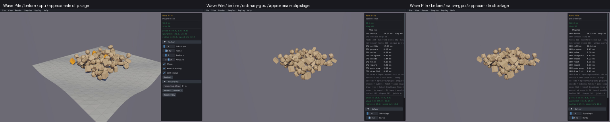
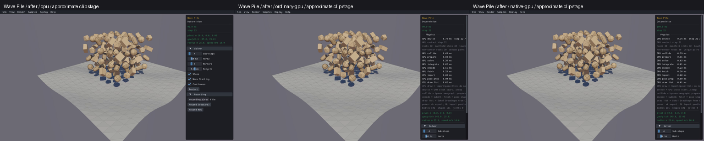
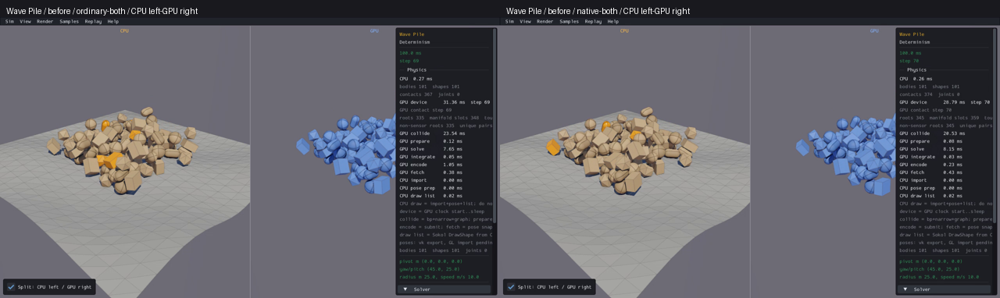
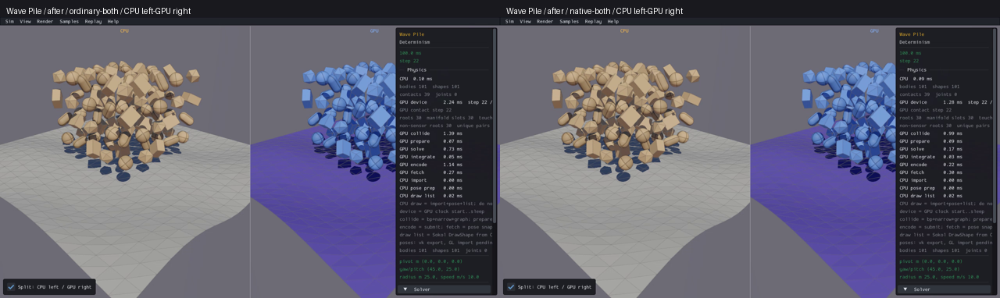
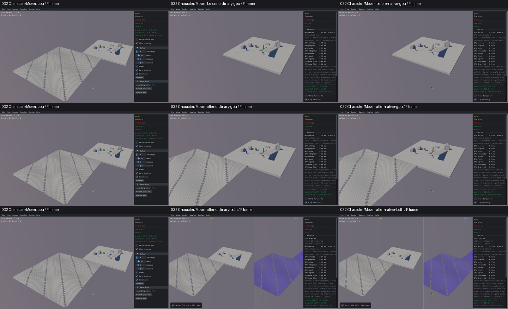
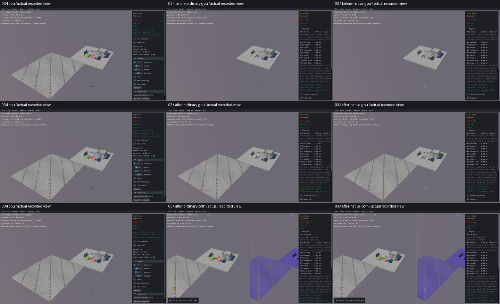
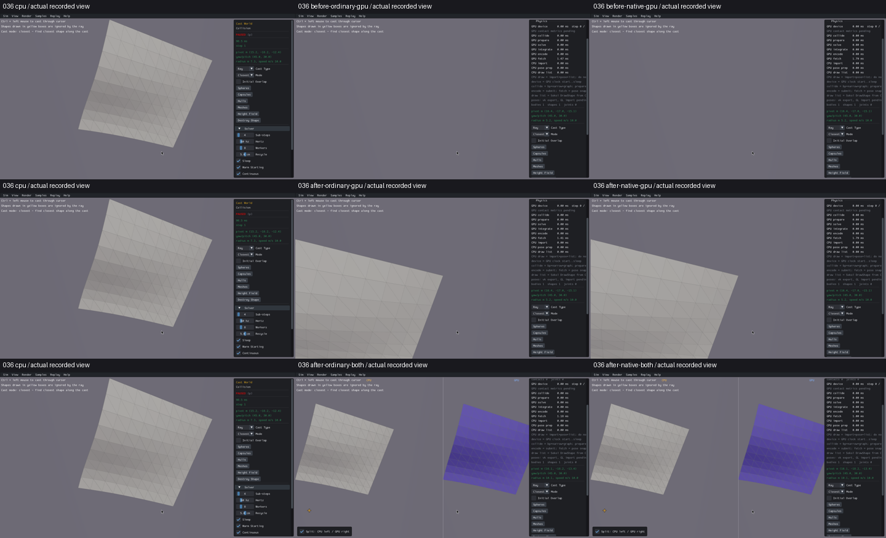

# Published evidence: VIS03

**Verified repair.** Final milestone:21 fixed,1 resolved without repair,0 open;165 native samples reviewed,0 left. PR04 physical failures remain open.

This is a portable extract of the original report, SHA256 `d0d8ba8202b74b57a550b357f03ee27ef1b261ce460d488e99c980f4bb50eeb4`. Original milestone-time counts and scope statements below are historical; current PR09 acceptance/routing is in the [publication overview](../README.md). Selected original screenshots are byte-identical. Additional per-scene clips, full raw outputs, protocols and failure inputs remain in the local capture/audit archive; their links are explicitly labeled rather than published as broken paths.

# VIS03: heightfield draw metadata

Status: **[x] VIS03 verified — 1 fixed, 21 open**. The other21 groups stay open. The complete165-sample review preceded this repair; its original
findings and budget remain preserved.

Wave Pile, the falling objects on an uneven floor, had real heightfield physics
but no GPU terrain draw. The same rendering omission affected seven confirmed
samples and three source-derived constructor/control cases. The repair
retains the original immutable heightfield pointer in the shared draw metadata
and invokes the existing upstream heightfield renderer.

Before and after below are actual captured frames, resized into labeled panels:
real Box3D CPU first, ordinary GPU second, native GPU third. Before is from the
120-step full sweep, after from the30-step rendering screen; stages are
approximate clip times, not matching physics ticks or trajectories. Startup and
black shutdown frames remain in the original clips/sheets.

Both routes have actual CPU on the left and GPU on the right:

CPU-first before/after clip grid (local capture/audit archive),
sequential manual review log (local capture/audit archive),
affected constructor matrix (local capture/audit archive),
original full review (local capture/audit archive).

## First failing operation and repair

The standalone shim and combined factory passed b3_heightShape to the generic
shape hook with threeNULL geometry arguments, dropping the input heightfield.
ShapeVis stored other geometry types but no heightfield pointer. Its actual
ensure_user_shape branch returnedNULL before createDebugShape; no terrain
instance could reach the adapter. Physics creation and the query mirror already
received the geometry. The upstream adapter already supports heightfields.

The regression executes the actual archived/current samples_api.c operation.
Identical input: public shape index17/world1/generation9, body13/world1/generation7,
heightfield version B3_HEIGHT_FIELD_VERSION,21×21 scale[1,.6,1]. Before: type2,
callbackNULL and draw metadataNULL in all six cases. After: the callback receives
the exact geometry pointer, type and public shape ID. The same operation covers
lazy callback caching,400×400 replacement/scale[2,1.5,2], name/identity retention,
world isolation, generation reuse, duplicate destruction and world cleanup.
Both six-case processes pass without a rewritten rendering model.

Changes are limited to samples_api.c, shim.c and both_dual.c. A typed creation
hook retains caller-owned immutable data; ensure_user_shape sets the existing
b3DebugShape.heightField field. Successful standalone runtime replacement now
destroys stale debug metadata before retaining the replacement pointer. The
original body transform/public shape ID still enters the existing adapter;
there are no fake bodies, shifted terrain, new mesh reconstruction, physics
defaults, Rust/WGSL, Box3D or WASM changes. Focused checks prove metadata identity;
end-to-end picking/query release qualification remains open.

## Bounded execution and provenance

Original protocol (local capture/audit archive): one candidate, four C-only viewer builds/ten
units, two focused builds/processes/six cases each,60 after capture cells,
30 measured frames,180s watchdog, zero Rust builds/performance/retries. Original
CPU and full-sweep before media are reused with binary/source receipts.

Preparation failed before a compiler because of an inferred CPU archive path;
the exact receipt path corrected it. The first build then failed on the missing
early declaration of gpu_b3_shape_get_body after the focused checks and first
C object passed. Distinct compile correction (local capture/audit archive)
retains that failure, reuses successful work and freezes one corrected compile,
eight never-launched compiles and four links. No extra test/capture/Rust budget.
The corrected build completed all four viewers; actual compiled inputs and
unchanged linked CPU/Rust/scene/render objects are in build-*.json.

The original collector catalog-neighbor guard blocked121 before display/engine
launch because120 was scheduled last. The
unlaunched-order amendment (local capture/audit archive) moves120 before121;
the same60-cell budget, sources, binaries and settings remain. The failed
preparation output is retained. No cell rerun.

Distinct camera/control protocol (local capture/audit archive) freezes27 fresh
processes with no builds/retries: related032/034 F framing and036 original Height
Field button plusF. Distinct panel protocol (local capture/audit archive) freezes five
processes for039 F/Tab because its default split information panel occludes the
terrain. Real CPU comes first, then original/repaired ordinary/native routes.
The control locator uses actual retained button glyphs, bounded nine pixel reads/
eight scroll events; no synthetic scene setup. Initial plans and final driver
freeze are retained. These are uncovered interaction/view scenarios, not retries
of an exhausted default run.

Actual NVIDIA RTX4070SUPER/Vulkan compute, driver610.57.04; Mesa llvmpipe/Xvfb
1280×720 diagnostic graphics. No desktop FPS or performance claim. The fixed
capture window verifies terrain visibility; it does not qualify long support,
query accuracy, articulated physics, runtime/performance or the full release.
QRY01, VIS01/02/07/08 and PERF02 observations stay open. PR09 remains unchecked.

No commit/push is part of this newly authorized repair goal. Build failures,
original source bytes, before clips, partial/startup/black frames and all raw
receipts remain preserved. Follow the log before resumption; never infer review
from capture completion.

## Verified scenes and limitations

Allseven originally confirmed surfaces and allthree related constructor/control
cases are now visually verified in ordinary/native and combinedGPU routes.
Real Box3D CPU comes first in every comparison. Both floor guards remain visible.

| Scene | Verified terrain/view | Evidence |
|---|---|---|
|008 Benchmark/Height Field|Wave surface and diagonal holes; original120-step timeout stays PERF02 OPEN|before/after (local capture/audit archive)|
|039 Long Ray Cast|Rightmost heightfield, standalone and split; F/Tab exposes panel-occluded split region; QRY01/VIS07 stay OPEN|default before/after (local capture/audit archive), unoccluded actual views (local capture/audit archive)|
|041 Overlap World|Three rotated vertical heightfield panels; unchanged sphere/capsule/hull layout|before/after (local capture/audit archive)|
|065 Wave Pile|Uneven floor beneath100 falling objects;101 bodies unchanged, GPU terrain instance restores100→101|Displayed above; allfive-mode sheet (local capture/audit archive)|
|091 s&box mover|Broad terrain restored; separate mesh platform retained;3 bodies unchanged|before/after (local capture/audit archive)|
|096 Driving|Wave floor restored;6 bodies/5 joints unchanged, GPU instances5→6|before/after (local capture/audit archive)|
|121 Mesh/Height Field|400×400 surface,1 physical body; standalone instances1→2, split0→1; missing split direct probe stays VIS07 OPEN|before/after (local capture/audit archive)|
|032 Character/Mover|50×50 terrain at[20,0,0] exposed by F;10 bodies/12 shapes unchanged|[CPU-first actual comparison](../media/aa012e07af1e25e7c40b5a93.png)|
|034 Character/Rigid Body|50×50 terrain at[20,0,0], T disables camera follow and30 wheel-out events expose it;22 bodies/23 shapes unchanged|[CPU-first actual comparison](../media/4d54d405eaadbdc3e6a5d9bf.png)|
|036 Cast World|Original Height Field button creates exactly1 body/shape; F exposes its randomized rotated geometry; default remains empty|[CPU-first actual comparison](../media/56568d706b00fbcb0758a3e4.png)|
|158 Single Box /120 Mesh Grid|Box and mesh floor guards remain visible; unrelated combined CPU grid/axes remain VIS01 OPEN|box sheet (local capture/audit archive), mesh sheet (local capture/audit archive)|

## Retained observation failures and final audit

The first independent CPU032 UI process stopped at a premature0.4s pause
assertion: before/after observer both remainedframe0. Its logs/clip/initial frame
remain failed. The one-process corrected observer protocol (local capture/audit archive)
waits for actual pause and fresh frames under the original60s bound; it passed
and supplies the independent CPU screenshot. No original GPU cell was repeated.
Only never-launched034/036/039 apps used the observer-corrected remaining protocols.

Rigid Body's original F view remained at radius1000 while following the character,
so the scene was too tiny to verify its terrain. An initially optimistic review
and incorrect population count were corrected after enlarged inspection; both
versions are retained. That view remains unqualified. The separate
nine-cell T/zoom view protocol (local capture/audit archive), frozen before launch,
changes only camera inputs and visibly verifies the same geometry. It does not
fix or qualify F framing.

Offline audit (local capture/audit archive) passes:60 default captures/12 manual scene reviews,
42 distinct UI attempts/41 complete/one original early-observer failure retained,
four reviewed terrain scenarios,12 focused cases, four GPU viewer builds and157
unchanged linked inputs. Total102 scene-process attempts,101 complete and one
retained failure. All budgets are CLOSED. Zero Rust builds, performance runs or
unchanged engine retries. No live job remains.

Exact changed compiled-source snapshots (local capture/audit archive), current-source/
and build-*.json retain actual source/commands/object/library/executable hashes.
The retained CPU executable is unchanged, as are the Rust providers and scene/
renderer objects. Full portable evidence index (local capture/audit archive) verifies
retained raw files and original before-evidence references without an engine.
The local audit additionally checks executable/provider hashes. Future changes
require an applicability audit; this is one rendering repair, not all165 samples
physically passing. PR09 and allother21 issue groups remain unchecked.
