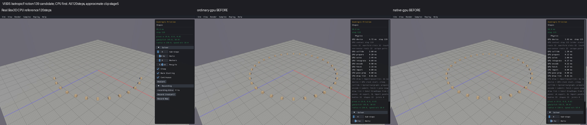
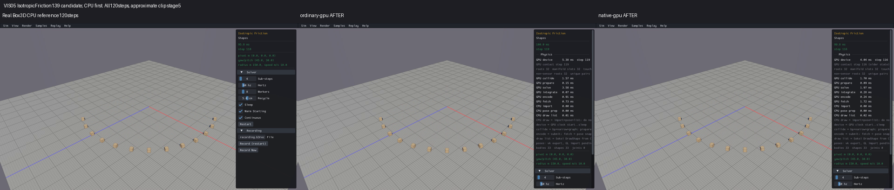
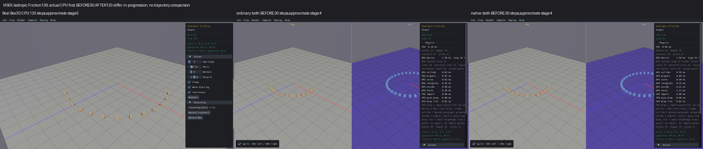
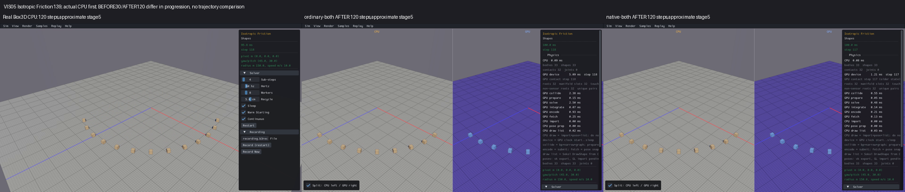

# Published evidence: VIS05

**Verified repair.** Final milestone:21 fixed,1 resolved without repair,0 open;165 native samples reviewed,0 left. PR04 physical failures remain open.

This is a portable extract of the original report, SHA256 `9a0f18723dd20a665a5014c9c43d3d0c58108a2338dc8fd4482c2a9b133ce6a7`. Original milestone-time counts and scope statements below are historical; current PR09 acceptance/routing is in the [publication overview](../README.md). Selected original screenshots are byte-identical. Additional per-scene clips, full raw outputs, protocols and failure inputs remain in the local capture/audit archive; their links are explicitly labeled rather than published as broken paths.

# VIS05 — GPU debug drawing ignores the CPU visibility bounds

**Rendering repair verified.** Sequential repair goal: **3 fixed, 0 resolved, 19 open** after acceptance. All **165/165 native registrations reviewed, 0 left**, with **660 after captures** and **825 reused real CPU/before cells**. The roadmap checkbox requires the final portable verification receipt to pass. Individual log (local capture/audit archive), full matrix (local capture/audit archive), CPU-first clips (local capture/audit archive), source/build/media audit (local capture/audit archive), closed engine budget (local capture/audit archive), portable manifest (local capture/audit archive) and portable verification receipt (local capture/audit archive) retain the evidence. PR09 and the full release roadmap remain unchecked.

CPU showed fewer distant bodies in Many Pyramids, Mixed Stacks and Isotropic Friction while GPU continued drawing them. Physical populations matched. The cause was GPU debug submission: `gpu_samples_world_draw` iterated all live shape metadata without using the caller's `drawingBounds`. Actual Box3D CPU drawing queries its broadphase using those bounds, which combine the configured 100-metre view distance with the shadow-caster box. The GPU renderer now follows the same incoming bounds. CPU geometry, defaults and culling stay unchanged.

The smallest frozen example is Isotropic Friction139 at step120: actual CPU shape/body31, generation1, position `[44.0376205, 0.99990618, -29.4484634]`. Its speculative AABB upperZ is `-28.0405750`, below the draw-bound lowerZ `-26.5981674`, so inclusive overlap is false. CPU excludes it. Before the repair GPU never queried its AABB and submitted it anyway. Afterward the false-overlap branch skips debug allocation/submission while retaining its live identity and geometry metadata for reentry. Actual diagnostic traces (local capture/audit archive), diagnostic audit (local capture/audit archive) and frozen inputs (local capture/audit archive) establish this calculation without comparing diverged trajectories.

The only new production change is the existing public `gpu_b3_shape_get_aabb(shapeId)` lookup plus `b3AABB_Overlaps(bounds, draw->drawingBounds)` before `ensure_user_shape`. Exact delta (local capture/audit archive) and source snapshots (local capture/audit archive) retain the change. Repeated draw checks preserve shape/body IDs, generations, names and poses; wide-bound reentry creates and submits the same culled shapes without renumbering or destroying them. Picking code is unchanged; interactive picking remains unqualified. Box3D, WASM, Rust/WGSL, scene geometry, physics defaults and world routing are unchanged.

| Demonstrated scene | Actual CPU bounded / wide shapes | GPU after, standalone / combined draws | Physical bodies retained |
|---|---:|---:|---:|
| 014 Many Pyramids | 6931 / 10781 | 6931 / 5391 at30steps | 10781 |
| 075 Mixed Stacks4096 | 2442 / 4098 | 2442 / 2442 at30steps | 4098 |
| 139 Isotropic Friction | 14 / 33 at120;33 /33 at1 and30 | 14 / 10 at120steps | 33 |

Combined view/shadow bounds differ from standalone. Mixed Stacks was an enumeration discrepancy; its distant pixels are too small to independently establish an exact row omission. Many Pyramids' visible array extent and Isotropic Friction's back arc demonstrate the repaired visibility discrepancy. No CPU physical body loss was established.

The finite diagnostic protocol (local capture/audit archive) closed after one read-only CPU observer unit/link and three120-step processes, with nine actual CPU stage sets. The distinct repair protocol (local capture/audit archive) closed after one candidate, two focused C builds/processes with21 cases each, four C viewer units/links and exactly660 unique after cells, with no new before captures, Rust builds, performance runs or unchanged engine retries. Capture targets were30 steps except moving-ring139 at120, with a90-second watchdog. The shared loop changes every registration, so the affected matrix includes all165, beyond the benchmark short list.

Before (local capture/audit archive) and after (local capture/audit archive) focused cases exercise the actual C loop using44,736 frozen shape records across nine actual CPU scene/stage inputs and12 inclusive touching/separation cases. Before submits every live shape with zero AABB lookups; after reproduces each frozen CPU membership set. Cache/identity/pose preservation and reentry pass. These cases isolate GPU pose/AABB endpoints with actual CPU inputs; all four ordinary/native standalone/combined capture paths exercise the existing GPU AABB producer. CPU fat-tree margins can admit additional boundary candidates relative to tight/speculative GPU AABBs; exact global counts, pixels and trajectories are not promised.

The full source/build/media audit passes604 compiled source hashes,604 object hashes and162 unchanged linked inputs. Each generated compiled API source has the same two insertions and no removals as the production source; existing export suppression is preserved. CPU, scene, rendering, other C providers and linked Rust inputs stay unchanged. Prior repair applicability (local capture/audit archive) preserves VIS03 terrain and VIS01 CPU ground decoration; all seven confirmed terrain guards and the other default scenes were individually reviewed. Historical interaction campaigns were not rerun.

| Identity | SHA256 |
|---|---|
| Candidate samples_api.c | `a24402a0a5ce422c4025702834238ee7b070d14be31f6381f6052d02fb571a05` |
| Ordinary GPU viewer | `b27eed0b8c301595b019a1f5a98d423f1670aa487fd2b82d9518007ce47ea1c2` |
| Native GPU viewer | `edda93aacfc155d5132113208e28922eca5fdac17d2bee4c5ca991bb8e06cd54` |
| Ordinary combined viewer | `9d8fde7f4fc87f95eadb28676c52d2cd6ff751eee2bf1c77a789ac35042fd1a6` |
| Native combined viewer | `57cad85cfdd44aeab8b9b214f706acf0cf026f81c94ce4afa5199035846396ac` |

All165 reviews retain individual limitations. Of660 after cells,652 completed and8 timed out: four Joint Grid010 and four capacity-unavailable Large World013. Large World requires3,971,611,912 scratch bytes versus the device's2,147,483,647 limit and never reaches the rendering check; it is an explicit availability exclusion, not a renderer or physical pass. Stall060 completes30 display frames but remains at physics step4 with real capacity/GPU failure. Twenty-eight flagged cells include these limits and original DIAG01 warnings in003/061/071/125. Raw failures, health flags, loading screens and shutdown tails remain preserved. Source preparation's initial fixture-schema assumption was corrected before engine checks, with its original script retained.

The short checks do not close runtime/performance, sensor filtering, queries, contacts, constraints, restitution, conveyor transport, static-invoke lifecycle or far-mesh fall-through. Sensor016's0draws/1681bodies suggests a related bounds cause but needs exact filter/AABB provenance before VIS06 can close. Far Mesh Drop162 is precontact in30steps; its known120-step fall-through remains BEH03. Far Pyramid163 remains an unconfirmed watch item requiring huge-coordinate setup and physical-invariant tracing. Direct geometry tools use shared CPU host calculations and are not independent GPU algorithm qualification. Replay130's empty default menu does not establish GPU playback, which remains unsupported. The13 browser/native gaps and browser variants remain outside this22-item goal.

Camera/panel occlusion, tiny or overlapping shapes, hidden faces and off-camera geometry are explicitly unreviewed in each matrix row. Existing colors/text/overlays remain open. These are rendering checks, with no exact pixel/trajectory, numerical physics/query, full picking or desktop FPS claim. Mesa software GL captures use NVIDIA Vulkan compute; capture wall times are diagnostic, not presentation benchmarks. Baseline media selection and source/settings applicability are retained in baseline evidence (local capture/audit archive); old120/300partial or30 targets versus after30/139120 are approximate progress. No new commit/push is authorized; changes remain local on feat/gpu at baseline c076092.

Real Box3D CPU is first in every screenshot and clip row. Standalone ordinary/native before and after target120steps, sampled near the final video stage. Actual UI steps are CPU118, beforeordinary119/native115 and afterordinary119/native116. The GPU ring becomes the visible front arc; all33 physical bodies remain.

Combined columns each show CPUleft/GPUright, with real standalone CPU first. Before targets30 steps, after120: different progress is explicitly labeled, with no same-state trajectory claim. Actual UI steps are CPU118, beforeordinary24/native23, afterordinary118/native117. The identical-input focused checks establish the cause independently of these screenshots.

The original combined before composite (local capture/audit archive) used black shutdown tails and is retained unchanged; it cannot demonstrate before geometry. The displayed replacement uses valid existing frames. Exact assembly inputs/outputs (local capture/audit archive), visual review (local capture/audit archive) and assembly script (local capture/audit archive) preserve that correction without new captures or altered scene pixels. All four displayed composites were actually inspected.

The initial offline index stopped before hashing because five old compiled receipts used the wrong root. Its failed output, path list and script remain preserved. The distinct offline path-correction protocol packages exact unchanged receipt copies and permits one corrected relative-path index plus the never-launched portable verifier, with no engine or ignored executables. The immutable closure log snapshot (local capture/audit archive) preserves the detailed review history; mutable log.md remains the recovery record. Only a PASS in portable-verification.txt permits marking VIS05[x]. The next item is VIS06 exact bounds/AABB/filter tracing, keeping its independent step32 runtime defect open.
