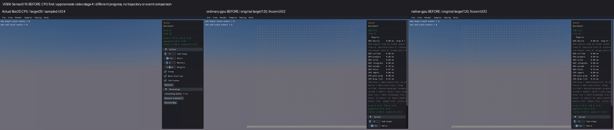
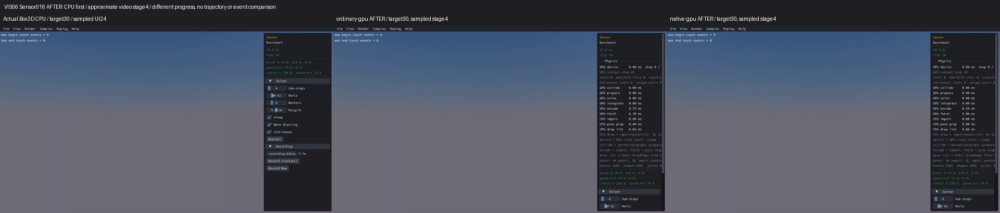
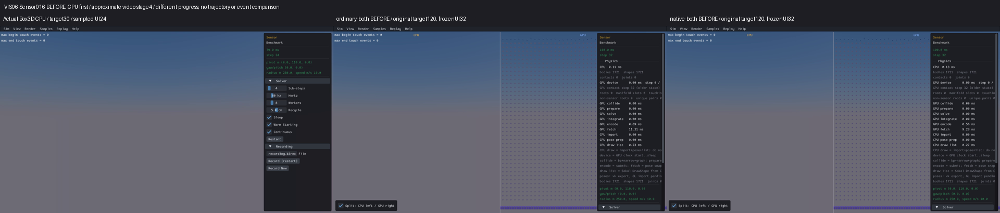
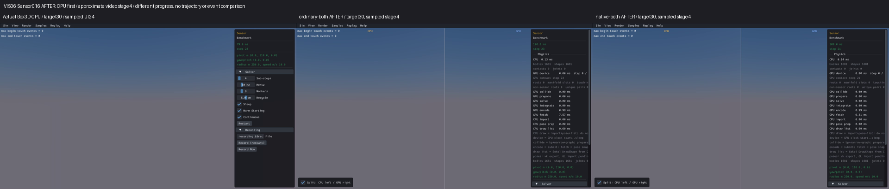

# Published evidence: VIS06

**Verified repair.** Final milestone:21 fixed,1 resolved without repair,0 open;165 native samples reviewed,0 left. PR04 physical failures remain open.

This is a portable extract of the original report, SHA256 `317f1a0f5363e8c597c81bb0c2ed5c6085cb1f46fcb0487f0d54f13c51bcd920`. Original milestone-time counts and scope statements below are historical; current PR09 acceptance/routing is in the [publication overview](../README.md). Selected original screenshots are byte-identical. Additional per-scene clips, full raw outputs, protocols and failure inputs remain in the local capture/audit archive; their links are explicitly labeled rather than published as broken paths.

# VIS06 — sensor visibility follows the incoming CPU draw bounds

**Rendering repair verified; portable publication gate pending.** After acceptance, the sequential repair goal is **4 fixed,0 resolved,18 open**, with **165 native samples reviewed,0 left**. This closes Sensor016's visibility finding using the existing VIS05 production repair; no additional production edit or default change. The independent step32 spawning/runtime failure remains RUNTIME02. Review log (local capture/audit archive), coverage (local capture/audit archive), actual traces (local capture/audit archive), CPU-first clips (local capture/audit archive), source/build/media audit (local capture/audit archive), source applicability (local capture/audit archive), portable index (local capture/audit archive) and portable verification (local capture/audit archive) preserve the result. Do not mark VIS06[x] until portable verification passes. PR09/fullrelease remain unchecked; changes are local at feat/gpu baselinec076092, with no new commit/push.

The original GPU views showed the 81 base cubes and40×40 sensor grid while actual Box3D CPU was empty. CPU did not suppress sensor geometry by type. Its debug draw queries the broadphase using the camera/view and shadow-caster bounds. Sensor's unchanged default camera eye is `[0,110,250]` and draw distance100; every sensor is atZ0. Before VIS05, GPU ignored `drawingBounds` and submitted every live shape. The VIS05 lookup of existing public shape AABB plus inclusive `b3AABB_Overlaps` now skips debug allocation/submission for those out-of-bounds shapes. Metadata, bodies and sensor flags remain live.

The smallest example is static sensor shape/body860,generation1,position `[-10,105,0]`, with AABBupperZ `0.51999998092651367`. Actual CPU camera box is `[-100,10,150]..[100,210,350]`; shadow-caster box is `[-77.1084213257,32.8915786743,105.37451171875]..[101.5059204102,226.1444244385,279.1093444824]`. Their componentwise union has lowerZ `105.37451171875`. Shape860 is within the X/Y ranges and misses Z alone by104.8545117 metres. Actual standalone GPU receives those same bounds and AABB. Combined GPU receives lowerZ `131.03372192382812` under the narrower viewport's shadow projection. Inclusive overlap is false on every route. All sensor AABBupperZ values are at most1.459999919, far below either bound; no boundary tolerance or fat-tree margin explains the difference.

Read-only actual CPU observations atsteps1/30 return **0 bounded shapes and1681 wide shapes**; every shape is a static sensor with its original public identity. Actual ordinary/native standalone/combined GPU traces each return all1681 live sensors at both draw-call stages1/30, matching CPU IDs after accounting for world namespace, exact poses/AABBs and false default overlap. Static rotations are the unchanged CPU default identity and independently observed from every GPU transform. GPU stage is draw-call ordinal; the full captures separately complete30 physics steps. The trace totals16,810 shape observations. No collision/query sensor was deleted. Sensor event, numerical query and collision behavior are not qualified by these reads.

| Route | Physical bodies through30 steps | Debug draws | Actual sensor trace rows |
|---|---:|---:|---:|
| Real Box3D CPU | 1681 | 0 | 3362 |
| Ordinary GPU | 1681 | 0 | 3362 |
| Native GPU | 1681 | 0 | 3362 |
| Ordinary combined GPU | 1681 | 0 | 3362 |
| Native combined GPU | 1681 | 0 | 3362 |

The focused before (local capture/audit archive)/after (local capture/audit archive) checks execute the actual C debug loop on identical CPU-frozen inputs: two sensor stage sets/3362 records plus12 inclusive touching/separation cases,14 cases per process. Original81 cube metadata uses upstream float32 half-extent `0.48f*3.0f`;1600 row cubes use0.5f. Before submits1681 with zero AABB lookups; after submits0 under the exact incoming bounds. Repeated draw/cache/shape-body IDs/generations/names/poses and no-destruction checks pass. Under wide bounds all1681 reenter with the same identity. GPU AABB/pose endpoints are isolated for identical-input calculation checks; all four fresh read-only GPU observer captures separately exercise the actual producers. No rewritten formula alone establishes this result.

The frozen protocol (local capture/audit archive) consumed exactly one CPU C++ observer unit/link, four GPU C observer units/archive placements/links, five30-step captures under90-second watchdogs, and two focused C builds/processes under180/30-second watchdogs. Zero production candidates, Rust builds, performance trials or retries. All14 observer build operations, allfive captures and14before/14after focused cases passed. Generated GPU source reconstructs exactly to its prior production unit after removing only read-only stderr/getter observation blocks; CPU observer reconstructs to its previous read-only observer after removing the additional source/filter prints and label change. The audit matches723 compiled sources/723 objects,718 unchanged units and199 linked inputs. CPU/scene/render/Rust/other C providers are unchanged. Original binaries/artifacts remain retained; no old campaign was restarted.

Production samples_api.c SHA256 remains `a24402a0a5ce422c4025702834238ee7b070d14be31f6381f6052d02fb571a05`. Exact five observer executable hashes and complete build receipts are in repair-audit.json and build-*.json. The before draw function in all four original compiled viewer sources exactly matches the focused-before source. Reused prior VIS05 after clips have the current production identity. VIS05's existing165-scene/four-route rendering matrix, VIS03 heightfield and VIS01 CPU floor decoration applicability remain valid on the unchanged production source; this item does not rerun them. Box3D/WASM, geometry, defaults, lifetimes and picking implementation are untouched; interaction/picking remain unqualified.

A separate **OPEN PR02 filter-default finding (local capture/audit archive)** was discovered: actual CPU and combined sensors use categoryBitsUINT64_MAX, whereas standalone GPU uses1. The unchanged standalone shim `b3DefaultFilter` hardcodes1; CPU uses the header's `B3_DEFAULT_CATEGORY_BITS`=UINT64_MAX. Masks are UINT64_MAX and group0 on every route. Both categories pass this sample's ALL draw mask, while Z separation independently rejects every shape. This does not explain VIS06 or establish mask-specific query/collision parity. The finding is retained outside the original22-group count and requires its own future repair/acceptance; no unrelated default or solver change is hidden in this milestone.

All new captures end before the first dynamic row atstep32. Original GPU captures targeted120 steps but timed out at displayed32, with1721 bodies after the first40-body spawn. After captures target30, with1681 static sensors. This progress/population difference is explicit and is not deletion or matched-state proof. Identical-input focused checks and live identity traces establish the rendering cause. RUNTIME02, sensor events/custom filtering/queries/contacts, missing GPU-half text overlays, material colors, picking and performance remain open. Health exports dynamic bodies only: min/maxY0 here does not represent the static sensor grid; the actual static poses/AABBs come from the trace. This sample has no physical floor. Camera/panel occlusion, tiny-grid limits, early loading screens and shutdown tails remain preserved. Five captures complete without generic health flags; this is not a full physics/runtime qualification. Mesa software GL graphics with NVIDIA Vulkan compute do not establish desktop FPS.

Real Box3D CPU is first in all screenshots. The same CPU30-step sampledUI24 frame is reused in both phases. Before GPU targets120 but is frozenUI32; after targets30, sampledUI28 standalone,UI23/21 combined. Approximate video stage4 is labeled; no trajectory/event comparison is implied. All four composites were actually visually inspected; exact source/output hashes are in assembly inputs (local capture/audit archive) and visual review (local capture/audit archive). Raw valid frames and black/loading tails are retained.

Each combined column has CPUleft/GPUright, with real standalone CPU first.

The offline publication protocol (local capture/audit archive) permits one source/build/media audit, one relative evidence index and one portable verifier,180s each/2000files/1GiB, with no engine or ignored executables. All engine/build/capture/focused budgets are closed. The immutable closure-log snapshot preserves detailed review history; log.md stays the mutable recovery record. Only portable PASS allows ticking VIS06. The next original repair item is VIS07's missing direct primitives/Step overlays, under its own finite diagnosis budget. The full goal remains active.
