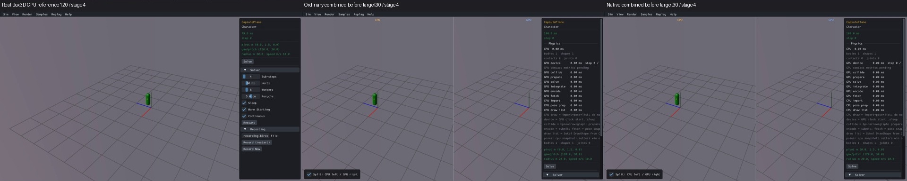
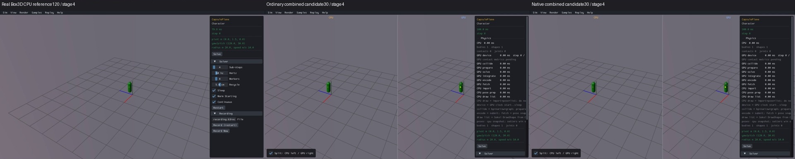
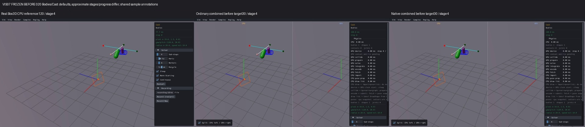
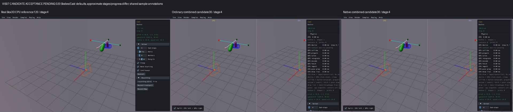
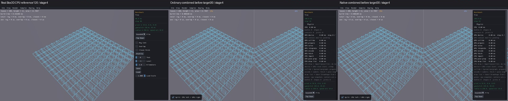
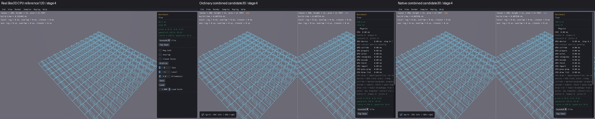

# Published evidence: VIS07

**Verified repair.** Final milestone:21 fixed,1 resolved without repair,0 open;165 native samples reviewed,0 left. PR04 physical failures remain open.

This is a portable extract of the original report, SHA256 `5edd9db520674b19a904d08cc88b05333e1bb87b23ea3d7e0b96fbfb3b5021c9`. Original milestone-time counts and scope statements below are historical; current PR09 acceptance/routing is in the [publication overview](../README.md). Selected original screenshots are byte-identical. Additional per-scene clips, full raw outputs, protocols and failure inputs remain in the local capture/audit archive; their links are explicitly labeled rather than published as broken paths.

# VIS07 — preserve sample drawings and labels in the GPU pane

**55/55 affected or related scenes individually reviewed, 0 left; 110 candidate captures complete. Acceptance: source/build/media and portable verification PASS. VIS07 [x]; overall5 fixed,0 resolved,17 open.**

The combined viewer lost drawings and labels submitted by the sample's `Step()`. It reset the frame arena between panes, then drew the GPU world and called `Render()` again; direct Step submissions had already been cleared. CapsulePlane's green capsule, BodyCast's collision-plane outline and Single Box's position label demonstrate the loss. Tree's four labels followed a separate path: `DrawControls()` ran after pane rendering and submitted text only at the CPU pane's x5.

The repair records accepted direct Step drawing arguments in a frame-local journal, owns temporary text, then replays those submissions after the reset through the same packing functions. It excludes the base world draw so each pane keeps its own world geometry. Late pane-local screen text receives a second copy at x+paneWidth. There is still one sample Step, with no repeated queries, spawning, events or physics. Render geometry, camera-relative inputs, geometry/physics defaults, public identities and picking implementation are preserved. Box3D, WASM, Rust/WGSL and the C ABI are unchanged from the prior verified repair.

These copied annotations retain their existing shared sample/readout provenance. Geometry tools and Tree are host tools, with GPUphysics0 expected where applicable; they do not establish independent GPU query algorithms or performance parity.

## Before and after

Actual standalone Box3D CPU is first in every image. Ordinary and native combined GPU follow. CPU reference120 and before/candidate30 progress differ; sampled stages are approximate. Loading, shutdown black tails, camera minification and panels remain in the complete clips/sheets. The displayed crops were actually inspected after assembly.

CapsulePlane, before:

CapsulePlane, after — green direct capsule restored:

BodyCast, before:

BodyCast, after — orange collision-plane outline restored in the visible GPU origin:

Tree, before:

Tree, after — four late UI labels restored:

All55 CPU-first comparison rows, latest GPU then older GPU (local capture/audit archive), individual review log (local capture/audit archive), original165-sample source inventory (local capture/audit archive), original defect diagnosis (local capture/audit archive).

## Checks and source identity

- One frozen candidate; 12 viewer compilation units, two archive updates and two links passed. The two routes reuse verified CPU/Rust/scene/renderer inputs. CMake attaches the journal to combined gfx; standalone/CPU paths are guarded and their retained binaries/source/object records remain applicable.
- One ASAN/UBSAN check passed 516 copied transient inputs, nested world-draw exclusion, replay isolation, disabled/small/new frames, cleanup and UI width routing. Raw result (local capture/audit archive).
- Every one of55 cases was visually inspected before proceeding to the next. All110 captures completed; 071's two existing incomplete/explosion flags remain recorded for DIAG01. Health warnings were never converted into physics passes.
- At actual display ordinals1/30 on both routes, all2692 recorded packed primitives and text space/XY/string submissions match replay. Tree's four late labels independently match x5/x645 and y27/49/71/93, with text count0→8. Typed color/world position/material arguments are preserved by the exact source-generation reconstruction.
- Full audit (local capture/audit archive):725 sources and725 objects match,713 units unchanged,198 unchanged linked inputs match. All10 production-generated/observed source pairs reconstruct exactly; archive contents retain all unrelated members. Actual CPU and ordinary/native standalone applicability checked. `git diff --check` passes; Box3D/WASM paths unchanged.
- Portable evidence index (local capture/audit archive), portable verification result (local capture/audit archive):4,518 files/797,808,056 bytes PASS, with725 portable compiled-source records. The package contains real CPU references, before/after clips and receipts, five sampled images per cell, observations, source copies, readable diffs and build records. Its verifier needs no engine, ignored object, archive or viewer executable.

Ordinary candidate SHA256 `f0ea9d3e116b67bf4693273f57b6cf615653ff1cd08c829e916b0503d845c52e`. Native candidate SHA256 `8d4433d094368862189969e5673ac89d49c9ec44c72b7404e318745b494b6949` (receipt (local capture/audit archive)). The candidate protocol (local capture/audit archive) pins all six production files, prepared sources and exact build/input hashes. Example production renderer delta (local capture/audit archive), ordinary receipt (local capture/audit archive).

## Budget and retained failures

Original finite candidate budget (local capture/audit archive): one candidate,110 cells/55 scenes,30 display steps,90s viewer watchdog, zero engine retries/Rust builds/performance runs. All engine budgets are CLOSED. The remaining collector used one media worker, probe/extraction5s, display startup10s and whole-scene300s, with outer310s termination. Bounded profile (local capture/audit archive).

The original009 before-folder/target-label error and invalid empty sheet are preserved; valid sheets use the existing real VIS05 before30 media. 046 stalled only during media assembly after both engine captures finished. 052's PNG thread initialization failed after both captures finished. Their frozen host-only recoveries reused unchanged clips with zero engine reruns. Original capture receipts remain intact. The first offline audit rejected their intentionally incomplete pre-media receipt schema; corrected audit protocol (local capture/audit archive) checks the already frozen recovery video/capture hashes. Both audit scripts and the original error are retained.

## Limits and remaining findings

This closes the missing submission/routing defect within VIS07; it does not qualify numerical physics, independent query/contact outputs, interactions, picking or performance. Every conditional/panel/offcamera limitation is preserved in each linked review. Kinematic026's later target, MeshDrop057's hover label, contact/query branches and later sleep/hash text are not all exercised in30 frames. Hidden markers in038/071/121/144 have actual input replay evidence but no full silhouette/pixel pass. ReplayViewer's default instruction is restored; native recording/player capability is unchanged. LongRayCast039's failures, Sensor016 step32, SensorHits071 flags, FarMeshDrop162 collision failure, FarPyramid163's unconfirmed watch, VIS02 materials/sleep and VIS08 text offset remain open. Host clocks and software graphics captures are not desktop GPU performance qualification.

PR09 and the full release roadmap remain unchecked. Changes are local and uncommitted; this sequential repair goal has no additional commit/push authorization.
