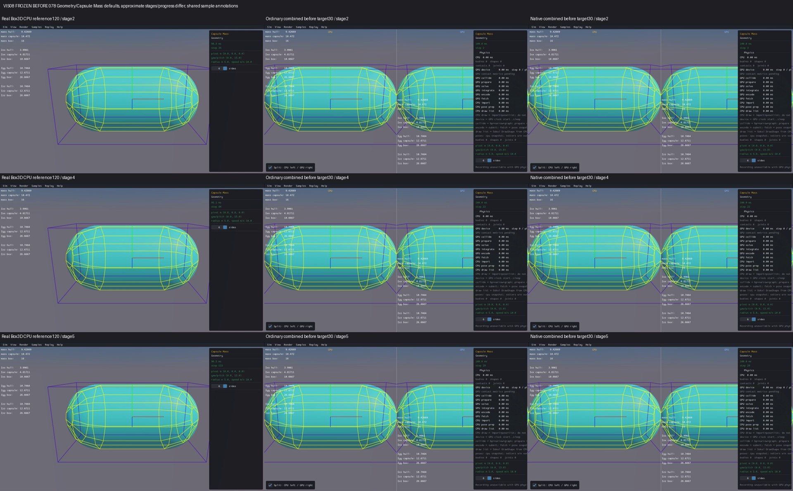
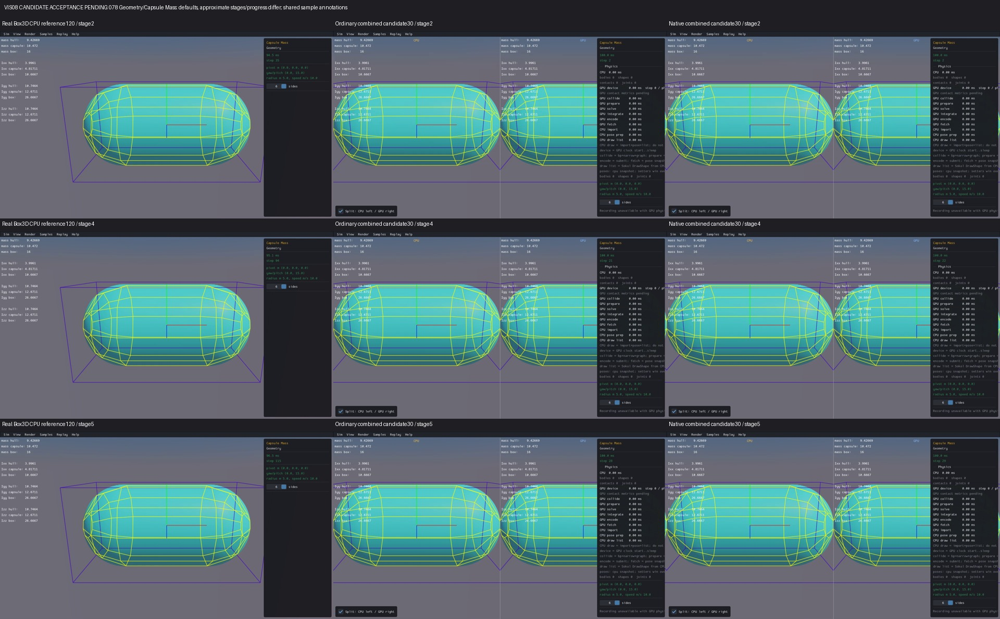
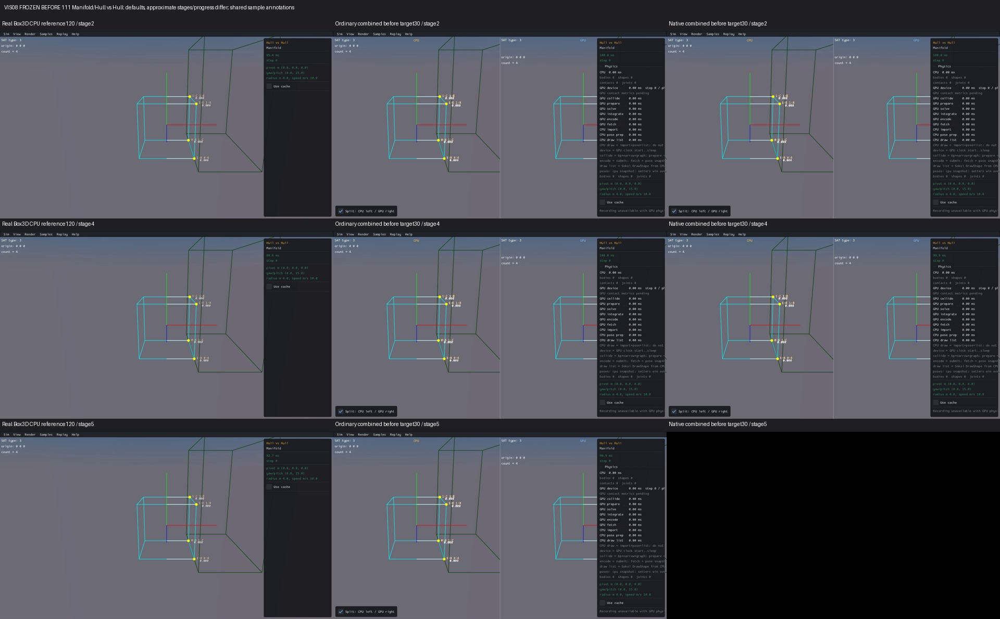
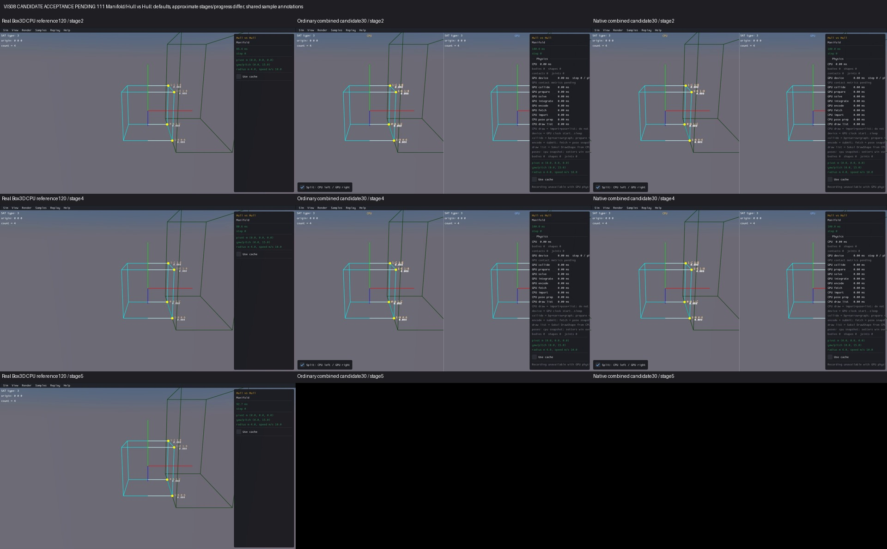

# Published evidence: VIS08

**Verified repair.** Final milestone:21 fixed,1 resolved without repair,0 open;165 native samples reviewed,0 left. PR04 physical failures remain open.

This is a portable extract of the original report, SHA256 `9ba394f2bbd4560c4c76e920d5eb5de1fb0288df74b53269d974e06053a572fd`. Original milestone-time counts and scope statements below are historical; current PR09 acceptance/routing is in the [publication overview](../README.md). Selected original screenshots are byte-identical. Additional per-scene clips, full raw outputs, protocols and failure inputs remain in the local capture/audit archive; their links are explicitly labeled rather than published as broken paths.

# VIS08 — Render text cursor repair

Combined viewers call the sample Render twice using a shared text cursor. The CPU Render advances it before the GPU Render, so the GPU labels start too low. The repair saves the cursor immediately after Step, starts both Render calls there, then restores the CPU Render end for late UI labels. Step labels and deliberate blank lines remain intact. The change is only in scripts/sokol_split_injection.py; no geometry, defaults, body identity, picking, Box3D or WASM change.

6 issue groups fixed, 0 resolved, 16 open. Original review: 165 done, 0 left. Candidate acceptance: all 33 individual comparisons saved, 0 left; all 66 after cells completed without health flags. VIS08 is verified and checked: the full matrix, source/build/media audit and portable evidence pass. Read log.md (local capture/audit archive) for current progress.

The full 165-class source audit found 28 Render cursor paths, including explicitly qualified inherited calls, with 5 negative guards. All 18 original VIS08 tags are included. The frozen budget permits one candidate, two C++ main compiles and two links, 66 after captures (33 scenes × ordinary/native combined), 30 display steps and 90 seconds per viewer. No new baseline captures or engine retries. Capture jobs have a 310-second outer deadline; media subprocesses have 5-second deadlines and one worker. Offline audit/index/portable verification each have one 180-second process.

The input defect is demonstrated in actual preserved submission traces: Driving advances five lines, making GPU labels 110 pixels too low; manifold origin/count advances two lines, adding 44 pixels. Capsule Mass advances twelve lines plus three intentional blank lines, adding 330 pixels. Starting at the after-Step cursor is necessary: Hull vs Hull has a preceding SAT Step label, which must stay first. Exact Render submission coordinates and cursor restore are checked at display ordinals 1 and 30 in both routes; preserved VIS07 Step primitive/text replay is checked independently.

Before Capsule Mass — actual Box3D CPU reference first, ordinary combined then native combined:

After candidate:

CPU reference captures target 120 display steps; before/candidate combined captures target 30. Stages and progress differ. Black shutdown tails, loading, panel occlusion and minification are retained and logged individually. These are actual captured images, not pixel or trajectory equivalence claims. Mass, manifold and query tools/readouts retain existing shared-host or per-call provenance; moving their labels does not validate an independent GPU physical calculation. Colour, query, runtime, solver and performance findings remain open.

Source inventory (local capture/audit archive), frozen budget (local capture/audit archive), build/source protocol (local capture/audit archive), capture protocol (local capture/audit archive), individual review log (local capture/audit archive).

All 33 affected and guard samples have their own before/after images, exact input checks and preserved limitations in the review log (local capture/audit archive). The frozen source matrix remains source-only; the separate acceptance overlay records the completed reviews. The CPU-first comparison grid (local capture/audit archive) and offline audit (local capture/audit archive) are produced by the three bounded closure stages. Portable verification PASS: 2,815 files / 566,764,722 bytes and 725 portable source-unit records; no engine or ignored binaries required.

Affected source paths: 004, 008, 047–052, 067, 069, 078, 080–081, 096, 103, 107–116, 120, 123–124. Negative guards: 031, 039, 130, 158, 161. These include all 18 original VIS08 tags; the full 165-class inventory includes the qualified inherited manifold Render paths.

Hull vs Hull guard — the preceding Step SAT label stays first, with Render labels starting at y49/y71 in both panes:

Builds: two main C++ units and two links completed, no archive or Rust rebuild. One existing baseline per route is reused according to the frozen source-applicability proof; no new before capture or engine retry. Geometry, world defaults, body identity, picking implementation, Box3D and WASM remain unchanged by this repair. Picking interaction, long-window physics, colours, raycast correctness and performance are not qualified here. Individual black capture tails are retained rather than presented as a rendering pass. Fresh bounded fetch completed; HEAD and origin/feat/gpu agree. All local documentation and prior repair work is preserved; no new commit or push.

Offline source/build/media audit PASS: 725 compiled sources and objects, 723 unchanged units, 198 unchanged linked inputs; only two main units changed from the verified VIS07 viewers. All 33 individual reviews, 66 completed candidate cells and 99 preserved reference cells pass their applicable acceptance checks. Tree late UI still emits four equal label pairs. Production and read-only observer source reconstruction both pass in ordinary/native modes. The corrected pre-existing Village media receipt is preserved without editing or re-capturing it. Portable closure PASS.

Final acceptance: all 33 affected/guard cases reviewed, 0 left; all 66 candidate cells completed without health issues and 99 CPU/before reference cells preserved. Exact cursor/Render-coordinate checks pass at display ordinals 1 and 30; 282 accepted Step primitive replays preserve their raw packed inputs, with Step text and Tree late UI regression checks passing. Frozen 165-source inventory and original review records remain unchanged. The candidate-pending banner inside the original screenshots records when those images were captured; final acceptance is recorded here and in acceptance.json (local capture/audit archive).

Source identity: production split-injection SHA256 `5e7a7a4eedf657177168d2f18168118e963221843a40eb33c88e33e2c2b24933`; both generated production main units `61d35912f7438085d7d8ed468e436da27a3444fd041194d0abcfee2e6ed8ce11`. Exact ordinary/native executable identities are in ordinary receipt (local capture/audit archive) and native receipt (local capture/audit archive), with read-only observers disclosed. Audit (local capture/audit archive), portable result (local capture/audit archive), closure protocol (local capture/audit archive), closure state (local capture/audit archive). All build/capture/offline budgets CLOSED; no live job, no additional commit or push. PR09 and the full release checklist remain unchecked. Next original issue group: VIS02 material/state colours, under a new finite protocol.
