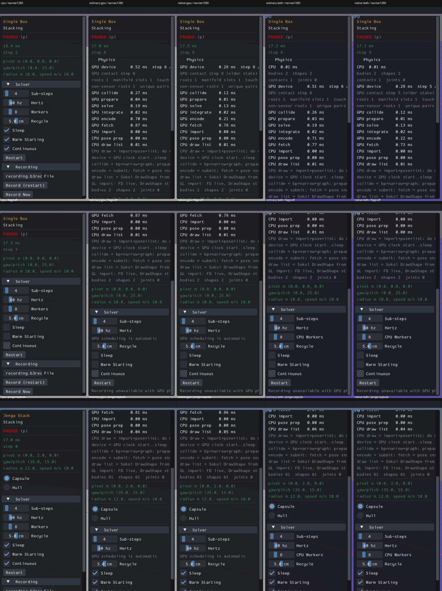
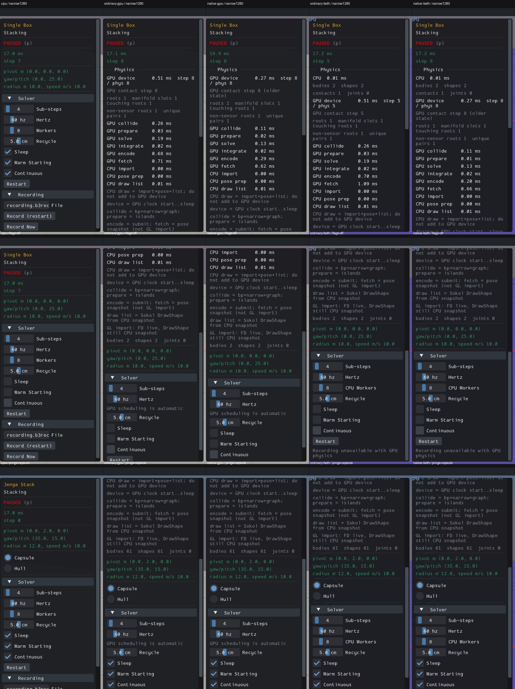

# UI01: readable Info panel text

[x] Verified locally. CPU first; ordinary/native standalone and combined routes pass. PR10 remains open: full sample interaction reviews **0 done / 165 left**.

The fixed-width Info panel clipped long diagnostic text and the GPU recording-unavailable explanation. Actual ImGui item rectangles exceeded its clip bounds. The generator now scopes text wrapping to this window and restores the wrapping stack before leaving it. The exact text, diagnostics, default expansion and all code outside this window are preserved. Box3D/WASM, Rust/WGSL, geometry, defaults and body/picking code are unchanged.

Before, actual Box3D CPU first:

After, actual Box3D CPU first:

[Original CPU-first comparison grid](ui01-compare.html), [acceptance and same-input rectangle measurements](ui01-acceptance.json), [compact world/event checks](ui01-stream-summaries.json).

All five routes pass 20 checks before and after: pause/single-step, actual context/world flags, restart lifetime and retained settings, metrics, sample selection, Jenga Hull/Capsule changes, resize and clean quit. All 90 saved stages were visually inspected. Native before captures have 7–9 clipped text rows; after captures have zero at every tested stage. World IDs, populations, hertz/substeps and flags agree before/after for the selected stages. Every sampled combined CPU flag agrees too. These are scoped checks, not whole-physics, full-state, manual-picking or all-widget qualification.

The shared parent Info rendering affects all165 registrations by source. This report executes Single Box/Jenga only; other sample-specific widgets, child windows, layouts and interactions remain unreviewed. Required broader affected-scene snapshots must precede a future commit; no PR10 commit/push is newly authorized. UI02 panel-wheel capture needs reproduction; startup/cache limitations remain explicit PR05/PR08 inputs. Original harness failures and their bounded corrections are retained, not promoted to passes. No new engine build or physics experiment was run.

Consumed observer streams were reduced to required checks/event windows; five before executables were deleted. The five after diagnostic viewers remain needed for remaining PR10 checks. Shared driver/app caches were measured and preserved.
