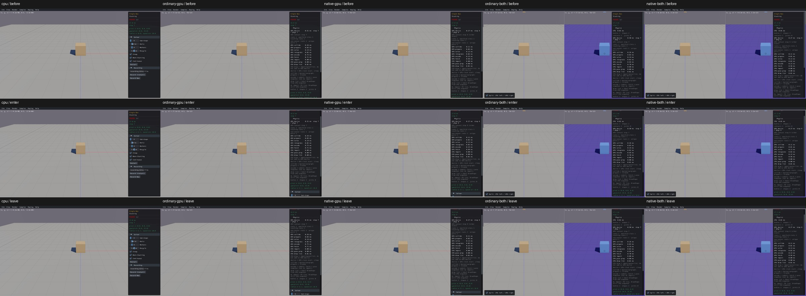
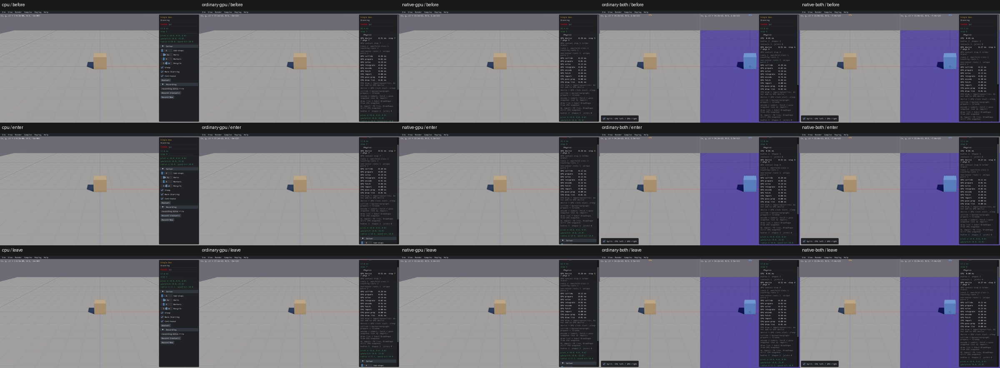

# UI02 — panel wheel also moved the camera

[x] Fixed and verified locally on real Box3D CPU, ordinary GPU, native GPU, ordinary combined and native combined. Not committed. Full PR10 interaction coverage remains open.

A pointer movement into Info followed immediately by a wheel event could scroll Info and zoom the camera together. The shared `HandleEvent` queued both events, then returned ImGui's previous-frame `WantCaptureMouse`. The wheel's actual position was inside Info but the returned capture flag was false: camera radius 10 → 11.1. The inverse transition swallowed the first wheel outside Info: radius 11.1 → 11.1. Actual event inputs/returns and camera output reproduce both directions on all five before routes.

The generated native host now calls `gpu_ui_capture_event` after the original `HandleEvent`, using the wheel event's own position and ImGui's actual window hit test. The native host and Sokol events both use physical framebuffer pixels. Active UI items and popups retain capture. All non-wheel events and held mouse-button gestures retain the original capture route; release/focus-loss forwarding and keyboard routing are unchanged. Only the generated host include/call and new native helper changed. Box3D, WASM, Rust/WGSL, geometry, physics defaults and picking implementation are unchanged.

All five after routes pass the two camera outcomes, held world gesture over Info, popup outside-wheel capture, keyboard single step and clean quit: 35 before checks + 55 after checks, 30 retained original screenshots. World/body/shape identity and counts, hertz 60, substeps 4 and solver flags stay unchanged through the paired screenshots. All original linked object/archive hashes are preserved. [Acceptance and actual input/output traces](ui02-acceptance.json), [build provenance](ui02-build-after.json).

Before (real CPU first; columns CPU / ordinary GPU / native GPU / ordinary combined / native combined; rows initial / enter panel / leave panel):

After, same order and input sequence:

The first candidate compile failed on a relocated diagnostic include search path; its original receipt is retained and the source include directory correction was budgeted separately. One native after run received motion and wheel across two UI frames, so the harness's assumed stale-false capture assertion failed even though camera radius correctly stayed 10. The corrected protocol records actual capture/frame values while retaining the same required camera outcomes. It reran only native and the two unlaunched combined routes. CPU/ordinary after directly exercise stale capture and the repair; all routes have actual paired events in the acceptance JSON. No implicit retries or engine builds.

Limits: this is shared wheel routing, not full widget/picking qualification. Other mouse actions, all sample-specific controls and the remaining shared controls stay open in the inventory. Full affected-scene pre-commit recordings remain required before any future authorized visual commit. Startup latency remains a separate PR05/PR08 limitation. Frozen budgets, failed receipts, cache accounting and cleanup are in the simple log.
