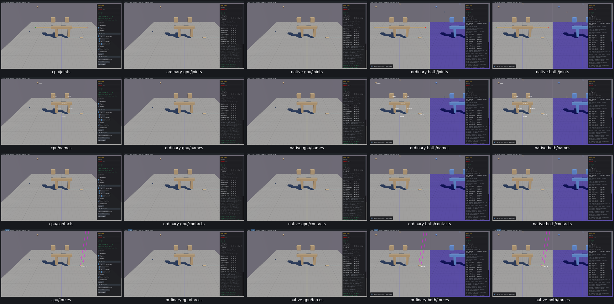
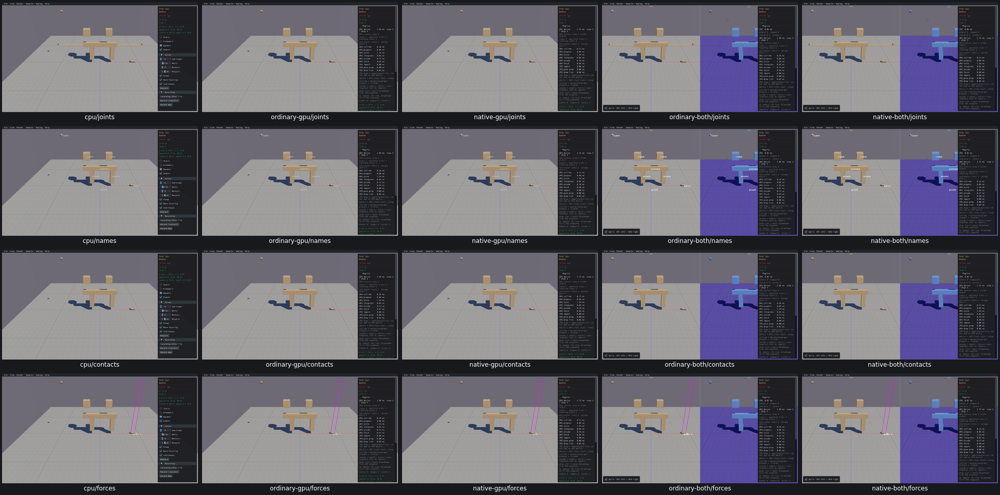
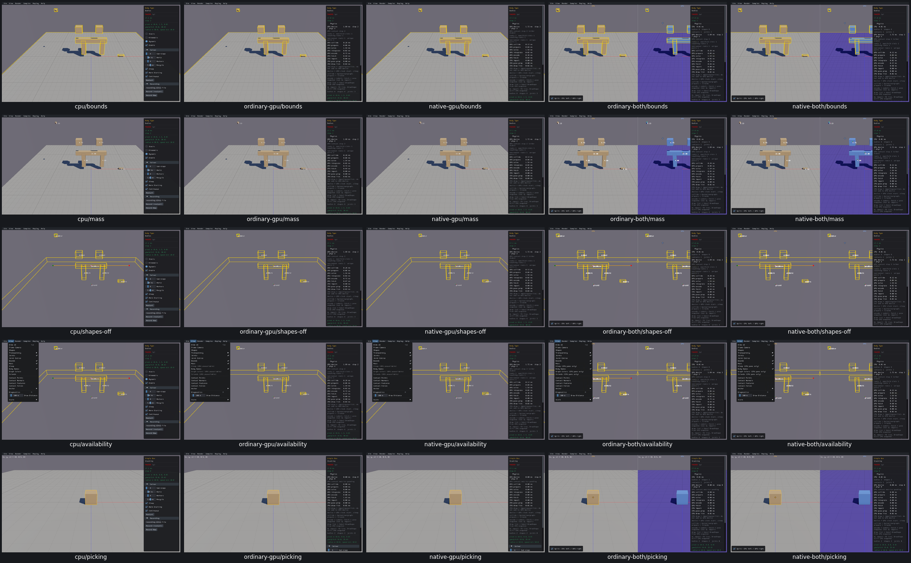

# UI03 — GPU debug overlays

[x] Verified locally on real Box3D CPU, ordinary/native GPU, and both combined viewers. [Acceptance and resource receipt](ui03-acceptance.json).

`gpu_samples_world_draw` previously consumed only Shapes and returned early when Shapes was hidden. View-menu flags changed, but GPU bounds, mass, names, joints and contact diagnostics produced no callbacks.

The native viewer now draws supported overlays from actual GPU AABBs, body COM/mass/names, joint frames/reactions and the Rust engine's existing contact manifolds. Full identities deduplicate bodies, joints and contacts; draw scratch is freed each frame. Joint drawing metadata is generation checked and released with its world. Drawing-only joint defaults retain native length units, and contact force conversion uses the actual step time. Geometry, physical defaults, stepping, IDs and picking are unchanged. No Box3D, WASM, Rust or WGSL changes were needed.

Sleep velocity, per-constraint graph colours and island membership are unavailable through the current C diagnostics. These three controls are disabled with **GPU unavailable** in standalone GPU, and labelled **CPU pane only** in combined viewers. CPU controls remain available. This is an explicit capability limitation, not GPU diagnostic parity. GPU Bounds represent public speculative-padded AABBs; CPU Bounds show fat broadphase AABBs. GPU joint glyphs show real anchor frames and reactions; CPU type-specific decorations differ.

The focused fixture is Bodies / Body Type: eight bodies/shapes, three joints and actual contacts after two single steps. Checks cover bounds, mass, names, joints/extras, contact points/normals/features/forces, both anchors, Joint/Force scales and restoration, Shapes-off overlays, availability labels and unchanged identities/poses/mass/geometry. Single Box verifies projected picking on all four GPU routes, including both panes. CPU picking explicitly reuses the unchanged UI24 case.

There are 249 recorded checks across seven bounded apps. Native GPU passes 46; each corrected combined run passes 60; the ordinary remaining-control supplement passes 27. Actual getter inputs are compared with independent final renderer line/point/text submissions at `1e-5`. [Additional retained-data audit](ui03-additional-sink-audit.json) checks name/mass text positions and reaction endpoints.

Original harness failures are preserved: CPU omitted a projection-trace flag after all 29 overlay checks passed; ordinary GPU's checker forgot the ground name and reversed ID fields; the combined observer shared a request counter between panes. [CPU adjudication](ui03-cpu-picking-adjudication.json), [ordinary adjudication](ui03-ordinary-adjudication.json) and [read-only observer correction budget](ui03-combined-observer-budget.json) distinguish them from product defects. Passed standalone sections were reused. Current CPU/native GPU links differ from their checked binaries only by that read-only counter correction and output path; the source and link deltas are asserted.

Columns: **real Box3D CPU first**, ordinary GPU, native GPU, ordinary combined, native combined. Before/after rows: joints, names, contacts, forces, on the same two-step Body Type fixture. Exact pixels and trajectories are outside scope.

Regression rows: Bounds, Mass, Shapes off, availability labels and picking. The CPU picking cell is the explicitly reused UI24 case.

All three grids were inspected. Retained evidence is 28,195,077 bytes; raw storage is 908,654,112 bytes. All 66 recorded PIDs are absent, no owned cores remain, and measured shared-cache growth is zero. Consumed traces/logs and superseded viewers/API modules/carriers were removed. The current five-viewer pool has a named consumer: final PR10 compatibility and evidence audit.

This verifies a short UI/rendering fixture at 60 Hz, default ALL mask and native joint draw scale 1. Custom per-joint scales are preserved by source and creation metadata, but are not separately exercised here. It does not qualify solver accuracy, query accuracy, arbitrary time steps or every scene at runtime. Shared renderer applicability is recorded separately from actual scene fixtures. PR10 remains unchecked pending observations, fresh compatibility and the final acceptance/evidence audit. No commit or push was requested for PR10.
