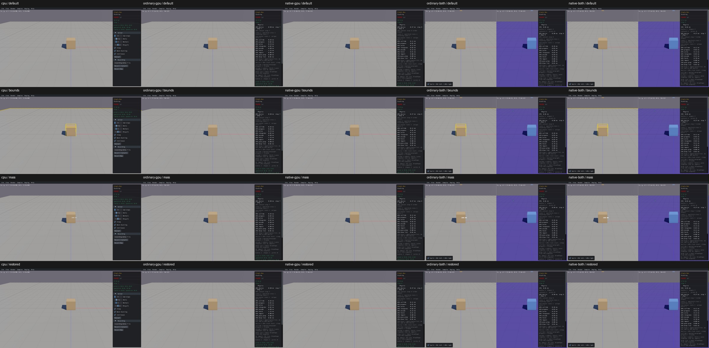

# UI03 — GPU debug overlays are missing

[x] Confirmed, unfixed. Actual Bounds and Mass output checked on all five viewer routes; other overlay flags share the source gap but their outputs remain unreviewed. Continue the full control review before repair.

Actual View-menu inputs update the UI state and reach `b3World_Draw`. With Bounds enabled, real Box3D CPU emits two bounding-box callbacks; GPU emits zero. With Mass enabled, CPU emits two transform callbacks and displays mass text; GPU emits zero transform callbacks and no mass display. Both combined viewers show the overlays on the CPU left half and omit them on the GPU right half. Geometry, body/shape counts, physics settings and identities stay intact.

The first failing rendering operation is `gpu_samples_world_draw` in `c_abi/samples_api.c`: it reads `drawShapes`, enumerates visible shapes and calls `DrawShapeFcn`, while the other debug flags and overlay callbacks are unconsumed. The same path serves ordinary and native GPU and combined GPU halves. Source applicability covers the shared native host; this is not a claim that all 165 sample controls have been reviewed.

[Actual draw inputs and callback outputs](ui03-output-acceptance.json) retain 44 checks, with real CPU first, clean exits and 20 original screenshots. A diagnostic local copy of `b3DebugDraw` wraps Bounds/Transform callbacks, forwards each original callback once with the original arguments/context, and calls the original world draw once. The combined GPU inner operation is traced separately. All original object/archive hashes remain unchanged. No production repair was made for UI03.

Columns CPU / ordinary GPU / native GPU / ordinary combined / native combined; rows default / Bounds / Mass / restored:

Remaining: inspect applicable fixtures for Joints, Joint Extras, Sleep, Body Names, Graph Colors, Islands, Contact Points/Normals/Features/Forces and Anchor A/B. Routing checks alone are not rendered-output passes. No after screenshot exists until a repair is implemented and verified.

## Extended output review,2026-10-15

[All12 remaining controls and two scales](overlay-controls-acceptance.json) now have actual callback evidence onall5routes: CPU47checks pass, eachGPUroute14missing effects. Combined CPU/GPU callback provenance is recorded separately. See [overlay report](overlay-controls.md). Original Bounds/Mass evidence remains unchanged; no repair yet.

Verified repair: [GPU debug overlays](UI03-repair.md). Real GPU bounds/COM/mass/names/jointframes/reactions/contactmanifolds now reach actual renderer sinks, including Shapesoff; unavailable Sleep/Graph/Islands honestly disabled or CPU-pane-only. Five CPUfirst routes,249 recorded checks/seven bounded apps, full-ID dedup and unchanged geometry/physical defaults/IDs/picking; CPU picking and source-identical readonly-observer checks explicitly reused. Original harness errors retained/adjudicated.
