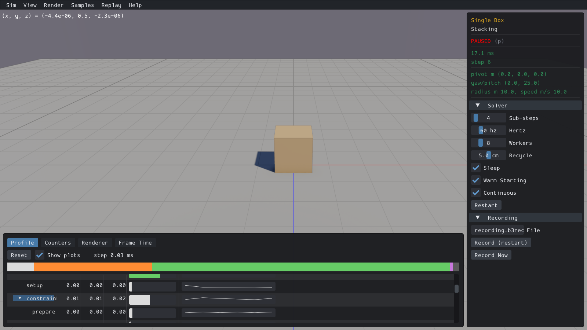
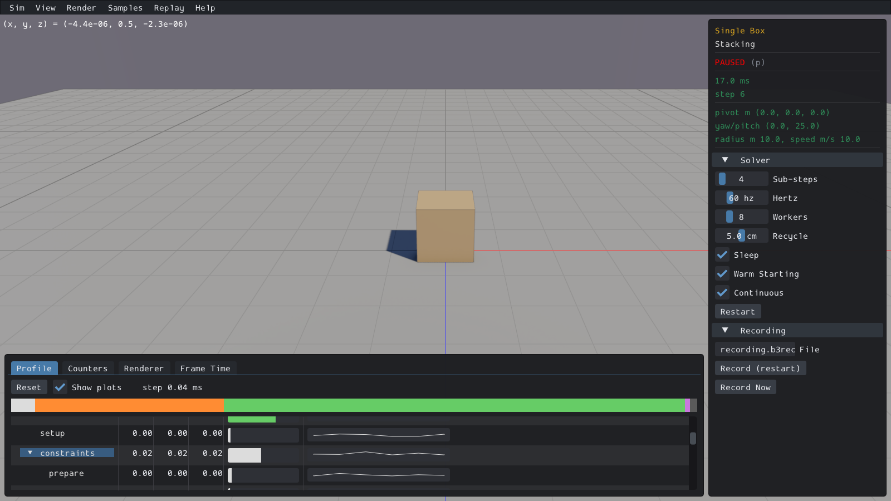
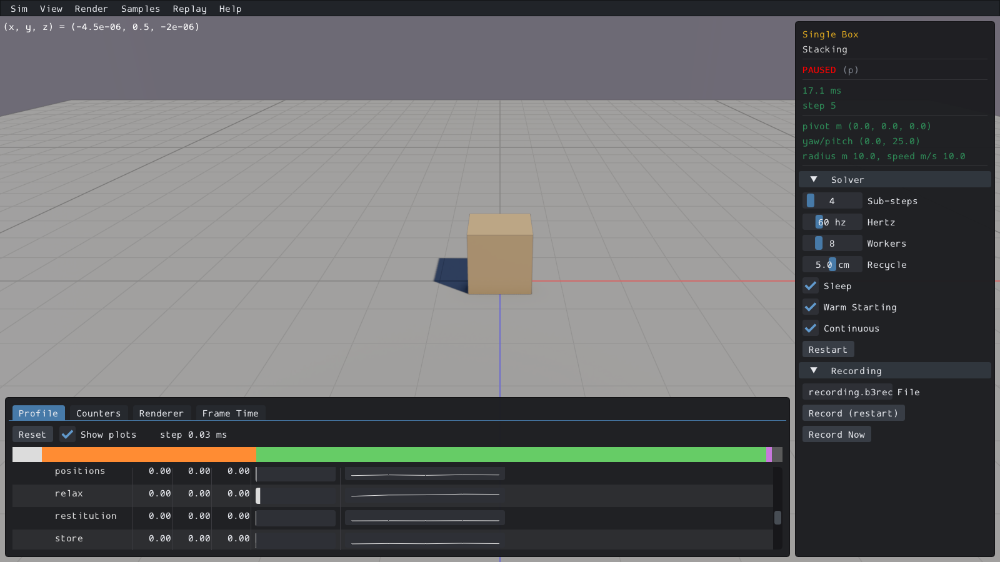

# UI04 — CPU Profile label width

The shared CPU Profile column requested128px at font size16. The indented `constraints` label needs16px indentation,36px arrow spacing and99px of native text. Its actual text ended at x171 while the column clipped at x155, cutting off16px. Leaf labels such as `restitution` need still more room.

The generated native sample now measures all22 row definitions with the current ImGui font, indentation and arrow/leaf spacing. It uses the largest measured width,185px on this viewer. The repaired clip edge is x212. Collapsed and zero-valued rows participate in sizing, so expanding a subtree keeps its labels visible. Box3D and WASM remain unchanged.

| Check | Evidence |
| --- | --- |
| Actual CPU before/after text and clip bounds | [Acceptance](ui04-acceptance.json), original/repaired receipts |
| Plots on/off, both subtrees open/restore,1280x800 resize | 17 repaired CPU checks |
| Native nonzero leaf and tree labels | 20 actual label rectangles fit; widest submitted leaf `restitution` ends at187 before clip212 |
| Body/shape IDs, paused poses, defaults and world identity | Actual native getters before/after UI input |
| Four GPU/combined routes | CPU tree is excluded; before/after generated translation units have identical preprocessor digests. Existing binaries reused; no new GPU runtime pass claimed |
| All165 CPU samples | Explicit shared nonvirtual `Sample::DrawMetrics` applicability; runtime fixture is Single Box, not165 new runs |

60 actual checks across3 bounded CPU apps passed. All8 screenshots and2 CPU-first grids were inspected. `split islands` and `bullets` were hidden by the original zero-value rule in the runtime fixture; both remain included in the22-row sizing calculation. Native startup ran5–6steps before pause; no scripted advancing physics, solver or trajectory qualification is claimed. Arbitrarily narrow windows are unqualified.

Before, real Box3D CPU:

After, real Box3D CPU:

Related leaf labels:

[CPU-first before grid](ui04-before-grid.png) · [CPU-first after grid](ui04-after-grid.png). Four GPU/combined cells explicitly state source-unaffected status instead of showing new captures.

Two source preflight failures are preserved: current generation already contained BOTH-only split-step hooks absent from the historical CPU copy; actual CPU preprocessing proved those differences excluded. Combined preprocessing then required its existing VIS07 diagnostic include path, which the reused Joint compile flags omitted. Passed operations were reused; no viewer was rerun for either correction. The first label observer covered only tree calls; a separate read-only TextUnformatted wrapper verified20 submitted labels without changing production code.

Cleanup deleted26,789,898bytes of superseded builds and consumed streams. Diagnostic evidence retained2,911,151bytes; current viewer/object inputs have named next-relink consumers. Shared NVIDIA cache grew583,017bytes during each of the trace and leaf apps, exceeding their mistakenly frozen0-byte cache sub-budget. Original failure flags are preserved; the cache is shared and was preserved, and growth is not causally attributed to this task. Aggregate temporary storage including measured growth stayed below1GiB. Future CPU OpenGL viewer budgets must include shared driver-cache headroom too. All21 recorded app/build/driver PIDs are absent; no owned cores.

PR10 final criterion audit, compatibility checks and any required pre-commit affected-scene recordings remain open. No PR10 commit/push is authorized.
