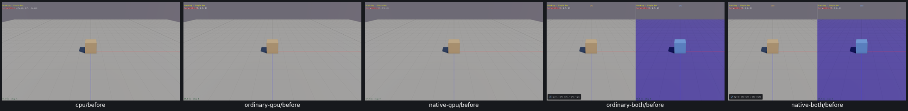
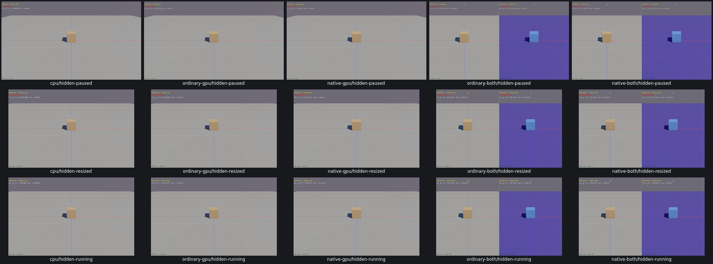

# UI05 — hidden HUD layout and combined control visibility

The final native text drain confirmed that the white Single Box coordinate label and red PAUSED label both occupied y48–64 at font size16. The combined Comparison view checkbox also stayed visible while the main UI was hidden, covering the footer.

The generated native sample now reserves the paused HUD row: hidden sample text starts at y72 while paused and retains y48 while running. Shown sample text stays at y34. The combined Comparison view window and its checkbox callback now follow `showUI`. The split choice, pane labels, pointer assistance and rendering policy remain unchanged. Box3D/WASM and physics code are unchanged.

| Route | Repair evaluations | Short running window |
| --- | --- | --- |
| Real Box3D CPU | 23 positive | 28steps |
| Ordinary GPU | 23 positive | 28steps |
| Native GPU | 23 positive | 31steps |
| Ordinary combined | 24 positive;2 original single-pane probe assertions adjudicated from retained actual two-pane data | 28steps |
| Native combined | 26 positive | 29steps |

[Acceptance, actual final text bounds, visibility, resize, IDs/poses/defaults, split toggle/restore and cleanup](ui05-acceptance.json). Nine CPU before checks plus121 repair evaluations cover the fix;128 evaluations are positive and2 original wrong probes remain explicitly preserved. One additional positive shown-UI check from the first interrupted trace is retained separately. Split view correctly emits one PAUSED label per pane; the ordinary combined case was not rerun to change that evidence.

The three standalone cases and both combined cases check hidden paused text,1280x800 resize, a short unpaused capture and UI restoration. IDs, paused poses and timing/physics defaults survive UI actions; the brief running windows stay below the frozen48-step cap. These are UI transitions, not solver or trajectory qualification. All165 applicability rows explicitly reuse the shared host implementation; this is not165 new runtime executions.

Before, real CPU first:

After: hidden paused, resized and running, real CPU first:

[Full CPU before](evidence/ui05-trace-completion-runs/cpu/hidden-paused-before.png) · [Full CPU after](evidence/ui05-runs/cpu/hidden-paused.png) · [Native combined before](evidence/navigation-metrics-runs/native-both-gpu-policy/hidden.png) · [Native combined after](evidence/ui05-runs/native-both/hidden-paused.png). All20 before/after images and2 grids were inspected. Four GPU before images come from the original control review at the same hidden/paused Single Box policy, with older builds/startup state; actual bounds and current input/effect checks establish the repair.

The first trace hit a diagnostic limitation: its frame counter advanced only when widgets were recorded, so hiding every widget left a stale frame and the driver timed out after3seconds. Native rendering continued and its final text bounds were retained. A read-only observer correction uses the actual ImGui frame count and clears stale items. That timeout is not a product freeze. All original failures and the two combined probe corrections remain linked from acceptance.

Cleanup removed superseded viewers/objects, consumed streams and operation logs. Current viewer/object inputs retain named next-relink consumers; shared caches were preserved. No owned process or core remains. Arbitrarily narrow windows, every possible long sample message, final PR10 compatibility/audit and pre-commit affected-scene recordings remain unqualified/open. No PR10 commit/push is authorized.
