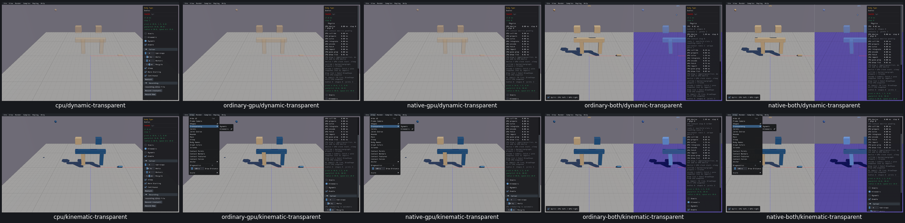
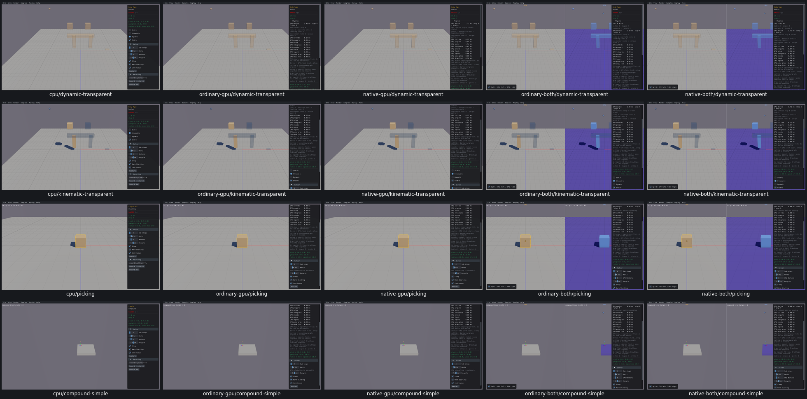

# UI06 — current body type and CPU draw ownership

- [x] Fixed and verified locally on real Box3D CPU, ordinary/native GPU and both combined viewers.

The native adapter stored body type when each shape was created. Changing five Body Type bodies to kinematic left cached type2 while actual getters returned1. Kinematic transparency therefore submitted0 transparent shapes instead of5. The actual native default-material calculation also selected roughness.40 instead of.55 for preset0 input. Combined CPU drawing had a second ownership error: raw CPU shape IDs reached GPU getters, returning a null body and cached type0; Dynamic transparency submitted0 instead of7.

The native capacity generator now refreshes `DebugShape.bodyType` from its existing body ID before material/transparency selection. Two combined getters (`b3Shape_GetBody` and `b3Body_GetType`) use CPU getters inside the existing CPU debug-draw guard. Normal GPU dispatch is unchanged. Box3D/WASM, geometry, physics defaults and solver code are unchanged.

| Route | Repair checks | Runtime |
| --- | --- | --- |
| Real Box3D CPU | 48 | 10.48s |
| Ordinary GPU | 48 | 11.85s |
| Native GPU | 48 | 12.05s |
| Ordinary combined | 61 | 12.47s |
| Native combined | 61 | 12.66s |

All266 repair checks pass with0 findings. The22 original boundary and9 native default-material checks establish the causes:297 checks in total. [Acceptance](ui06-acceptance.json) links exact inputs/intermediates, source/module hashes, budgets and receipts. Body Type checks cover Dynamic7/Kinematic5 transparency, static/kinematic/dynamic transitions, original IDs/paused poses, normal presets, restart/default restoration and scene destruction/recreation. Single Box checks actual mouse picking, including both combined panes. Compound/Simple checks parent metadata, the baked static hull/child submission and dynamic sphere transparency on all five routes.

Before: dynamic and kinematic transparency, real CPU first.

After: dynamic transparency, kinematic transparency, picking and Compound/Simple, real CPU first.

All30 individual before/after images and both grids were inspected. Six GPU/native-combined before images reuse the original paused Body Type review; build/startup/menu differences are explicit, and exact pixel matching is not claimed.

The default-material probe calls actual native DrawShape on a stack copy with the same transform and low24bit colour, strips only the preset byte, then returns before renderer append. It verifies default roughness.70/.55/.40 without duplicating geometry. Normal presets1/2/5 remain.85/.65/.35. This verifies the fallback calculation, not fallback pixels. Explicit overrides are unchanged by source inspection but have no runtime fixture. The diagnostic `public_body_valid` field uses CPU owner validity inside a CPU callback; product `b3Body_IsValid` dispatch was not changed. RenderFrame numeric counts cover the first CPU pane only; material rows and visuals cover both panes.

An original combined link failed because `--whole-archive` forced the old getter object alongside a direct override. The failure is preserved. A small task-owned API archive replaces only that member; other members are byte-identical and shared archives were never mutated. No qualified viewer check was repeated. Five viewers and16 needed objects retain named next-relink consumers. Superseded builds, streams and logs were consumed;47 recorded processes are absent,0 owned cores and0 measured shared-cache growth. Raw evidence is913512054bytes, below1GiB; selected diagnostics are13287338bytes, below64MiB.

Runtime covers three fixtures on five routes; all165 inventory applicability rows explicitly reuse shared adapter source rather than claiming165 new executions. Checks remain paused after5–6 native startup steps; no solver/trajectory qualification. Per-draw getter performance, full affected-scene precommit recordings, final compatibility and PR10 criterion audit remain open. No PR10 commit/push is authorized.
