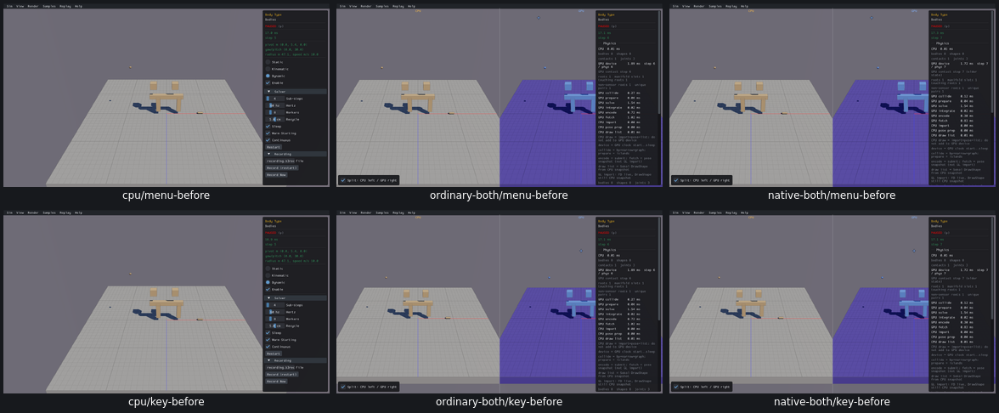
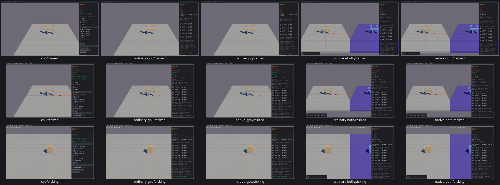

# UI07 — Frame Camera uses the actual split viewport

- [x] Fixed and verified locally.

Combined DrawUI temporarily widens the camera width to1600 for full-window UI layout. The Frame Camera menu used that layout width, passing aspect1.7778; F used the actual800px pane, passing.8889. With identical frozen Body Type bounds and padding.75, actual native Camera::Frame selected radius47.1602 from the menu and53.0552 from F. Its horizontal fit distance changed35.3702→70.7403. Real CPU menu/F agreed at47.1195; CPU/GPU bounds differ after startup, so cross-engine radius equality is not an assertion.

The split sample generator now computes the menu aspect from `sapp_width()/2` while split view is active. Overlay mode uses the existing full width. Full-window UI layout, projection, picking, the F-key path and Camera::Frame itself are unchanged. The compiled combined Sample copy differs by exactly this guarded menu block; standalone Sample objects are unchanged.

| Route | Repair checks | Runtime |
| --- | --- | --- |
| Real Box3D CPU | 25 | 4.97s |
| Ordinary GPU | 25 | 6.13s |
| Native GPU | 25 | 6.24s |
| Ordinary combined | 39 | 8.68s |
| Native combined | 39 | 8.91s |

All153 repair checks and27 before checks pass:180 total,0 findings. [Acceptance](ui07-acceptance.json) retains actual native Frame inputs/results, intermediate fitting distances, source/build evidence and budgets. Checks cover menu/F consistency, split off/on,1600×900 and1280×800, full-window panel placement, IDs/paused poses, restart defaults, scene recreation and actual Single Box mouse picking in both combined panes.

Before: real CPU, ordinary combined, native combined; menu above, F below.

After: all five routes, real CPU first; framing, resize, picking.

All23 individual images and both grids were inspected. Split-off screenshots remain linked in each combined receipt. Before evidence covers CPU and both affected combined routes; standalone GPU sources were unchanged and are checked in the after regression. No missing before capture is presented as an actual capture.

The first observer compile referenced a helper that is file-local in camera.cpp and failed before any viewer launched. The corrected diagnostic copies only display/intermediate observation and always calls the actual native Frame operation. That original failure is preserved. Closeout also caught an inherited absolute generator pin retaining its original hash while the new relative pin was correct. Removing the exact intended insertion reproduced the original hash; only manifest metadata was corrected, with no build/runtime/media repeated. See `ui07-original-observer-compile-failure.json` and `ui07-pin-adjudication.json`.

Cleanup removed254569837bytes of superseded builds,11756853bytes of consumed streams and9844bytes of logs. All28 recorded processes are absent;0 owned cores. Shared-cache growth6219197bytes was measured during native-combined before capture, within16MiB/app, preserved and not solely attributed to this task. Repair apps measured0 further growth. Raw evidence919567671bytes plus measured cache remains below1GiB; selected diagnostics9095350bytes stay below64MiB. Current five viewers,17 objects and the small task API archive have named next-relink consumers.

Runtime covers Body Type and Single Box on five routes, with paused checks after5–7 startup steps and no scripted advancing physics. All165 applicability rows explicitly reuse shared source. Extreme/odd window sizes and nondefault render axes/units/FOV are unexercised; their math, clamp and padding are unchanged. Full affected-scene precommit recordings, final compatibility and PR10 criterion audit remain open. Box3D/WASM/Rust/WGSL/shared archives are unchanged; no PR10 commit/push is authorized.
