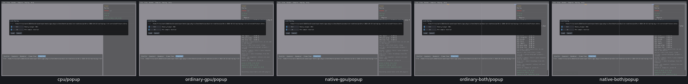
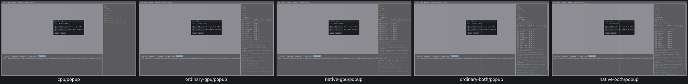

# UI08 — Replay filename on Unix

The native Replay load dialog searched only for a backslash. A normal Unix path was therefore displayed in full and expanded the modal to1412pixels. The project generator now copies Replay with a filename calculation accepting either separator, choosing the last when both occur. The player still receives the original complete path. Box3D and WASM are unchanged.

[Actual five-route checks, exact generated C++ boundary cases, limitations and cleanup](ui08-acceptance.json). CPU opens the same64-frame recording with unchangedbodyIDs/poses and edited128MiB/8keyframepolicy. The fourGPUplayers remain unsupported underUI09.

Before, realBox3DCPUfirst:

After, realBox3DCPUfirst:

