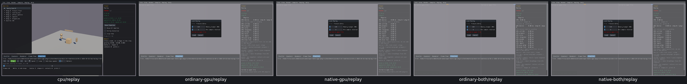
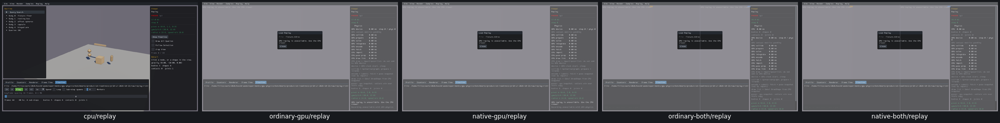

# UI09 — Honest Replay availability

GPU recording loading is an unsupported API. Its null return was described as a bad file, even for a valid CPU recording. Generated native GPU/combined Replay UI now explains that playback requires the CPU viewer, offers Close, and hides ineffective loading policy controls. Restart preserves the explanation without calling unavailable APIs. Box3D, WASM and engine code remain unchanged.

[Actual CPU valid/missing-file checks, four GPU routes, original probe errors and cleanup](ui09-acceptance.json). GPU playback remains unsupported.

Before: CPU loads the recording; four GPU routes misreport a file error.

After: CPU still loads it; four GPU routes explain the unsupported feature.

Visual review also caught the original66-character explanation being truncated by the native64-byte HUD buffer. The final46-character status fits. Only this GPU-only string changed; actual CPU checks were reused and four GPU routes were rechecked.
