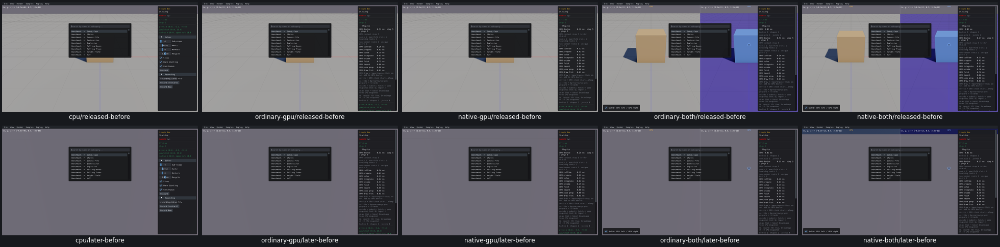
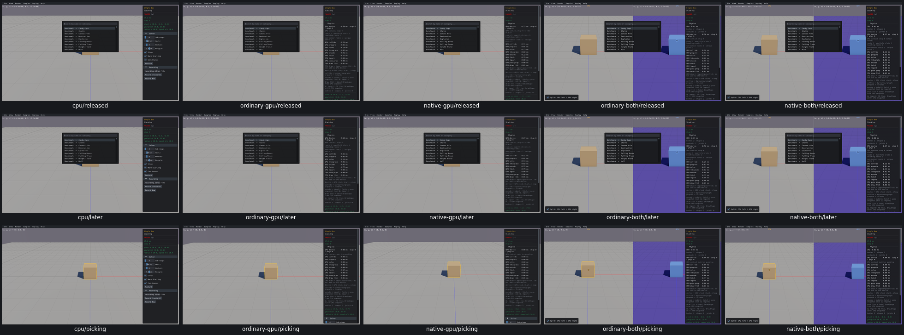

# UI10 — captured releases clear camera and sample-host key state

- [x] Fixed and verified locally on all five routes.

Holding RMB+W in Single Box, opening the actual Ctrl+O picker and releasing hardware W left both native camera W and `IsKeyDown(W)` set. Actual HandleEvent reported key-up captured; Camera::OnEvent never received it, and the early UI return skipped SetKeyDown(false). Actual Camera::Update kept moving4.77–4.95m between selected post-release observations on all five routes. The world remained paused and body poses/IDs unchanged.

The native host generator now delivers key-up events to the camera even during UI capture and clears the captured key in the host table before returning. Captured new presses still go only to the UI. The existing mouse-release/focus-loss flag is unchanged, so releasing a key does not acquire the combined pointer-up behavior. All other qualified host source remains byte-exact. Box3D/WASM, physics and picking logic are unchanged.

| Route | Repair checks | Runtime |
| --- | --- | --- |
| Real Box3D CPU | 53 | 9.98s |
| Ordinary GPU | 53 | 11.30s |
| Native GPU | 53 | 11.29s |
| Ordinary combined | 54 | 11.61s |
| Native combined | 54 | 11.72s |

All267 repair checks and40 before checks pass:307 total,0 findings. [Acceptance](ui10-acceptance.json) retains actual capture events, native held-key flags, host W state, Update outputs and source/build provenance. W/A/S/D/Q/E and left Alt are held before actual picker capture, then released under capture. All camera flags clear, RMB stays held and after-release pivot displacement is exactly0. Actual picker typing W still changes its text without forwarding a camera/host press. Normal world W press/release, mouse-up cleanup, IDs/paused poses, timing defaults, restart lifetime/defaults and Single Box picking in both combined panes pass.

Before: hardware W released, then a later observation; CPU first.

After: released, later, and picking; CPU first.

All25 individual before/after images and both grids were inspected. Before/after native startup timing differs slightly; the actual input/state boundary and post-release invariant establish the fix, not exact pixels or CPU/GPU trajectories.

The initial diagnostic link collided with the existing UI observer's Camera::Update wrapper before any viewer launched. The failure is preserved. Two task-owned symbol renames chain the new observer through the previous wrapper into the actual native Update once, preserving its camera pointer observation. Shared objects are unchanged; no qualified runtime was repeated. The inherited relative generator pin was normalized to the updated absolute pin; reversing exactly the intended function replacement reproduces the original source hash. See `ui10-original-observer-link-failure.json` and `ui10-pin-normalization.json`.

Cleanup removed334018359bytes of superseded builds,12948018bytes of consumed streams and128733bytes of logs. All40 recorded processes are absent;0 owned cores and0 measured shared-cache growth. Raw evidence927090453bytes is below1GiB; selected diagnostics11812071bytes are below64MiB. Current five viewers,19 task-owned link objects and the small task API archive have named next-relink consumers; exact paths are in acceptance/current link manifest.

Runtime covers Single Box on five routes;165 applicability rows reuse the shared native host rather than claiming165 new runtimes. Host W is queried directly; the same generic host setter covers other keys by source applicability. Existing focus-loss routing is unchanged and was not rerun. Arbitrary OS/IME configurations remain unqualified. Checks stay paused after5–6 startup steps with no scripted advancing physics. Full affected-scene precommit recordings, final compatibility and PR10 criterion audit remain open; no PR10 commit/push is authorized.
