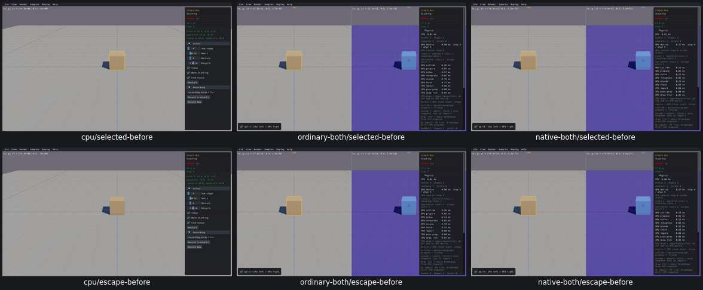
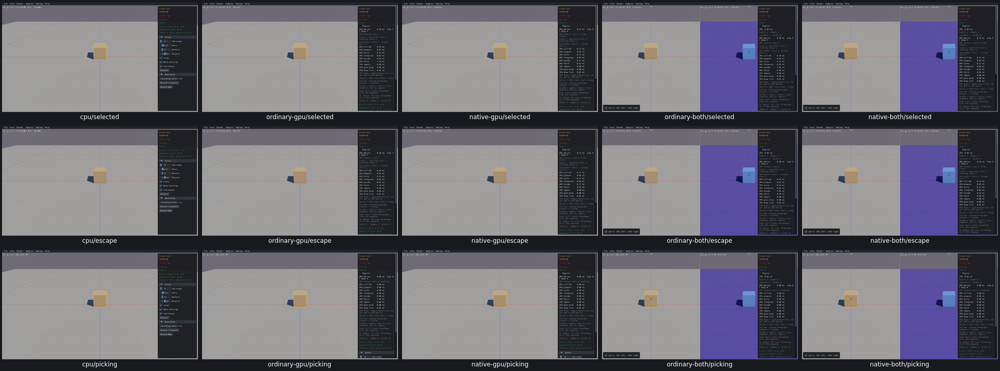

# UI11 — Escape clears the combined selection owner

- [x] Fixed and verified locally.

Actual ClearSelection changed the combined renderer's GPU ID from[2,1,1] to null, but the authoritative pointer state retained CPU[2,1,0] and GPU[2,1,1]. The next draw restored both selections. Real CPU stayed cleared. [The native boundary trace](ui11-trace-result.json) records the inputs, immediate result and subsequent actual metadata;25 before checks establish the cause.

A small `both_clear_selection` helper now clears both authoritative selected IDs and renderer selections. The split generator calls it only at the selection layer of Escape, before the original ClearSelection. Grabbed bodies, mouse bodies, joints, world state and physics remain untouched. Popup and Controls routing is unchanged. Three standalone binaries are reused unchanged; only the combined host and existing combined API member are rebuilt.

| Route | Repair evaluations | Runtime |
| --- | --- | --- |
| Real Box3D CPU | 10 positive | 2.92s |
| Ordinary GPU | 10 positive | 4.01s |
| Native GPU | 10 positive | 4.16s |
| Ordinary combined | 26 positive;2 wrong registry-count probes adjudicated from retained actual data | 6.21s |
| Native combined | 28 positive | 6.28s |

[Acceptance](ui11-acceptance.json) covers25 before+86 repair evaluations:109 original positives and2 original wrong probes adjudicated without a rerun. Escape and repeated Escape clear both selections; picker Escape preserves the selected body. Escape in overlay mode prevents resurrection when split view returns. During an active Ctrl grab, selection clears while the real mouse/joint IDs survive; actual world count stays3 until mouse-up returns it to2. Original body IDs/paused poses, timing defaults, restart lifecycle and actual left/right picking remain correct.

Before: real CPU and both affected combined routes; selected, then Escape.

After: all five routes, CPU first; selected, Escape, picking.

All25 individual images and both grids were inspected. Combined overlay-return and active-grab screenshots remain linked in the receipts. Runtime covers Single Box;165 applicability rows explicitly reuse the shared combined host, not165 new executions.

The two original ordinary-combined grab assertions read `actual_mutation_frame.worlds[].bodies`, a creation-observer registry that omits the internally created GPU mouse body. Retained actual native world counters show3→3→2, CPU registry count3, and unchanged real owner mouse/joint IDs. The original false flags remain preserved in `ui11-original-grab-probes.json`; `ui11-grab-probe-adjudication.json` validates the same actual data. Native combined's first check uses the actual counter. No passed app was repeated and no product change was needed for this diagnostic correction.

Only `both_dual.c.o` changes in a small task-owned API archive; map/passthrough members are byte-identical and shared archives were never mutated. Cleanup removed168488180bytes of superseded builds,4771004bytes of consumed streams and212656bytes of logs. All32 recorded processes are absent;0 owned cores and0 measured shared-cache growth. Raw evidence933382473bytes is below1GiB; selected diagnostics8964891bytes are below64MiB. Current five viewers,20 task-owned link objects, the new dual member and small task archive have next-relink consumers.

Checks remain paused after5–7 startup steps with no scripted advancing physics; grab lifecycle/identity checks do not qualify joint physics. Controls-window layering is preserved by exact source placement, not an additional Controls-window runtime. Full affected-scene precommit recordings, final compatibility and PR10 criterion audit remain open. Box3D/WASM/Rust/WGSL are unchanged; no PR10 commit/push is authorized.
