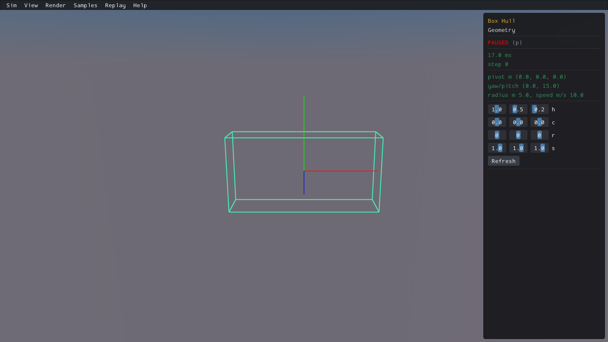
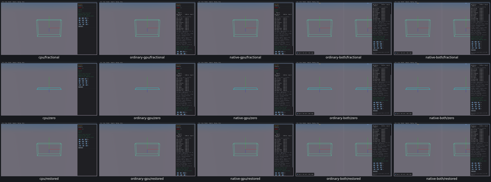

# UI12 — Box Hull null preview guarded

- [x] Verified locally on real Box3D CPU first, ordinary/native GPU and both combined viewers.

Typing `0.7` temporarily supplies `0`. The original eight points become coplanar, hull construction correctly returns null, and native DrawHull dereferences it. The [original CPU debugger evidence](geometry-null-debug.txt) stops at that exact boundary; no crash/core experiment was repeated.

The native renderer generator now makes DrawHull return immediately for a null hull. Valid drawing, hull construction, text input, geometry and physics defaults remain unchanged. The generated CPU/BOTH sources equal their qualified originals plus that guard; all five original DrawC archive modules are byte-identical. One rebuilt DrawC module is used by all five viewers without changing shared archives or Box3D/WASM.

Actual input on every route reaches null while typing the full `0.7`, then restores two valid hulls with volume 1.4 and matching bounds. Zeroing each axis remains safe; restoring each width restores volume 1. Hull Reduction's valid preview and Single Box picking/lifecycle also pass. Runs took 12.0–13.8 seconds, stayed paused, and used no scripted advancing physics.

There were 172 evaluations: 169 original positives and three incorrect CPU probe expectations adjudicated from the same recorded data. The analytic native box already clamps minimum half-width to 0.02; its zero-axis volumes are 0.02/0.04/0.08, rather than zero. Original flags and [probe source](ui12-original-controls.ts) are retained; [adjudication](ui12-zero-probe-adjudication.json) verifies the native rule. No completed viewer was rerun.

Before: actual CPU **valid initial preview before the original crashing input**, not a crash screenshot. The failure itself is recorded by the debugger.

After: real CPU first, ordinary GPU, native GPU, ordinary combined, native combined. Rows show valid fractional width, zero width and restored defaults.

[Related previews and picking](ui12-related-grid.png) · [acceptance and resource receipt](ui12-acceptance.json)

All 30 after images were inspected in two grids, with CPU fractional, native GPU zero and native combined restored images additionally inspected individually. The original CPU before image was inspected individually. Original GPU crashes were not reproduced; all five repaired routes actually receive null safely. Other native DrawHull callers share the guard but are not claimed as new crash reproductions.

Cleanup removed superseded viewers and consumed streams/logs; current viewers and needed link inputs have a named next PR10 consumer. All 23 recorded processes are absent, no owned cores and no measured cache growth. A size-walk warning about a concurrently renamed request file made the completion wrapper exit 1 after all five checks qualified; independent closeout validated every receipt, pin, link input and process. The helper now ignores only vanished files (ENOENT).

Final precommit affected-scene recordings, compatibility and the PR10 criterion audit remain open. No commit or push.
