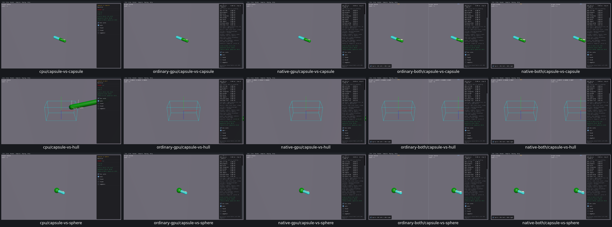
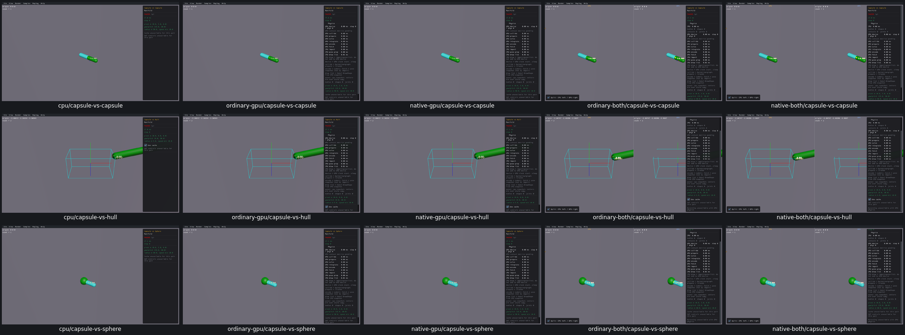

# UI13 — Show only supported Manifold controls

- [x] Verified locally on real CPU first, ordinary/native GPU and both combined viewers.

The shared Manifold UI offered cache and manual SAT controls regardless of the actual collision API. Four pairs have no cache argument; seven pairs have no manual SAT policy. Clicking their controls changed UI fields without changing the calculation.

The TypeScript native-copy generator now declares each pair's capabilities. Unsupported options show availability text. Cache controls remain for Capsule vs Hull, Hull vs Sphere, Triangle vs Capsule, Hull vs Hull and Triangle vs Hull; only the last two offer manual SAT selection. CMake builds the generated local copy with Bun. Upstream Box3D, all constructors, Step/Render/input methods, geometry, defaults and collider math remain unchanged.

All nine pairs ran on all five routes: **540 checks, all true**, in 30.9–33.3 seconds per viewer. Checks cover displayed availability, actual populated simplex reuse/off invalidation/on reuse, actual SAT inputs 6/7/8 and off reset, mouse translation/collider arguments, release stopping motion, restart geometry and paused 60 Hz/four-substep defaults. No scripted advancing physics. The separate UI14 stale manual-to-auto SAT policy remains open.

Before/after, CPU first. Rows: Capsule vs Capsule, Capsule vs Hull, Capsule vs Sphere.

All nine pairs are included in the six inspected grids: [before 2](ui13-before-grid-2.png), [after 2](ui13-after-grid-2.png), [before 3](ui13-before-grid-3.png), [after 3](ui13-after-grid-3.png). Original screenshots use their original review stimuli; comparisons establish control availability and retained geometry, not exact pixels. CPU Capsule vs Capsule and native combined Hull vs Sphere after images were additionally inspected individually.

[Acceptance](ui13-acceptance.json) records per-pair arguments, applicability, resource cleanup and limits. One C++ compile serves all five routes: all original Manifold modules were byte-identical, and neither the generated constant capabilities nor its base interface has GPU/BOTH conditionals. Shared archives were not modified.

All 17 recorded processes are absent, with no owned cores or measured cache growth. Superseded viewers and consumed traces/logs were removed; current viewers and needed objects remain named inputs for the next PR10 relink. Full fresh CMake/build compatibility, final affected-scene recordings and PR10 acceptance remain open. No commit/push.
