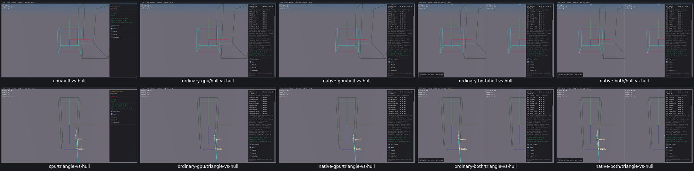
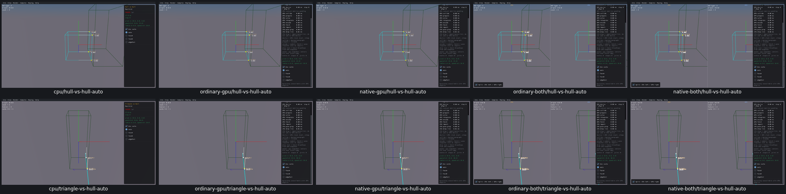

# UI14 — Auto SAT policy clears the previous manual feature

- [x] Verified locally on all five routes, real CPU first.

Hull vs Hull's Step forced SAT cache types 6/7/8 for manual policies but left that cache unchanged when the UI selected auto. The actual collider still received type 8 and could omit the automatic contact manifold. Original all-five-route evidence is preserved in [acceptance](ui14-acceptance.json).

The native TypeScript generator now clears the SAT cache once when the auto radio button is pressed. Subsequent frames reuse the automatic cache normally. Exactly two generated UI calls change; Step, collider math, geometry, defaults and input handlers stay unchanged. Triangle vs Hull shared this UI but already returned to automatic calculation before the fix; it is checked as a related regression, not claimed as a demonstrated defect.

Every route checked both SAT pairs: manual 6/7/8 → automatic type 3, restored manifold counts, unchanged geometry, subsequent automatic cache reuse, cache off/on and restart defaults. The five runs took 11.0–13.2 seconds. There were 210 evaluations: 208 original positives plus two wrong CPU probe expectations adjudicated from the same actual data. Those probes compared the output cache-hit flag across off/on; the native flag correctly changes 0→1 when reuse begins. Original flags/source remain in [adjudication](ui14-cache-hit-probe-adjudication.json); no completed run was repeated.

Before, CPU first: Hull vs Hull is incorrectly still type 8 with auto selected; Triangle vs Hull is the unaffected reference.

After: both pairs use automatic type 3, with automatic manifolds restored.

[Manual SAT preserved](ui14-manual-grid.png). All 30 before/after images were inspected in three grids; CPU Hull vs Hull before/auto images were additionally inspected individually. These are paused native collision tools with no physics bodies and no scripted advancing physics. Exact pixels and solver qualification are outside this repair.

All 17 recorded processes are absent; no owned core dumps or measured cache growth. Superseded viewers/Manifold object/source and consumed streams/logs were removed. The current five-viewer pool and required objects remain next PR10 relink inputs. Box3D/WASM/Rust/WGSL/shared archives stay unchanged. Fresh CMake/build compatibility, final affected-scene recordings and PR10 acceptance remain open. No commit/push.
