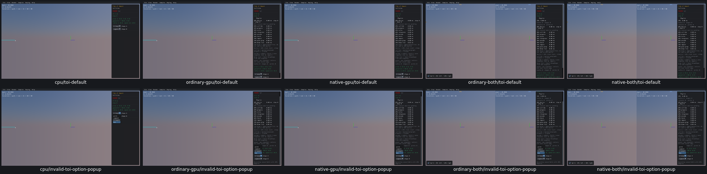
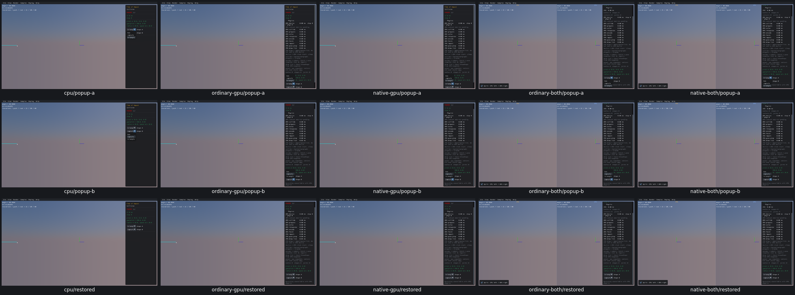

# UI15 — TOI menus match their supported shapes

- [x] Verified locally on all five routes, real Box3D CPU first.

Time of Impact supports three enums: box, capsule and triangle. Its menus instead showed point, segment, triangle and box. The first two labels were wrong; the fourth choice produced a zero-vertex proxy and crashed native TOI on all five original routes. Those original inputs and SIGSEGVs are preserved in [acceptance](ui15-acceptance.json); no new crash/core run was needed.

The TypeScript native-copy generator changes only this sample's shape-name array to `box`, `capsule`, `triangle`. CMake builds the local collision copy with Bun. All other collision classes, proxies, sweeps, defaults, calculations and drawing remain unchanged; the existing generated Manifold repairs also remain byte-identical. Box3D/WASM/Rust/WGSL/shared archives are unchanged.

Both actual menus now have exactly three rows. All nine supported A/B pairs run on every route with expected vertex counts 8/2/3, radii 0/0.02/0, finite native TOI results and unchanged sweeps. Restored input/output and restart defaults match the retained original native reference. **205 recorded checks pass** across the five complete fixtures, taking 13.3–15.0 seconds each; no scripted advancing physics.

Before, CPU first: original defaults and the invalid fourth option.

After: both corrected menus and restored defaults, CPU first.

All 25 before/after images were inspected in two grids. Original CPU invalid popup, repaired CPU menu A and repaired native combined menu B were additionally inspected individually.

The original 5.6-second CPU attempt verified defaults and menu A, then timed out because Escape did not close the first popup before the second click. Its three passing checks, receipt, UI snapshot and screenshot remain in [the failure record](ui15-original-popup-timeout.json). The same candidate completed the CPU fixture using current-option selection plus an explicit popup-closed check; four GPU fixtures then ran for the first time. One incomplete app was replaced; no fully qualified app was repeated. **OBS03 remains an unconfirmed Escape-behavior watch**, requiring actual event evidence before any product conclusion.

UI16 hidden radii, UI17 stale Shape Distance support indices and UI18 offscreen preview framing remain separate open issues. The TOI menu repair does not claim to repair framing. All 19 recorded processes are absent, with no owned core or measured cache growth. Superseded viewers and consumed streams/logs were deleted; the current pool and required objects have a next PR10 relink consumer. Fresh CMake/build compatibility, final affected-scene recordings and PR10 acceptance remain open. No commit/push.
