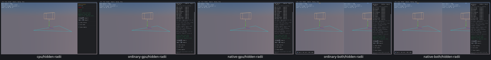
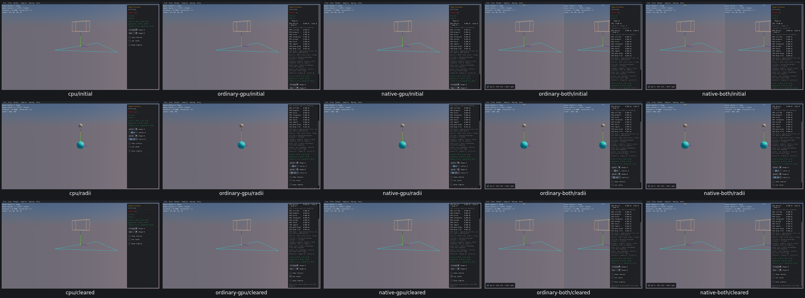

# UI16 — Hidden radii stop affecting unrounded previews

- [x] Verified locally on all five routes, real Box3D CPU first.

Shape Distance kept point/segment radii when switching to triangle or box. The radius controls disappeared and the previews showed unrounded geometry, but GJK still used the hidden radii: A=0.2/B=0.1 produced distance 0.45 instead of the visible geometry's 0.75.

The native TypeScript generator now clears the corresponding radius when the actual shape menu switches to triangle/box, before rebuilding that proxy. Point/segment radii and the other axis remain unchanged. Exactly two generated type-change branches change; initial defaults, geometry, drawing, collider math, Step and other collision samples stay unchanged. Box3D/WASM/Rust/WGSL/shared archives remain unchanged.

All five routes pass **175 recorded checks**, taking 30.3–32.1 seconds each. Both A/B axes preserve custom radii on point→segment, clear them on triangle/box, hide the unsupported control, retain the other radius and produce the expected actual GJK distance. Restoring triangle A/box B gives radii zero, distance 0.75 and the original proxy/preview line and point digests. Restart restores native defaults. All runs are paused with no scripted advancing physics; these tools have no physics bodies.

Before, CPU first: hidden radii still affect GJK.

After: initial defaults, supported radius edits, and triangle/box with radii cleared.

[Acceptance and resources](ui16-acceptance.json). All 20 before/after images were inspected in two grids, with CPU before/cleared additionally inspected individually. Cache stays off in this fixture; **UI17 stale support indices remains open**, as does UI18 preview framing. OBS03 Escape remains an unconfirmed watch.

All 17 recorded processes are absent, with no owned cores or measured cache growth. Superseded viewers/source/object and consumed traces/logs were removed. A separate [historical timing-log cleanup](timing-log-cleanup-v2.json) reclaimed 47,212,789 bytes while retaining 332,262 bytes of hashes, numeric timing summaries, first/last timing records and every non-timing diagnostic line; receipts, images, failure inputs and shared caches were preserved. Its first preflight selected no files because the older logs use PERF05WINDOW/PERF05R prefixes; that no-op is retained separately.

The current viewer pool and required inputs remain named next PR10 relink consumers. Fresh CMake/build compatibility, final affected-scene recordings and PR10 acceptance remain open. No commit/push.
