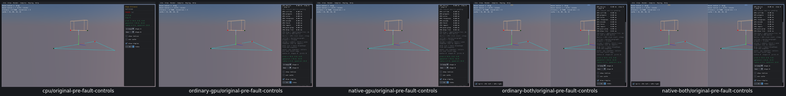
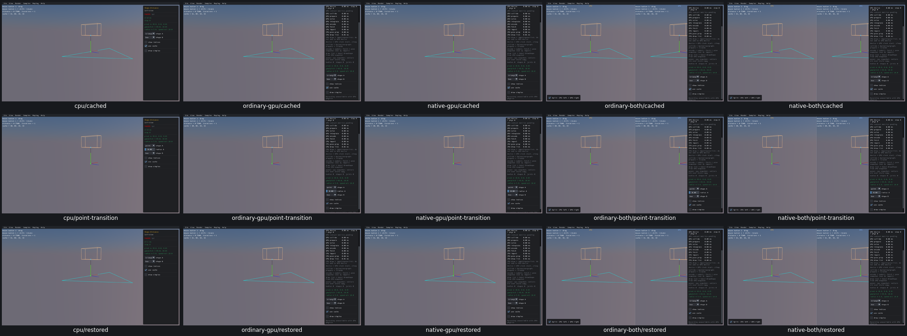

# UI17 — Invalidate cached support indices when a proxy changes

- [x] Verified locally on all five routes, real Box3D CPU first.

Shape Distance rebuilt a different proxy vertex set while retaining the old simplex cache. The original native calculation received A support indices `[1,0]` after A became a one-vertex point. CPU logged invalid input and survived; all four GPU viewers faulted SIGILL at the same native operation. [Original boundary/fault evidence](ui17-acceptance.json) is retained; no original fault/core run was repeated.

The native TypeScript generator now clears `m_cache` in both actual shape-combo change branches before rebuilding the proxy. Exactly two branches change. Cache reuse between changes, UI16 radius policy, UI15 TOI menus, all geometry/defaults, Step and collider math remain unchanged. Box3D/WASM/Rust/WGSL/shared archives are unchanged.

All five routes pass **515 recorded checks** in 41.5–42.9 seconds each. Each route exercises all 12 ordered transitions among point, segment, triangle and box on both axes: 24 transitions, **120 actual first-calculation boundaries** total. The old cache is populated, the first native GJK call receives count zero with valid indices, and later calls reuse valid newly generated indices. Actual proxies, finite GJK results, unchanged transforms/radii, restored default geometry, cache behavior and restart pass. The original invalid-cache observer sees no invalid entry across all calls.

A read-only native observer captures the actual first input at each vertex-count change and the native output. It chains through the existing observer to the native function once. A task-owned objcopy renames the prior wrapper; symbol checks verify the chain and preserve every other observer/key/camera hook. No formula substitutes for the native calculation.

Before: original valid controls before the later invalid cached transition, CPU first. These are **not post-fault screenshots**; the bad calculation input and signals are in the acceptance JSON.

After: cached defaults, surviving triangle→point change with caching enabled, restored defaults, CPU first.

All 20 before/after images were inspected in two grids; original CPU controls and native combined point transition were additionally inspected individually. Supported types have unique vertex counts 1/2/3/8; the observer qualifies those transitions, not arbitrary proxy identity changes. Runs stay paused with no scripted advancing physics; these tools have zero bodies/shapes. This is native caller-input correctness, not GPU solver or PR11 qualification.

All 21 recorded processes are absent; no owned cores or measured cache growth. Superseded viewers/Collision source/object/old observer and consumed traces/logs were deleted. The current five-viewer pool and 24 required task objects remain named next PR10 relink consumers. UI18 framing, remaining issues and OBS01–03 still require work. Fresh CMake/build compatibility, final affected-scene recordings and PR10 acceptance remain open. No commit/push.
