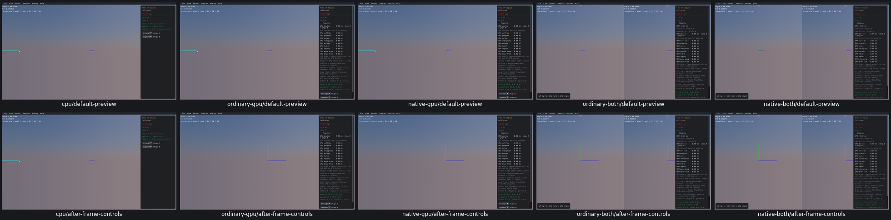
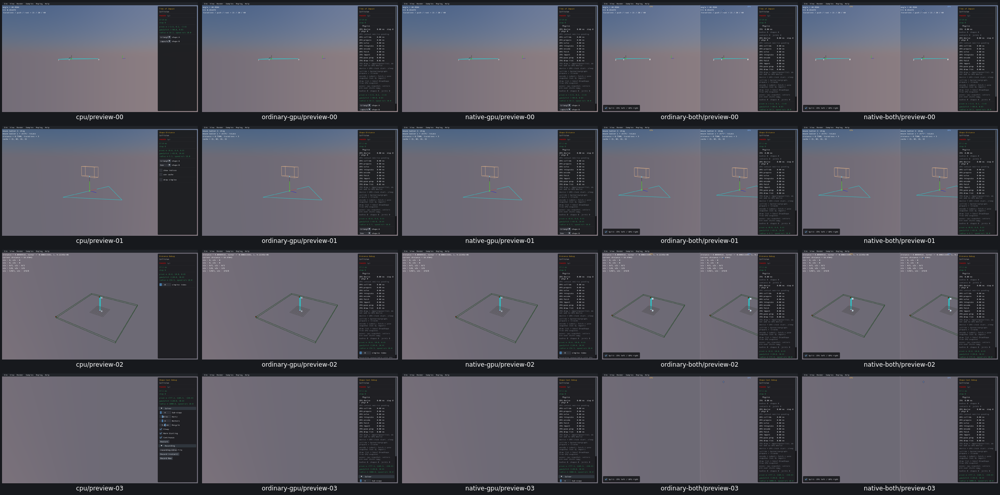

# UI18 — Frame actual no-body preview geometry

- [x] Fixed and verified locally on real Box3D CPU, ordinary/native GPU and both combined routes.

Time of Impact renders its shapes directly and creates no physics bodies. `World_GetBounds` therefore returned invalid CPU bounds or GPU placeholder bounds. Its default camera and both Frame Camera paths left all three moving capsule poses offscreen.

The native host now collects bounds from accepted cube, sphere, capsule, overlay line and point submissions during the sample's first Step/Render. It restores simulation coordinates using the actual draw origin, seals one complete frame, and keys the result by world index/generation. F and the menu use this fallback only for zero-body worlds. Preview padding is 1.25; bodyful world bounds and their existing 0.75 padding remain unchanged. TOI requests one initial frame after its first completed preview; restart preserves the user's camera. Camera implementation/angles, geometry, physics defaults, body identity and picking remain unchanged. The changes are local generated native copies; Box3D/WASM/Rust/WGSL and shared archives are untouched.

[Actual inputs, native camera matrices, eight-corner projections and acceptance](ui18-acceptance.json) cover 19 related scenes on all five routes: four Collision tools, five Geometry tools, all nine Manifold pairs and Tree/Benchmark. Eighteen scenes fit their accepted preview bounds in both F/menu views on all routes. TOI initially fits too. Resize, split off/on, scene replacement, restart, normal Single Box framing and actual projected body picking pass. The five scene runs took 54.9–59.5 seconds each, with zero scripted advancing physics steps. There are 858 recorded checks including a focused restart completion; three original false harness assertions remain preserved with their resolutions.

Shape Cast Debug deliberately spans several kilometres. Its correct preview bounds require a radius of about 7,413 metres, above the unchanged native 1,000-metre camera limit. This fixture verifies bounds routing and the native clamp only; **whole-preview fit is not passed**. Z-up has no user control in these direct-preview scenes and is explicitly unavailable for this UI fixture.

The first source audit omitted existing VIS07 diagnostic calls; the first link incorrectly added a renderer beside an existing diagnostic renderer; the first CPU snapshot required a nonexistent geometry-observer request field. Each stopped before substantive checks and is retained in the acceptance record. The corrected link preserves the exact currently linked diagnostic renderer plus preview calls. Two CPU kilometre-scale bounds assertions used an absolute tolerance below float rebasing precision; the same captured values pass the documented arithmetic envelope, without a CPU repeat. One native-combined composite restart assertion omitted its failing input signature; its exact cause cannot be recovered. A distinct 3.52-second focused check records only actual TOI inputs/shapes, current world and native camera and passes. No full 19-scene run was repeated.

CPU is the first column in every five-route grid. All eight grids were visually inspected, along with CPU TOI initial, Tree and picking originals. The kilometre-scale Shape Cast Debug view remains visibly limited as documented. Required final fresh native/WASM compatibility, precommit affected-scene recordings and PR10 criterion audit remain open.

Before — original TOI default/F/menu miss the moving preview:

After — TOI, Shape Distance, Distance Debug and the explicitly range-limited Shape Cast Debug:

[Geometry](ui18-preview-grid-1.png), [capsules and Manifold](ui18-preview-grid-2.png), [Manifold](ui18-preview-grid-3.png), [remaining Manifold and Tree](ui18-preview-grid-4.png), [initial/resize/picking](ui18-regressions-grid.png), [combined split-off](ui18-split-off-grid.png).

The selected evidence occupies 36.9 MB, within the 64 MiB limit; whole raw tree is 946 MB, within 1 GiB. Superseded builds (171 MB), consumed streams (including failures/completion) and build logs were removed after extraction. All 59 recorded producer/viewer PIDs are absent, no owned cores were created and measured shared-cache growth is zero. Current `ui18-build.json/link_plan` retains five viewers, 30 task link objects and the small combined API archive for the next repair. PR10 remains unchecked and the goal active.
