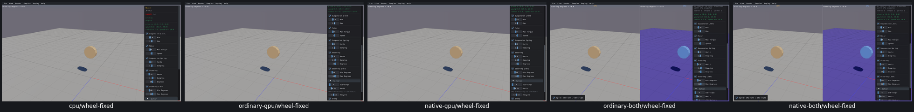
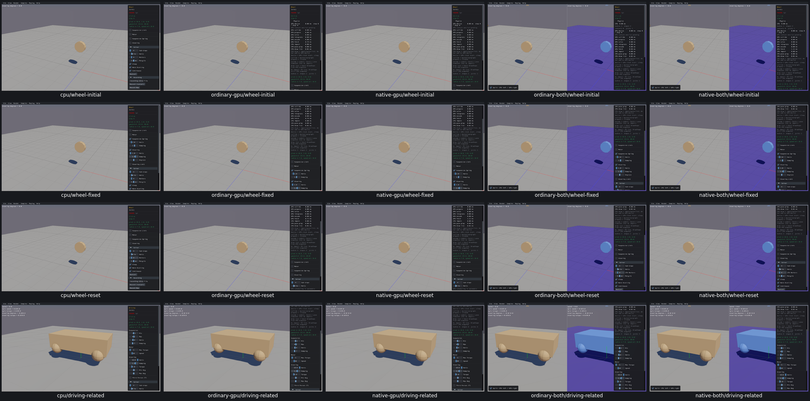

# UI19 — Independent Wheel steering damping

The Wheel steering-damping slider called the suspension setter with the suspension value. On all five routes, steering input1.4 left actual steering damping near0.7. The generated native sample now calls the steering setter with the steering value. Box3D remains unchanged.

| Input | Before actual state | After actual state |
| --- | --- | --- |
| Suspension1.2, then steering1.4 | suspension1.2; steering0.7 | suspension1.2; steering1.4 |

[Actual setter inputs/getters, two-way independence, wake, body/joint identity, restart defaults, Driving regression and limitations](ui19-acceptance.json). Six CPU Wheel transitions and the CPU Driving check come from separate retained runs; each GPU route has both checked. Ordinary combined passes span a storage-limited run and a follow-up for the remaining cases; completed results were reused. Physics was paused throughout.

Before, actual CPU first (other original controls were also configured):

After, actual CPU first; rows show initial Wheel, repaired damping, reset and related Driving:

