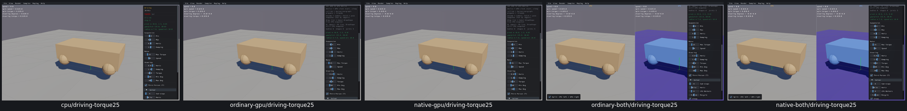
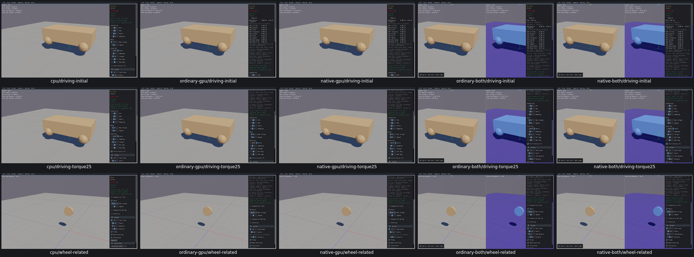

# UI20 — Driving rear motor torque

Driving’s Max Torque slider only changed a sample variable. Entering25 left the actual rear motor caps at5 on all five routes, including while W/S commanded the motors. The generated native sample now applies the changed value to both rear motors. Front-wheel torque/steering and the auxiliary Parallel joint remain unchanged.

| Slider input | Before actual rear caps | After actual rear caps |
| --- | --- | --- |
| 25 | 5 | 25 |

[Actual setters/getters, zero/restoration, W/S commands, IDs, poses, defaults, related Wheel checks and cleanup](ui20-acceptance.json). These checks ran paused; dynamic driving and solver qualification remain separate. CPU passes were retained across a mouse-lock probe correction; GPU routes ran the full case once.

Before, real CPU first (other original review settings differ):

After, real CPU first; initial Driving, torque25 with W held, and related Wheel:

