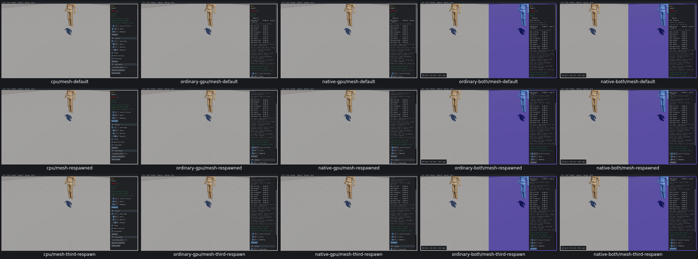

# UI21 — Release ragdoll anchors on respawn

- [x] Fixed and verified locally on real Box3D CPU, ordinary/native GPU and both combined routes.

`DestroyHuman` deleted bone joints and bodies but omitted the anchor joints and kinematic anchor bodies owned by the same Human. Respawn then overwrote those saved IDs. The original mesh ragdoll grew from 29 to 43 to 57 bodies after two respawns; its 14 dynamic bones stayed constant while leaked anchors accumulated.

The generated native Human helper now destroys each non-null anchor joint and anchor body, clears their IDs, then performs the unchanged bone-body cleanup. All other generated Human code, creation diagnostics, geometry and defaults remain byte-for-byte unchanged. Box3D, its header, WASM, Rust/WGSL and shared archives remain unchanged. Five original shared-library Human modules are identical, so one C compile serves all routes.

[Actual lifetime boundaries and acceptance](ui21-acceptance.json) record 179 successful checks. Three mesh respawns per route keep 29 bodies, 14 dynamic bones and 14 kinematic anchors. All 210 replaced anchor bodies and 210 anchor joints become invalid; bone IDs become invalid and stored slots clear too. Replacement bones retain their original poses and mass and the selected Hertz policy. Restart restores defaults. Box respawn remains at 15 bodies. All 100 Human destructors across five Reflection fixtures release their bone IDs correctly; actual projected picking selects fresh valid IDs afterward. There are zero scripted advancing physics steps; native 60 Hz/four-substep defaults remain intact.

The three standalone runs completed in 8.84–10.93 seconds. Combined evidence explicitly joins the Mesh/Box core fixture with a separate Reflection lifetime/picking fixture, totaling 13.29–14.02 seconds per route. [Receipt provenance](ui21-composite-evidence.json) preserves the actual runs and original failures; no completed full route was repeated.

The first combined link hit the frozen 96 MiB build estimate, leaving an unlaunched partial binary. Its hash/size receipt was retained and the partial output removed before freezing the corrected 192 MiB estimate. The whole raw-tree 1 GiB cap stayed unchanged.

A subsequent combined Reflection transition aborted with joint diagnostics enabled. The original cleanup kept startup lines but discarded its assertion message; that missing evidence is explicit. Source and the compiled observer contain a 512-record assertion, whereas combined Reflection creates 840 joint records. The last accepted records and a positive flag control support this diagnostic-limit attribution; **the exact original assertion message was not captured**. Required Mesh/Box joint checks remain enabled. Reflection's actual 20-Human lifetime/picking checks run separately with that joint tracer disabled. The stderr consumer now retains a bounded tail. No engine or diagnostic-capacity repair was made.

Motor-anchor creation has no active native sample caller. The generic stored-field cleanup applies by source inspection, with no runtime motor-anchor claim. This milestone covers all three active `DestroyHuman` callers: Ragdoll/Mesh, Ragdoll/Box and Mesh/Reflection. Other Human creation paths are unchanged.

All three CPU-first grids were inspected. Original default settings match the repaired default baseline. The original after-leak capture had friction 8/Hertz 4/damping 1.2; repaired respawn checks use native friction 5/damping 0.7 and explicit Hertz 4. That control difference is recorded, with no pixel or trajectory equivalence claim. The native default ragdoll camera still crops the upper body; actual geometry/poses are checked at the data boundary.

Before:

After:

[Box, Reflection and picking regressions](ui21-regressions-grid.png).

Selected evidence is about 26.6 MB and the whole raw tree is 968 MB. Superseded builds/partial and diagnostic duplicate binaries (235 MB), consumed streams and build logs were removed. All recorded producer/viewer PIDs are absent, no owned cores were created and measured shared-cache growth is zero. Current `ui21-build.json/link_plan` retains five viewers and 32 task link objects for the next repair. Final fresh compatibility, precommit affected-scene recordings, remaining issues and PR10 criterion audit stay open; PR10 remains unchecked and the goal active.
