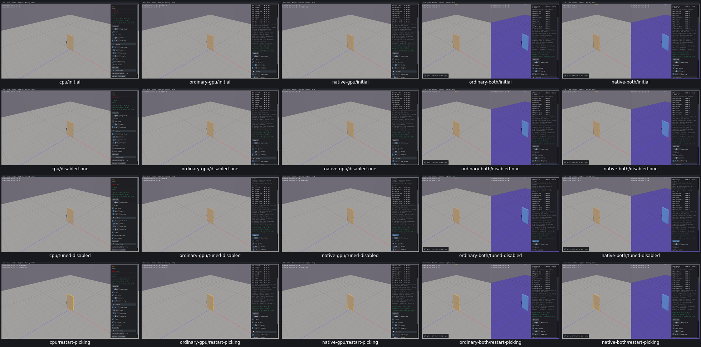

# UI22 — Keep Door limits consistent with the checkbox

- [x] Fixed and verified locally on real Box3D CPU, ordinary/native GPU and both combined routes.

Door did not initialize `m_enableLimit`, while both hinge definitions forced limits on. The UI could start unchecked despite enabled native limits, fail to clear, or lose an unchecked policy when switching between one and two hinges.

The generated native Door constructor now sets the policy to `true`, matching the existing enabled physics default, and initializes its hinge IDs to null before their first validity check. Both hinge definitions use the current policy when recreated. All other generated Joint source, including the previous Wheel/Driving fixes, remains byte-for-byte unchanged. Box3D/WASM/Rust/WGSL, geometry, body identity, other joint defaults and picking are preserved.

[Actual native policy, hinge lifecycle and acceptance](ui22-acceptance.json) contain 252 successful checks on five routes. Each route performs ten real hinge recreations: disabled and enabled policies across one/two hinges, repeated transitions, and changed constraint tuning. Every replaced joint ID becomes invalid; new joint IDs replace them. Bodies, paused poses, mass and geometry remain stable. Other native spring/motor/angle defaults persist. Restart restores enabled limits, two hinges and original tuning; projected picking selects the current door body in each applicable pane. The runs took 11.23–13.59 seconds, with zero scripted advancing physics steps and native 60 Hz/four-substep defaults.

Original failures and screenshots are reused. The original uninitialized bool's raw byte was not captured; the source omission and actual UI/native-policy failures are retained. Original configured captures include impulses and a changed magnitude, whereas the repaired focused captures exercise policy and tuning while paused; there is no exact-pixel or trajectory claim.

Both CPU-first grids were inspected: ten original and twenty repaired images.

Before:

After:

Selected evidence is 14.1 MB; the whole raw tree is 978 MB. Superseded viewers/Joint objects/source (167 MB), consumed streams (15.7 MB) and build logs were removed after extraction. All 19 recorded producer/viewer PIDs are absent, no owned cores were created and measured shared-cache growth is zero. Current `ui22-build.json/link_plan` retains five viewers and 32 task link objects for the next repair. Fresh compatibility, final affected-scene recordings, remaining issues and PR10 acceptance audit remain open; PR10 stays unchecked and the goal active.
