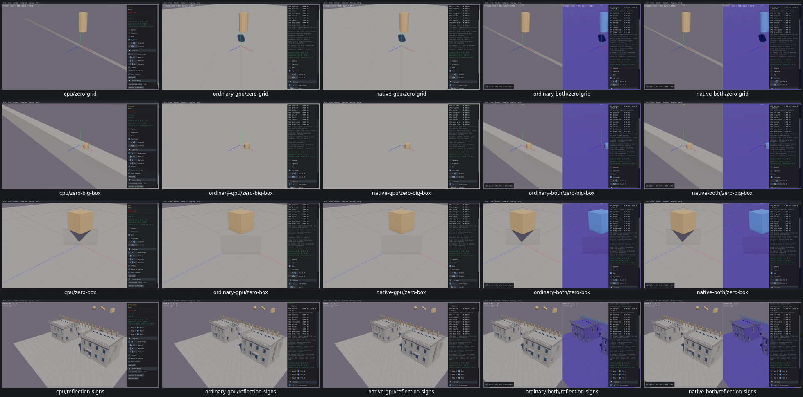
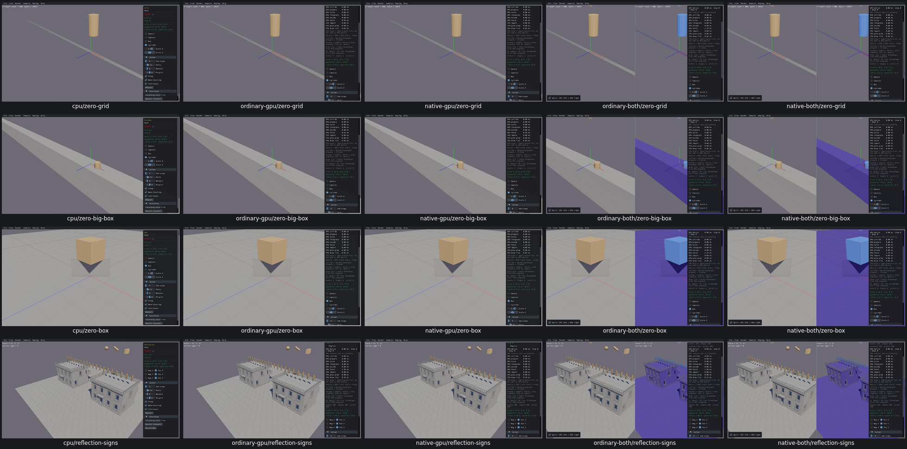

# UI23 — Update GPU mesh collision geometry and its cached drawing

- [x] Fixed and verified locally on real Box3D CPU, ordinary/native GPU and both combined routes.

Mesh scale controls exposed two gaps in `b3Shape_SetMesh`. First, raw zero reached GPU replacement, whose temporary mesh creation rejected it; native Box3D instead applies `b3SafeScale` and uses +0.01. Second, accepted replacements updated physics and the getter mirror but left the viewer's `ShapeVis.mesh` and cached drawing at their creation geometry. Visual inspection caught that second gap after the physical bounds checks passed: CPU showed a narrow floor while GPU still drew the full floor.

Both compatibility wrappers now normalize finite GPU scales with the actual native helper. The standalone getter mirror stores that normalized scale; combined CPU calls retain the original input and native normalization. After a successful GPU replacement, a dedicated callback discards the cached drawing and updates only the mesh/body/type record. It preserves names and other metadata. The next native drawing allocation receives the new mesh scale. Failed replacements retain their existing path. Box3D/WASM/Rust/WGSL and shared archives are unchanged.

[Acceptance and actual boundary values](ui23-acceptance.json) cover Grid, Big Box, Box, Collision/Mesh Scale and Reflection on all five routes. There are 165 scale cases, including 45 zero-axis cases. All 132 GPU case boundaries return successful Rust replacement and match the real CPU bounds oracle. The final stage additionally checks 132 cache updates and 96 actual native mesh-drawing allocations, with correct scales and accepted geometry. Body/shape IDs, poses, mass, topology, counts, defaults, reflection signs, restart and picking pass. These are five affected scene fixtures, not a repeat of the full 165-sample review.

For Box/Scale X = 0, ordinary GPU's X bounds previously stayed at approximately ±1.43421. They now become ±0.735743, matching native CPU, and the actual drawing receives scale `[0.01, 1, 1]`. The combined CPU-backed mesh getter is insufficient evidence on its own; actual GPU bounds and actual renderer inputs are checked separately.

The first physical stage retains 909 successful checks. The final stage has 1,173 recorded checks, including nine original wrong renderer assertions adjudicated from the same captured data. Collision/Mesh Scale overrides `Step` without the base world-drawing call and inherits an empty `Render`; it draws query points, lines and a sphere. Its mesh is not drawn by the native sample. Those nine cases retain physical bounds qualification and an explicit no-world-draw disposition. The other four scenes exercise the render-cache repair. CPU fixtures/images/oracle are reused, and the ordinary render fixture was not repeated. All runs remain paused with zero scripted advancing physics steps.

[Original zero-scale failures](mesh-controls-acceptance.json), [original collision-tool evidence](query-input-controls-acceptance.json), [interim physical-only qualification](ui23-physics-normalization-acceptance.json), and [query-only assertion adjudication](ui23-query-only-render-adjudication.json) are preserved. Original and interim images remain available. All three final CPU-first grids, all three interim grids, and individual ordinary GPU Grid/Big Box repaired views were inspected.

Before — collision normalization is already repaired here, but the GPU still draws its old mesh:

After — the GPU drawing updates with the collision geometry:

[Query-only sample and picking regressions](ui23-render-regressions-grid.png).

Initial zero-scale mesh creation is unchanged and unqualified by this replacement repair. Tiny scales, signed zero and invalid API inputs were not separately stimulated through these UI fixtures; finite normalization uses the native implementation and nonfinite forwarding stays unchanged. UI27's sphere-preview offset remains open. This checks static geometry/API/render behavior, not full solver or PR11 query qualification.

Selected evidence stays below 64 MiB; the whole raw tree is 1,006 MB, below 1 GiB. Superseded builds/carriers/modules (320 MB), consumed streams (78 MB) and build logs were removed. All 86 recorded producer/viewer PIDs are absent, no owned cores were created and measured shared-cache growth is zero. The current pool has five viewers, 33 direct task objects, four C module objects and three small API carriers for the next repair. Final compatibility, affected-scene recordings, remaining issues and PR10 acceptance audit are still open; PR10 remains unchecked and the goal active.
