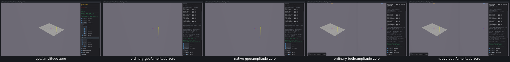
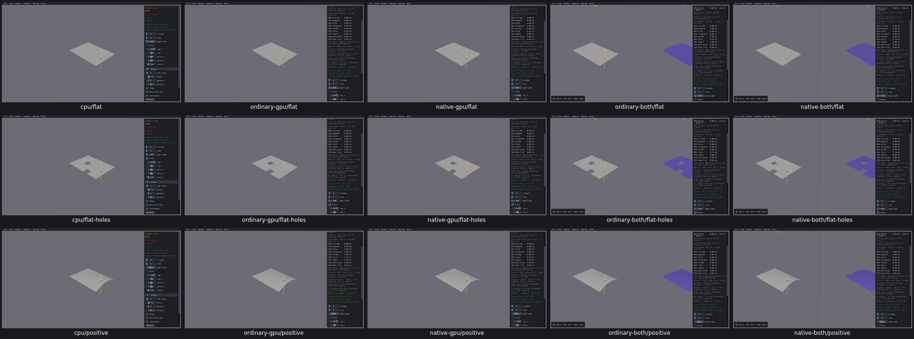

# UI24 — Preserve flat Height Field floors

- [x] Fixed and verified locally on real Box3D CPU, ordinary/native GPU and both combined viewers.

Setting Mesh/Height Field amplitude to zero deliberately creates a grid with native scale `[2,0,2]`. The GPU heightfield validator rejected that scale and returned a null shape. The floor disappeared on all four GPU routes; the real CPU floor remained valid.

The C bridge now encodes valid zero-Y-scale fields with `minHeight=0`, `heightScale=0`, `scaleY=1` for GPU creation. Every decoded vertex remains at Y=0. The original native data, renderer/getter scale, holes, materials, winding, body placement and combined CPU arguments remain unchanged. The same helper covers the standalone compatibility replacement call. Positive scales and invalid metadata retain their existing encoding; Rust, WGSL, Box3D and WASM are unchanged.

The [acceptance receipt](ui24-acceptance.json) records 207 passing checks across five viewers. Actual keyboard/mouse checks cover an 8×6 solid flat floor, two material holes, solid restoration, amplitude 0.8 restoration, the original 400×400 restart defaults and fresh picking in both combined panes. All 16 observed GPU creation calls returned valid shapes; all 12 flat GPU AABBs match the independent real CPU oracle at the existing tolerance. Native data hashes match the CPU. The actual helper also passed 131,072 equivalent decoded-vertex calculations and invalid/overflow metadata controls.

All three CPU-first grids were visually inspected. The before grid shows the missing GPU floor; the after grid shows the floor and matching holes. The GPU tint in combined views is an existing comparison-view convention.

[Restart and picking regression screenshots](ui24-regressions-grid.png).

The five app runs took 8.54–11.88 seconds each. Two C modules, one read-only boundary observer and one small header check were compiled; four GPU viewers were relinked. Shared archives/caches were preserved. All 39 recorded producer/viewer PIDs are absent, with no owned cores and zero measured cache growth. Superseded binaries and consumed streams/logs were removed; selected evidence is 10,841,152 bytes and the whole raw tree is 847,855,412 bytes.

Separately, reversible whitespace compaction of 308 completed-run JSON receipts saved 166,655,909 bytes. Every original receipt byte and SHA is reconstructable from the [compaction plan](storage-receipt-compaction-plan.json); screenshots, values and current build inputs were preserved. The first apply invocation used the wrong working directory and stopped before mutation; the corrected invocation passed.

Limits: no native sample exercises the compatibility replacement API, so its lifecycle is not newly qualified. Preexisting positive-heightfield quantization differences are unchanged. The runs were paused and do not qualify solver behavior or full PR11 queries. UI25 input loss and the other PR10 findings remain open. PR10 remains unchecked pending remaining fixes, fresh compatibility checks, affected-scene recordings and the final criterion audit.
