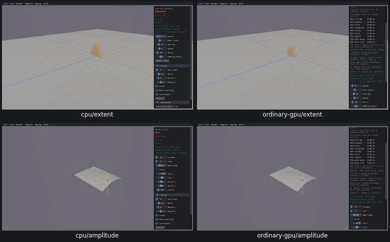
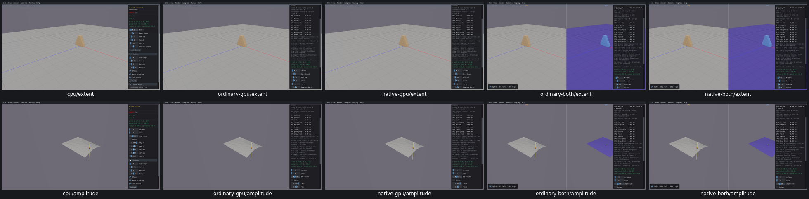

# UI25 — Keep complete text input through GPU preparation

- [x] Fixed and verified locally on all four GPU routes against real Box3D CPU.

Typing `.25` into Overlap Recovery Extent applied `.2`; typing `.75` into Height Field amplitude applied `.7`. This changed actual geometry. The read-only event trace confirms that character `5` reached `HandleEvent`. The partial value rebuilt the scene; the next loading-only ImGui frame consumed the remaining queued input while the slider was absent and cleared its active ID. CPU kept drawing the slider and applied the complete value.

Loading frames now use a separate ImGui context with the existing font atlas and style. The sample context is restored before events arrive. Its queued input and active widget remain intact until the next normal sample UI frame. The loader retains exclusive worker ownership of scene/world access. One loading context is reused and destroyed at shutdown; Box3D, WASM, Rust and WGSL are unchanged.

The [acceptance receipt](ui25-acceptance.json) verifies actual `.25`/`.75` inputs, hull geometry/mass, native heightfield scale/hash, retained input queues/active IDs, flat floor validity, original restart defaults and fresh picking on ordinary/native GPU and both combined viewers. Real CPU reference data/images were reused. The shared loading repair also fixes [UI29 Auto Generate](UI29-repair.md).

All five final comparison grids were inspected, including [restart/picking regressions](ui25-regressions-grid.png). Three C++ modules were compiled and four GPU viewers relinked. All 26 recorded producer/viewer PIDs are absent, no owned cores exist and measured shared-cache growth is zero. Superseded builds and consumed streams/logs were removed; selected evidence is 22,162,961 bytes and the whole raw tree is 866,485,083 bytes.

Two ordinary-GPU UI29 predicates initially clicked a stale button rectangle after it moved. Those false flags remain preserved; complete UI25 checks from that run were reused without repetition. A distinct current-target UI29 app supplies the missing button/lifecycle evidence. A link-plan map-key guard stopped before any link/app, and a consumer rejected its own still-live driver before deleting anything; both harness errors were corrected and retained. See [adjudication](ui25-ordinary-adjudication.json).

Limits: finite paused UI fixtures do not qualify solver behavior, full query semantics, cold startup or arbitrary input floods. Fresh compatibility checks, final affected-scene recordings and the PR10 criterion audit remain open. No commit or push was made.
