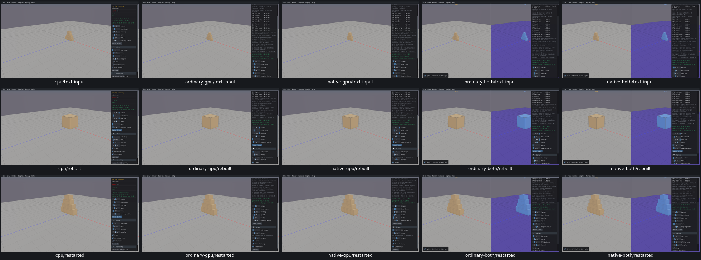

# UI25 — Height Field text edit loses its final digit on GPU routes

- [x] Wrong applied value confirmed; exact event/focus cause remains untraced. Unfixed pending full review.

After setting Mesh/Height Field amplitude to 0, the same real keyboard sequence types `.75` and commits it. CPU applies 0.75. All four GPU routes instead display and apply 0.7. The actual heightfield scale is `[2,1.4,2]`, so this is not only a display-format discrepancy. The xdotool action receipts retain the exact intended spelling and timing. Original failures are in `raw/flat-heightfield-capture-runs/<route>/receipt.json` and their consumed-stream failure tails.

The two-image capture protocol stopped at the failed input assertion, so the GPU positive-amplitude image was not produced. The amplitude-zero before-repair image was preserved on all five routes. Do not mark the capture protocol wholly passed or invent a GPU 0.75 state.

A possible explanation is a geometry rebuild/loading transition consuming the remaining character or losing the active text field. That is a hypothesis, not a measured event boundary. Before repair, trace the queued character, ImGui active ID/value and geometry/loading transition to the first lost operation. UI12's transient text-edit geometry failure may be related, but shared cause is not yet proved.

The original text stimulus used the existing driver's 1 ms typing delay; this proves a failure for that actual input sequence, not every human typing rate. No product code has been changed.

Overlap Recovery has the same demonstrated symptom on all four GPU routes: `.25` applies `.2` in Extent, including actual hull half-extents. CPU applies `.25`. [Actual input/effect receipts](scene-controls-acceptance.json). The following grid preserves before-repair text states; the later rows show reviewed one-character settings and default restart, not a repair. A common cause with Height Field remains untraced.

Verified repair: [Complete text input during GPU preparation](UI25-repair.md). Loading UI uses a separate shared-font/style ImGui context; sample queued input/active widget survives preparation. Actual .25/.75 values and hull/heightfield effects, queue/activeID retention, UI24 flat floor, restart/defaults/picking pass allfourGPU routes against reused realCPU. Two invalid stale-position UI29 flags preserved and supplemented; no repeated ordinaryUI25 app. No engine/WASM changes.
